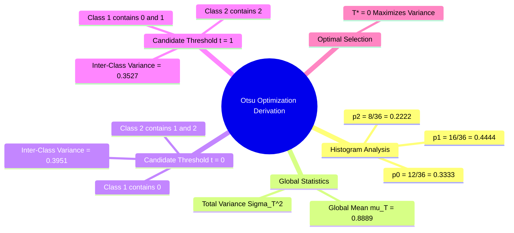

# Exercise 2: Exhaustive Step-by-Step Optimization of Otsu's Inter-Class Variance

### Problem Statement
Given a $6 \times 6$ discrete image containing three intensity levels ($0, 1,$ and $2$), determine the optimal binarization threshold $T^*$ using Otsu's method by maximizing the between-class variance $\sigma_B^2(t)$.

Pixel counts per intensity level:
* Level $0$: $n_0 = 12$ pixels
* Level $1$: $n_1 = 16$ pixels
* Level $2$: $n_2 = 8$ pixels

Total number of pixels:

$$N = 6 \times 6 = 36 \text{ pixels}$$

---

### Step-by-Step Mathematical Derivation

#### Step 1: Compute Empirical Probability Distribution $p_i$

$$p_0 = \frac{n_0}{N} = \frac{12}{36} = \frac{1}{3} \approx 0.33333$$

$$p_1 = \frac{n_1}{N} = \frac{16}{36} = \frac{4}{9} \approx 0.44444$$

$$p_2 = \frac{n_2}{N} = \frac{8}{36} = \frac{2}{9} \approx 0.22222$$

Check: $\sum_{i=0}^2 p_i = \frac{1}{3} + \frac{4}{9} + \frac{2}{9} = \frac{9}{9} = 1.0$.

#### Step 2: Compute the Global Mean $\mu_T$

$$\begin{aligned}
\mu_T = \sum_{i=0}^{2} i \cdot p_i = & (0 \cdot p_0) + (1 \cdot p_1) + (2 \cdot p_2) \\
= & \left(0 \times \frac{3}{9}\right) + \left(1 \times \frac{4}{9}\right) + \left(2 \times \frac{2}{9}\right) \\
= & 0 + \frac{4}{9} + \frac{4}{9} = \frac{8}{9} \approx \mathbf{0.88889}
\end{aligned}$$

---

### Evaluating Candidate Threshold $t = 0$

Partition the intensity levels into two classes:
* Background Class $C_1 = \{0\}$
* Foreground Class $C_2 = \{1, 2\}$

#### 1. Class Probabilities (Weights)
$$\omega_1(0) = p_0 = \frac{3}{9} = \frac{1}{3} \approx 0.33333$$

$$\omega_2(0) = p_1 + p_2 = \frac{4}{9} + \frac{2}{9} = \frac{6}{9} = \frac{2}{3} \approx 0.66667$$

Check: $\omega_1(0) + \omega_2(0) = \frac{1}{3} + \frac{2}{3} = 1.0$.

#### 2. Class Means
$$\mu_1(0) = \frac{1}{\omega_1(0)} \sum_{i=0}^{0} i \cdot p_i = \frac{0 \cdot p_0}{p_0} = \mathbf{0.0}$$

$$\mu_2(0) = \frac{1}{\omega_2(0)} \sum_{i=1}^{2} i \cdot p_i = \frac{(1 \cdot p_1) + (2 \cdot p_2)}{\omega_2(0)} = \frac{\frac{4}{9} + \frac{4}{9}}{\frac{6}{9}} = \frac{\frac{8}{9}}{\frac{6}{9}} = \frac{8}{6} = \frac{4}{3} \approx \mathbf{1.33333}$$

Verify using the global mean relation:
$$\omega_1 \mu_1 + \omega_2 \mu_2 = \left(\frac{1}{3} \times 0\right) + \left(\frac{2}{3} \times \frac{4}{3}\right) = 0 + \frac{8}{9} = \mu_T \quad \text{(Confirmed)}$$

#### 3. Between-Class Variance $\sigma_B^2(0)$
$$\begin{aligned}
\sigma_B^2(0) = & \omega_1(0) \cdot \omega_2(0) \cdot \big(\mu_1(0) - \mu_2(0)\big)^2 \\
= & \left(\frac{1}{3}\right) \cdot \left(\frac{2}{3}\right) \cdot \left(0 - \frac{4}{3}\right)^2 \\
= & \frac{2}{9} \cdot \left(-\frac{4}{3}\right)^2 = \frac{2}{9} \cdot \frac{16}{9} = \frac{32}{81} \approx \mathbf{0.39506}
\end{aligned}$$

---

### Evaluating Candidate Threshold $t = 1$

Partition the intensity levels into two classes:
* Background Class $C_1 = \{0, 1\}$
* Foreground Class $C_2 = \{2\}$

#### 1. Class Probabilities (Weights)
$$\omega_1(1) = p_0 + p_1 = \frac{3}{9} + \frac{4}{9} = \frac{7}{9} \approx 0.77778$$

$$\omega_2(1) = p_2 = \frac{2}{9} \approx 0.22222$$

Check: $\omega_1(1) + \omega_2(1) = \frac{7}{9} + \frac{2}{9} = 1.0$.

#### 2. Class Means
$$\mu_1(1) = \frac{1}{\omega_1(1)} \sum_{i=0}^{1} i \cdot p_i = \frac{(0 \cdot p_0) + (1 \cdot p_1)}{\omega_1(1)} = \frac{0 + \frac{4}{9}}{\frac{7}{9}} = \frac{4}{7} \approx \mathbf{0.57143}$$

$$\mu_2(1) = \frac{1}{\omega_2(1)} \sum_{i=2}^{2} i \cdot p_i = \frac{2 \cdot p_2}{p_2} = \mathbf{2.0}$$

Verify using the global mean relation:
$$\omega_1 \mu_1 + \omega_2 \mu_2 = \left(\frac{7}{9} \times \frac{4}{7}\right) + \left(\frac{2}{9} \times 2\right) = \frac{4}{9} + \frac{4}{9} = \frac{8}{9} = \mu_T \quad \text{(Confirmed)}$$

#### 3. Between-Class Variance $\sigma_B^2(1)$
$$\begin{aligned}
\sigma_B^2(1) = & \omega_1(1) \cdot \omega_2(1) \cdot \big(\mu_1(1) - \mu_2(1)\big)^2 \\
= & \left(\frac{7}{9}\right) \cdot \left(\frac{2}{9}\right) \cdot \left(\frac{4}{7} - 2\right)^2 \\
= & \frac{14}{81} \cdot \left(\frac{4 - 14}{7}\right)^2 = \frac{14}{81} \cdot \left(-\frac{10}{7}\right)^2 = \frac{14}{81} \cdot \frac{100}{49} \\
= & \frac{2 \times 7 \times 100}{81 \times 49} = \frac{2 \times 100}{81 \times 7} = \frac{200}{567} \approx \mathbf{0.35273}
\end{aligned}$$

---

### Optimal Threshold Selection

Compare the calculated between-class variances:
* For candidate threshold $t = 0$: $\sigma_B^2(0) = \frac{32}{81} \approx \mathbf{0.39506}$
* For candidate threshold $t = 1$: $\sigma_B^2(1) = \frac{200}{567} \approx \mathbf{0.35273}$

Because $\sigma_B^2(0) > \sigma_B^2(1)$, Otsu's criterion identifies the optimal threshold as:

$$T^* = \mathbf{0}$$

#### Final Binarization Rule
Using $T^* = 0$, every pixel in the image is classified as:

$$g(x, y) = \begin{cases} 
0 \ (\text{Background}) & \text{if } f(x, y) \le 0 \implies f(x, y) = 0 \\
1 \ (\text{Foreground}) & \text{if } f(x, y) > 0 \implies f(x, y) \in \{1, 2\}
\end{cases}$$

Related concepts: [[02. NumPy Array Manipulation - Slicing, Strides, Shapes, and Vectorized Indexing]], [[06.1.9. Tonal Histograms, Probability Densities, and Cumulative Distribution Functions]], [[06.7.2. Global Optimal Statistical Thresholding (Otsu's Method Derivation)]].
