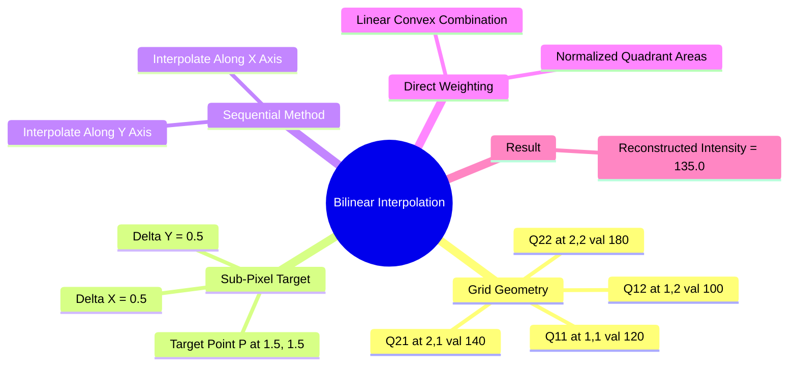

# Exercise 3: Analytical Sub-Pixel Reconstruction via Bilinear Interpolation

### Problem Statement
An image is upsampled by a factor of $2$. Calculate the continuous reconstructed intensity at sub-pixel coordinate $P(1.5, 1.5)$ using the four nearest neighboring grid points:

* $Q_{11}(x_1=1, y_1=1) = 120$
* $Q_{21}(x_2=2, y_1=1) = 140$
* $Q_{12}(x_1=1, y_2=2) = 100$
* $Q_{22}(x_2=2, y_2=2) = 180$

---

### Method 1: Sequential 1D Linear Interpolations

Bilinear interpolation can be computed as three consecutive 1D linear interpolations: first along the horizontal $x$-axis, then along the vertical $y$-axis.

#### Step 1: Interpolate Horizontally along Row $y = 1$
Interpolate between $Q_{11}(1, 1)$ and $Q_{21}(2, 1)$ at $x = 1.5$:

$$\begin{aligned}
f(x, 1) = & \frac{x_2 - x}{x_2 - x_1} \cdot f(Q_{11}) + \frac{x - x_1}{x_2 - x_1} \cdot f(Q_{21}) \\
= & \frac{2.0 - 1.5}{2 - 1} \cdot 120 + \frac{1.5 - 1.0}{2 - 1} \cdot 140 \\
= & (0.5 \times 120) + (0.5 \times 140) = 60 + 70 = \mathbf{130}
\end{aligned}$$

#### Step 2: Interpolate Horizontally along Row $y = 2$
Interpolate between $Q_{12}(1, 2)$ and $Q_{22}(2, 2)$ at $x = 1.5$:

$$\begin{aligned}
f(x, 2) = & \frac{x_2 - x}{x_2 - x_1} \cdot f(Q_{12}) + \frac{x - x_1}{x_2 - x_1} \cdot f(Q_{22}) \\
= & \frac{2.0 - 1.5}{2 - 1} \cdot 100 + \frac{1.5 - 1.0}{2 - 1} \cdot 180 \\
= & (0.5 \times 100) + (0.5 \times 180) = 50 + 90 = \mathbf{140}
\end{aligned}$$

#### Step 3: Interpolate Vertically along Column $x = 1.5$
Interpolate between the intermediate values $f(1.5, 1) = 130$ and $f(1.5, 2) = 140$ at $y = 1.5$:

$$\begin{aligned}
f(1.5, 1.5) = & \frac{y_2 - y}{y_2 - y_1} \cdot f(1.5, 1) + \frac{y - y_1}{y_2 - y_1} \cdot f(1.5, 2) \\
= & \frac{2.0 - 1.5}{2 - 1} \cdot 130 + \frac{1.5 - 1.0}{2 - 1} \cdot 140 \\
= & (0.5 \times 130) + (0.5 \times 140) = 65 + 70 = \mathbf{135.0}
\end{aligned}$$

---

### Method 2: Direct 2D Formulation

Using the full 2D bilinear interpolation equation:

$$\begin{aligned}
f(x, y) = \frac{1}{(x_2 - x_1)(y_2 - y_1)} \Big[ & f(Q_{11})(x_2 - x)(y_2 - y) + f(Q_{21})(x - x_1)(y_2 - y) \\
+ & f(Q_{12})(x_2 - x)(y - y_1) + f(Q_{22})(x - x_1)(y - y_1) \Big]
\end{aligned}$$

Substitute the coordinate values:
* $(x_2 - x_1) = (2 - 1) = 1.0$
* $(y_2 - y_1) = (2 - 1) = 1.0$
* Weight for $Q_{11}$: $(2.0 - 1.5)(2.0 - 1.5) = 0.5 \times 0.5 = 0.25$
* Weight for $Q_{21}$: $(1.5 - 1.0)(2.0 - 1.5) = 0.5 \times 0.5 = 0.25$
* Weight for $Q_{12}$: $(2.0 - 1.5)(1.5 - 1.0) = 0.5 \times 0.5 = 0.25$
* Weight for $Q_{22}$: $(1.5 - 1.0)(1.5 - 1.0) = 0.5 \times 0.5 = 0.25$

Sum the weighted pixel contributions:

$$f(1.5, 1.5) = 0.25 \cdot \Big[ f(Q_{11}) + f(Q_{21}) + f(Q_{12}) + f(Q_{22}) \Big]$$

$$f(1.5, 1.5) = 0.25 \cdot \big[ 120 + 140 + 100 + 180 \big] = 0.25 \cdot \big[ 540 \big] = \mathbf{135.0}$$

Both methods yield the exact reconstructed intensity of **135.0**.

Related concepts: [[16. Image Spatial Transformations - Interpolation, Scaling, Cropping, and Affine Warping]], [[06.8.1. Continuous Image Reconstruction (Nearest, Bilinear, and Keys' Bicubic Spline)]], [[06.8.2. Edge-Adaptive Interpolation (Contour Stencils and Total Variation Minimization)]].
