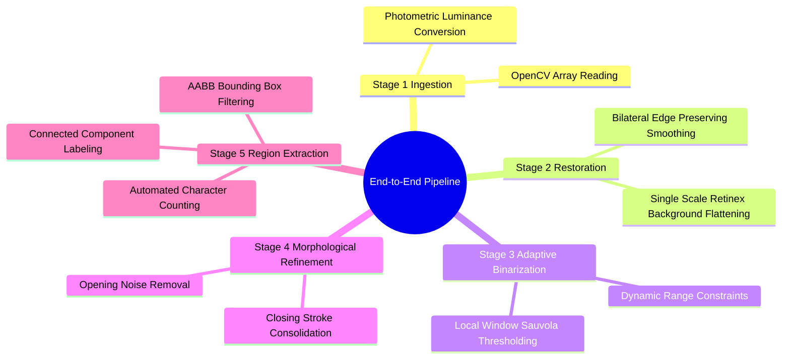

# Applied Project: End-to-End Document Cleaning and Text Extraction Pipeline

This complete applied project integrates the foundations taught across the entire curriculum. It implements an automated, robust document restoration and segmentation pipeline for historical manuscripts corrupted by non-uniform lighting, bleed-through stains, and sensor noise.



---

### Complete Python Implementation

```python
"""
End-to-End Historical Document Restoration and Text Extraction Pipeline
Unifying: OpenCV, NumPy, SciPy, Matplotlib, and Sauvola Thresholding.
"""

import cv2
import numpy as np
import matplotlib.pyplot as plt

def single_scale_retinex(image: np.ndarray, sigma: float = 80.0) -> np.ndarray:
    """
    Applies Single-Scale Retinex (SSR) to estimate and normalize non-uniform illumination.
    Formula: R(x, y) = log(I(x, y) + 1) - log(I(x, y) * G_sigma(x, y) + 1)
    """
    img_float = image.astype(np.float32) + 1.0  # Prevent log(0)
    
    # Estimate smoothly varying illumination using a wide Gaussian blur
    illumination = cv2.GaussianBlur(img_float, ksize=(0, 0), sigmaX=sigma, sigmaY=sigma)
    
    # Subtract log illumination from log intensity to isolate surface reflectance
    log_reflectance = np.log(img_float) - np.log(illumination)
    
    # Normalize reflectance back to standard 8-bit dynamic range [0, 255]
    norm_reflectance = cv2.normalize(log_reflectance, None, alpha=0, beta=255, norm_type=cv2.NORM_MINMAX)
    return norm_reflectance.astype(np.uint8)

def sauvola_threshold(image: np.ndarray, window_size: int = 25, k: float = 0.2, r: float = 128.0) -> np.ndarray:
    """
    Applies local adaptive Sauvola binarization to extract text strokes under varying contrast.
    Formula: T(x, y) = m(x, y) * [1 + k * (s(x, y) / R - 1)]
    """
    # Ensure window dimensions are odd
    if window_size % 2 == 0:
        window_size += 1
        
    img_float = image.astype(np.float32)
    
    # Compute local mean m(x, y) using an averaging box filter
    mean = cv2.boxFilter(img_float, ddepth=-1, ksize=(window_size, window_size), borderType=cv2.BORDER_REFLECT)
    
    # Compute local standard deviation s(x, y) = sqrt(E[X^2] - (E[X])^2)
    mean_sq = cv2.boxFilter(img_float ** 2, ddepth=-1, ksize=(window_size, window_size), borderType=cv2.BORDER_REFLECT)
    variance = np.maximum(mean_sq - (mean ** 2), 0.0)
    std_dev = np.sqrt(variance)
    
    # Compute the dynamic pixel-wise threshold surface
    threshold_surface = mean * (1.0 + k * ((std_dev / r) - 1.0))
    
    # Binarize: text pixels (darker than local threshold) become 255 (foreground)
    binary = np.where(img_float < threshold_surface, np.uint8(255), np.uint8(0))
    return binary

def run_document_processing_pipeline(image_path: str):
    """
    Executes the complete multi-stage restoration and segmentation pipeline.
    """
    # --- Stage 1: Ingestion and Preprocessing ---
    raw_bgr = cv2.imread(image_path, cv2.IMREAD_COLOR)
    if raw_bgr is None:
        # Generate synthetic degraded document if no file path is provided
        h, w = 400, 600
        raw_gray = np.full((h, w), 200, dtype=np.uint8)
        # Add non-uniform illumination gradient (shadow across the page)
        gradient = np.tile(np.linspace(50, 220, w, dtype=np.uint8), (h, 1))
        raw_gray = cv2.addWeighted(raw_gray, 0.5, gradient, 0.5, 0)
        # Draw synthetic text strokes
        cv2.putText(raw_gray, "Image Processing & Analysis", (50, 150), cv2.FONT_HERSHEY_SIMPLEX, 1.0, 30, 3)
        cv2.putText(raw_gray, "Master 1 APDS & Data Science", (50, 250), cv2.FONT_HERSHEY_SIMPLEX, 1.0, 40, 3)
        # Corrupt with Gaussian noise
        noise = np.random.normal(0, 15, raw_gray.shape).astype(np.float32)
        raw_gray = np.clip(raw_gray.astype(np.float32) + noise, 0, 255).astype(np.uint8)
    else:
        # Convert BGR to standard grayscale luminance
        raw_gray = cv2.cvtColor(raw_bgr, cv2.COLOR_BGR2GRAY)

    # --- Stage 2: Illumination Correction and Denoising ---
    # Flatten uneven illumination field using Single-Scale Retinex
    retinex_clean = single_scale_retinex(raw_gray, sigma=60.0)
    
    # Suppress noise while preserving text stroke edges using a Bilateral Filter
    bilateral_smooth = cv2.bilateralFilter(retinex_clean, d=9, sigmaColor=50, sigmaSpace=50)

    # --- Stage 3: Local Adaptive Binarization ---
    # Segment foreground text strokes using Sauvola thresholding
    binary_raw = sauvola_threshold(bilateral_smooth, window_size=25, k=0.25, r=128.0)

    # --- Stage 4: Morphological Refinement ---
    # Remove isolated salt noise specks using Morphological Opening
    kernel_open = cv2.getStructuringElement(cv2.MORPH_RECT, (2, 2))
    cleaned_mask = cv2.morphologyEx(binary_raw, cv2.MORPH_OPEN, kernel_open)
    
    # Bridge small gaps in broken character strokes using Morphological Closing
    kernel_close = cv2.getStructuringElement(cv2.MORPH_RECT, (2, 1))
    refined_mask = cv2.morphologyEx(cleaned_mask, cv2.MORPH_CLOSE, kernel_close)

    # --- Stage 5: Connected Component Analysis and Character Extraction ---
    # Label connected components (using 8-connectivity for foreground text)
    num_labels, labels, stats, centroids = cv2.connectedComponentsWithStats(refined_mask, connectivity=8)
    
    # Create an RGB visual canvas to display extracted bounding boxes
    annotated_output = cv2.cvtColor(refined_mask, cv2.COLOR_GRAY2BGR)
    
    extracted_characters = 0
    for label_id in range(1, num_labels):  # Skip background label 0
        x = stats[label_id, cv2.CC_STAT_LEFT]
        y = stats[label_id, cv2.CC_STAT_TOP]
        w = stats[label_id, cv2.CC_STAT_WIDTH]
        h = stats[label_id, cv2.CC_STAT_HEIGHT]
        area = stats[label_id, cv2.CC_STAT_AREA]
        
        # Filter out noise components based on minimum pixel area and aspect ratio
        if 20 < area < 5000 and h > 8:
            extracted_characters += 1
            # Draw Axis-Aligned Bounding Box (AABB) around the extracted character
            cv2.rectangle(annotated_output, (x, y), (x + w, y + h), (0, 255, 0), 1)

    # --- Stage 6: Multi-Stage Visualization Canvas ---
    fig, axes = plt.subplots(nrows=2, ncols=3, figsize=(14, 8), dpi=100)
    
    axes[0, 0].imshow(raw_gray, cmap='gray', vmin=0, vmax=255)
    axes[0, 0].set_title("1. Input Degraded Document")
    axes[0, 0].axis('off')
    
    axes[0, 1].imshow(retinex_clean, cmap='gray', vmin=0, vmax=255)
    axes[0, 1].set_title("2. Retinex Illumination Correction")
    axes[0, 1].axis('off')
    
    axes[0, 2].imshow(bilateral_smooth, cmap='gray', vmin=0, vmax=255)
    axes[0, 2].set_title("3. Edge-Preserving Bilateral Filter")
    axes[0, 2].axis('off')
    
    axes[1, 0].imshow(binary_raw, cmap='gray', vmin=0, vmax=255)
    axes[1, 0].set_title("4. Raw Sauvola Adaptive Binarization")
    axes[1, 0].axis('off')
    
    axes[1, 1].imshow(refined_mask, cmap='gray', vmin=0, vmax=255)
    axes[1, 1].set_title("5. Morphological Refinement")
    axes[1, 1].axis('off')
    
    axes[1, 2].imshow(cv2.cvtColor(annotated_output, cv2.COLOR_BGR2RGB))
    axes[1, 2].set_title(f"6. Extracted Characters (Count: {extracted_characters})")
    axes[1, 2].axis('off')
    
    plt.tight_layout()
    plt.show()

if __name__ == '__main__':
    run_document_processing_pipeline(image_path="")
```

Related concepts: [[15. OpenCV Core Architecture - Matrix Representation, Channels, and Color Constellations]], [[06.2.7. Non-Linear Boundary-Preserving Filtering (Bilateral Joint Spatial-Radiometric Filter)]], [[06.5.2. Advanced Contrast Models (Histogram Specification and Land's Retinex Theory)]], [[06.7.3. Local Adaptive Thresholding (Niblack and Dynamic Range Sauvola)]], [[06.7.6. Connected Component Analysis (Two-Pass CCL and Equivalence Trees)]], [[06.7.7. Geometric Region Descriptors (AABB, OBB, Centroids, and Central Moments)]].
