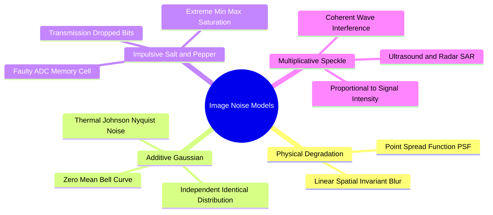

# Physical Noise Models: Point Spread Function, Additive Gaussian, Speckle, and Salt-and-Pepper

This note covers the phenomenology of image noise — the physical processes by which corruption arises during sensing and transmission.

Image degradation can occur during acquisition, transmission, or optical focusing. A degraded observation $G(x, y)$ is modeled mathematically as:

$$G(x, y) = \mathcal{H}\{F(x, y)\} + \eta(x, y)$$

Where $F(x, y)$ is the original clean image, $\mathcal{H}$ represents the degradation operator, and $\eta(x, y)$ is an additive noise term. If $\mathcal{H}$ is linear and space-invariant (such as motion blur or out-of-focus optics), it can be modeled as a spatial convolution with the system's **Point Spread Function (PSF)** $h(x, y)$:

$$G(x, y) = F(x, y) * h(x, y) + \eta(x, y)$$

### 1. Additive Gaussian Noise
Arises from thermal vibrations of electrons in sensor electronics (Johnson-Nyquist noise) and sensor noise under low-light conditions.

* Mathematical Model:
  $$G(x, y) = F(x, y) + \eta_G(x, y)$$
* Probability Density Function (PDF):
  $$p(z) = \frac{1}{\sqrt{2\pi}\sigma} \exp\left( -\frac{(z - \mu)^2}{2\sigma^2} \right)$$
  where $\mu$ is the mean (typically $\mu = 0$) and $\sigma^2$ is the noise variance.
* Characteristics: Affects *every pixel* in the image by adding a small, random variation to its intensity. Effectively smoothed using linear averaging and Gaussian filters.

### 2. Impulsive Noise (Salt-and-Pepper Noise)
Caused by faulty sensor pixels (dead or stuck pixels), transmission errors, or analog-to-digital bit errors.

* Mathematical Model: Pixels are randomly replaced with either the minimum or maximum intensity value:
  $$G(x, y) = \begin{cases}
  0 \ (\text{Pepper, Black}) & \text{with probability } \frac{p}{2} \\
  255 \ (\text{Salt, White}) & \text{with probability } \frac{p}{2} \\
  F(x, y) & \text{with probability } 1 - p
  \end{cases}$$
* Characteristics: Affects only a *fraction* $p$ of pixels, while the remaining pixels remain clean. Because the noise values are extreme outliers ($0$ and $255$), linear averaging filters fail; rank-order filters (such as the Median filter) must be used instead.

### 3. Multiplicative Noise (Speckle Noise)
Occurs in coherent imaging systems, such as Synthetic Aperture Radar (SAR), sonar, and medical ultrasound, due to constructive and destructive interference of reflected waves.

* Mathematical Model:
  $$G(x, y) = F(x, y) \cdot \eta_M(x, y)$$
* Characteristics: The noise amplitude is proportional to the local image intensity: brighter regions exhibit larger noise variations, while dark regions exhibit little noise.

Related concepts: [[02. NumPy Array Manipulation - Slicing, Strides, Shapes, and Vectorized Indexing]], [[06.2.2. Quantitative Quality Benchmarks (MSE, PSNR, and SSIM)]], [[06.2.5. Order-Statistic Non-Linear Filtering (Median, Min, Max, Min-Max Operators)]], [[06.9.3. TP2 Part 1 - Discrete Noise Models and Spatial Convolution Smoothing]].
