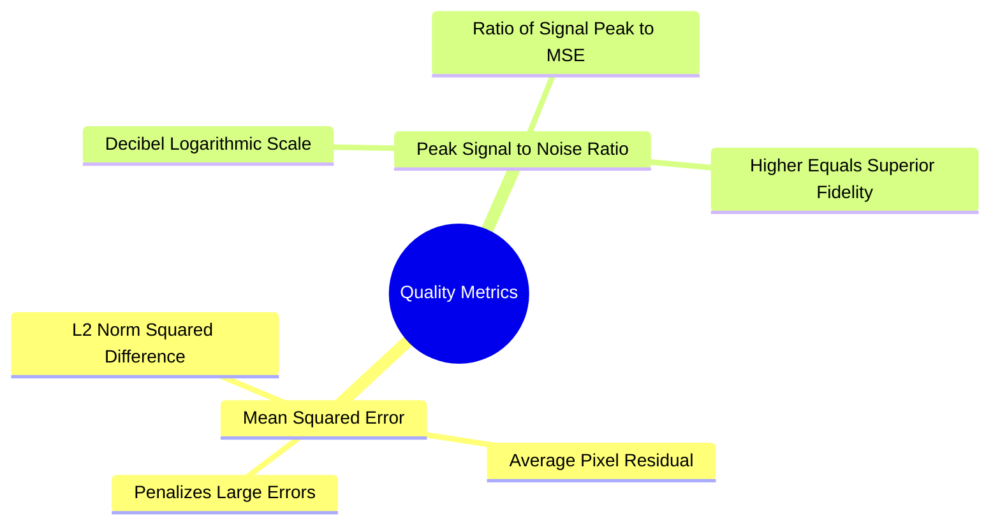

# Quantitative Quality Metrics: Mean Squared Error (MSE) and Peak Signal-to-Noise Ratio (PSNR)

To evaluate the performance of an image restoration or denoising algorithm, the restored image $\hat{F}(x, y)$ must be compared quantitatively against a reference ground-truth image $F(x, y)$.

### 1. Mean Squared Error (MSE)
The Mean Squared Error measures the average squared difference between the pixel values of the restored and reference images:

$$\text{MSE}(F, \hat{F}) = \frac{1}{M \cdot N} \sum_{x=0}^{M-1} \sum_{y=0}^{N-1} \Big( F(x, y) - \hat{F}(x, y) \Big)^2$$

* An MSE of $0$ indicates a perfect reconstruction ($\hat{F} = F$).
* Because the error term is squared, large localized errors are penalized much more heavily than small, widespread differences.

### 2. Peak Signal-to-Noise Ratio (PSNR)
PSNR expresses the ratio between the maximum possible power of the image signal and the power of corrupting noise on a logarithmic decibel (dB) scale:

$$\text{PSNR} = 10 \cdot \log_{10}\left( \frac{R^2}{\text{MSE}} \right) = 20 \cdot \log_{10}\left( \frac{R}{\sqrt{\text{MSE}}} \right)$$

where $R$ is the maximum possible pixel intensity:
* For standard 8-bit unsigned images: $R = 255$.
* For normalized floating-point images: $R = 1.0$.

#### Interpreting PSNR Values
* **PSNR $> 35\text{ dB}$:** High visual quality; artifacts are nearly imperceptible.
* **$30\text{ dB} \le \text{PSNR} \le 35\text{ dB}$:** Good restoration; minor artifacts visible upon close inspection.
* **$20\text{ dB} \le \text{PSNR} < 30\text{ dB}$:** Poor restoration; visible blurring or lingering noise.
* **PSNR $< 20\text{ dB}$:** Severe degradation; significant distortion of image details.
* As $\text{MSE} \to 0$, $\text{PSNR} \to \infty$.

Related concepts: [[04. NumPy Mathematical Engine - Vectorization, ufuncs, and Broadcasting Rules]], [[06.2.1. Physical Noise Models (PSF, Gaussian, Impulse Salt-and-Pepper, Speckle)]], [[06.9.3. TP2 Part 1 - Discrete Noise Models and Spatial Convolution Smoothing]].
