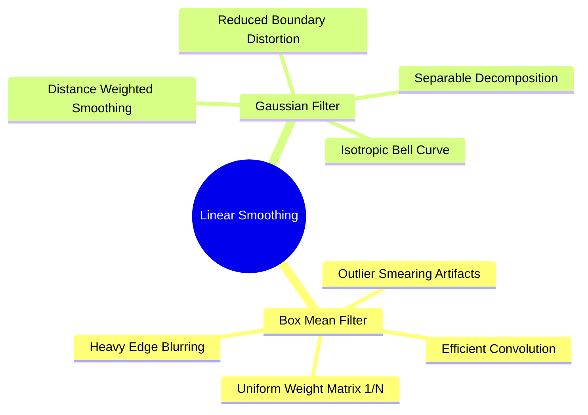
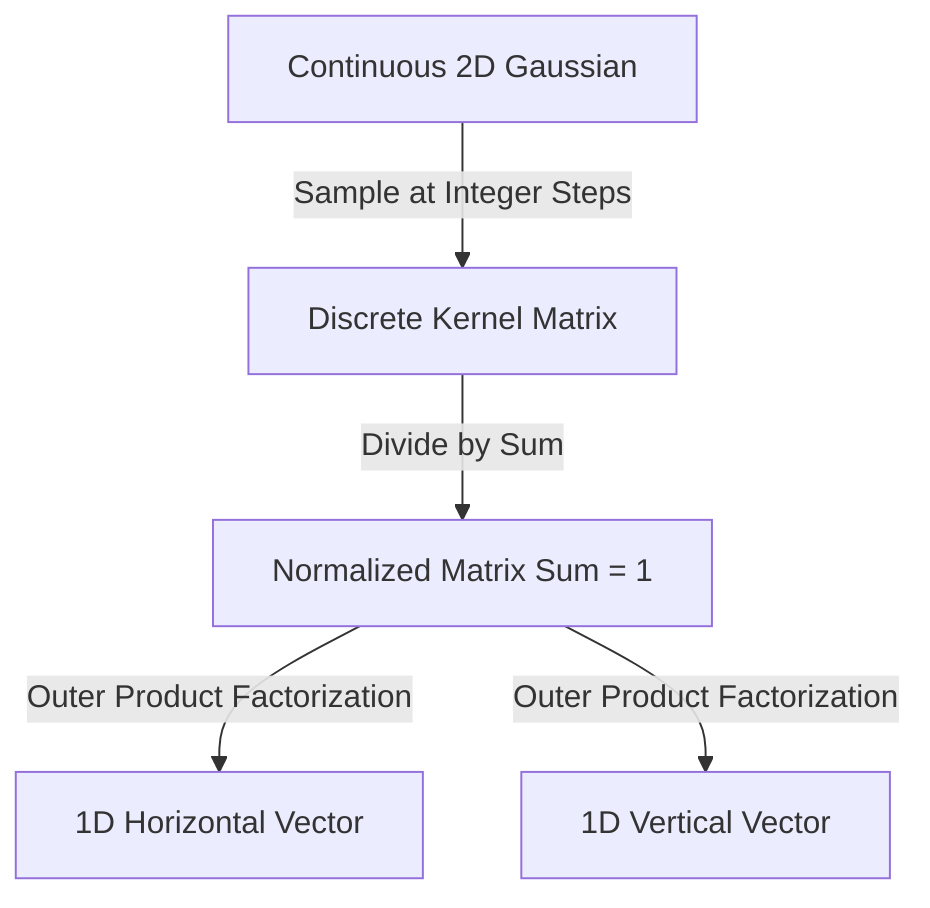

# Linear Smoothing Filters: Box Mean and Separable Gaussian Convolutions

Linear spatial smoothing filters reduce noise by replacing each pixel with a weighted average of its local neighborhood.

### 1. The Mean (Box) Filter
The simplest linear filter. Replaces each pixel with the arithmetic mean of its neighborhood. A standard $3 \times 3$ normalized box kernel is defined as:

$$H_{\text{mean}} = \frac{1}{9} \begin{pmatrix} 1 & 1 & 1 \\ 1 & 1 & 1 \\ 1 & 1 & 1 \end{pmatrix}$$

#### Characteristics and Limitations
* **Effective against Gaussian noise:** Averages zero-mean random fluctuations, reducing noise variance.
* **Ineffective against impulse noise:** Outliers (such as white salt pixels with value $255$) are averaged into the result, smearing the noise into a visible gray blur.
* **Blurs edges:** Treats all pixels in the neighborhood equally, causing sharp edges and fine details to become soft and blurry.

### 2. The Gaussian Filter
The Gaussian filter is an isotropic (rotationally symmetric) low-pass filter. Instead of weighting all neighbors equally, it weights pixels based on their spatial distance from the center, following a Gaussian distribution:

$$G(x, y) = \frac{1}{2\pi\sigma^2} \exp\left( -\frac{x^2 + y^2}{2\sigma^2} \right)$$

where $\sigma$ (the standard deviation) controls the width of the bell curve and the strength of the smoothing effect.

#### Sampling a Discrete $5 \times 5$ Gaussian Kernel
To construct a discrete $5 \times 5$ kernel with $\sigma = 1.4$, we sample coordinates $(x, y) \in [-2, 2] \times [-2, 2]$, calculate $G(x, y)$, and divide by the sum of all elements to ensure the weights sum to $1$ (preserving overall image brightness):

$$H_{\text{Gauss}} = \frac{1}{115} \begin{pmatrix}
2 & 4 & 5 & 4 & 2 \\
4 & 9 & 12 & 9 & 4 \\
5 & 12 & 15 & 12 & 5 \\
4 & 9 & 12 & 9 & 4 \\
2 & 4 & 5 & 4 & 2
\end{pmatrix}$$

#### Separable Decomposition
Because the 2D Gaussian function is mathematically separable:

$$G(x, y) = G_1(x) \cdot G_2(y) = \left( \frac{1}{\sqrt{2\pi}\sigma} e^{-\frac{x^2}{2\sigma^2}} \right) \cdot \left( \frac{1}{\sqrt{2\pi}\sigma} e^{-\frac{y^2}{2\sigma^2}} \right)$$

a 2D Gaussian convolution can be decomposed into two consecutive 1D convolutions: one along the rows using $G_1(x)$, followed by one along the columns using $G_2(y)$. This reduces computational complexity from $W^2$ to $2W$ operations per pixel.

Related concepts: [[15. OpenCV Core Architecture - Matrix Representation, Channels, and Color Constellations]], [[06.1.10. Mathematical 2D Spatial Convolution, Cross-Correlation, and Boundary Padding]], [[06.9.3. TP2 Part 1 - Discrete Noise Models and Spatial Convolution Smoothing]].
