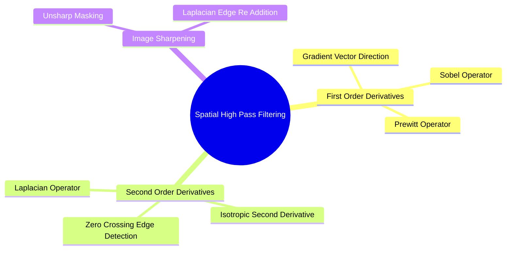

# Spatial High-Pass Filtering: Differential Operators and Laplacian Sharpening

While low-pass filters smooth images by attenuating high frequencies, high-pass filters enhance sharp transitions, boundaries, and fine details using spatial derivatives.

### 1. The Image Gradient (First Derivatives)
The gradient of a continuous image $f(x, y)$ is a 2D vector pointing in the direction of maximum intensity change:

$$\nabla f = \begin{pmatrix} G_x \\ G_y \end{pmatrix} = \begin{pmatrix} \frac{\partial f}{\partial x} \\ \frac{\partial f}{\partial y} \end{pmatrix}$$

Its magnitude $|\nabla f|$ and orientation $\theta$ are:

$$|\nabla f| = \sqrt{G_x^2 + G_y^2} \approx |G_x| + |G_y|, \quad \theta = \arctan\left(\frac{G_y}{G_x}\right)$$

In discrete space, the derivatives are approximated using finite differences via kernels like the **Sobel operator**:

$$S_x = \begin{pmatrix} -1 & 0 & 1 \\ -2 & 0 & 2 \\ -1 & 0 & 1 \end{pmatrix}, \quad S_y = \begin{pmatrix} -1 & -2 & -1 \\ 0 & 0 & 0 \\ 1 & 2 & 1 \end{pmatrix}$$

### 2. The Laplacian Operator (Second Derivative)
The Laplacian $\nabla^2 f$ is an isotropic (rotation-invariant) second-order derivative:

$$\nabla^2 f = \frac{\partial^2 f}{\partial x^2} + \frac{\partial^2 f}{\partial y^2}$$

Approximating the second derivatives with finite differences:

$$\frac{\partial^2 f}{\partial x^2} \approx f(x+1, y) - 2f(x, y) + f(x-1, y)$$

$$\frac{\partial^2 f}{\partial y^2} \approx f(x, y+1) - 2f(x, y) + f(x, y-1)$$

Summing both equations yields the standard discrete $3 \times 3$ Laplacian kernel:

$$\nabla^2 = \begin{pmatrix} 0 & 1 & 0 \\ 1 & -4 & 1 \\ 0 & 1 & 0 \end{pmatrix} \quad \text{or including diagonals:} \quad \begin{pmatrix} 1 & 1 & 1 \\ 1 & -8 & 1 \\ 1 & 1 & 1 \end{pmatrix}$$

### 3. Laplacian Sharpening
Sharpening works by adding the spatial second derivative back to the original image to accentuate intensity transitions:

$$g(x, y) = f(x, y) - \nabla^2 f(x, y) \quad (\text{when using a negative-center Laplacian})$$

$$g(x, y) = f(x, y) + \nabla^2 f(x, y) \quad (\text{when using a positive-center Laplacian})$$

*Limitation:* Because second derivatives are highly sensitive to rapid fluctuations, the Laplacian amplifies noise significantly and should not be applied to noisy images without prior smoothing.

Related concepts: [[04. NumPy Mathematical Engine - Vectorization, ufuncs, and Broadcasting Rules]], [[06.1.10. Mathematical 2D Spatial Convolution, Cross-Correlation, and Boundary Padding]], [[06.10.1. Exercise 1 - Complete Calculation of 2D Convolution and Boundary Padding Modes]].
