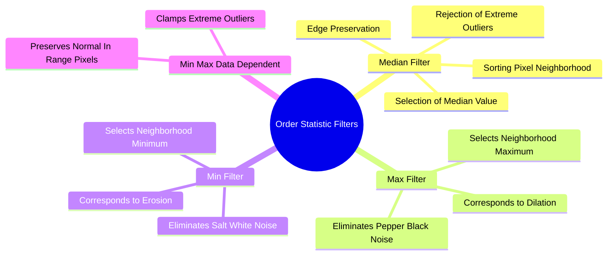

# Order-Statistic Non-Linear Filtering: Median and Rank-Order Min-Max Operators

Order-statistic filters are non-linear spatial filters whose response is based on sorting (ranking) the pixels in a local neighborhood rather than computing a weighted sum.

### 1. The Median Filter
The Median filter is designed to remove impulsive (salt-and-pepper) noise while preserving sharp edges.

#### Algorithm
1. Define a sliding window $W$ of size $(2K+1) \times (2K+1)$ centered at pixel $(x, y)$.
2. Collect the intensity values of all pixels within the window.
3. Sort the collected values in ascending order:
   $$\{z_1 \le z_2 \le z_3 \le \dots \le z_N\}, \quad N = (2K+1)^2$$
4. Assign the median (middle) value to the output pixel:
   $$g(x, y) = z_{\text{median}} = z_{\left(\frac{N+1}{2}\right)}$$

#### Why the Median Filter Rejects Outliers
Consider a clean $3 \times 3$ neighborhood corrupted by a single white salt pixel (value $255$):

$$\text{Neighborhood} = \{105, 108, 102, 106, \mathbf{255}, 107, 103, 104, 108\}$$

* **Mean filter:** $\frac{105+108+102+106+255+107+103+104+108}{9} = \frac{1098}{9} = \mathbf{122}$. The noise skews the average, producing a visible bright artifact.
* **Median filter:** Sorted sequence:
  $$\{102, 103, 104, 105, \mathbf{106}, 107, 108, 108, \mathbf{255}\}$$
  The median value is $\mathbf{106}$. The outlier $255$ is sorted to the end of the list and discarded completely.

### 2. Rank-Order Min and Max Filters
* **Max Filter:** Selects the maximum value in the neighborhood:
  $$g(x, y) = \max_{(s, t) \in W} f(x+s, y+t)$$
  *Effect:* Brightens the image; removes black "pepper" noise. Equivalent to grayscale morphological **dilation**.
* **Min Filter:** Selects the minimum value in the neighborhood:
  $$g(x, y) = \min_{(s, t) \in W} f(x+s, y+t)$$
  *Effect:* Darkens the image; removes white "salt" noise. Equivalent to grayscale morphological **erosion**.

### 3. The Data-Dependent Min-Max Filter
Instead of replacing every pixel unconditionally, the data-dependent Min-Max filter checks whether the current pixel falls within the dynamic range of its neighbors:
1. Examine the neighborhood $W$ excluding the center pixel $P$.
2. Calculate the minimum ($Min_N$) and maximum ($Max_N$) among the neighbors.
3. Decision rule:
   $$P_{\text{new}} = \begin{cases}
   P & \text{if } Min_N \le P \le Max_N \quad (\text{pixel blends normally with surroundings}) \\
   Max_N & \text{if } P > Max_N \quad (\text{clamped to prevent excessive brightness}) \\
   Min_N & \text{if } P < Min_N \quad (\text{clamped to prevent excessive darkness})
   \end{cases}$$

Related concepts: [[02. NumPy Array Manipulation - Slicing, Strides, Shapes, and Vectorized Indexing]], [[06.2.1. Physical Noise Models (PSF, Gaussian, Impulse Salt-and-Pepper, Speckle)]], [[06.9.3. TP2 Part 1 - Discrete Noise Models and Spatial Convolution Smoothing]].
