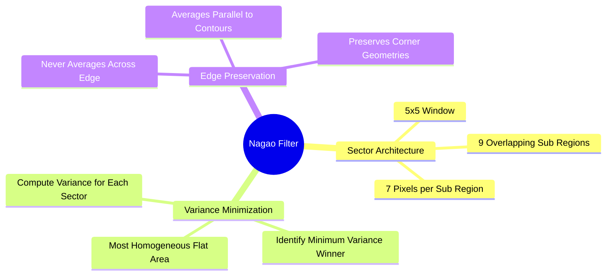

# Structural Edge-Preserving Smoothing: The Nagao Adaptive Multi-Sector Filter

Linear smoothing filters blur edges because they average pixels across boundaries. The **Nagao filter** avoids this by dividing the local neighborhood into oriented sub-regions and averaging only within the most homogeneous one.



### 1. Structural Architecture of the Nagao Filter
The filter operates within a $5 \times 5$ window centered on pixel $P(x, y)$. The window is divided into **nine overlapping sub-regions of 7 pixels each**, oriented in different directions around the center:
* One central sub-region (cross-like configuration centered on $P$).
* Four directional sub-regions aligned horizontally and vertically.
* Four corner sub-regions aligned diagonally.

```text
The 9 Nagao Sub-Regions (7 pixels each, centered on P):
Sub-Region 1 (Center):    Sub-Region 2 (Horizontal):    Sub-Region 3 (Diagonal):
    .  X  .  .  .               .  .  .  .  .                 X  X  .  .  .
    X  X  X  .  .               X  X  X  X  .                 X  X  X  .  .
    .  X  .  .  .               .  .  P  .  .                 .  X  P  .  .
    .  .  .  .  .               .  .  .  .  .                 .  .  .  .  .
    .  .  .  .  .               .  .  .  .  .                 .  .  .  .  .
```

### 2. Algorithmic Execution Steps
For each pixel $P(x, y)$ in the image:

**Step 1:** For each of the nine sub-regions $R_k \ (k = 1, \dots, 9)$, calculate the local mean $\mu_k$ and variance $\sigma_k^2$:

$$\mu_k = \frac{1}{7} \sum_{(i, j) \in R_k} f(i, j)$$

$$\sigma_k^2 = \frac{1}{7} \sum_{(i, j) \in R_k} \big( f(i, j) - \mu_k \big)^2 = \left( \frac{1}{7} \sum_{(i, j) \in R_k} f(i, j)^2 \right) - \mu_k^2$$

**Step 2:** Find the sub-region with the **lowest variance**:

$$k^* = \arg\min_{k \in \{1, \dots, 9\}} \Big( \sigma_k^2 \Big)$$

**Step 3:** Assign the mean of this winning sub-region to the output pixel:

$$g(x, y) = \mu_{k^*}$$

### 3. Why the Nagao Filter Preserves Edges
Variance measures local intensity dispersion:
* A sub-region that crosses an edge contains pixels from both sides of the boundary, resulting in a large variance $\sigma^2$.
* A sub-region that lies entirely on one side of an edge contains pixels of similar intensities, resulting in a small variance $\sigma^2$.

Because the filter selects the sub-region with the lowest variance, it always averages pixels that lie on the **same side of the edge as the center pixel**, smoothing noise without blurring across the boundary.

Related concepts: [[02. NumPy Array Manipulation - Slicing, Strides, Shapes, and Vectorized Indexing]], [[06.2.3. Linear Spatial Smoothing (Mean Box Filter, Gaussian Bell, and 1D Separability)]], [[06.9.5. TP2 Part 2 - Edge-Preserving Non-Linear Smoothing with Nagao Filter]].

**Library implementation deep-dive:** four cross-verified implementations of this exact algorithm — explicit loops, semi-vectorized `E[X²]-E[X]²` gathering, hardcoded 9-kernel convolution via `cv2.filter2D`, and stride-tricks sliding windows — with measured benchmarks, the variance-estimator subtlety, and border-mode pitfalls are in [[26. Nagao Filtering - Multi-Implementation Reference with Hardcoded Kernels, Vectorized, and Convolution Approaches]].
