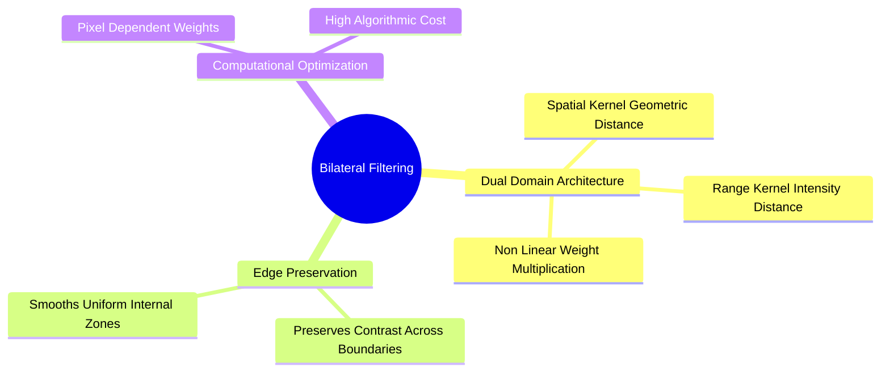
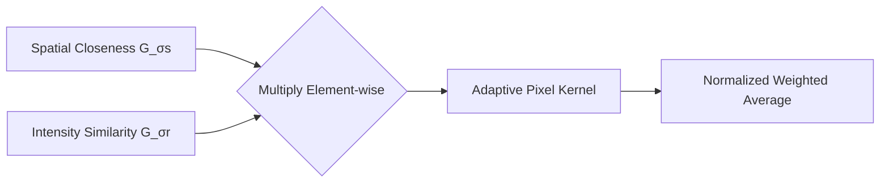

# Non-Linear Boundary-Preserving Filtering: The Joint Spatial-Radiometric Bilateral Filter

The Bilateral Filter is an edge-preserving smoothing filter that weights neighboring pixels by both their **spatial proximity** and their **radiometric similarity** (intensity difference).

### 1. Mathematical Formulation
For a pixel at coordinate $p$, its filtered intensity is defined as:

$$I_{\text{filtered}}(p) = \frac{1}{W_p} \sum_{q \in S} I(q) \cdot G_{\sigma_s}(\|p - q\|) \cdot G_{\sigma_r}(|I(p) - I(q)|)$$

where:
* $S$: The spatial neighborhood centered at pixel $p$.
* $G_{\sigma_s}(\|p - q\|)$: The **spatial domain kernel**, which weights pixels based on their geometric distance:
  $$G_{\sigma_s}(\|p - q\|) = \exp\left( -\frac{\|p - q\|^2}{2\sigma_s^2} \right)$$
* $G_{\sigma_r}(|I(p) - I(q)|)$: The **range (radiometric) kernel**, which weights pixels based on their intensity difference:
  $$G_{\sigma_r}(|I(p) - I(q)|) = \exp\left( -\frac{|I(p) - I(q)|^2}{2\sigma_r^2} \right)$$
* $W_p$: The normalization factor ensuring that all filter weights sum to $1$:
  $$W_p = \sum_{q \in S} G_{\sigma_s}(\|p - q\|) \cdot G_{\sigma_r}(|I(p) - I(q)|)$$

### 2. The Role of the Parameters ($\sigma_s$ and $\sigma_r$)
* **$\sigma_s$ (Spatial Parameter):** Controls the spatial neighborhood size. Larger values allow pixels farther away to contribute to the output, producing more smoothing.
* **$\sigma_r$ (Range Parameter):** Controls sensitivity to intensity boundaries:
  * **Large $\sigma_r$ ($\sigma_r \to \infty$):** The range kernel approaches $1$, causing the filter to behave like a standard linear Gaussian blur.
  * **Small $\sigma_r$ ($\sigma_r \to 0$):** Only pixels with nearly identical intensities are averaged together, preserving sharp edges.

Related concepts: [[15. OpenCV Core Architecture - Matrix Representation, Channels, and Color Constellations]], [[06.2.3. Linear Spatial Smoothing (Mean Box Filter, Gaussian Bell, and 1D Separability)]], [[06.2.8. Partial Differential Equations in Restoration (Perona-Malik Anisotropic Diffusion)]].

**Library implementation deep-dive:** worked numeric examples, parameter limit behaviors, the from-scratch NumPy implementation, the `cv2.bilateralFilter` API semantics, the range-LUT optimization, complexity analysis, and artifacts (staircasing, gradient reversal) are in [[25. Bilateral Filtering - Complete Mathematical Theory, Implementation, and Practice]].
