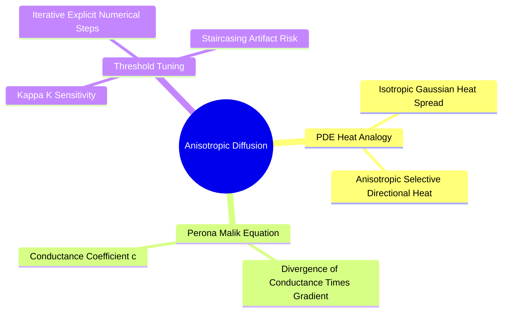

# Partial Differential Equations in Restoration: Perona-Malik Anisotropic Diffusion

Anisotropic diffusion models image restoration as a physical heat diffusion process governed by a non-linear Partial Differential Equation (PDE). It smooths flat regions while halting diffusion across sharp boundaries.

### 1. Continuous Formulation
Standard heat diffusion (which produces isotropic Gaussian blurring) is described by:

$$\frac{\partial I}{\partial t} = \nabla^2 I = \text{div}(\nabla I)$$

Perona and Malik (1990) modified this equation to make diffusion **anisotropic** by introducing a gradient-dependent conductance coefficient $c(\|\nabla I\|)$:

$$\frac{\partial I}{\partial t} = \text{div}\Big( c\big(\|\nabla I\|\big) \cdot \nabla I \Big)$$

where $\nabla I$ is the spatial gradient vector, and $\text{div}$ is the divergence operator.

### 2. Conductance Coefficient Functions
Perona and Malik proposed two functions for the conductance coefficient $c(\|\nabla I\|)$:

1. **Exponential Function:** Favors high-contrast edges over low-contrast ones:
   $$c\big(\|\nabla I\|\big) = \exp\left( -\left(\frac{\|\nabla I\|}{K}\right)^2 \right)$$
2. **Rational/Quadratic Function:** Favors wider, smoother regions over sharp boundaries:
   $$c\big(\|\nabla I\|\big) = \frac{1}{1 + \left(\frac{\|\nabla I\|}{K}\right)^2}$$

#### The Role of the Sensitivity Threshold $K$
* In homogeneous areas with low gradients ($\|\nabla I\| \ll K$), $c\big(\|\nabla I\|\big) \to 1$, leading to standard isotropic smoothing.
* At sharp edges with high gradients ($\|\nabla I\| \gg K$), $c\big(\|\nabla I\|\big) \to 0$, halting diffusion and preserving the boundary.

### 3. Discrete Numerical Implementation
Using forward Euler time-stepping, the discrete update equation for iteration $t+1$ is:

$$I_{x, y}^{t+1} = I_{x, y}^t + \lambda \sum_{p \in \mathcal{N}_4} c\big(\nabla I_p\big) \cdot \nabla I_p$$

where $\mathcal{N}_4$ represents the 4-neighbors (North, South, East, West), $\nabla I_p$ is the directional difference, and $\lambda$ is a numerical stability parameter ($\lambda \le 0.25$ on 2D grids to prevent numerical divergence).

Related concepts: [[04. NumPy Mathematical Engine - Vectorization, ufuncs, and Broadcasting Rules]], [[06.2.4. Spatial High-Pass Filtering, Sobel Gradients, and Laplacian Sharpening]], [[06.2.7. Non-Linear Boundary-Preserving Filtering (Bilateral Joint Spatial-Radiometric Filter)]].
