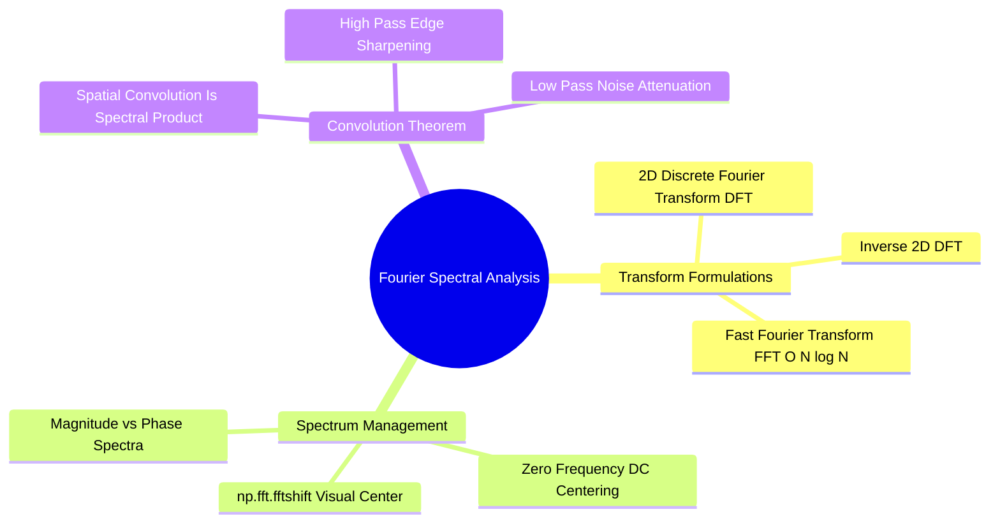
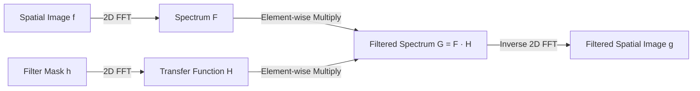

# Fourier Spectral Analysis: 2D DFT, FFT Shift, and Frequency Domain Filtering

Fourier analysis transforms an image from the spatial domain into the frequency domain, representing the image as a weighted sum of sinusoidal basis functions of varying frequencies.

### 1. Mathematical Definitions

#### The 2D Discrete Fourier Transform (DFT)
For an $M \times N$ discrete image $f(x, y)$:

$$F(u, v) = \sum_{x=0}^{M-1} \sum_{y=0}^{N-1} f(x, y) \cdot \exp\left( -i 2\pi \left( \frac{ux}{M} + \frac{vy}{N} \right) \right)$$

where $u \in \{0, \dots, M-1\}$ and $v \in \{0, \dots, N-1\}$ are spatial frequency variables, and $i = \sqrt{-1}$.

#### The Inverse 2D DFT (IDFT)
Reconstructs the spatial image from its frequency spectrum:

$$f(x, y) = \frac{1}{M \cdot N} \sum_{u=0}^{M-1} \sum_{v=0}^{N-1} F(u, v) \cdot \exp\left( i 2\pi \left( \frac{ux}{M} + \frac{vy}{N} \right) \right)$$

#### Magnitude and Phase Spectra
Each Fourier coefficient is a complex number: $F(u, v) = R(u, v) + i \cdot I(u, v)$.
* **Magnitude Spectrum (Amplitude):**
  $$|F(u, v)| = \sqrt{R(u, v)^2 + I(u, v)^2}$$
  Describes the strength of each frequency component.
* **Phase Spectrum:**
  $$\phi(u, v) = \arctan\left( \frac{I(u, v)}{R(u, v)} \right)$$
  Preserves structural edge locations and spatial geometry.
* **Logarithmic Scaling:** Because the zero-frequency DC component $F(0, 0)$ is orders of magnitude larger than high frequencies, dynamic range compression is used for visualization:
  $$D(u, v) = \log\big( 1 + |F(u, v)| \big)$$

### 2. The Convolution Theorem
Spatial convolution is mathematically equivalent to element-wise multiplication in the frequency domain:

$$f(x, y) * h(x, y) \iff F(u, v) \cdot H(u, v)$$

### 3. Frequency Domain Filter Types
* **Low-Pass Filter (LPF):** Preserves frequencies near the center while attenuating high frequencies. Smooths noise but blurs edges.
* **High-Pass Filter (HPF):** Attenuates low frequencies near the center while passing high frequencies. Enhances sharp edges while removing smooth background tones.
* **Band-Reject (Notch) Filter:** Attenuates a specific band of frequencies, making it ideal for removing periodic interference patterns.

Related concepts: [[10. Matplotlib and Seaborn Statistical Plotting for Tabular Data]], [[06.1.10. Mathematical 2D Spatial Convolution, Cross-Correlation, and Boundary Padding]], [[06.3.2. Frequency Filters (Low-Pass, High-Pass, and Band-Reject Notch Filtering)]].
