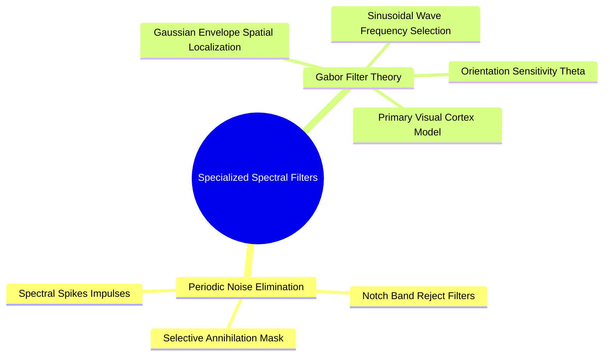

# Specialized Spectral Operators: Band-Reject Notch Filters and Directional Gabor Filter Banks

Specialized spectral filters target specific frequencies and orientations to remove periodic interference patterns or extract directional textures.

### 1. Band-Reject and Notch Filters
Periodic noise (e.g., electronic humming from alternating current) appears in the frequency spectrum as distinct, bright, symmetric spikes (impulses) at specific frequencies $(u_0, v_0)$.

A **Notch Reject Filter** places narrow zeros over these noise coordinates while preserving all other frequencies:

$$H_{\text{notch}}(u, v) = \prod_{k=1}^{Q} H_k(u, v) \cdot H_{-k}(u, v)$$

where each notch $H_k(u, v)$ is a high-pass filter shifted to the noise frequency $(u_k, v_k)$.

### 2. Directional Gabor Filters
A Gabor filter is a linear filter whose impulse response is defined by a **Gaussian envelope modulated by a sinusoidal plane wave**. It is optimal for joint spatial and frequency localization, modeling how the mammalian primary visual cortex processes directional textures.

#### Mathematical Formulation
The 2D Gabor filter function is defined as:

$$G(x, y; \lambda, \theta, \psi, \sigma, \gamma) = \exp\left( -\frac{x'^2 + \gamma^2 y'^2}{2\sigma^2} \right) \cdot \cos\left( 2\pi \frac{x'}{\lambda} + \psi \right)$$

where:

$$x' = x \cos\theta + y \sin\theta, \quad y' = -x \sin\theta + y \cos\theta$$

* **$\theta$ (Orientation):** The angle of the filter (e.g., $\theta = 0^\circ$ detects vertical edges; $\theta = 90^\circ$ detects horizontal edges).
* **$\lambda$ (Wavelength):** Controls the frequency/thickness of the stripes.
* **$\psi$ (Phase Offset):** Controls the symmetry of the wave ($\psi = 0$ is symmetric/real; $\psi = -\frac{\pi}{2}$ is antisymmetric/imaginary).
* **$\sigma$ (Gaussian Spread):** Sets the spatial size of the filter's receptive field.
* **$\gamma$ (Aspect Ratio):** Defines the ellipticity of the Gaussian envelope.

#### Gabor Filter Banks
In practice, a single Gabor filter is rarely used alone. Instead, a **filter bank** is constructed using multiple orientations (e.g., $\theta \in \{0^\circ, 45^\circ, 90^\circ, 135^\circ\}$) and wavelengths $\lambda$. Convolving an image with this filter bank produces a rich feature vector at each pixel, which is widely used for texture classification, fingerprint recognition, and biometric iris segmentation.

Related concepts: [[17. SciPy Signal and Spatial Operations - 2D Filtering and Morphology]], [[06.3.1. 2D Discrete Fourier Transform (DFT), FFT Shift, and Convolution Theorem]], [[06.7.7. Geometric Region Descriptors (AABB, OBB, Centroids, and Central Moments)]].
