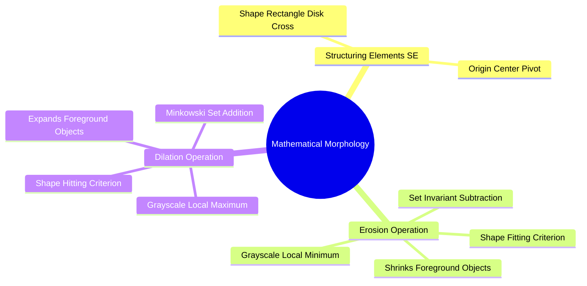

# Set-Theoretic Mathematical Morphology: Structuring Elements, Erosion, and Dilation

Mathematical morphology processes binary and grayscale images based on shape, using principles from set theory and lattice topology. Images are probed with a small geometric template called a **Structuring Element (SE)**.



### 1. The Structuring Element (SE)
The structuring element is the morphological counterpart to a convolution kernel. It is a small binary matrix that defines the shape and neighborhood of the probe. Common shapes include:
* **Box / Square ($3 \times 3$):** Probes connectivity in all 8 directions equally.
* **Cross ($3 \times 3$):** Probes 4-connected horizontal and vertical features.
* **Disk:** Provides isotropic (rotationally symmetric) probing.

```text
3x3 Square SE:            3x3 Cross SE:
  1  1  1                    0  1  0
  1 [1] 1                    1 [1] 1   <-- [ ] denotes the origin (0,0)
  1  1  1                    0  1  0
```

### 2. Fundamental Operation 1: Erosion ($\ominus$)

#### Binary Formulation
Erosion shrinks foreground objects (white pixels). It is defined as the set of all translation points $z$ such that the structuring element $B$ translated by $z$ is completely contained within the foreground set $A$:

$$A \ominus B = \{ z \mid (B)_z \subseteq A \}$$

* Intuitive Logic: "Does the structuring element **FIT** completely inside the object?"
* Visual Effect: Shrinks objects, removes small noise specks (salt noise), and breaks thin bridges connecting adjacent structures.

#### Grayscale Formulation
For a grayscale image $f(x, y)$, erosion computes the local minimum within the neighborhood defined by $B$:

$$[f \ominus B](x, y) = \min_{(s, t) \in B} \{ f(x + s, y + t) \}$$

### 3. Fundamental Operation 2: Dilation ($\oplus$)

#### Binary Formulation
Dilation expands foreground objects. It is defined as the set of all translation points $z$ such that the reflected structuring element $\hat{B}$ translated by $z$ overlaps with the foreground set $A$ by at least one pixel:

$$A \oplus B = \{ z \mid (\hat{B})_z \cap A \neq \varnothing \}$$

* Intuitive Logic: "Does the structuring element **HIT** (touch) the object?"
* Visual Effect: Expands objects, fills small interior holes and gaps (pepper noise), and merges nearby structures together.

#### Grayscale Formulation
For a grayscale image $f(x, y)$, dilation computes the local maximum within the neighborhood defined by $B$:

$$[f \oplus B](x, y) = \max_{(s, t) \in B} \{ f(x - s, y - t) \}$$

Related concepts: [[17. SciPy Signal and Spatial Operations - 2D Filtering and Morphology]], [[06.4.2. Compound Operators (Opening, Closing, Gradient, and Zhang-Suen Thinning)]], [[06.9.6. TP2 Part 3 - Mathematical Morphology, Cell Counting, and Skeletonization]].
