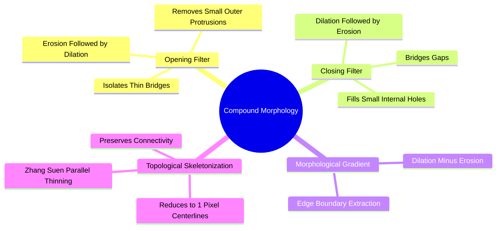

# Compound Morphological Operators: Opening, Closing, Gradient, and Zhang-Suen Thinning

By chaining erosion and dilation in specific sequences, compound morphological operators can remove noise, isolate shapes, and extract boundaries without permanently altering the size of objects.



### 1. Morphological Opening ($\circ$)
Opening is an **erosion followed by a dilation** using the same structuring element $B$:

$$A \circ B = (A \ominus B) \oplus B$$

* **Mechanism:** The initial erosion removes small noise specks and thin connections; the subsequent dilation restores the remaining structures to their original size.
* **Geometric Analogy:** Rolling a ball of shape $B$ *inside* the object. Any protrusion or bridge narrower than the ball is eliminated.
* **Idempotence:** Opening is idempotent — applying it more than once changes nothing further: $(A \circ B) \circ B = A \circ B$.
* **Application:** Removes small background noise and separates lightly touching objects without shrinking larger structures.

### 2. Morphological Closing ($\bullet$)
Closing is a **dilation followed by an erosion** using the same structuring element $B$:

$$A \bullet B = (A \oplus B) \ominus B$$

* **Mechanism:** The initial dilation expands boundaries, filling in small holes and gaps; the subsequent erosion restores the outer dimensions of the objects.
* **Geometric Analogy:** Rolling a ball of shape $B$ along the *outside* of the object. Any gap or indentation narrower than the ball is filled.
* **Application:** Fills interior holes (pepper noise) and bridges small breaks in contours.

### 3. The Morphological Gradient
Unlike differential operators (e.g., Sobel, Laplacian), the morphological gradient provides a non-linear method for detecting boundaries:

$$\text{Gradient}(A) = (A \oplus B) - (A \ominus B)$$

Subtracting the eroded image (which shrinks the boundary) from the dilated image (which expands the boundary) isolates a sharp outline of the object edges.

### 4. Topological Skeletonization (Zhang-Suen Thinning)
Skeletonization reduces binary objects to single-pixel-wide central skeletons while preserving the original topology and connectivity.

The **Zhang-Suen algorithm** is a parallel thinning algorithm that alternates between two sub-iterations. It examines the 8-neighbors of each boundary pixel $P_1$:

```text
Neighborhood Labeling:
  P9  P2  P3
  P8 [P1] P4
  P7  P6  P5
```

A foreground pixel $P_1$ is deleted if it satisfies four simultaneous conditions:
1. $2 \le B(P_1) \le 6$ (where $B(P_1)$ is the number of non-zero neighbors).
2. $A(P_1) = 1$ (where $A(P_1)$ is the number of $0 \to 1$ transitions in the ordered sequence $P_2, P_3, P_4, P_5, P_6, P_7, P_8, P_9, P_2$).
3. **Sub-iteration 1:** $P_2 \cdot P_4 \cdot P_6 = 0$ and $P_4 \cdot P_6 \cdot P_8 = 0$.
4. **Sub-iteration 2:** $P_2 \cdot P_4 \cdot P_8 = 0$ and $P_2 \cdot P_6 \cdot P_8 = 0$.

Iterations repeat until no further boundary pixels can be removed, leaving a 1-pixel-wide topological skeleton.

Related concepts: [[17. SciPy Signal and Spatial Operations - 2D Filtering and Morphology]], [[06.4.1. Set-Theoretic Foundations, Binary Grids, and Structuring Elements]], [[06.9.6. TP2 Part 3 - Mathematical Morphology, Cell Counting, and Skeletonization]].
