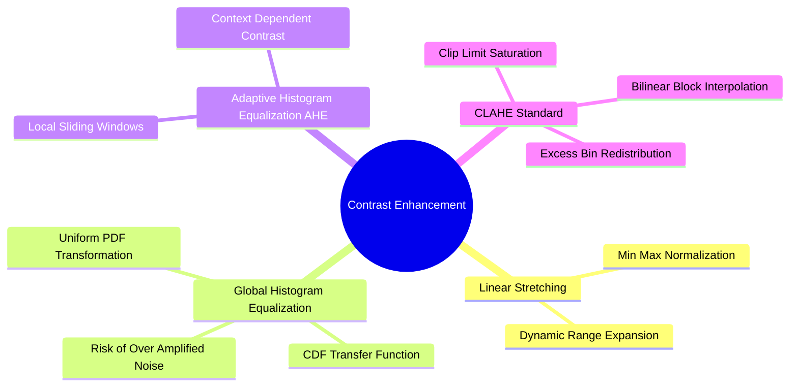
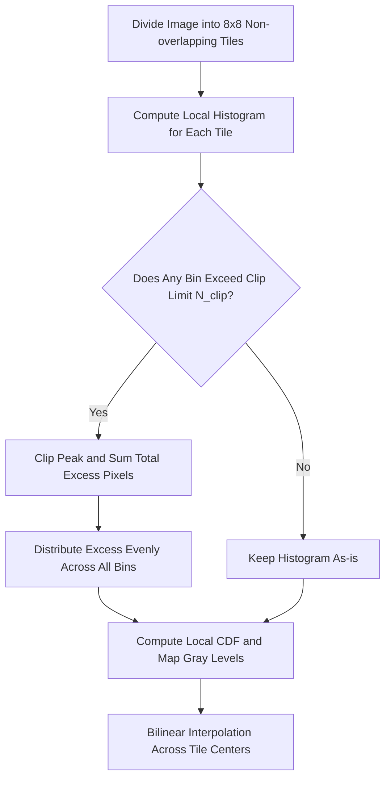

# Tonal Modification: Dynamic Range Expansion, Global HE, AHE, and CLAHE

Tonal modification techniques enhance image contrast by redistributing pixel intensities across the full available dynamic range.

### 1. Dynamic Range Expansion (Linear Contrast Stretching)
If an underexposed or poorly lit image spans only a narrow intensity range $[X_{\text{min}}, X_{\text{max}}]$, linear stretching maps these values to the full dynamic range $[Y_{\text{min}}, Y_{\text{max}}]$ (typically $[0, 255]$):

$$Y(x, y) = \frac{Y_{\text{max}} - Y_{\text{min}}}{X_{\text{max}} - X_{\text{min}}} \cdot \big( X(x, y) - X_{\text{min}} \big) + Y_{\text{min}}$$

*Limitation:* Because the transformation is linear, it cannot correct non-uniform lighting (e.g., an image with both harsh shadows and bright highlights).

### 2. Global Histogram Equalization (HE)
Global Histogram Equalization uses the image's Cumulative Distribution Function (CDF) as a non-linear mapping function to produce a uniform intensity histogram, maximizing global contrast.

#### Mathematical Derivation
1. Compute the empirical probability density $p_r(r_k) = \frac{n_k}{M \cdot N}$ for each intensity $r_k \in [0, L-1]$.
2. Compute the Cumulative Distribution Function (CDF):
   $$P_c(r_k) = \sum_{j=0}^{k} p_r(r_j)$$
3. Map each original intensity level $r_k$ to an equalized output level $s_k$:
   $$s_k = \text{round}\Big( (L - 1) \cdot P_c(r_k) \Big)$$

*Limitation:* Because the mapping is global, it can over-amplify background noise in near-constant regions and wash out subtle local details.

### 3. Contrast Limited Adaptive Histogram Equalization (CLAHE)
CLAHE addresses the limitations of global equalization by operating on small local tiles and capping contrast amplification.

#### The CLAHE Pipeline
1. **Tile Division:** Divide the image into small, non-overlapping contextual tiles (typically $8 \times 8$ pixels).
2. **Histogram Clipping:** Compute the histogram for each tile. If any bin exceeds a predefined **Clip Limit** ($N_{\text{clip}}$), the excess pixels are clipped:
   $$E_{\text{total}} = \sum_{k=0}^{L-1} \max\big(0, \ H(k) - N_{\text{clip}}\big)$$
3. **Redistribution:** The total excess $E_{\text{total}}$ is redistributed evenly across all histogram bins:
   $$H_{\text{new}}(k) = \min\big(H(k), N_{\text{clip}}\big) + \frac{E_{\text{total}}}{L}$$
4. **Equalization:** Compute the CDF on this modified histogram to determine the mapping function for the tile.
5. **Bilinear Interpolation:** To eliminate visible seams between adjacent tiles, each pixel's final value is interpolated using the mapping functions of the four nearest neighboring tiles.

#### Equalizing Color Images Safely
**Critical Warning:** Never apply histogram equalization to the Red, Green, and Blue channels independently! Because the channels are equalized separately, the relative ratios between colors change, introducing severe color shifts (e.g., a blue sky turning purple).

**Correct Procedure:**
1. Convert the image from RGB to a decoupled space such as **CIE $L^*a^*b^*$** or **HSV**.
2. Apply CLAHE only to the luminance channel ($L^*$ in $L^*a^*b^*$, or $V$ in HSV).
3. Merge the equalized luminance channel with the original chrominance channels.
4. Convert back to RGB.

Related concepts: [[15. OpenCV Core Architecture - Matrix Representation, Channels, and Color Constellations]], [[06.1.6. Perceptual and Broadcast Spaces - YUV, YCbCr, HSV, and CIE Lab]], [[06.1.9. Tonal Histograms, Probability Densities, and Cumulative Distribution Functions]].
