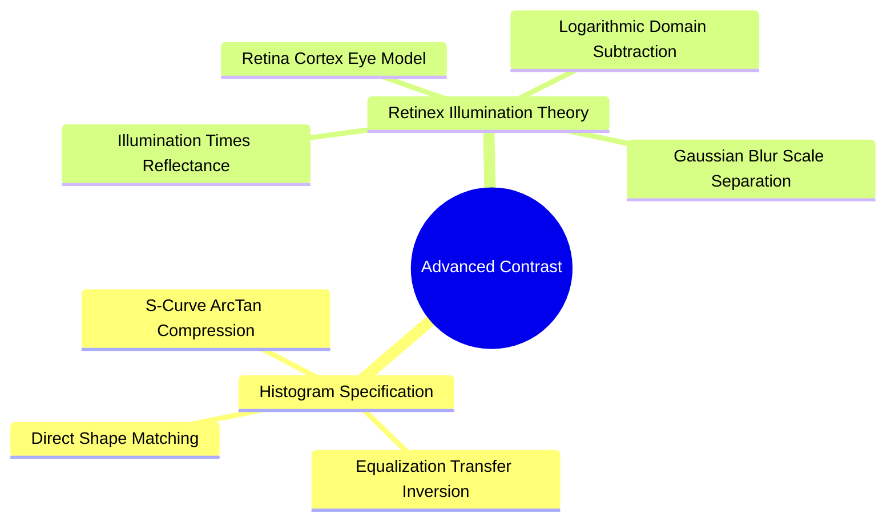

# Advanced Contrast Models: Histogram Specification and Land's Retinex Illumination Separation

Advanced contrast enhancement techniques allow shaping an image's histogram to match a specific reference distribution, or decomposing an image into illumination and reflectance components to correct uneven lighting.

### 1. Histogram Specification (Histogram Matching)
Rather than flattening the histogram to a uniform distribution (as in equalization), histogram specification transforms an image's histogram to match the shape of a target reference histogram (e.g., matching the lighting between different camera shots).

#### Algorithmic Method
1. Compute the equalizing transformation $s = T(r)$ for the input image using its CDF.
2. Compute the equalizing transformation $v = G(z)$ for the target reference image using its CDF.
3. Compute the inverse mapping:
   $$z = G^{-1}(s) = G^{-1}\big( T(r) \big)$$

#### The Thang & Zhuang S-Curve Model
To enhance contrast while preventing highlight and shadow clipping, Thang and Zhuang proposed an S-curve mapping based on the arctangent function:

$$F(x) = 0.5 + \frac{\arctan\big(\delta \cdot (x - m)\big)}{\pi}$$

The S-shape increases the slope (boosting contrast) in mid-tones while compressing shadows and highlights to prevent clipping.

### 2. Land's Retinex Theory (Illumination Correction)
Edwin Land's Retinex theory models how human vision achieves **color constancy**, perceiving true object colors regardless of variations in ambient illumination.

An observed image $I(x, y)$ is the product of incident **illumination** $L(x, y)$ and surface **reflectance** $R(x, y)$:

$$I(x, y) = L(x, y) \cdot R(x, y)$$

* Illumination $L(x, y)$ varies smoothly across the scene (low spatial frequencies).
* Reflectance $R(x, y)$ contains sharp details, edges, and textures (high spatial frequencies).

#### Single-Scale Retinex (SSR)
To isolate reflectance, transform the multiplicative relationship into an additive one using logarithms:

$$\log R(x, y) = \log I(x, y) - \log L(x, y)$$

Because illumination varies smoothly, it can be estimated by convolving the original image with a wide Gaussian low-pass filter $G_\sigma(x, y)$:

$$L(x, y) \approx I(x, y) * G_\sigma(x, y)$$

The Single-Scale Retinex output is:

$$R_{\text{SSR}}(x, y) = \log I(x, y) - \log\big( I(x, y) * G_\sigma(x, y) \big)$$

#### Multi-Scale Retinex (MSR)
Single-Scale Retinex involves a trade-off: small Gaussian scales preserve dynamic range in shadows, while large scales maintain accurate color rendition. **Multi-Scale Retinex (MSR)** resolves this by taking a weighted average of SSR outputs across multiple scales (e.g., $\sigma \in \{15, 80, 250\}$):

$$R_{\text{MSR}}(x, y) = \sum_{n=1}^{N} w_n \cdot \Big( \log I(x, y) - \log\big( I(x, y) * G_{\sigma_n}(x, y) \big) \Big)$$

where $\sum_{n=1}^N w_n = 1$.

Related concepts: [[06.1.1. Physical Image Formation, Radiometry, and Optical Sensing]], [[06.2.3. Linear Spatial Smoothing (Mean Box Filter, Gaussian Bell, and 1D Separability)]], [[06.5.1. Dynamic Range Expansion and Noise-Tolerant Contrast Stretching]].
