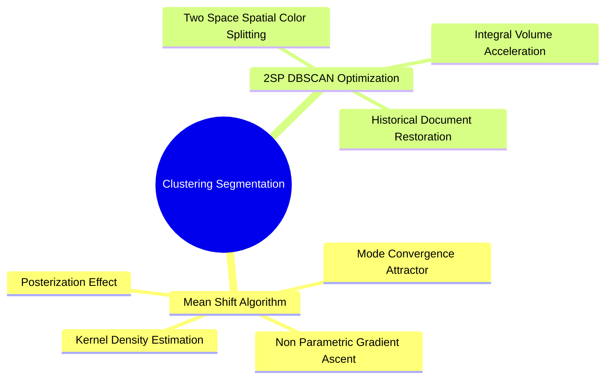

# Feature Space Clustering Segmentation: Mean-Shift and 2SP-DBSCAN

Clustering algorithms group pixels in a multi-dimensional feature space combining spatial coordinates and color values: $(x, y, R, G, B)$ or $(x, y, L^*, a^*, b^*)$.

### 1. Mean-Shift Filtering
Mean-Shift is a non-parametric iterative algorithm that shifts each point in feature space toward the local mode (the peak of a probability density function).

#### The Mean-Shift Vector
For a feature point $x$, the shift vector $m(x)$ is calculated as:

$$m(x) = \frac{\sum_{x_i \in S_h} x_i \cdot g\left( \big\|\frac{x - x_i}{h}\big\|^2 \right)}{\sum_{x_i \in S_h} g\left( \big\|\frac{x - x_i}{h}\big\|^2 \right)} - x$$

where $S_h$ is a multi-dimensional search window of bandwidth $h$, and $g(s) = -k'(s)$ is the derivative of the kernel profile.

#### Algorithmic Execution
1. Initialize a search window centered at pixel $x$.
2. Compute the mean feature vector of all points within the window.
3. Shift the center of the window to this new mean.
4. Repeat until the window converges ($m(x) \to 0$).
5. Assign the final convergence color to the original pixel.
*Result:* Groups pixels into flat regions of constant color with sharp boundaries, creating a posterized appearance.

### 2. 2SP-DBSCAN (UMBB Research)
Developed by the iVision research team at UMBB (Gaceb, Kezzoula), **Two-Space DBSCAN (2SP-DBSCAN)** improves document image restoration by accelerating standard density-based clustering.

* **Limitation of Standard DBSCAN:** Computing multi-dimensional distances between all pairs of pixels is computationally slow on high-resolution documents ($\mathcal{O}(N^2)$).
* **2SP-DBSCAN Formulation:**
  1. Decouples the clustering space into two separate domains: a 2D **spatial domain** $(x, y)$ and a 1D/3D **color/intensity domain**.
  2. Uses **integral volume tables** to count neighbor densities in $\mathcal{O}(1)$ constant time.
* **Application:** Restores historical manuscripts by removing ink bleed-through, stains, and paper aging artifacts while preserving thin character strokes.

Related concepts: [[23. Scikit-Learn Primitives - Clustering, Dimensionality, and Metrics]], [[06.7.3. Local Adaptive Thresholding (Niblack and Dynamic Range Sauvola)]], [[06.7.4. Complex Document Segmentation (Gaceb's Multi-Scale Mixed Binarization)]].
