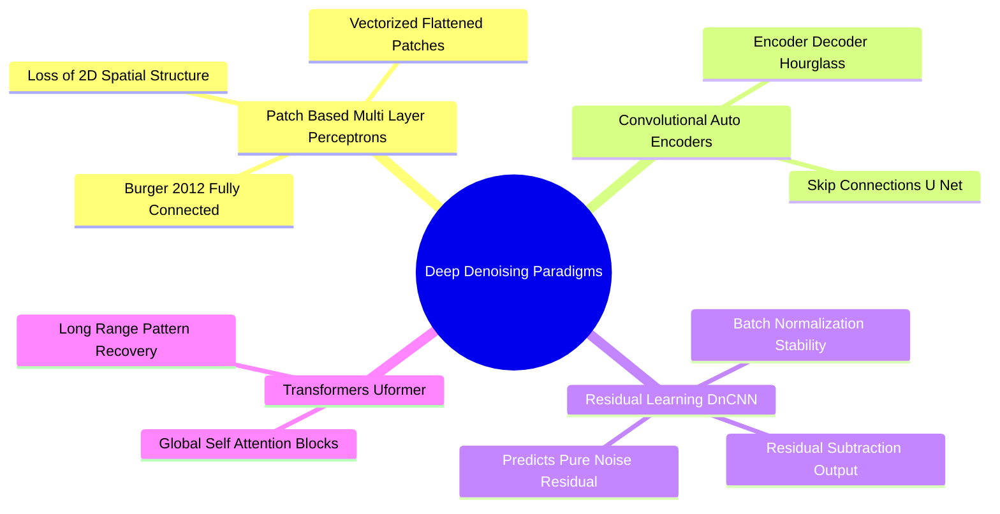
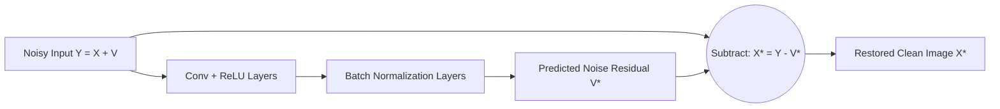

# Deep Learning Denoising Architectures: From Patch MLPs to Residual DnCNN and Uformer

Traditional filters rely on hand-crafted mathematical models. Deep learning approaches learn complex noise models directly from data pairs consisting of corrupted inputs and clean ground-truth targets.

### 1. Patch-Based Multi-Layer Perceptrons (MLPs)
Early deep learning approaches (Burger et al., 2012) used fully connected neural networks to restore image patches.
* Mechanism: Small image patches (e.g., $17 \times 17$ pixels) are flattened into 1D vectors and passed through several fully connected layers.
* Limitation: Flattening 2D patches discards spatial pixel relationships, and fully connected layers require large numbers of parameters, making them slow on full-resolution images.

### 2. Residual Learning Frameworks: DnCNN (Zhang et al., 2017)
The **Denoising Convolutional Neural Network (DnCNN)** introduced two key innovations: **residual learning** and **batch normalization**.

#### The Residual Formulation
Instead of training the network to predict the clean image $X$ directly from the noisy input $Y = X + V$, DnCNN trains the network $\mathcal{R}(Y)$ to predict the **corrupting noise residual** $V$:

$$\mathcal{L}(\Theta) = \frac{1}{2N} \sum_{i=1}^{N} \big\| \mathcal{R}(Y_i; \Theta) - (Y_i - X_i) \big\|_F^2$$

The restored image is obtained by subtracting the predicted noise from the input:

$$X^* = Y - \mathcal{R}(Y)$$

*Why Residual Learning Works:* The clean image contains complex semantic textures and edges that are difficult for a network to reconstruct from scratch. In contrast, the noise residual is simpler and more uniform, making it much easier for the network to learn.

### 3. Hierarchical Restoration Transformers: Uformer (Wang et al., 2021)
While Convolutional Neural Networks (CNNs) excel at learning local features, their small receptive fields make them less effective at capturing global image context.

**Uformer** addresses this by using a U-shaped hierarchical architecture built with **Transformer blocks** instead of standard convolutions. It uses **self-attention** to compute relationships between every pixel and all other pixels across the image, allowing it to reconstruct repetitive textures and patterns by referencing clean structures in distant parts of the image.

Related concepts: [[01. NumPy Foundations - Memory Layout, ndarray Anatomy, and Array Instantiation]], [[06.2.1. Physical Noise Models (PSF, Gaussian, Impulse Salt-and-Pepper, Speckle)]], [[06.8.3. Deep Super-Resolution Frameworks (SRCNN, Perceptual SRGAN, and ESRGAN)]].
