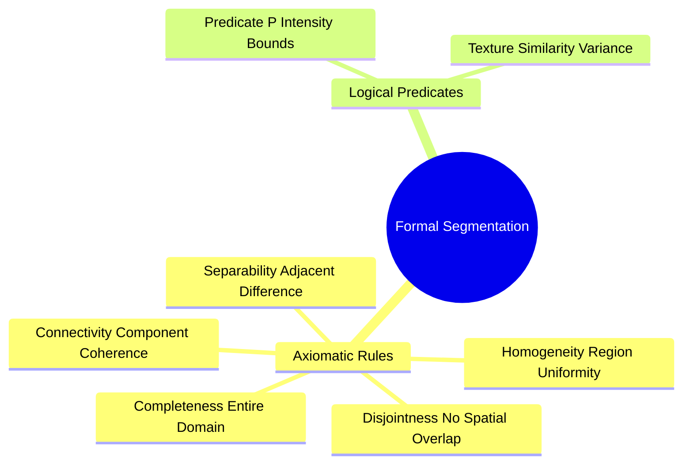

# Formal Segmentation Axioms and Homogeneity Predicates

Image segmentation partitions an image domain $I$ into $n$ distinct, homogeneous regions that correspond to physical objects or scene structures.

### 1. The Five Mathematical Axioms of Segmentation
A valid segmentation of an image domain $I$ into $n$ sub-regions $\{R_1, R_2, \dots, R_n\}$ must satisfy five formal conditions:

1. **Completeness:** The union of all partitioned regions must equal the entire image domain:
   $$\bigcup_{i=1}^{n} R_i = I$$
   *(Every pixel must belong to a region.)*

2. **Disjointness (Exclusivity):** The partitioned regions must not overlap:
   $$R_i \cap R_j = \varnothing \quad \forall \ i \neq j$$
   *(No pixel can belong to more than one region.)*

3. **Homogeneity:** All pixels within a region $R_i$ must satisfy a uniform property predicate $P(R_i)$ (e.g., matching intensity, color, or texture):
   $$P(R_i) = \text{True} \quad \forall \ i$$

4. **Separability:** Any two adjacent regions $R_i$ and $R_j$ must have different properties, meaning their union does not satisfy the homogeneity predicate:
   $$P(R_i \cup R_j) = \text{False} \quad \forall \text{ adjacent } R_i, R_j$$
   *(Adjacent regions cannot be merged without violating homogeneity.)*

5. **Connectivity:** Each partitioned region $R_i$ must form a connected component on the discrete pixel grid:
   $$R_i \text{ is a connected set of pixels}$$

Related concepts: [[06.1.8. Discrete Spatial Topology, Neighborhoods (N4, N8), and Metric Spaces]], [[06.7.2. Global Optimal Statistical Thresholding (Otsu's Method Derivation)]], [[06.7.6. Connected Component Analysis (Two-Pass CCL and Equivalence Trees)]].
