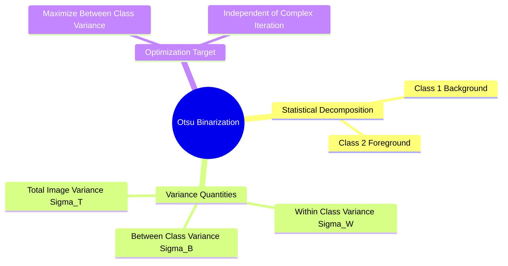

# Global Statistical Thresholding: Mathematical Derivation of Otsu's Method

Binarization maps a grayscale image $f(x, y)$ to a binary mask $g(x, y) \in \{0, 1\}$ using an intensity threshold $T$:

$$g(x, y) = \begin{cases} 1 & \text{if } f(x, y) \ge T \\ 0 & \text{if } f(x, y) < T \end{cases}$$

**Otsu's method** (1979) automatically calculates the optimal global threshold $T^*$ by maximizing the variance between two pixel classes: the background ($C_1$) and the foreground ($C_2$).

### Mathematical Derivation of Otsu's Method

Let an image contain $N$ total pixels with $L$ discrete gray levels $\{0, 1, \dots, L-1\}$. The normalized histogram gives the empirical probability distribution $p_i = \frac{n_i}{N}$.

Partition the pixels into two classes using a candidate threshold $t$:
* $C_1$: Pixels with intensities in the range $[0, t]$ (Background).
* $C_2$: Pixels with intensities in the range $[t+1, L-1]$ (Foreground).

#### Step 1: Class Probabilities (Weights)

$$\omega_1(t) = \sum_{i=0}^{t} p_i, \quad \omega_2(t) = \sum_{i=t+1}^{L-1} p_i = 1 - \omega_1(t)$$

#### Step 2: Class Means

$$\mu_1(t) = \frac{1}{\omega_1(t)} \sum_{i=0}^{t} i \cdot p_i, \quad \mu_2(t) = \frac{1}{\omega_2(t)} \sum_{i=t+1}^{L-1} i \cdot p_i$$

The global mean $\mu_T$ of the entire image is:

$$\mu_T = \sum_{i=0}^{L-1} i \cdot p_i = \omega_1(t)\mu_1(t) + \omega_2(t)\mu_2(t)$$

#### Step 3: Class Variances

$$\sigma_1^2(t) = \frac{1}{\omega_1(t)} \sum_{i=0}^{t} (i - \mu_1(t))^2 \cdot p_i, \quad \sigma_2^2(t) = \frac{1}{\omega_2(t)} \sum_{i=t+1}^{L-1} (i - \mu_2(t))^2 \cdot p_i$$

#### Step 4: Total Variance Decomposition
The total variance $\sigma_T^2$ decomposes into the sum of the **within-class variance** $\sigma_W^2(t)$ and the **between-class variance** $\sigma_B^2(t)$:

$$\sigma_T^2 = \sigma_W^2(t) + \sigma_B^2(t)$$

$$\sigma_W^2(t) = \omega_1(t)\sigma_1^2(t) + \omega_2(t)\sigma_2^2(t)$$

$$\sigma_B^2(t) = \omega_1(t)\big(\mu_1(t) - \mu_T\big)^2 + \omega_2(t)\big(\mu_2(t) - \mu_T\big)^2 = \omega_1(t)\omega_2(t)\big(\mu_1(t) - \mu_2(t)\big)^2$$

#### Step 5: Optimization
Because the total variance $\sigma_T^2$ is constant for a given image, **minimizing the within-class variance $\sigma_W^2(t)$ is mathematically equivalent to maximizing the between-class variance $\sigma_B^2(t)$**.

The optimal threshold $T^*$ is found by evaluating $\sigma_B^2(t)$ across all candidate gray levels $t \in [0, L-1]$:

$$T^* = \arg\max_{0 \le t < L-1} \Big( \sigma_B^2(t) \Big)$$

Related concepts: [[02. NumPy Array Manipulation - Slicing, Strides, Shapes, and Vectorized Indexing]], [[06.1.9. Tonal Histograms, Probability Densities, and Cumulative Distribution Functions]], [[06.10.2. Exercise 2 - Exhaustive Step-by-Step Optimization of Otsu's Inter-Class Variance]].
