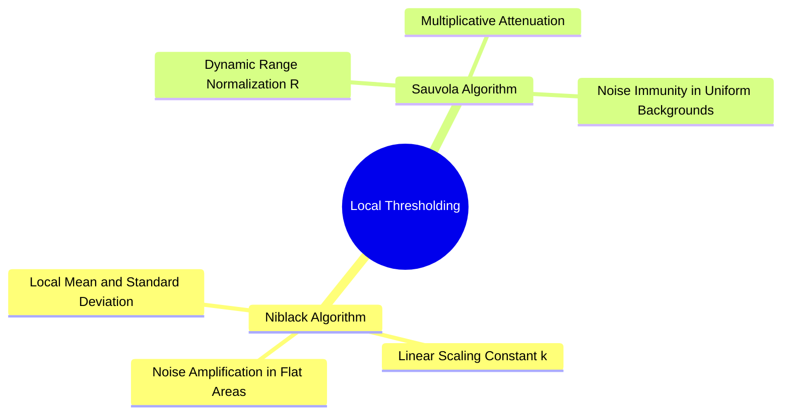

# Local Adaptive Thresholding: Niblack and Dynamic Range-Constrained Sauvola Algorithms

Global thresholding methods (such as Otsu's) fail when an image suffers from non-uniform lighting, shadows, or gradients across the scene. Local adaptive methods address this by computing a unique threshold for each pixel based on the statistics of its local neighborhood.

### 1. Niblack's Local Thresholding Method
Niblack's algorithm computes a threshold $T(x, y)$ within a sliding window of size $W \times W$ centered on each pixel $(x, y)$:

$$T(x, y) = m(x, y) + k \cdot s(x, y)$$

where:
* $m(x, y)$: The local mean intensity within the window.
* $s(x, y)$: The local standard deviation within the window:
  $$s(x, y) = \sqrt{\frac{1}{W^2} \sum_{i} \sum_{j} f(i, j)^2 - m(x, y)^2}$$
* $k$: A user-defined tuning parameter (typically set to $k = -0.1$ or $-0.2$ for dark text on a light background).

*Limitation:* In flat, homogeneous background regions, the standard deviation is very small ($s(x, y) \approx 0$). This causes the threshold to match the local mean ($T \approx m$), mistakenly classifying subtle background noise as foreground text.

### 2. Sauvola's Local Thresholding Method
Sauvola and Pietikäinen (2000) resolved Niblack's noise amplification problem by scaling the threshold using the dynamic range of the standard deviation:

$$T(x, y) = m(x, y) \cdot \left[ 1 + k \cdot \left( \frac{s(x, y)}{R} - 1 \right) \right]$$

where:
* $m(x, y)$ and $s(x, y)$ are the local mean and standard deviation.
* $R$: The dynamic range of the standard deviation ($R = 128$ for standard 8-bit images).
* $k$: A scaling parameter (typically $k \in [0.2, 0.5]$).

#### Why Sauvola Prevents Noise in Background Regions
* **Near High-Contrast Edges (e.g., Text Strokes):** The local standard deviation is high ($s(x, y) \approx R$). The term $\left(\frac{s(x, y)}{R} - 1\right)$ approaches $0$, keeping the threshold close to the local mean:
  $$T(x, y) \approx m(x, y)$$
  This produces crisp, accurate character boundaries.
* **In Flat Background Regions:** The standard deviation is near zero ($s(x, y) \to 0$). The term $\left(\frac{s(x, y)}{R} - 1\right)$ approaches $-1$, significantly lowering the threshold below the mean:
  $$T(x, y) \approx m(x, y) \cdot (1 - k)$$
  Because the threshold drops far below the background intensity, subtle noise fluctuations are not falsely detected as foreground.

Related concepts: [[02. NumPy Array Manipulation - Slicing, Strides, Shapes, and Vectorized Indexing]], [[06.7.2. Global Optimal Statistical Thresholding (Otsu's Method Derivation)]], [[06.7.4. Complex Document Segmentation (Gaceb's Multi-Scale Mixed Binarization)]].
