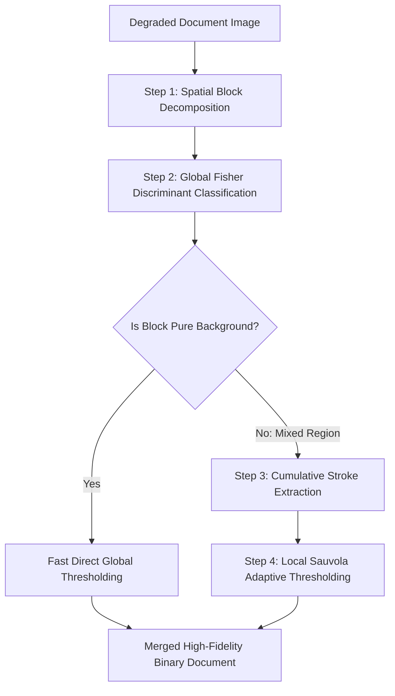

# Complex Document Segmentation: Gaceb's Multi-Scale Mixed Binarization

Developed by D. Gaceb (2006), this hybrid binarization framework combines the speed of global thresholding with the adaptability of local thresholding to restore degraded historical documents.

### Algorithmic Pipeline
1. **Spatial Block Decomposition:** The document is partitioned into rectangular blocks of varying sizes to isolate regions with different illumination levels.
2. **Global Background Analysis:** Fisher discriminant analysis classifies each block as either pure background or mixed content. Uniform background blocks are binarized immediately using global thresholding.
3. **Cumulative Stroke Extraction:** In mixed blocks containing degraded or faded text, a cumulative gradient operator identifies potential character strokes.
4. **Adaptive Local Thresholding:** Sauvola's local thresholding is applied *only* within the active text regions identified in Step 3. This preserves fine character details while keeping background regions clean.

Related concepts: [[06.6.1. Feature Space Clustering (Mean-Shift and 2SP-DBSCAN by UMBB iVision)]], [[06.7.2. Global Optimal Statistical Thresholding (Otsu's Method Derivation)]], [[06.7.3. Local Adaptive Thresholding (Niblack and Dynamic Range Sauvola)]].
