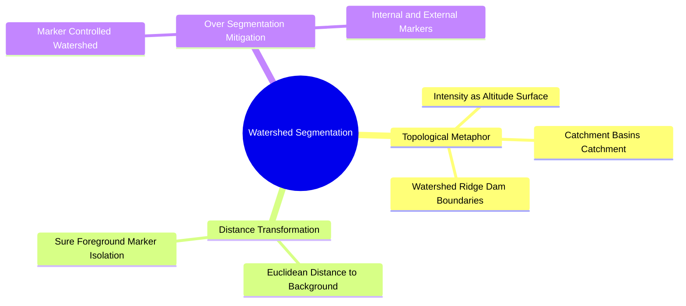
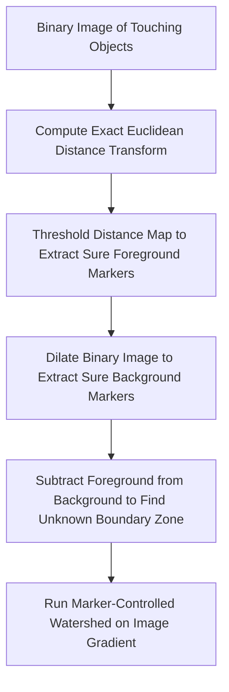

# Morphological Watershed Segmentation and Topological Distance Transforms

The **Watershed algorithm** treats a grayscale image as a 3D topographic relief surface, where pixel intensity corresponds to altitude.

### 1. The Topographic Flooding Concept
Imagine piercing holes at each local minimum in the topographic surface and immersing the surface in water:
* Water rises from the minima, filling the surrounding **catchment basins**.
* Where rising water from adjacent basins meets, imaginary dams (**watershed lines**) are built.
* When the water reaches the highest peak, the network of dams forms the final segmentation boundaries.

### 2. The Over-Segmentation Problem
Applying the watershed algorithm directly to raw image gradients often causes severe **over-segmentation**, dividing the image into thousands of tiny, meaningless fragments due to local noise fluctuations.

### 3. Marker-Controlled Watershed Pipeline
To prevent over-segmentation, **marker-controlled watershed** initializes flooding only from predefined marker regions:
1. **Compute the Distance Transform:** For each foreground pixel in a binary image, calculate its Euclidean distance to the nearest background pixel:
   $$D(p) = \min_{q \in \text{Background}} \|p - q\|$$
2. **Identify Sure Foreground Markers:** Threshold the distance transform to isolate the centers of objects (e.g., touching cells).
3. **Identify Sure Background Markers:** Perform morphological dilation on the binary image to identify pixels that are guaranteed to belong to the background.
4. **Define the Unknown Region:** Subtract the sure foreground from the sure background to identify the boundary zone where object edges lie.
5. **Flood from Markers:** Run the watershed algorithm on the image gradient using only the verified markers as flooding sources.

Related concepts: [[17. SciPy Signal and Spatial Operations - 2D Filtering and Morphology]], [[06.4.1. Set-Theoretic Foundations, Binary Grids, and Structuring Elements]], [[06.9.6. TP2 Part 3 - Mathematical Morphology, Cell Counting, and Skeletonization]].
