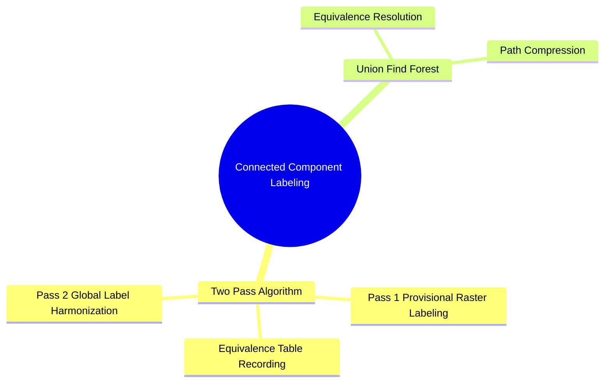

# Connected Component Analysis: Two-Pass Labeling and Equivalence Trees

Connected Component Labeling (CCL) scans a binary image and groups adjacent foreground pixels into uniquely labeled objects.

### The Classical Two-Pass CCL Algorithm (8-Connectivity)

#### Pass 1: Provisional Labeling
Scan the image row by row from top to bottom, and left to right. For each foreground pixel $P(x, y)$:
1. Examine its four already-scanned neighbors:
   $$\mathcal{N}_{\text{prior}}(P) = \{ (x-1, y-1), \ (x, y-1), \ (x+1, y-1), \ (x-1, y) \}$$
2. **Case A:** If all four neighbors are background pixels (unlabeled), assign a new unique integer label to $P$:
   $$\text{Label}(P) = \text{new\_label}()$$
3. **Case B:** If exactly one neighbor has a label, copy that label to $P$.
4. **Case C:** If multiple neighbors have different labels, assign the smallest label to $P$ and record the equivalence between the labels in a **Union-Find equivalence table**:
   $$\text{Label}(P) = \min(\text{neighbor labels})$$
   $$\text{Union}(\text{Label}_A, \text{Label}_B)$$

#### Pass 2: Resolving Equivalences
Scan the image a second time. For each pixel, replace its provisional label with the root label of its equivalence class from the Union-Find table. This merges connected regions that were initially assigned different labels.

Related concepts: [[02. NumPy Array Manipulation - Slicing, Strides, Shapes, and Vectorized Indexing]], [[06.1.8. Discrete Spatial Topology, Neighborhoods (N4, N8), and Metric Spaces]], [[06.7.7. Geometric Region Descriptors (AABB, OBB, Centroids, and Central Moments)]].
