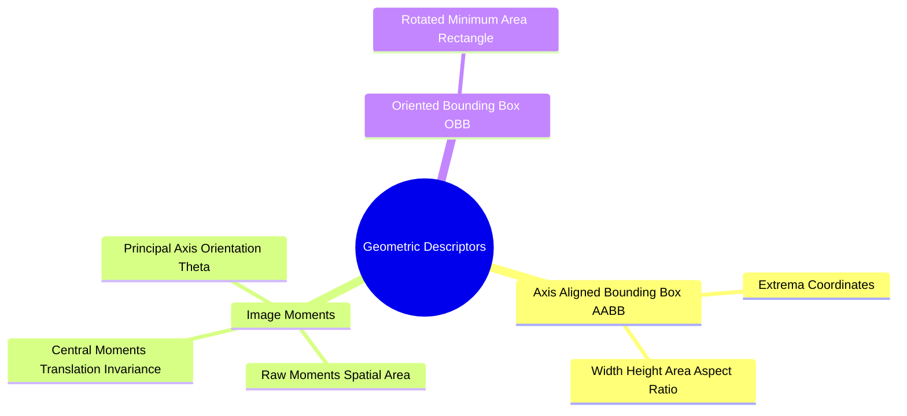

# Geometric Region Descriptors: Axis-Aligned Bounding Boxes, Central Moments, and OBB

Once connected components are labeled, geometric descriptors are extracted to quantify each object's size, shape, and orientation.



### 1. Axis-Aligned Bounding Box (AABB)
The smallest rectangle enclosing an object whose sides are parallel to the coordinate axes:

$$\mathbf{AABB}(C) = [x_{\text{min}}, \ y_{\text{min}}, \ x_{\text{max}}, \ y_{\text{max}}]$$

$$x_{\text{min}} = \min_{(x, y) \in C} x, \quad x_{\text{max}} = \max_{(x, y) \in C} x, \quad y_{\text{min}} = \min_{(x, y) \in C} y, \quad y_{\text{max}} = \max_{(x, y) \in C} y$$

* Descriptors:
  * Width: $W = x_{\text{max}} - x_{\text{min}} + 1$
  * Height: $H = y_{\text{max}} - y_{\text{min}} + 1$
  * Aspect Ratio: $AR = \frac{W}{H}$
  * Extent: $\frac{\text{Area}(C)}{W \cdot H}$

```text
Axis-Aligned Bounding Box (AABB):
  (x_min, y_min) ┌──────────────┐
                 │     ***      │
                 │   *******    │
                 │     ***      │
                 └──────────────┘ (x_max, y_max)
```

### 2. Statistical Image Moments and Centroids

#### Raw Spatial Moments
The $(p+q)$-th raw spatial moment of a discrete region is:

$$m_{pq} = \sum_{(x, y) \in C} x^p \cdot y^q$$

* $m_{00}$: The total pixel **area** of the object.
* The **centroid** (center of mass) $(\bar{x}, \bar{y})$ is:
  $$\bar{x} = \frac{m_{10}}{m_{00}}, \quad \bar{y} = \frac{m_{01}}{m_{00}}$$

#### Central Moments (Translation Invariant)
Central moments are calculated relative to the centroid:

$$\mu_{pq} = \sum_{(x, y) \in C} (x - \bar{x})^p \cdot (y - \bar{y})^q$$

### 3. Object Orientation ($\theta$) and the Oriented Bounding Box (OBB)
The orientation angle $\theta$ of an object's principal axis of inertia is computed from its second-order central moments:

$$\theta = \frac{1}{2} \arctan\left( \frac{2\mu_{11}}{\mu_{20} - \mu_{02}} \right)$$

An **Oriented Bounding Box (OBB)** aligns with this principal angle $\theta$, providing a tighter bounding box for elongated or rotated objects than an axis-aligned box.

Related concepts: [[16. Image Spatial Transformations - Interpolation, Scaling, Cropping, and Affine Warping]], [[06.7.6. Connected Component Analysis (Two-Pass CCL and Equivalence Trees)]], [[06.7.8. Segmentation Evaluation Benchmarks (Dice DSC, Jaccard IoU, Hausdorff Distance)]].
