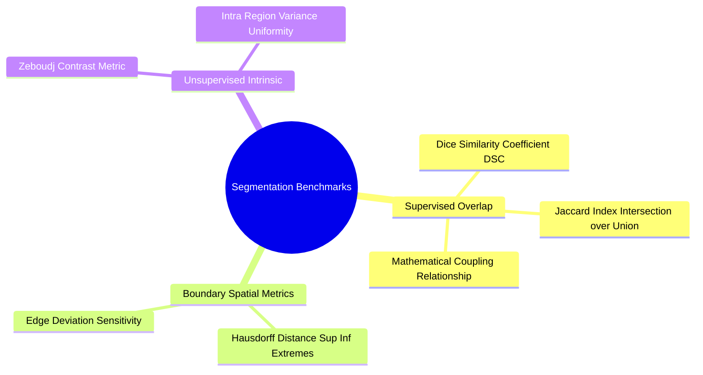

# Segmentation Evaluation Benchmarks: Dice DSC, Jaccard IoU, Hausdorff, and Zeboudj Contrast

To validate a segmentation algorithm, its output is evaluated quantitatively using **supervised metrics** (compared against a ground-truth reference) or **unsupervised metrics** (measuring intrinsic properties like region homogeneity).

### 1. Supervised Overlap Metrics
Let $A$ represent the segmented region produced by the algorithm, and let $B$ represent the ground-truth region.

#### Dice Similarity Coefficient (DSC)
Measures the relative overlap between the two regions:

$$\text{Dice}(A, B) = \frac{2 |A \cap B|}{|A| + |B|}$$

* Ranges from $0$ (no overlap) to $1$ (perfect match).

#### Jaccard Index (Intersection over Union, IoU)
The ratio of the intersection area to the union area:

$$\text{Jaccard}(A, B) = \frac{|A \cap B|}{|A \cup B|} = \frac{|A \cap B|}{|A| + |B| - |A \cap B|}$$

#### Relationship between Dice and Jaccard

$$\text{Dice} = \frac{2 \cdot \text{Jaccard}}{1 + \text{Jaccard}}, \quad \text{Jaccard} = \frac{\text{Dice}}{2 - \text{Dice}}$$

### 2. Boundary Distance: The Hausdorff Distance ($d_H$)
Overlap metrics do not measure how closely segmented boundaries match ground-truth contours. The **Hausdorff distance** measures the maximum distance between the boundaries of regions $A$ and $B$:

$$d_H(A, B) = \max\left( \sup_{a \in \partial A} \inf_{b \in \partial B} \|a - b\|, \ \sup_{b \in \partial B} \inf_{a \in \partial A} \|a - b\| \right)$$

* Sensitive to outliers and localized boundary errors.

### 3. Unsupervised Evaluation Metrics
When ground-truth references are unavailable, unsupervised metrics evaluate segmentation quality by measuring intrinsic region properties:
* **Intra-Region Variance:** Measures the sum of intensity variances within each segmented region, weighted by region area:
  $$U(R) = \sum_{i=1}^{n} \frac{|R_i|}{|I|} \sigma^2(R_i)$$
  Lower values indicate more homogeneous, well-defined segments.
* **Zeboudj Contrast Metric:** Measures the contrast between adjacent regions relative to their internal homogeneity. Higher scores indicate well-separated regions with distinct boundaries.

Related concepts: [[23. Scikit-Learn Primitives - Clustering, Dimensionality, and Metrics]], [[06.7.1. Formal Segmentation Axioms and Homogeneity Predicates]], [[06.7.2. Global Optimal Statistical Thresholding (Otsu's Method Derivation)]].
