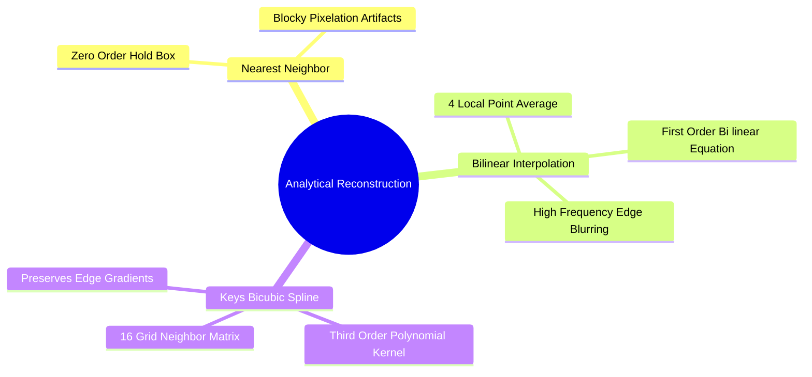

# Continuous Image Reconstruction: Nearest-Neighbor, Bilinear, and Keys' Bicubic Spline

Super-resolution reconstructs a continuous image surface $\hat{f}(x, y)$ from a discrete grid of pixel samples.

### 1. Nearest-Neighbor Interpolation (Zero-Order Hold)
Assigns each target point the intensity of the nearest known pixel:

$$\hat{f}(x, y) = f\big(\text{round}(x), \ \text{round}(y)\big)$$

* Highly computationally efficient, but produces severe blockiness and jagged edges (aliasing).

### 2. Bilinear Interpolation
Performs linear interpolation along both axes using the four nearest neighboring pixels: $Q_{11}(x_1, y_1)$, $Q_{21}(x_2, y_1)$, $Q_{12}(x_1, y_2)$, and $Q_{22}(x_2, y_2)$.

$$\begin{aligned}
\hat{f}(x, y) = \frac{1}{(x_2 - x_1)(y_2 - y_1)} \Big[
& f(Q_{11})(x_2 - x)(y_2 - y) + f(Q_{21})(x - x_1)(y_2 - y) \\
+ & f(Q_{12})(x_2 - x)(y - y_1) + f(Q_{22})(x - x_1)(y - y_1)
\Big]
\end{aligned}$$

* Produces smoother results than nearest-neighbor, but blurs high-frequency details and sharp edges.

### 3. Bicubic Interpolation (Keys' Spline Formulation)
Computes the target value using a weighted average of the **16 nearest neighbors** on a $4 \times 4$ grid:

$$\hat{f}(x, y) = \sum_{i=-1}^{2} \sum_{j=-1}^{2} f(x_i, y_j) \cdot W(x - x_i) \cdot W(y - y_j)$$

The weight function $W(d)$ is defined by **Keys' cubic convolution kernel**:

$$W(d) = \begin{cases}
(a + 2)|d|^3 - (a + 3)|d|^2 + 1 & \text{for } 0 \le |d| \le 1 \\
a|d|^3 - 5a|d|^2 + 8a|d| - 4a & \text{for } 1 < |d| \le 2 \\
0 & \text{for } |d| > 2
\end{cases}$$

where $a = -0.5$ matches the Taylor expansion of the continuous function.
* Preserves sharp edges and fine details much better than bilinear interpolation.

Related concepts: [[16. Image Spatial Transformations - Interpolation, Scaling, Cropping, and Affine Warping]], [[06.8.2. Edge-Adaptive Interpolation (Contour Stencils and Total Variation Minimization)]], [[06.10.3. Exercise 3 - Analytical Sub-Pixel Reconstruction via Bilinear Interpolation]].
