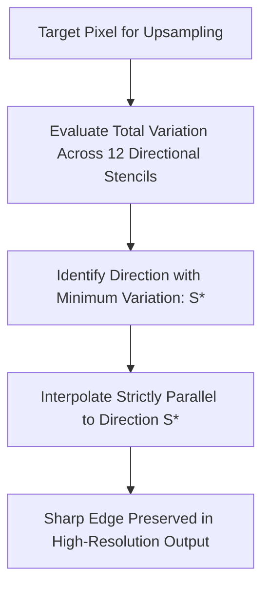

# Directional Reconstruction: Contour Stencils and Total Variation Minimization

Standard interpolation methods (bilinear, bicubic) interpolate isotropically, which blurs edges by averaging pixels across boundaries. **Contour Stencils** (Getreuer, 2009) estimates local edge orientations before interpolating to keep edges sharp.

### Algorithmic Execution Steps
1. **Total Variation (TV) Estimation:** For a set of candidate directional stencils $S$, calculate the local Total Variation over neighboring pixels:
   $$\text{TV}(S) = \frac{1}{|S|} \sum_{e \in \text{edges}(S)} w_e \cdot |v_{\alpha_e} - v_{\beta_e}|$$
2. **Direction Selection:** Evaluate TV across 12 distinct stencil angles. Select the optimal orientation $S^*$ with the **minimum total variation**:
   $$S^* = \arg\min_{S \in \Sigma} \Big( \text{TV}(S) \Big)$$
3. **Directional Interpolation:** Interpolate missing pixels along the path of $S^*$. By interpolating parallel to the edge rather than across it, boundaries remain sharp and free of blur.

Related concepts: [[06.2.6. Structural Edge-Preserving Smoothing (Nagao 9-Sector Multi-Directional Filter)]], [[06.8.1. Continuous Image Reconstruction (Nearest, Bilinear, and Keys' Bicubic Spline)]], [[06.10.3. Exercise 3 - Analytical Sub-Pixel Reconstruction via Bilinear Interpolation]].
