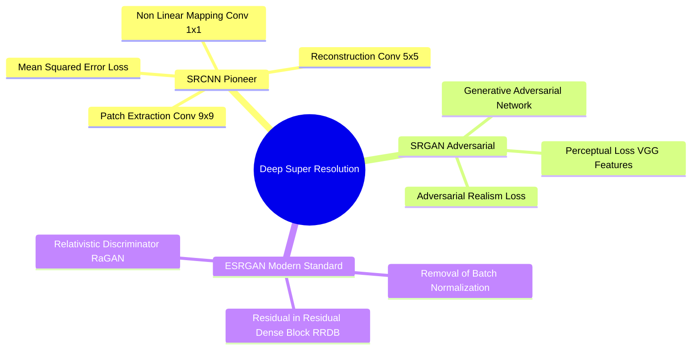
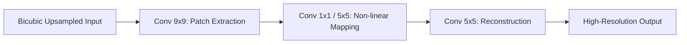

# Deep Super-Resolution Frameworks: SRCNN, Perceptual SRGAN, and ESRGAN RRDB Networks

Deep learning super-resolution frameworks learn to predict high-frequency details from low-resolution observations using deep convolutional and adversarial networks.

### 1. SRCNN (Dong et al., 2014)
The first deep learning super-resolution model. Uses a three-layer convolutional neural network to learn the mapping from low-resolution to high-resolution patches:

* Limitation: Trained using pixel-wise Mean Squared Error (MSE) loss, which averages possible high-frequency patterns and produces overly smooth textures.

### 2. SRGAN (Ledig et al., 2017)
Introduced Generative Adversarial Networks (GANs) and **Perceptual Loss** to generate realistic high-frequency textures:

$$\mathcal{L}_{\text{perceptual}} = \mathcal{L}_{\text{VGG/content}} + 10^{-3} \cdot \mathcal{L}_{\text{adversarial}}$$

* **VGG Content Loss:** Computes the Euclidean distance between feature representations extracted from a pre-trained VGG network, preserving perceptual textures rather than raw pixel values.
* **Adversarial Loss:** Pushes the generator to produce high-frequency details that fool a discriminator network.

### 3. ESRGAN (Wang et al., 2018)
Improves upon SRGAN through three architectural enhancements:
1. **Residual-in-Residual Dense Block (RRDB):** Replaces basic residual blocks with multi-level residual connections, increasing model capacity and training stability.
2. **Removes Batch Normalization:** Eliminates Batch Normalization layers to remove visual artifacts and reduce computational overhead.
3. **Relativistic Average Discriminator (RaGAN):** Estimates the probability that the real image is relatively more realistic than the generated image, producing sharper edges and natural textures.

Related concepts: [[06.6.2. Deep Learning Denoising (Patch MLPs, Residual DnCNN, and Uformer)]], [[06.8.4. Document Image Super-Resolution (Bi-ESRGAN Dual Path Architecture)]].
