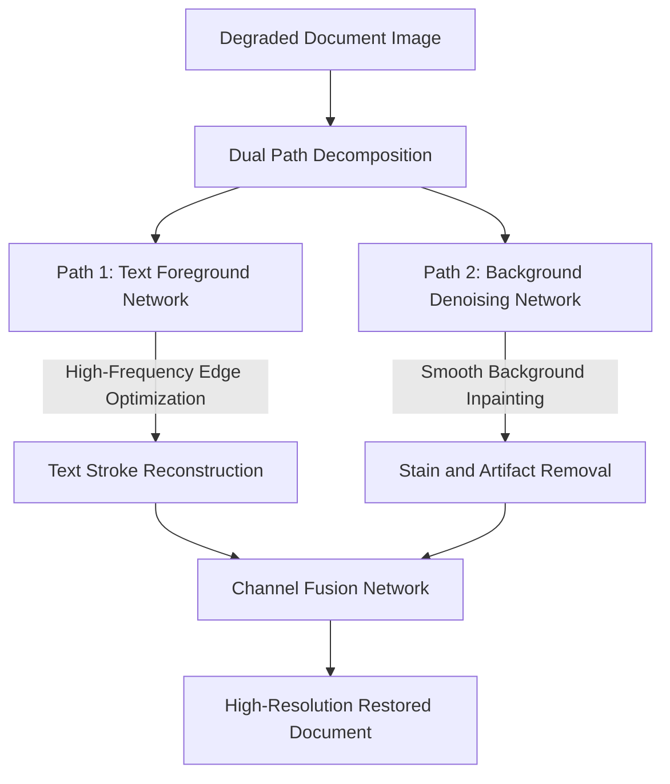

# Document Image Enhancement: Bi-ESRGAN Dual Path Architecture

Developed by Z. Kezzoula and D. Gaceb (UMBB, 2023), **Bi-ESRGAN** is a specialized dual-path deep learning architecture designed for document restoration and super-resolution.

### Architectural Pipeline
* **Text Foreground Path:** Focuses on extracting and sharpening text strokes, preserving the legibility and connectivity of fine characters.
* **Background Path:** Focuses on removing stains, ink bleed-through, paper grain, and non-uniform illumination.
* **Feature Fusion:** Merges the outputs of both paths to produce a clean, high-resolution document image with sharp text and a uniform background.

Related concepts: [[06.6.1. Feature Space Clustering (Mean-Shift and 2SP-DBSCAN by UMBB iVision)]], [[06.7.4. Complex Document Segmentation (Gaceb's Multi-Scale Mixed Binarization)]], [[06.8.3. Deep Super-Resolution Frameworks (SRCNN, Perceptual SRGAN, and ESRGAN)]].
