# Handwritten Computer Vision Exam Compendium: Syntax, Algorithms, Mathematics, and Active Recall

---

## 1. Core Architectural Invariants: The Five Mental Safety Nets

When writing computer vision code by hand, you do not have an interpreter to flag a `TypeError` or a compiler to catch mismatched dimensions. You must operate with deterministic mental checks. Before writing any line of code, run it through these five universal architectural invariants.

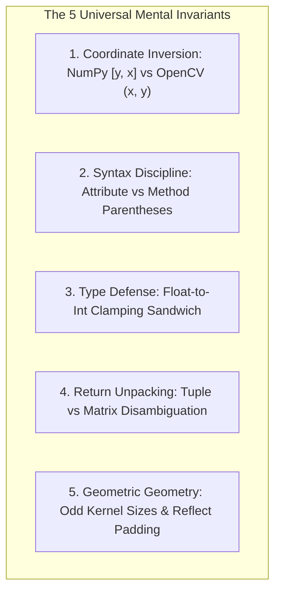

---

### 1.1. Invariant 1: The Coordinate Inversion Rule
This is the single most common source of deductions on written image processing exams. The divergence stems from linear algebra matrix conventions versus computer graphics screen-space Cartesian coordinate conventions.

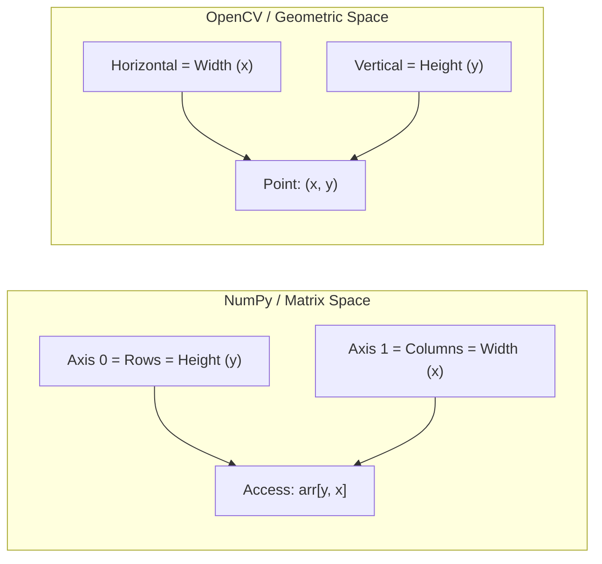

* **NumPy indexing and array slicing:** Always indexed by `[row, column]`, which corresponds to `[y, x]`.
  ```python
  # Accessing a pixel at vertical coordinate y, horizontal coordinate x:
  pixel_value = image[y, x]

  # Slicing a region of interest (ROI):
  roi = image[y_start:y_end, x_start:x_end]

  # Extracting dimensions from shape:
  h, w = image.shape[:2]  # h is vertical (rows), w is horizontal (cols)
  ```
* **OpenCV functions (Drawing, Geometry, Geometric Transformations):** Always expect coordinates as `(width, height)` or `(col, row)`, which corresponds to Cartesian `(x, y)`.
  ```python
  # Resizing an image to width w, height h:
  resized = cv2.resize(image, (w, h))  # dsize is (width, height) -> (cols, rows)

  # Drawing a bounding box:
  cv2.rectangle(
      image, (x_min, y_min), (x_max, y_max), color=(255, 0, 0), thickness=2
  )

  # Placing text: origin is bottom-left corner in (x, y)
  cv2.putText(
      image,
      "Target",
      (x, y),
      cv2.FONT_HERSHEY_SIMPLEX,
      0.5,
      (0, 255, 0),
      thickness=1,
  )
  ```
* **Summary Mnemonic:** *NumPy accesses Matrices `[Row, Col]` $\implies$ `[y, x]`. OpenCV renders to Screen `(X, Y)` $\implies$ `(Width, Height)`.*

---

### 1.2. Invariant 2: Attribute vs. Method (The Parentheses Trap)
Handwritten code often loses points on syntax errors involving parentheses. A property describing an intrinsic state of an array is an **attribute** (no parentheses). An operation that performs active computation or memory reallocation is a **method** or **function** (requires parentheses).

| Target | Classification | Correct Handwritten Syntax | Common Fatal Mistake |
| :--- | :--- | :--- | :--- |
| Array dimensions | Attribute | `img.shape` | `img.shape()` |
| Data type | Attribute | `img.dtype` | `img.dtype()` |
| Number of axes | Attribute | `img.ndim` | `img.ndim()` |
| Total elements | Attribute | `img.size` | `img.size()` |
| Deep copy | Method | `img.copy()` | `img.copy` |
| Type cast | Method | `img.astype(np.float64)` | `img.astype[np.float64]` |
| Flattening array | Method | `img.ravel()` or `img.flatten()` | `img.ravel` |

---

### 1.3. Invariant 3: The Float-to-Int Defensive Sandwich
Images are natively stored as `np.uint8` (unsigned 8-bit integers, valid range $[0, 255]$). Performing any mathematical operation (summation, subtraction, convolution, noise addition) directly on `uint8` triggers **modulo arithmetic overflow and underflow**:
$$250_{\text{uint8}} + 20_{\text{uint8}} = 14 \quad (270 \pmod{256})$$
$$10_{\text{uint8}} - 30_{\text{uint8}} = 236 \quad (-20 \pmod{256})$$

To prevent catastrophic corruption in written implementations, every mathematical operation must follow the three-stage defensive pattern:

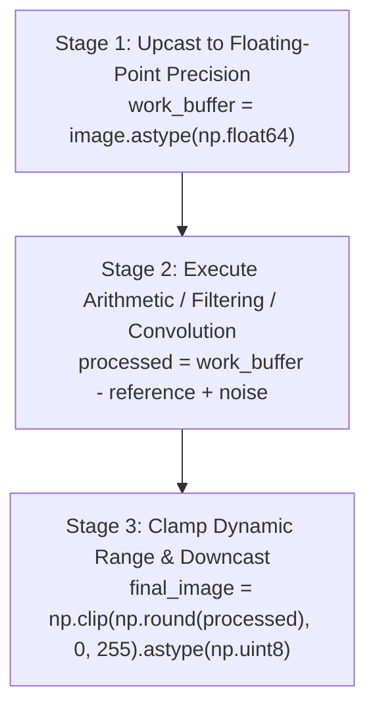

```python
# The standard handwritten defensive template:
work_img = image.astype(np.float64)  # 1. Safe float representation
processed = work_img - 50.0  # 2. Mathematical processing
final_img = np.clip(np.round(processed), 0, 255).astype(
    np.uint8
)  # 3. Guard, clamp, cast
```

---

### 1.4. Invariant 4: The Tuple Return Trap
Several core OpenCV functions return compound tuples rather than bare matrices. Assigning the result of these functions to a single variable results in storing a tuple or scalar, causing subsequent image-processing operations to fail.

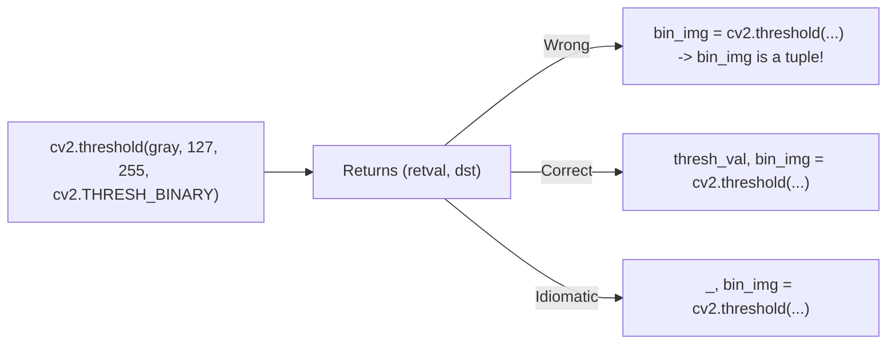

* **`cv2.threshold`:** Returns `(retval, thresholded_image)`. You must unpack or discard the first parameter:
  ```python
  _, binary_mask = cv2.threshold(gray_img, 127, 255, cv2.THRESH_BINARY)
  ```
* **Shape unpacking:** `img.shape` returns `(H, W)` for single-channel grayscale, and `(H, W, C)` for 3-channel color. Always slice defensively:
  ```python
  h, w = img.shape[:2]  # Works uniformly across grayscale and color matrices
  ```

---

### 1.5. Invariant 5: Odd Filter Dimensions, Integer Radii, and Reflective Padding
Spatial filtering operations require an unambiguous, symmetric neighborhood centered directly over an anchor pixel $(x, y)$.
* **Odd Kernel Dimensions:** A kernel dimension $K$ must always be an odd integer ($K = 2k + 1$, where $k \in \mathbb{N}$).
* **Integer Radius Calculation:** The radius $k$ represents the spatial reach on either side of the center. In Python, calculating this reach must use integer floor division (`//`):
  $$k = \lfloor K / 2 \rfloor \implies \texttt{rad = ksize // 2}$$
  *Using single division `/` yields a float (`3 / 2 = 1.5`), causing array slicing operations like `image[y - rad : y + rad + 1]` to crash with a `TypeError`.*
* **Border Extension:** Convolution and neighborhood extraction at image boundaries require padding. Never pad with zeros (`mode='constant'`) unless explicitly instructed; zero-padding causes artificial edge-gradient drops (dark halos). Use reflective padding:
  ```python
  padded = np.pad(image, rad, mode='reflect')
  ```

---

## 2. OpenCV Syntactic Logic and Naming Architecture

OpenCV's Python API (`cv2`) wraps a C++ codebase developed over decades. Because of this history, function names follow specific patterns based on when they were introduced and what kind of operation they perform. Understanding these conventions eliminates the need to memorize arbitrary function names.

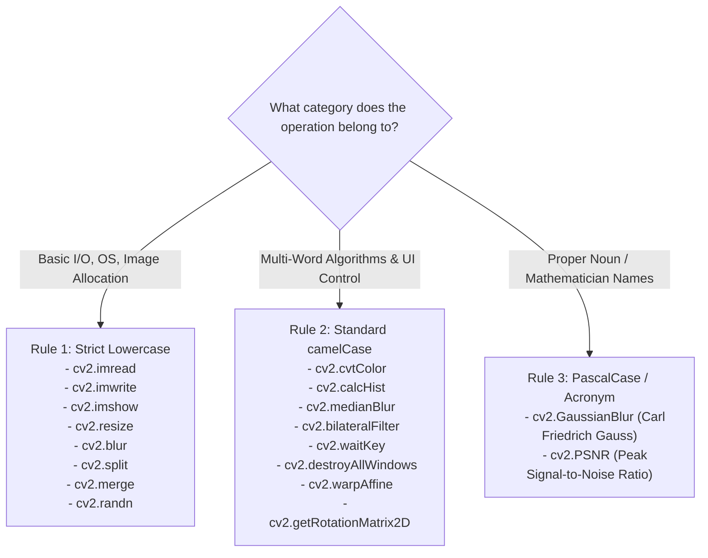

---

### 2.1. The Zero-Underscore Rule
In OpenCV function names, **there are never underscores**.
* ❌ `cv2.im_read()` $\implies$  **`cv2.imread()`**
* ❌ `cv2.cvt_color()` $\implies$  **`cv2.cvtColor()`**
* ❌ `cv2.calc_hist()` $\implies$  **`cv2.calcHist()`**
* ❌ `cv2.gaussian_blur()` $\implies$  **`cv2.GaussianBlur()`**
* ❌ `cv2.destroy_all_windows()` $\implies$  **`cv2.destroyAllWindows()`**

*Note on Constants:* The **only** place underscores appear in OpenCV is inside **ALL-CAPS enumerated constants**, where they separate category prefixes from flags:
* `cv2.COLOR_BGR2GRAY`, `cv2.COLOR_BGR2RGB`
* `cv2.THRESH_BINARY`, `cv2.THRESH_OTSU`
* `cv2.INTER_LINEAR`, `cv2.INTER_NEAREST`
* `cv2.FONT_HERSHEY_SIMPLEX`

---

### 2.2. Standard Casing Buckets
1. **Bucket 1: Pure Lowercase.** Reserved for fundamental file I/O, display routines, structural array reshaping, and single-word classic filters:
   * `cv2.imread`, `cv2.imwrite`, `cv2.imshow`, `cv2.resize`, `cv2.blur`, `cv2.split`, `cv2.merge`, `cv2.randn`.
2. **Bucket 2: Standard `camelCase`.** Applies to compound phrases, verb-noun combinations, and multi-word algorithmic methods:
   * `cv2.cvtColor`, `cv2.calcHist`, `cv2.medianBlur`, `cv2.bilateralFilter`, `cv2.waitKey`, `cv2.destroyAllWindows`.
3. **Bucket 3: `PascalCase` and All-Caps Acronyms.** Applied when the function name incorporates a proper noun (e.g., a mathematician) or is an industry-standard acronym:
   * `cv2.GaussianBlur` (Carl Friedrich **G**auss must be capitalized).
   * `cv2.PSNR` (Standard acronym for Peak Signal-to-Noise Ratio).

---

### 2.3. The Contraction Rule
OpenCV uses specific, standardized contractions for common operations:
* The verb **"Convert"** is always shortened to **`cvt`** $\implies$ `cv2.cvtColor` (never `convertColor`).
* The verb **"Calculate"** is always shortened to **`calc`** $\implies$ `cv2.calcHist` (never `calculateHist`).
* The noun **"Histogram"** is always shortened to **`Hist`** $\implies$ `cv2.calcHist`.
* Words like `resize`, `threshold`, `rectangle`, and `destroyAllWindows` are never abbreviated.

---

### 2.4. Positional Argument Discipline and Integer Flag Lifehacks
When writing code on an exam, avoid using explicit parameter names (`src=...`, `ksize=...`, `dsize=...`). If you misremember a parameter name, the examiner may deduct points. Instead, supply arguments **positionally in their natural mathematical order**:
* `cv2.blur(img, (3, 3))` is safer than `cv2.blur(src=img, ksize=(3, 3))`.
* `cv2.threshold(img, 120, 255, cv2.THRESH_BINARY)` is safer than trying to recall `thresh=` or `maxval=`.

#### Numeric Flags for `cv2.imread`
To avoid misspelling the constant `cv2.IMREAD_GRAYSCALE` or `cv2.IMREAD_COLOR`, use their standard integer equivalents:
* `cv2.imread('image.bmp', 0)` $\equiv$ `cv2.imread('image.bmp', cv2.IMREAD_GRAYSCALE)`
* `cv2.imread('image.bmp', 1)` $\equiv$ `cv2.imread('image.bmp', cv2.IMREAD_COLOR)`

---

## 3. Comprehensive Library API Reference Bible

### 3.1. NumPy Precision Reference

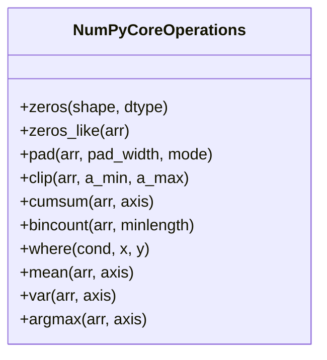

#### Array Instantiation & Memory Allocation
* **`np.zeros(shape, dtype=float)`**
  * *Arguments:* `shape` (integer tuple, e.g., `(h, w)` or `(h, w, 3)`), `dtype` (e.g., `np.uint8`, `np.float64`).
  * *Example:* `canvas = np.zeros((h, w), dtype=np.uint8)`
* **`np.zeros_like(a, dtype=None)`**
  * *Arguments:* `a` (prototype array). Allocates an array matching the exact shape and data type of `a`.
  * *Example:* `output = np.zeros_like(image)`
* **`np.pad(array, pad_width, mode='reflect')`**
  * *Arguments:* `array`, `pad_width` (integer or tuple of tuples), `mode` (e.g., `'reflect'`, `'constant'`, `'edge'`).
  * *Example:* `padded = np.pad(img, rad, mode='reflect')`

#### Element-Wise Logic & Value Bounding
* **`np.clip(a, a_min, a_max)`**
  * *Arguments:* `a` (input array), `a_min` (lower limit), `a_max` (upper limit).
  * *Example:* `clean = np.clip(work_buffer, 0, 255).astype(np.uint8)`
* **`np.where(condition, [x, y])`**
  * *Arguments:* `condition` (Boolean array). If provided with `x` and `y`, yields a merged array where values are drawn from `x` if `True`, and `y` if `False`. If called with only `condition`, returns coordinate indices where the condition holds.
  * *Example:* `bin_img = np.where(gray > 128, np.uint8(255), np.uint8(0))`
  * *Coordinate extraction:* `y_coords, x_coords = np.where(binary_mask > 0)`

#### Aggregations and Statistical Operations
* **`np.mean(a, axis=None)` / `np.var(a, axis=None)`**
  * *Arguments:* `a` (array), `axis` (optional integer or tuple). Computes the mean or variance along the specified axis. If `axis=None`, aggregates over the entire array.
* **`np.cumsum(a, axis=None)`**
  * *Arguments:* Computes the cumulative sum along the specified axis. Essential for constructing Integral Images.
  * *Example:* `integral_y = np.cumsum(img, axis=0)`
* **`np.bincount(x, minlength=0)`**
  * *Arguments:* `x` (1D array of non-negative integers). Counts the frequency of each integer value.
  * *Example:* `hist = np.bincount(gray_img.ravel(), minlength=256)`

---

### 3.2. OpenCV (`cv2`) Master Reference

#### File I/O and Window Management
```python
# Read an image (0 = Grayscale, 1 = BGR Color)
img = cv2.imread('cameraman.bmp', 0)

# Write an image to disk
cv2.imwrite('output.png', img)

# Standard desktop UI display cycle:
cv2.imshow('Display Window', img)
cv2.waitKey(0)  # Blocks execution until any key is pressed; 0 = indefinite
cv2.destroyAllWindows()  # Releases GUI window handles
```

#### Color Spaces & Channel Slicing
```python
# Convert Color Spaces
gray = cv2.cvtColor(img_bgr, cv2.COLOR_BGR2GRAY)
rgb = cv2.cvtColor(img_bgr, cv2.COLOR_BGR2RGB)

# Splitting and Merging Channels (Order is strictly Blue, Green, Red)
b, g, r = cv2.split(img_bgr)
merged_bgr = cv2.merge([b, g, r])  # Expects a list or tuple of matrices
```

#### Geometry and Transformations
```python
# Resize: dsize MUST be Cartesian (width, height) -> (cols, rows)
h, w = img.shape[:2]
resized = cv2.resize(img, (w // 2, h // 2), interpolation=cv2.INTER_LINEAR)

# Affine 2D Rotation around center point:
center = (w / 2.0, h / 2.0)  # (x_center, y_center)
rot_mat = cv2.getRotationMatrix2D(center, angle=45.0, scale=1.0)
rotated = cv2.warpAffine(img, rot_mat, (w, h))  # Target size is (width, height)
```

#### Drawing Primitives
```python
# Drawing a rectangle: pt1=(x1, y1), pt2=(x2, y2), color=(B, G, R), thickness
cv2.rectangle(img, (50, 100), (200, 250), (255, 0, 0), thickness=2)

# Drawing text: org=(x, y) specifies bottom-left corner of the text string
cv2.putText(
    img,
    "Tracked",
    (50, 90),
    cv2.FONT_HERSHEY_SIMPLEX,
    fontScale=0.7,
    color=(0, 255, 0),
    thickness=2,
)
```

#### Spatial Filters and Blurring

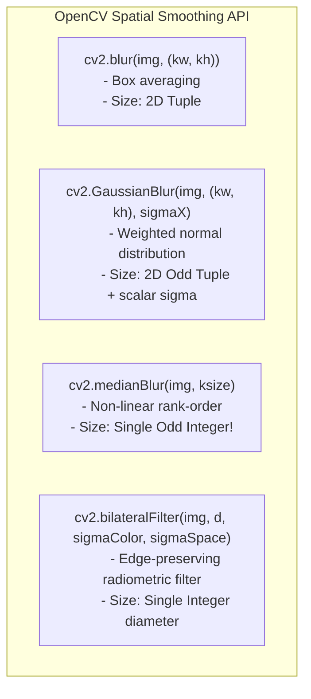

* **`cv2.blur(src, ksize)`**
  * *Arguments:* `src` (matrix), `ksize` (tuple `(width, height)`). Computes a box filter (normalized mean).
  * *Example:* `blurred = cv2.blur(img, (3, 3))`
* **`cv2.GaussianBlur(src, ksize, sigmaX, sigmaY=0)`**
  * *Arguments:* `src`, `ksize` (tuple of odd integers `(kw, kh)`), `sigmaX` (Gaussian kernel standard deviation along horizontal axis). If `sigmaY=0`, it matches `sigmaX`.
  * *Example:* `blurred = cv2.GaussianBlur(img, (5, 5), 1.5)`
* **`cv2.medianBlur(src, ksize)`**
  * *Arguments:* `src`, `ksize` (**single odd integer**, NOT a tuple).
  * *Example:* `cleaned = cv2.medianBlur(img, 3)`
* **`cv2.bilateralFilter(src, d, sigmaColor, sigmaSpace)`**
  * *Arguments:* `src`, `d` (diameter of each pixel neighborhood; set to negative to compute from `sigmaSpace`), `sigmaColor` (filter sigma in color/intensity space), `sigmaSpace` (filter sigma in coordinate space).
  * *Example:* `filtered = cv2.bilateralFilter(img, 7, 40.0, 40.0)`

#### Intensity Histograms
```python
# The Mnemonic: I-C-M-B-R (Images, Channels, Mask, Bins, Ranges)
# Everything is enclosed in square brackets EXCEPT the mask!
hist = cv2.calcHist([img], [0], None, [256], [0, 256])
#                    ^      ^    ^      ^         ^
#                 Images   Chan Mask  nBins     Range
```

#### Random Noise Injection
```python
# In-place Gaussian Noise generation
noise = np.zeros(img.shape, dtype=np.float32)
cv2.randn(noise, mean=0.0, stddev=15.0)  # stddev = sqrt(variance)
noisy = np.clip(img.astype(np.float32) + noise, 0, 255).astype(np.uint8)
```

---

### 3.3. Matplotlib State-Based Visualization Reference
For exams, avoid using the object-oriented figure/axes API (`fig, ax = plt.subplots(...)`) to reduce boilerplate. Stick to the **state-based procedural API (`plt.`)**.

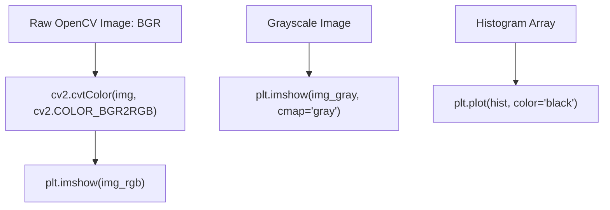

#### Template 1: Rendering Grayscale and Color Images
```python
import cv2
import matplotlib.pyplot as plt

# Color rendering (Matplotlib requires RGB; OpenCV provides BGR)
img_bgr = cv2.imread('lake.bmp', 1)
img_rgb = cv2.cvtColor(img_bgr, cv2.COLOR_BGR2RGB)

plt.imshow(img_rgb)
plt.title('RGB Rendering')
plt.axis('off')  # Suppresses axis ticks and numerical borders
plt.show()

# Grayscale rendering (Requires explicit grayscale colormap)
img_gray = cv2.imread('lake.bmp', 0)
plt.imshow(img_gray, cmap='gray')  # CRITICAL: Omitting cmap renders in Viridis/Green!
plt.title('Monochrome View')
plt.axis('off')
plt.show()
```

#### Template 2: Side-by-Side Comparative Subplots
```python
# plt.subplot(nrows, ncols, index) -> Index is 1-based, traversing row-by-row
plt.subplot(1, 2, 1)
plt.imshow(img_gray, cmap='gray')
plt.title('Original Image')
plt.axis('off')

plt.subplot(1, 2, 2)
plt.plot(hist, color='blue')
plt.title('Intensity Histogram')
plt.xlim([0, 256])  # Restricts horizontal domain to 8-bit dynamic range

plt.show()
```

---

## 4. Deep Theoretical Foundations and Guaranteed Exam Concepts

### 4.1. Perceptual Luminance vs. Uniform Averaging
A frequent written exam prompt asks: *"Derive or implement the conversion of a color image to grayscale without relying on built-in library functions."*

Computing a simple arithmetic average across channels is physically and perceptually incorrect:
$$Y_{\text{arithmetic}} = \frac{R + G + B}{3} \quad (\text{Incorrect})$$

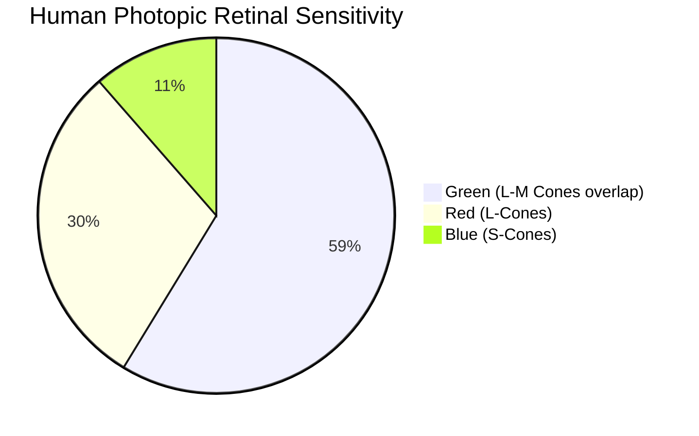

Human vision relies on photopic spectral sensitivity curves characterized by the CIE standard observer. Retinal cone cells have high sensitivity to green wavelengths, moderate sensitivity to red, and low sensitivity to blue. The ITU-R Recommendation BT.601 standardizes perceptual grayscale conversion as:

$$Y = 0.299 \cdot R + 0.587 \cdot G + 0.114 \cdot B$$

When reading an image via OpenCV, channels are ordered $[B, G, R]$. Thus:
$$Y(y, x) = 0.114 \cdot I(y, x, 0) + 0.587 \cdot I(y, x, 1) + 0.299 \cdot I(y, x, 2)$$

---

### 4.2. Kernel Separability and Computational Complexity
Exam questions often ask: *"Prove why a 2D Gaussian filter can be computed faster as two 1D operations, and determine its computational complexity."*

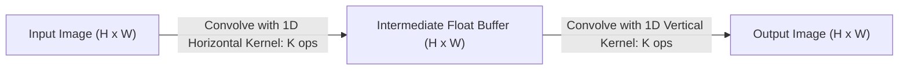

A 2D spatial convolution of an image $I$ of size $H \times W$ with a 2D kernel $K$ of size $M \times M$ requires:
$$\text{Complexity}_{2D} = O(H \cdot W \cdot M^2)$$
For an $M \times M$ kernel, every pixel requires $M^2$ multiplications and $M^2 - 1$ additions.

A 2D filter kernel $K_{2D}$ is **separable** if it can be expressed as the outer product of two 1D vectors $v$ (vertical, size $M \times 1$) and $h^T$ (horizontal, size $1 \times M$):
$$K_{2D} = v \cdot h^T$$

The 2D continuous isotropic Gaussian function is defined as:
$$G_{2D}(x, y) = \frac{1}{2\pi\sigma^2} e^{-\frac{x^2+y^2}{2\sigma^2}}$$
Using the exponential property $e^{a+b} = e^a \cdot e^b$:
$$G_{2D}(x, y) = \left( \frac{1}{\sqrt{2\pi}\sigma} e^{-\frac{x^2}{2\sigma^2}} \right) \cdot \left( \frac{1}{\sqrt{2\pi}\sigma} e^{-\frac{y^2}{2\sigma^2}} \right) = G_{1D}(x) \cdot G_{1D}(y)$$

#### Efficiency Gain
Separability allows us to factor the 2D spatial convolution into two sequential 1D passes:
1. Convolve each row of the image with the horizontal kernel $G_{1D}(x)$ ($M$ operations per pixel).
2. Convolve each column of the resulting matrix with the vertical kernel $G_{1D}(y)$ ($M$ operations per pixel).

$$\text{Complexity}_{\text{Separable}} = O(H \cdot W \cdot (2M))$$

**Numerical Comparison for an Exam Question:**
For a $7 \times 7$ kernel ($M = 7$):
* Standard 2D implementation: $7^2 = \mathbf{49\text{ multiplications per pixel}}$.
* Separated 1D implementation: $2 \times 7 = \mathbf{14\text{ multiplications per pixel}}$.
* Speedup factor: $\frac{49}{14} = \mathbf{3.5\times\text{ faster}}$, yielding identical mathematical outputs up to floating-point rounding.

---

### 4.3. Spatial Cross-Correlation vs. Mathematical Convolution
In image processing literature and library implementations (including PyTorch and TensorFlow), the operation referred to as "convolution" is often mathematically **cross-correlation**.

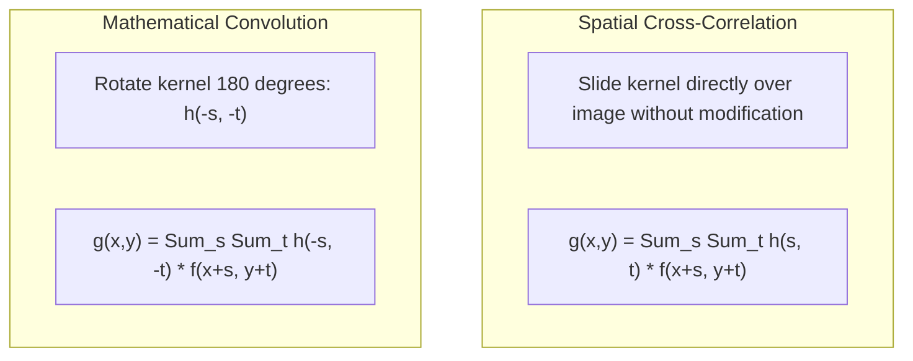

* **Cross-Correlation:** Scans the kernel across the image directly without modification:
  $$g(x, y) = \sum_{s=-a}^{a} \sum_{t=-b}^{b} h(s, t) \cdot f(x+s, y+t)$$
* **Mathematical Convolution:** Flips the kernel by $180^\circ$ (both horizontally and vertically) before computing the sum of products:
  $$g(x, y) = (f * h)(x, y) = \sum_{s=-a}^{a} \sum_{t=-b}^{b} h(-s, -t) \cdot f(x+s, y+t)$$

#### Exam Equivalence Criterion:
If a filter kernel is **centrosymmetric** (i.e., symmetric about its center such that $h(s, t) = h(-s, -t)$), rotating it by $180^\circ$ leaves the kernel unchanged. Therefore, for symmetric filters like **Box Mean, Gaussian, and Laplacian kernels**, cross-correlation and mathematical convolution produce **identical numerical outputs**.

---

### 4.4. Boundary Padding Mechanics: Constant/Zero vs. Reflection Halos
Convolving an $H \times W$ image with a kernel of size $K \times K$ requires access to pixels outside the image boundaries for any pixel within radius $k = \lfloor K/2 \rfloor$ of an edge.

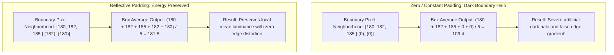

* **Constant (Zero) Padding (`np.pad(..., mode='constant')`):** Places zeros along the borders. This introduces an artificial intensity step at image boundaries, skewing neighborhood averages toward zero and causing visible dark halos along the outer edges of the image.
* **Reflective Padding (`np.pad(..., mode='reflect')`):** Mirrors valid interior image pixels outward across the boundary axis ($[c, b, a \mid a, b, c, d]$). This preserves local statistical properties (mean and variance), eliminating border artifacts.

---

### 4.5. Odd Kernel Dimensions and Spatial Phase Alignment
Filter kernels must have odd dimensions ($(2k+1) \times (2k+1)$) to ensure an unambiguous central anchor pixel:
$$(x_{\text{anchor}}, y_{\text{anchor}}) = (k, k) = \left(\left\lfloor \frac{K}{2} \right\rfloor, \left\lfloor \frac{K}{2} \right\rfloor\right)$$

If an even-sized kernel (e.g., $4 \times 4$) were used, the true geometric center would lie between four pixels at floating-point coordinates $(1.5, 1.5)$. Filtering with an even-sized kernel requires assigning the anchor to one of the four adjacent pixels, introducing an asymmetric half-pixel spatial shift ($\Delta = 0.5$ pixels) across the filtered output.

---

### 4.6. Normalization and Energy Preservation ($\sum K = 1$)
For any low-pass spatial smoothing filter, the sum of all elements in the kernel matrix must equal 1:
$$\sum_{s=-a}^{a} \sum_{t=-b}^{b} K(s, t) = 1$$

* **If $\sum K > 1$:** The operation amplifies the total energy of the signal. The average luminance increases with each pass, eventually clipping the image to white ($255$).
* **If $\sum K < 1$:** The operation attenuates the signal energy, progressively darkening the image toward black ($0$).
* **If $\sum K = 1$:** The filter acts as a local convex combination (a weighted average), preserving the overall mean luminance and energy balance of the image.

---

### 4.7. Filter vs. Noise Justification Matrix
A standard theoretical exam prompt presents a degraded image and asks you to select and justify the appropriate filtering strategy.

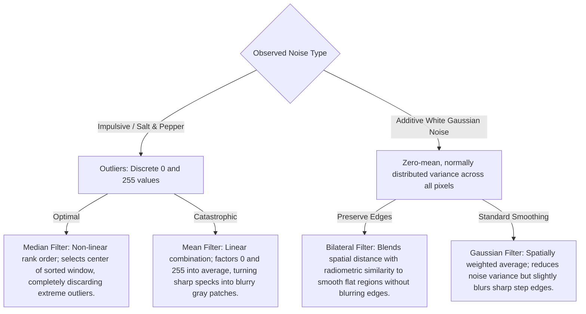

#### Detailed Justifications for Written Exams:
1. **Why the Median Filter is Optimal for Salt & Pepper Noise:**
   * Salt & Pepper noise sets corrupted pixels to extreme values (minimum $0$ or maximum $255$).
   * The median filter is a **non-linear, rank-order filter**. It sorts the $N$ neighborhood intensities into ascending order:
     $$I_{(0)} \le I_{(1)} \le \dots \le I_{(k)} \le \dots \le I_{(N-1)}$$
   * Because outliers are pushed to the extremes of the sorted list, the central element $I_{(k)}$ (where $k = \lfloor N/2 \rfloor$) is drawn from uncorrupted neighboring pixels, completely removing the noise impulse from the output.
2. **Why Linear Averaging Fails on Impulsive Noise:**
   * A box filter computes an unweighted linear sum: $\hat{I} = \frac{1}{N} \sum I_i$.
   * An outlier value of $255$ directly shifts the arithmetic mean, spreading the impulse noise into a blurry patch across surrounding pixels.
3. **Why the Bilateral Filter Outperforms the Gaussian Filter on Additive Gaussian Noise:**
   * A Gaussian filter weights pixels purely by **spatial distance**:
     $$w_s(i, j, x, y) = \exp\left(-\frac{(i-x)^2 + (j-y)^2}{2\sigma_s^2}\right)$$
     This blurs everything within the neighborhood, including sharp structural edges.
   * The Bilateral filter introduces a secondary **radiometric (range) weight** that penalizes intensity differences:
     $$w_r(i, j, x, y) = \exp\left(-\frac{(I(i, j) - I(x, y))^2}{2\sigma_r^2}\right)$$
     The overall filter weight is the product of both terms:
     $$W(i, j, x, y) = w_s \cdot w_r$$
     Across an edge boundary, $|I(i, j) - I(x, y)|$ is large, driving $w_r \to 0$. This stops the filter from smoothing across the edge, preserving sharp boundaries while smoothing flat regions.

---

### 4.8. Quantitative Fidelity Metrics: MSE and PSNR
Image restoration performance is quantified by comparing the restored output to an uncorrupted reference image.

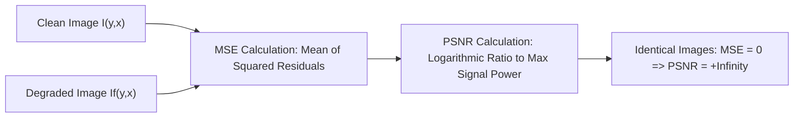

#### Mean Squared Error (MSE)
The average squared difference between original and restored pixel intensities:
$$\text{MSE} = \frac{1}{H \cdot W} \sum_{y=0}^{H-1} \sum_{x=0}^{W-1} \Big( I(y, x) - I_f(y, x) \Big)^2$$
* $H, W$: Image height and width.
* $I(y, x)$: Clean ground-truth reference pixel intensity.
* $I_f(y, x)$: Degraded, filtered, or restored pixel intensity.

#### Peak Signal-to-Noise Ratio (PSNR)
The ratio between the maximum possible signal power and the power of corrupting noise, expressed on a logarithmic decibel ($\text{dB}$) scale:
$$\text{PSNR} = 10 \cdot \log_{10}\left( \frac{R^2}{\text{MSE}} \right)$$
* $R$: The **dynamic range** of the pixel representation. For an 8-bit unsigned integer image (`np.uint8`), $R = 2^8 - 1 = \mathbf{255}$. (If pixel values are normalized to $[0.0, 1.0]$, $R = 1.0$).
* **Logarithm Base:** Must be $\log_{10}$ (base 10). In Python, use `math.log10()`, **never** `math.log()` (which computes the natural logarithm $\ln$, underestimating PSNR by a factor of $\ln(10) \approx 2.3026$).
* **The Zero-Error Singularity:** If two images are identical, $I(y, x) = I_f(y, x) \implies \text{MSE} = 0$. Because $\lim_{\text{MSE} \to 0} \frac{R^2}{\text{MSE}} = +\infty$, **$\text{PSNR} = +\infty\text{ dB}$**. Any handwritten implementation must include an explicit conditional check to prevent division by zero.

---

### 4.9. The Integral Image (Summed-Area Table)
An Integral Image (or Summed-Area Table) enables fast spatial box-filtering: it computes the sum of pixel values over any rectangular window in **$O(1)$ constant time**, independent of the window dimensions.

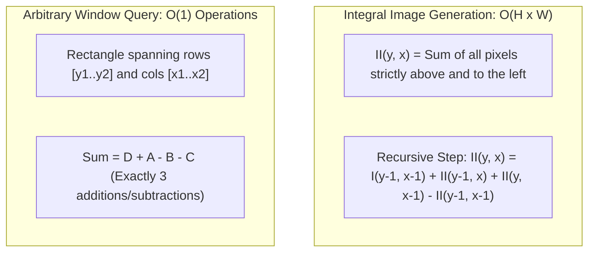

#### Mathematical Definition
For an image $I$ of size $H \times W$, its Integral Image $II$ has dimensions **$(H + 1) \times (W + 1)$**. The extra row and column at index $0$ are initialized to zero to handle boundary lookups without requiring edge checks:
$$II(y, x) = \sum_{y' < y} \sum_{x' < x} I(y', x')$$
* $II(0, x) = 0$ for all $x \in [0, W]$
* $II(y, 0) = 0$ for all $y \in [0, H]$

#### $O(1)$ Box-Sum Formulation
To compute the sum of pixels in a rectangular sub-window spanning rows $[y_1, y_2]$ and columns $[x_1, x_2]$ (in 0-indexed original image space), map the coordinates to the $(H+1) \times (W+1)$ integral image space:
* Top-left bound: $y_{\text{start}} = y_1$, $x_{\text{start}} = x_1$
* Bottom-right bound: $y_{\text{end}} = y_2 + 1$, $x_{\text{end}} = x_2 + 1$

The sum is computed using the values at four corner points in $II$:

```
(x_start, y_start)        (x_end, y_start)
        A ----------------------- B
        |                         |
        |      Target Window      |
        |                         |
        C ----------------------- D
(x_start, y_end)          (x_end, y_end)
```

$$\text{Sum} = D + A - B - C$$
* $D = II[y_{\text{end}}, x_{\text{end}}]$ (Sum of entire rectangle from origin to bottom-right)
* $A = II[y_{\text{start}}, x_{\text{start}}]$ (Top-left quadrant, added back to correct for double subtraction)
* $B = II[y_{\text{start}}, x_{\text{end}}]$ (Top rectangle above the target window)
* $C = II[y_{\text{end}}, x_{\text{start}}]$ (Left rectangle to the side of the target window)

---

### 4.10. The Adaptive Local Mean Filter (Lee/Wiener Formulation)
Standard linear smoothing filters apply a fixed weighting across the entire image, which blurs edges and fine details. The Adaptive Local Mean Filter (based on the Lee/Wiener local statistics model) varies the amount of smoothing at each pixel based on local variance.

$$\hat{f}(x, y) = \mu_L(x, y) + \left[ \max\left(0, 1 - \frac{\sigma_\eta^2}{\sigma_L^2(x, y)}\right) \right] \cdot \Big( g(x, y) - \mu_L(x, y) \Big)$$

* $g(x, y)$: The observed noisy input pixel value.
* $\sigma_\eta^2$: The known or estimated noise variance across the image.
* $\mu_L(x, y)$: The local sample mean computed over an odd-sized neighborhood $\Omega$:
  $$\mu_L(x, y) = \frac{1}{|\Omega|} \sum_{(i, j) \in \Omega} g(i, j)$$
* $\sigma_L^2(x, y)$: The local sample variance computed over $\Omega$:
  $$\sigma_L^2(x, y) = \frac{1}{|\Omega|} \sum_{(i, j) \in \Omega} \Big( g(i, j) - \mu_L(x, y) \Big)^2$$
* $\hat{f}(x, y)$: The restored output pixel value.

#### Mathematical Analysis of the Three Operational Regimes:
1. **Flat, Homogeneous Regions ($\sigma_L^2 \approx \sigma_\eta^2$):**
   * The local variance is driven almost entirely by noise.
   * The ratio $\frac{\sigma_\eta^2}{\sigma_L^2} \approx 1$, making the weighting factor $\left(1 - \frac{\sigma_\eta^2}{\sigma_L^2}\right) \approx 0$.
   * Output: $\hat{f}(x, y) \approx \mu_L(x, y)$ (the filter applies full local averaging to suppress noise).
2. **Sharp Edges and High-Contrast Details ($\sigma_L^2 \gg \sigma_\eta^2$):**
   * The local variance is dominated by true structural edges rather than noise.
   * The ratio $\frac{\sigma_\eta^2}{\sigma_L^2} \to 0$, making the weighting factor $\left(1 - \frac{\sigma_\eta^2}{\sigma_L^2}\right) \to 1$.
   * Output: $\hat{f}(x, y) \approx \mu_L + 1 \cdot (g - \mu_L) = g(x, y)$ (smoothing is disabled, preserving the edge).
3. **Variance Inversion Underestimation ($\sigma_L^2 < \sigma_\eta^2$):**
   * In smooth, low-contrast regions, random noise fluctuations can cause the sample variance $\sigma_L^2$ to fall below the global estimate $\sigma_\eta^2$.
   * Unchecked, this would make the weighting factor negative, inverting pixel values.
   * Applying $\max\left(0, 1 - \frac{\sigma_\eta^2}{\sigma_L^2}\right)$ clamps the factor to $0$, setting $\hat{f}(x, y) = \mu_L(x, y)$.

---

## 5. Guaranteed Step-by-Step Hand Calculations (Toy Matrix Problems)

### 5.1. Problem 1: $3 \times 3$ Mean and Median Filtering on a $4 \times 4$ Matrix
**Prompt:** Given the $4 \times 4$ 8-bit image patch $I$:
$$I = \begin{bmatrix}
10 & 12 & 15 & 20 \\
11 & \mathbf{14} & \mathbf{18} & \mathbf{22} \\
13 & \mathbf{15} & \mathbf{90} & \mathbf{25} \\
12 & \mathbf{16} & \mathbf{17} & \mathbf{24}
\end{bmatrix}$$
Calculate the updated value of the pixel at coordinate $(y=2, x=2)$ (currently containing an impulse noise outlier of value $90$, 0-indexed) after applying:
1. A $3 \times 3$ Box Mean Filter.
2. A $3 \times 3$ Median Filter.

#### Step 1: Extract the $3 \times 3$ Neighborhood Window
The pixel at row $y=2$, column $x=2$ has value $90$. Its $3 \times 3$ neighborhood spans rows $y \in [1, 3]$ and columns $x \in [1, 3]$:
$$\Omega = \begin{bmatrix}
14 & 18 & 22 \\
15 & \mathbf{90} & 25 \\
16 & 17 & 24
\end{bmatrix}$$
The 9 neighborhood values are:
$$\{14, 18, 22, 15, 90, 25, 16, 17, 24\}$$

#### Step 2: Calculate the $3 \times 3$ Mean Filter Response
Sum all 9 elements and divide by 9:
$$\text{Sum} = 14 + 18 + 22 + 15 + 90 + 25 + 16 + 17 + 24 = 231$$
$$\text{Mean} = \frac{231}{9} = 25.666\dots$$
Rounding to the nearest integer:
$$\hat{I}_{\text{mean}}(2, 2) = \mathbf{26}$$
*Observation:* The impulse outlier ($90$) skews the neighborhood average, raising the output from the surrounding baseline ($\approx 16$) up to $26$.

#### Step 3: Calculate the $3 \times 3$ Median Filter Response
Sort the 9 values in ascending order:
$$\text{Sorted List} = [14, 15, 16, 17, \mathbf{18}, 22, 24, 25, 90]$$
The median is the central element at index $k = \lfloor 9/2 \rfloor = 4$ (0-indexed, corresponding to the 5th element):
$$\hat{I}_{\text{median}}(2, 2) = \mathbf{18}$$
*Observation:* The outlier ($90$) is sorted to the end of the list, completely removing its effect from the filtered output.

---

### 5.2. Problem 2: $4 \times 4$ Integral Image Construction and $O(1)$ Sub-Window Query
**Prompt:** Given the $3 \times 3$ raw image patch $I$:
$$I = \begin{bmatrix}
2 & 3 & 1 \\
4 & 1 & 5 \\
3 & 2 & 2
\end{bmatrix}$$
1. Construct the $(3+1) \times (3+1) = 4 \times 4$ Integral Image $II$.
2. Using the 4-corner lookup formula, compute the sum of pixels in the $2 \times 2$ sub-window covering rows $y \in [1, 2]$ and columns $x \in [1, 2]$:
   $$\text{Target Window: } \begin{bmatrix} 1 & 5 \\ 2 & 2 \end{bmatrix}$$

#### Step 1: Construct the Integral Image ($II$)
The first row and column are set to zero. Every other cell $(y, x)$ is computed recursively:
$$II(y, x) = I(y-1, x-1) + II(y-1, x) + II(y, x-1) - II(y-1, x-1)$$

* Row $0$: $[0, 0, 0, 0]$
* Row $1$:
  * $II(1, 1) = I(0, 0) + 0 + 0 - 0 = 2$
  * $II(1, 2) = I(0, 1) + II(0, 2) + II(1, 1) - II(0, 1) = 3 + 0 + 2 - 0 = 5$
  * $II(1, 3) = I(0, 2) + II(0, 3) + II(1, 2) - II(0, 2) = 1 + 0 + 5 - 0 = 6$
* Row $2$:
  * $II(2, 1) = I(1, 0) + II(1, 1) + II(2, 0) - II(1, 0) = 4 + 2 + 0 - 0 = 6$
  * $II(2, 2) = I(1, 1) + II(1, 2) + II(2, 1) - II(1, 1) = 1 + 5 + 6 - 2 = 10$
  * $II(2, 3) = I(1, 2) + II(1, 3) + II(2, 2) - II(1, 2) = 5 + 6 + 10 - 5 = 16$
* Row $3$:
  * $II(3, 1) = I(2, 0) + II(2, 1) + II(3, 0) - II(2, 0) = 3 + 6 + 0 - 0 = 9$
  * $II(3, 2) = I(2, 1) + II(2, 2) + II(3, 1) - II(2, 1) = 2 + 10 + 9 - 6 = 15$
  * $II(3, 3) = I(2, 2) + II(2, 3) + II(3, 2) - II(2, 2) = 2 + 16 + 15 - 10 = 23$

The complete Integral Image is:
$$II = \begin{bmatrix}
0 & 0 & 0 & 0 \\
0 & 2 & 5 & 6 \\
0 & 6 & 10 & 16 \\
0 & 9 & 15 & \mathbf{23}
\end{bmatrix}$$

#### Step 2: Evaluate the Sub-Window Sum via 4 Lookups
The target window in original image space spans rows $[1, 2]$ and columns $[1, 2]$.
In the $(H+1) \times (W+1)$ Integral Image space, the bounding indices are:
* $y_{\text{start}} = 1, \quad y_{\text{end}} = 2 + 1 = 3$
* $x_{\text{start}} = 1, \quad x_{\text{end}} = 2 + 1 = 3$

Read the values at the four corner points in $II$:
* Point $D = II[y_{\text{end}}, x_{\text{end}}] = II[3, 3] = \mathbf{23}$
* Point $A = II[y_{\text{start}}, x_{\text{start}}] = II[1, 1] = \mathbf{2}$
* Point $B = II[y_{\text{start}}, x_{\text{end}}] = II[1, 3] = \mathbf{6}$
* Point $C = II[y_{\text{end}}, x_{\text{start}}] = II[3, 1] = \mathbf{9}$

Apply the 4-corner inclusion-exclusion formula:
$$\text{Sum} = D + A - B - C = 23 + 2 - 6 - 9 = \mathbf{10}$$

**Direct Verification:**
Summing the target window elements directly from $I$:
$$\text{Sum} = 1 + 5 + 2 + 2 = \mathbf{10}$$
The integral image formula yields the exact sum in $O(1)$ operations.

---

## 6. Complete Algorithmic Implementation Compendium (From Scratch)

These standalone Python implementations avoid high-level library functions (like `cv2.blur` or `cv2.cvtColor`). Use them to prepare for exam questions that require writing algorithms from scratch using nested loops or basic NumPy operations.

### 6.1. Manual BT.601 Grayscale Conversion
```python
import numpy as np


def manual_bgr_to_gray(image_bgr):
    """Converts an 8-bit 3-channel BGR image to single-channel Grayscale

    using ITU-R BT.601 perceptual luminance weights.
    """
    h, w = image_bgr.shape[:2]
    gray = np.zeros((h, w), dtype=np.uint8)

    for y in range(h):
        for x in range(w):
            b = image_bgr[y, x, 0]
            g = image_bgr[y, x, 1]
            r = image_bgr[y, x, 2]
            # Apply perceptual weighting and round to nearest integer
            lum = 0.114 * b + 0.587 * g + 0.299 * r
            gray[y, x] = int(round(lum))

    return gray


# Vectorized implementation:
def manual_bgr_to_gray_vectorized(img_bgr):
    weights = np.array([0.114, 0.587, 0.299], dtype=np.float64)
    return np.clip(np.round(np.dot(img_bgr, weights)), 0, 255).astype(np.uint8)
```

---

### 6.2. Arbitrary 2D Spatial Convolution with Reflective Padding
```python
def manual_convolve2d(image, kernel):
    """Performs 2D spatial convolution using an odd-sized kernel.

    Applies reflective boundary padding to prevent edge artifacts.
    """
    kh, kw = kernel.shape
    rad_y = kh // 2
    rad_x = kw // 2
    h, w = image.shape

    # Rotate kernel 180 degrees for true mathematical convolution:
    # (If kernel is symmetric, flipped_kernel == kernel)
    flipped_kernel = np.flipud(np.fliplr(kernel))

    # Pad image using reflection:
    padded = np.pad(
        image.astype(np.float64), ((rad_y, rad_y), (rad_x, rad_x)), mode='reflect'
    )
    output = np.zeros((h, w), dtype=np.float64)

    # Convolve:
    for y in range(h):
        for x in range(w):
            roi = padded[y : y + kh, x : x + kw]
            output[y, x] = np.sum(roi * flipped_kernel)

    return np.clip(np.round(output), 0, 255).astype(np.uint8)
```

---

### 6.3. Manual Mean Filter (`filtreMoyenne`)
```python
def filtreMoyenne(image, taille_masque):
    """Applies a square box-mean filter of size taille_masque x taille_masque.

    Pads boundaries using reflection.
    """
    rad = taille_masque // 2
    h, w = image.shape
    padded = np.pad(image.astype(np.float64), rad, mode='reflect')
    result = np.zeros((h, w), dtype=np.uint8)

    for y in range(h):
        for x in range(w):
            window = padded[y : y + taille_masque, x : x + taille_masque]
            result[y, x] = int(round(np.mean(window)))

    return result
```

---

### 6.4. Manual Median Filter (`filtreMedian`)
```python
def filtreMedian(image, taille_voisinage):
    """Applies a rank-order median filter of size taille_voisinage x taille_voisinage.

    Removes impulse (Salt & Pepper) noise while preserving edges.
    """
    rad = taille_voisinage // 2
    h, w = image.shape
    padded = np.pad(image, rad, mode='reflect')
    result = np.zeros((h, w), dtype=np.uint8)

    for y in range(h):
        for x in range(w):
            window = padded[y : y + taille_voisinage, x : x + taille_voisinage]
            result[y, x] = int(np.median(window))

    return result
```

---

### 6.5. Manual Binarization / Thresholding
```python
def manual_threshold(image_gray, T):
    """Segments a grayscale image into a binary mask using a fixed threshold T."""
    h, w = image_gray.shape
    binary = np.zeros((h, w), dtype=np.uint8)

    for y in range(h):
        for x in range(w):
            if image_gray[y, x] > T:
                binary[y, x] = 255
            else:
                binary[y, x] = 0

    return binary
```

---

### 6.6. Additive Gaussian and Impulsive Noise Generators
```python
import math
import cv2


def add_gaussian_noise(image, mean=0.0, var=100.0):
    """Adds zero-mean Additive White Gaussian Noise (AWGN) to an image."""
    stddev = math.sqrt(var)
    noise = np.zeros(image.shape, dtype=np.float32)
    cv2.randn(noise, mean, stddev)

    noisy = image.astype(np.float32) + noise
    return np.clip(noisy, 0, 255).astype(np.uint8)


def add_salt_and_pepper_noise(image, prob=0.05):
    """Injects Impulsive Salt & Pepper noise affecting probability prob of all pixels."""
    noisy = image.copy()
    random_matrix = np.random.random(image.shape[:2])

    # Pepper noise (intensity 0)
    noisy[random_matrix < (prob / 2.0)] = 0
    # Salt noise (intensity 255)
    noisy[random_matrix > 1.0 - (prob / 2.0)] = 255

    return noisy
```

---

### 6.7. Fast Integral Image Mean Filter ($O(1)$ Window Sums)
```python
def filtreMoyenne_integral(image, taille_masque):
    """Computes an exact box-mean filter in O(1) time per pixel

    using a Summed-Area Table (Integral Image).
    """
    rad = taille_masque // 2
    h, w = image.shape
    padded = np.pad(image.astype(np.float64), rad, mode='reflect')
    pad_h, pad_w = padded.shape

    # Allocate and construct the Integral Image: size (pad_h + 1, pad_w + 1)
    ii = np.zeros((pad_h + 1, pad_w + 1), dtype=np.float64)
    ii[1:, 1:] = np.cumsum(np.cumsum(padded, axis=0), axis=1)

    area = float(taille_masque * taille_masque)

    # Compute bounding coordinates in Integral Image space:
    # Top-Left: (0..h, 0..w), Bottom-Right: (taille..h+taille, taille..w+taille)
    D = ii[taille_masque : h + taille_masque, taille_masque : w + taille_masque]
    A = ii[0:h, 0:w]
    B = ii[0:h, taille_masque : w + taille_masque]
    C = ii[taille_masque : h + taille_masque, 0:w]

    # Calculate window sums via inclusion-exclusion:
    sums = D + A - B - C
    return np.clip(np.round(sums / area), 0, 255).astype(np.uint8)
```

---

### 6.8. Adaptive Local Mean Filter (Lee Formulation)
```python
def filtreMoyenne_adaptative(image, taille_masque=5, noise_var=100.0):
    """Applies the Lee adaptive filter to smooth noise while preserving edges.

    Blends the local mean with the original intensity using the ratio of
    noise variance to local variance.
    """
    rad = taille_masque // 2
    h, w = image.shape
    padded = np.pad(image.astype(np.float64), rad, mode='reflect')
    result = np.zeros((h, w), dtype=np.float64)

    for y in range(h):
        for x in range(w):
            window = padded[y : y + taille_masque, x : x + taille_masque]
            l_mean = np.mean(window)
            l_var = np.var(window)

            # Guard against local variance underestimating noise variance:
            if l_var < noise_var:
                factor = 1.0  # Apply full local averaging
            else:
                factor = noise_var / l_var

            # Blend local mean and original pixel intensity:
            result[y, x] = l_mean + (1.0 - factor) * (image[y, x] - l_mean)

    return np.clip(np.round(result), 0, 255).astype(np.uint8)
```

---

### 6.9. Custom 256-Bin Histogram Calculation
```python
# Iterative loop implementation:
def custom_histogram_loop(image_gray):
    """Computes a 256-bin histogram of a grayscale image using nested loops."""
    hist = np.zeros(256, dtype=np.int32)
    h, w = image_gray.shape

    for y in range(h):
        for x in range(w):
            val = image_gray[y, x]
            hist[val] += 1

    return hist


# Vectorized implementation using np.bincount:
def custom_histogram_fast(image_gray):
    """Computes a 256-bin histogram using flattened array bin counting."""
    return np.bincount(image_gray.ravel(), minlength=256)
```

---

### 6.10. Robust MSE and PSNR Metrics
```python
import math
import numpy as np


def calculate_mse(image_ref, image_test):
    """Computes Mean Squared Error with float64 precision to prevent overflow."""
    diff = image_ref.astype(np.float64) - image_test.astype(np.float64)
    return float(np.mean(diff**2))


def calculate_psnr(image_ref, image_test, max_val=255.0):
    """Computes Peak Signal-to-Noise Ratio in dB.

    Includes a check to prevent division by zero for identical images.
    """
    mse = calculate_mse(image_ref, image_test)
    if mse == 0.0:
        return float('inf')  # Identical images have zero error and infinite PSNR

    return 10.0 * math.log10((max_val**2) / mse)
```

---

## 7. The Handwritten Exam Survival Manual

### 7.1. The 60-Second Scrap Paper Brain Dump
The moment the exam begins and you receive scrap paper (or permission to write in the margins), **spend the first 60 seconds writing down these 7 core patterns**. Getting them on paper immediately frees up mental bandwidth and helps prevent second-guessing later.

```text
=== 60-SECOND RECOVERY DUMP ===
1. Coordinates:  NumPy = [y, x] (Rows, Cols)  |  OpenCV = (x, y) (Width, Height)
2. Dimensions:   h, w = img.shape[:2]
3. Radii:        rad = ksize // 2 (Double slash for integer index!)
4. Float-Sand:   np.clip(np.round(float_img), 0, 255).astype(np.uint8)
5. Threshold:    _, bin_img = cv2.threshold(g, 127, 255, cv2.THRESH_BINARY)
6. Filters:      blur(im, (3,3))                  <- Tuple
                 GaussianBlur(im, (3,3), 1.5)     <- Capital G & B!
                 medianBlur(im, 3)                <- Single Integer!
                 bilateralFilter(im, 7, 40, 40)   <- 4 parameters
7. Hist / Metric:calcHist([im], [0], None, [256], [0, 256])
                 PSNR = 10 * log10( 255^2 / MSE ) [Check if MSE == 0 -> inf]
```

---

### 7.2. Defensive Code Writing & Partial Credit Optimization
If you blank on an exact function name or flag during the exam, use these defensive strategies to protect your grade:

1. **Use Inline Descriptive Comments:**
   If you cannot remember `cv2.COLOR_BGR2GRAY`, write:
   ```python
   # Convert 3-channel BGR to grayscale
   gray = cv2.cvtColor(img, cv2.COLOR_BGR2GRAY)
   ```
   If you misspell the constant (e.g., `cv2.BGR2GRAY` or `cv2.COLOR_GRAY`), an examiner can still award 90%–100% partial credit because your intent and implementation are clear.
2. **Leave Blank Lines:**
   Write on every other line. If you realize you forgot to convert an array type (`.astype(np.float64)`) or missed a padding step, you can insert the line neatly without crossing out entire blocks of code.
3. **Write Out the Mathematical Formula:**
   If an exam asks for an algorithm and you are unsure of the NumPy syntax, write the mathematical equation next to your code:
   $$\text{PSNR} = 10 \cdot \log_{10}\left(\frac{255^2}{\text{MSE}}\right)$$
   This shows the examiner you understand the underlying concept, making it easier to award partial credit even if there are minor syntax errors.

---

### 7.3. The 15-Minute Blank Sheet Motor Recall Protocol
Reading code builds passive recognition, but a written exam tests physical motor recall. To prepare, spend 15 minutes practicing writing code by hand:

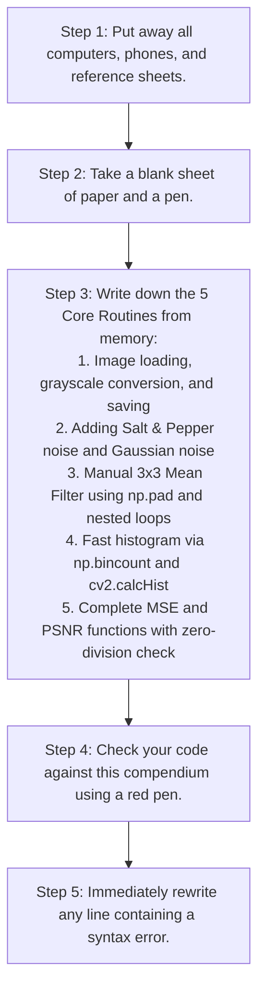

---

## 8. Active Recall Practice Drills & Exam-Style Exercises

Test your recall using these targeted exercises. Write your answers on a blank sheet of paper before checking the solution key in Section 9.

### 8.1. Drill 1: Exact Function Name & Casing Recall
Write the exact function call and casing for each operation:
1. Load `'scene.png'` as a single-channel grayscale image using an integer flag.
2. Run OpenCV's Gaussian blur with a $5 \times 5$ window and standard deviation $\sigma = 1.2$.
3. Run OpenCV's median blur with a window size of $5$.
4. Free all GUI window handles.
5. In-place addition of zero-mean Gaussian noise to an array `noise_buf` with $\sigma = 12.0$.
6. Calculate the histogram of a grayscale image `im` using OpenCV.
7. Compute the 2D affine transformation of `img` given rotation matrix `M` and output bounds `(w, h)`.

---

### 8.2. Drill 2: Fill-in-the-Missing Syntax
Complete the missing code marked by `___`:

#### Code Snippet A: Custom Mean Filter Border Padding
```python
def filtreMoyenne(img, ksize):
    rad = ksize ___ 2  # Fill in the division operator
    h, w = img.shape[:2]
    # Pad using reflection
    padded = np.pad(img.astype(np.float64), ___, mode='reflect')
    out = np.zeros_like(img)
    for y in range(h):
        for x in range(w):
            win = padded[y : y + ___, x : x + ___]
            out[y, x] = int(round(np.mean(win)))
    return out
```

#### Code Snippet B: Robust PSNR Function
```python
import math
import numpy as np


def compute_psnr(im_clean, im_noisy):
    diff = im_clean.astype(___) - im_noisy.astype(___)
    mse = float(np.mean(diff**2))
    if mse == ___:
        return float('___')
    return 10.0 * math.___( (___**2) / mse )
```

---

### 8.3. Drill 3: Spot-the-Bug (Code Review of Handwritten Flaws)
Identify the syntax, runtime, or logical errors in each handwritten code snippet:

#### Snippet 1: Slicing Coordinates
```python
# Goal: Crop a 100x200 (Height x Width) region starting at x=50, y=30
h, w = 100, 200
x, y = 50, 30
crop = image[x : x + w, y : y + h]
```

#### Snippet 2: Threshold Unpacking
```python
# Goal: Compute a binary mask at threshold T=128
binary_mask = cv2.threshold(gray_img, 128, 255, cv2.THRESH_BINARY)
cv2.imshow('Mask', binary_mask)
```

#### Snippet 3: Median Blur Invocation
```python
# Goal: Clean impulse noise with a 5x5 median blur
denoised = cv2.medianBlur(noisy_img, (5, 5))
```

#### Snippet 4: Grayscale Plotting
```python
# Goal: Display grayscale image via matplotlib
plt.imshow(gray_img)
plt.title('Grayscale Result')
plt.show()
```

#### Snippet 5: Dynamic Range Overflow
```python
# Goal: Brighten image by adding 40 intensity units
brightened = image + 40
```

---

### 8.4. Drill 4: Disambiguation Challenges
1. State whether `shape`, `dtype`, `size`, `copy`, and `ravel` are **attributes** or **methods**, and show the correct call syntax for each on an array `arr`.
2. Explain the difference between `cv2.blur` and `cv2.medianBlur` in terms of their kernel size arguments.
3. Explain why `np.pad(img, rad, mode='constant')` can cause issues when filtering boundaries compared to `mode='reflect'`.

---

### 8.5. Drill 5: Full Conceptual Code Synthesis Prompts
Write complete, syntactically correct implementations for each problem:
1. **Prompt A:** Write a function `remove_outliers(img)` that applies a $3 \times 3$ median filter across an image using only standard Python loops and basic NumPy operations (no calls to `cv2.medianBlur` or `scipy`). Include reflective padding.
2. **Prompt B:** Write an end-to-end Python script that loads `'cameraman.bmp'` as grayscale, adds Salt & Pepper noise with probability $p = 0.08$, filters the noisy image using a $3 \times 3$ median filter, computes the PSNR between the clean and restored images, and plots the noisy and restored images side-by-side using Matplotlib.

---

## 9. Comprehensive Solutions and Answer Keys to Practice Drills

### 9.1. Solutions to Drill 1: Function Name & Casing Recall
1. `cv2.imread('scene.png', 0)` *(or `cv2.imread('scene.png', cv2.IMREAD_GRAYSCALE)`)*
2. `cv2.GaussianBlur(img, (5, 5), 1.2)` *(PascalCase: Capital G and B; kernel size is a tuple)*
3. `cv2.medianBlur(img, 5)` *(camelCase: Lowercase m; kernel size is a single odd integer)*
4. `cv2.destroyAllWindows()` *(camelCase: Plural 'Windows')*
5. `cv2.randn(noise_buf, 0.0, 12.0)` *(Strictly lowercase; positional arguments: buffer, mean, stddev)*
6. `cv2.calcHist([im], [0], None, [256], [0, 256])` *(I-C-M-B-R brackets rule: everything in brackets except None)*
7. `cv2.warpAffine(img, M, (w, h))` *(camelCase; destination size is Cartesian (width, height))*

---

### 9.2. Solutions to Drill 2: Fill-in-the-Missing Syntax

#### Code Snippet A:
* Line 2: `//` *(Integer floor division: `rad = ksize // 2`)*
* Line 5: `rad` *(Padding width: `padded = np.pad(..., rad, mode='reflect')`)*
* Line 9: `ksize` and `ksize` *(Slice width: `padded[y : y + ksize, x : x + ksize]`)*

#### Code Snippet B:
* Line 5: `np.float64` and `np.float64` *(Upcasting to prevent uint8 underflow/overflow)*
* Line 7: `0.0` or `0` *(Zero error check)*
* Line 8: `inf` *(Infinite PSNR on identical inputs: `float('inf')`)*
* Line 9: `log10`, `255.0` *(Base-10 logarithm and 8-bit dynamic range: `10.0 * math.log10((255.0**2) / mse)`)*

---

### 9.3. Solutions to Drill 3: Spot-the-Bug Diagnostics

#### Snippet 1 Error:
* **Bug:** Coordinate ordering swapped. In NumPy, indexing is `[y, x]`, but the snippet uses `[x, y]`.
* **Fix:**
  ```python
  crop = image[y : y + h, x : x + w]
  ```

#### Snippet 2 Error:
* **Bug:** Missing tuple unpacking. `cv2.threshold` returns `(retval, dst_matrix)`. Assigning to a single variable stores a tuple, causing `cv2.imshow` to fail.
* **Fix:**
  ```python
  _, binary_mask = cv2.threshold(gray_img, 128, 255, cv2.THRESH_BINARY)
  cv2.imshow('Mask', binary_mask)
  ```

#### Snippet 3 Error:
* **Bug:** Passing a tuple to `cv2.medianBlur`. Unlike other filters, it expects a **single odd integer** for kernel size.
* **Fix:**
  ```python
  denoised = cv2.medianBlur(noisy_img, 5)
  ```

#### Snippet 4 Error:
* **Bug:** Missing colormap argument in `plt.imshow`. Matplotlib defaults to the `'viridis'` colormap, displaying the grayscale image in green and yellow.
* **Fix:**
  ```python
  plt.imshow(gray_img, cmap='gray')
  ```

#### Snippet 5 Error:
* **Bug:** Modulo overflow on `np.uint8`. Adding $40$ directly to an unsigned 8-bit integer wraps values greater than $215$ around zero ($220 + 40 = 260 \equiv 4$), creating dark blotches in bright regions.
* **Fix:**
  ```python
  brightened = np.clip(image.astype(np.int32) + 40, 0, 255).astype(np.uint8)
  ```

---

### 9.4. Solutions to Drill 4: Disambiguation Challenges
1. **Attributes vs Methods:**
   * `arr.shape`: Attribute (no parentheses)
   * `arr.dtype`: Attribute (no parentheses)
   * `arr.size`: Attribute (no parentheses)
   * `arr.copy()`: Method (requires parentheses)
   * `arr.ravel()`: Method (requires parentheses)
2. **`cv2.blur` vs `cv2.medianBlur` Arguments:**
   * `cv2.blur(src, ksize)` expects a 2D tuple `(width, height)`: `cv2.blur(img, (3, 3))`.
   * `cv2.medianBlur(src, ksize)` expects a **single odd integer**: `cv2.medianBlur(img, 3)`. Passing a tuple raises a `TypeError`.
3. **Boundary Padding Modes:**
   * `mode='constant'` pads with zeros, creating an artificial dark border that pulls neighborhood averages down and causes dark halo artifacts.
   * `mode='reflect'` mirrors valid edge pixels outward, preserving the local mean luminance and eliminating boundary artifacts.

---

### 9.5. Solutions to Drill 5: Full Conceptual Code Synthesis

#### Solution 5.1: Custom Median Filter
```python
import numpy as np


def remove_outliers(img):
    rad = 1  # For a 3x3 window: taille = 3, rad = 3 // 2 = 1
    h, w = img.shape[:2]
    padded = np.pad(img, rad, mode='reflect')
    cleaned = np.zeros((h, w), dtype=np.uint8)

    for y in range(h):
        for x in range(w):
            # Extract 3x3 window:
            window = padded[y : y + 3, x : x + 3]
            # Flatten, sort, and select central median element:
            sorted_vals = np.sort(window.ravel())
            cleaned[y, x] = sorted_vals[4]  # Index 4 is the 5th element of 9

    return cleaned
```

#### Solution 5.2: Complete End-to-End Restoration Pipeline
```python
import math
import cv2
import matplotlib.pyplot as plt
import numpy as np


def main():
    # 1. Load image as grayscale
    clean = cv2.imread('cameraman.bmp', 0)
    if clean is None:
        return

    # 2. Add Salt & Pepper noise (p = 0.08)
    noisy = clean.copy()
    prob = 0.08
    rnd = np.random.random(clean.shape)
    noisy[rnd < (prob / 2.0)] = 0
    noisy[rnd > 1.0 - (prob / 2.0)] = 255

    # 3. Clean noise using a 3x3 median blur
    restored = cv2.medianBlur(noisy, 3)

    # 4. Compute PSNR between clean and restored images
    diff = clean.astype(np.float64) - restored.astype(np.float64)
    mse = float(np.mean(diff**2))

    if mse == 0.0:
        psnr_val = float('inf')
    else:
        psnr_val = 10.0 * math.log10((255.0**2) / mse)

    # 5. Display comparative results with Matplotlib
    plt.figure(figsize=(10, 5))

    plt.subplot(1, 2, 1)
    plt.imshow(noisy, cmap='gray')
    plt.title('Noisy Image (Salt & Pepper)')
    plt.axis('off')

    plt.subplot(1, 2, 2)
    plt.imshow(restored, cmap='gray')
    plt.title(f'Restored (Median 3x3) - PSNR: {psnr_val:.2f} dB')
    plt.axis('off')

    plt.tight_layout()
    plt.show()


if __name__ == '__main__':
    main()
```


---
sources:
  - "[[Spatial Sampling and Discretization]]"
---
# Computer Vision and Image Processing Foundations: From Raw Pixels to Spatial Filtering

---

## 1. Digital Image Representation and Memory Architecture

To process an image computationally, we must first understand how a continuous physical scene of light is converted into discrete numbers inside computer memory.

### 1.1. The Continuous World vs. The Discrete Grid
A physical image is a continuous distribution of light intensity across a two-dimensional surface. In mathematical terms, it can be modeled as a continuous function of spatial coordinates:

$$I = f(x, y)$$

Where:
* $x$ and $y$ are spatial coordinates in a continuous plane.
* $f(x, y)$ is the intensity (radiance or brightness) of light at that precise physical point.

Computers cannot store continuous functions because they possess finite memory. To store and process an image digitally, the continuous signal must undergo two fundamental transformations:
1. **Sampling (Spatial Discretization):** The continuous spatial domain $(x, y)$ is divided into a regular discrete grid of tiny rectangular regions called **pixels** (*picture elements*).
2. **Quantization (Intensity Discretization):** The continuous light intensity at each pixel is mapped to a discrete numerical value selected from a finite set of integer levels.

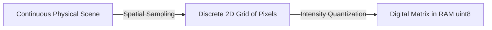

---

### 1.2. The Coordinate System: Cartesian Math vs. Matrix Memory
In traditional high-school mathematics, the Cartesian coordinate system places the origin $(0,0)$ at the **bottom-left corner**, with $x$ extending horizontally to the right and $y$ extending vertically upwards.

Digital image processing and computer memory systems use a different convention:
* The origin $(0,0)$ is positioned at the **top-left corner**.
* The **horizontal axis** ($x$, columns) increases from left to right.
* The **vertical axis** ($y$, rows) increases from top to bottom.

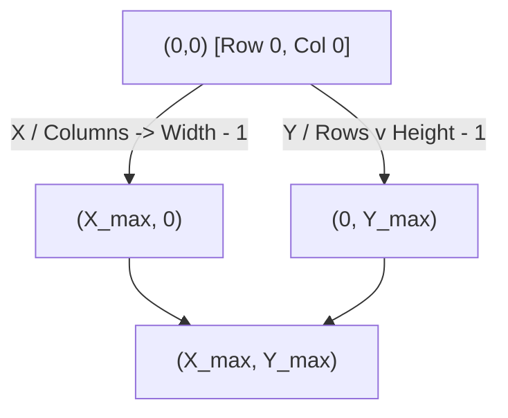

#### The Matrix Indexing Trap
When working with matrix libraries like NumPy:
* The first index references the **row** (vertical position, corresponding to $y$).
* The second index references the **column** (horizontal position, corresponding to $x$).

$$\text{Image Pixel at } (x, y) \implies \text{NumPy Array Element at } [y, x] \text{ or } [\text{row}, \text{col}]$$

If an algorithm requires you to inspect pixel coordinate $(x=150, y=100)$, in a NumPy array `img`, you must access:

```python
pixel_value = img[100, 150] # img[y, x]
```

Reversing these coordinates (`img[150, 100]`) accesses the pixel at $x=100, y=150$, which is transposed across the diagonal, causing runtime errors or silent computational bugs.

---

### 1.3. Intensity Representation and Data Types
In standard standard-definition digital imaging:
* Intensities are quantized into **8 bits** ($2^8 = 256$ discrete levels).
* The dynamic range spans integer values from **$0$** to **$255$**.
* $0$ represents total absence of light (**Pure Black**).
* $255$ represents maximum light saturation (**Pure White**).
* Any integer between $1$ and $254$ represents an intermediate shade of gray.

In memory, this format corresponds directly to the unsigned 8-bit integer data type: **`uint8`**.

| Data Type | Minimum Value | Maximum Value | Storage Per Channel | Common Usage |
| :--- | :--- | :--- | :--- | :--- |
| `uint8` | $0$ | $255$ | 1 byte | Standard storage, display, file I/O |
| `float32` | $-3.4 \times 10^{38}$ | $+3.4 \times 10^{38}$ | 4 bytes | Filtering, convolution, FFT, gradients |
| `float64` | $-1.7 \times 10^{308}$ | $+1.7 \times 10^{308}$ | 8 bytes | High-precision scientific computation |

#### The Arithmetic Overflow/Underflow Warning
A common mistake when processing `uint8` images is performing standard arithmetic without type conversion:

$$\text{In } \texttt{uint8}: \quad 250 + 20 = 270 \implies 270 \pmod{256} = 14 \quad (\text{Modulo Wrap-around})$$
$$\text{In } \texttt{uint8}: \quad 10 - 30 = -20 \implies 256 - 20 = 236 \quad (\text{Underflow Wrap-around})$$

To perform spatial convolution, noise addition, or gradients safely, images must always be converted to floating-point representation (`float32` or `float64`), manipulated, clipped to $[0, 255]$, and converted back to `uint8`.

---

### 1.4. Color Spaces: RGB vs. BGR
A grayscale image is a 2D matrix of shape $(H, W)$, where $H$ is the height (rows) and $W$ is the width (columns).
A color image requires three separate color components to recreate the visible spectrum based on trichromatic human vision:
1. **Red**
2. **Green**
3. **Blue**

A color image is stored as a 3D array of shape $(H, W, C)$, where $C=3$ is the channel dimension.

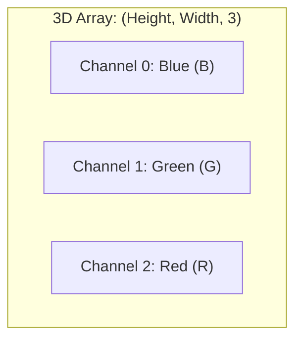

#### The OpenCV BGR Design Choice
In most graphics systems (HTML, CSS, PIL, Matplotlib), channels are arranged as **RGB** (Red at index 0, Green at index 1, Blue at index 2).

**OpenCV stores color channels in reverse order: BGR (Blue, Green, Red).**
* `img[y, x, 0]` represents the **Blue** component.
* `img[y, x, 1]` represents the **Green** component.
* `img[y, x, 2]` represents the **Red** component.

This design originated in the late 1990s when OpenCV was first developed by Intel; at that time, BGR was the native format for Windows bitmaps and video capture hardware. If you load an image with OpenCV (`cv2.imread`) and display it directly with Matplotlib (`plt.imshow`) without conversion, the image appears distorted: red tones turn blue and blue tones turn red.

---

## 2. Setting Up the Development Environment (TP1 Exercise 1)

### 2.1. Integrated Development Environments (IDEs) and PyCharm
Developing computer vision pipelines requires inspecting visual matrices, debugging array dimensions, and running interactive experiments. **PyCharm** (by JetBrains) is a dedicated Python IDE providing:
* Code introspection and type hints for massive C++ wrappers like OpenCV (`cv2`).
* An integrated debugger capable of inspecting array dimensions and raw pixel memory buffers.
* Built-in virtual environment management to prevent package dependency conflicts.

---

### 2.2. Isolated Python Environments: Why Virtualenv is Mandatory
Python installs packages globally by default. If Project A requires `numpy==1.21.0` while Project B requires `numpy==2.0.0`, installing one globally can break the other.

A **Virtual Environment (`venv`)** creates an isolated, self-contained directory tree containing:
1. A specific Python interpreter binary.
2. An isolated `site-packages` directory where packages installed via `pip` are stored independently.

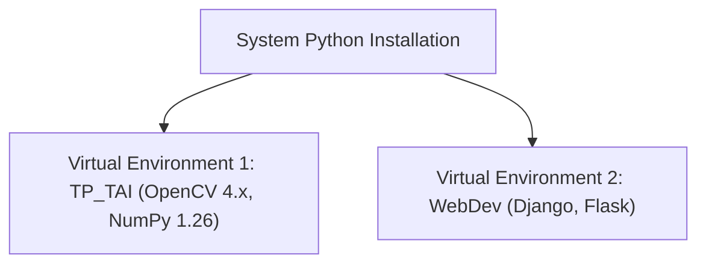

#### Essential Terminal Commands for Environment Setup
To initialize and activate an isolated environment manually from the operating system command line:

```bash
# 1. Create a virtual environment named 'venv' inside the project directory
python -m venv venv

# 2. Activate the virtual environment
# On Windows (Command Prompt):
venv\Scripts\activate.bat
# On Windows (PowerShell):
venv\Scripts\Activate.ps1
# On macOS / Linux:
source venv/bin/activate

# 3. Upgrade pip to its latest stable release
python -m pip install --upgrade pip

# 4. Install essential computer vision and scientific computing libraries
pip install opencv-python opencv-contrib-python numpy matplotlib
```

---

## 3. Basic Image I/O and Pixel-Level Manipulation (TP1 Exercise 2)

### 3.1. Detailed Function Breakdown: `cv2.imread`
1. **What it is:** The primary OpenCV function used to load a raster image file from non-volatile storage (disk) directly into an in-memory NumPy `ndarray`.
2. **What problem it solves:** Digital image files on disk are compressed and structured with headers, color tables, and metadata (e.g., JPEG, PNG, BMP). `cv2.imread` decodes these binary file formats into an uncompressed, structured pixel array.
3. **Why we need it:** Algorithms cannot process raw compressed JPEG bytes directly; they require random access to raw spatial pixel values.
4. **How it works internally:** The function reads the binary header from disk, detects the compression format, invokes the appropriate low-level C runtime decoder (such as `libjpeg`, `libpng`, or `libtiff`), allocates an uncompressed memory buffer, unpacks the pixels into BGR order, and returns a NumPy array.
5. **Syntax:**
   ```python
   image_matrix = cv2.imread(filename, flags=cv2.IMREAD_COLOR)
   ```
6. **Parameters and Arguments:**
   * `filename` (*str*): The relative or absolute path to the target image file.
   * `flags` (*int*, optional): Specifies the color format of the loaded image:
     * `cv2.IMREAD_COLOR` (or integer `1`): Loads the image as a 3-channel BGR array. Any transparency (alpha channel) is stripped.
     * `cv2.IMREAD_GRAYSCALE` (or integer `0`): Automatically converts the image into a 1-channel 2D grayscale intensity array during decoding.
     * `cv2.IMREAD_UNCHANGED` (or integer `-1`): Loads the image exactly as stored, including transparency channels.
7. **Return Value:** Returns a `numpy.ndarray` containing the decoded pixel values.
8. **Shape and Data Type:**
   * Grayscale: 2D array of shape `(Height, Width)` and `dtype=uint8`.
   * Color: 3D array of shape `(Height, Width, 3)` and `dtype=uint8`.
   * **Failure case:** If the file does not exist, the path is incorrect, or permissions are denied, it returns **`None`** instead of raising a Python exception.
9. **Minimal Usage Example:**
   ```python
   import cv2

   # Load image in color mode (BGR)
   color_img = cv2.imread('sample.jpg', cv2.IMREAD_COLOR)

   # Check if loading was successful
   if color_img is None:
       raise FileNotFoundError("The specified image path does not exist!")

   print("Array Shape:", color_img.shape)  # e.g., (480, 640, 3)
   print("Data Type:", color_img.dtype)    # uint8
   ```
10. **Role in the Exercise:** Used in Step 1 and Step 2 of `TP1_Exo2.py` to read `BoatsColor.bmp` into memory in both BGR color mode and direct grayscale mode.

---

### 3.2. Detailed Function Breakdown: `cv2.cvtColor`
1. **What it is:** A color-space conversion function that transforms an image from one color representation to another.
2. **What problem it solves:** Solves color channel mismatches, such as transforming 3-channel BGR arrays into 1-channel grayscale arrays, or BGR into RGB for Matplotlib visualization.
3. **Why we need it:** Converting to grayscale is a standard preprocessing step that reduces data volume by two-thirds ($3$ bytes per pixel down to $1$ byte), simplifying structural edge and texture detection without color bias.
4. **How it works internally:** For BGR-to-Grayscale conversion (`cv2.COLOR_BGR2GRAY`), the function computes a weighted sum of the color channels for each pixel, matching human perceptual sensitivity to luminance:
   $$Y = 0.299 \cdot R + 0.587 \cdot G + 0.114 \cdot B$$
   Human eyes are most sensitive to green, moderately sensitive to red, and least sensitive to blue.
5. **Syntax:**
   ```python
   destination_image = cv2.cvtColor(src, code)
   ```
6. **Parameters and Arguments:**
   * `src` (*numpy.ndarray*): The input image array.
   * `code` (*int*): An OpenCV transformation flag, such as `cv2.COLOR_BGR2GRAY`, `cv2.COLOR_BGR2RGB`, or `cv2.COLOR_BGR2HSV`.
7. **Return Value:** A new converted `numpy.ndarray`.
8. **Shape and Data Type:** For `COLOR_BGR2GRAY`, the output shape drops from `(H, W, 3)` to `(H, W)`, preserving `uint8` precision.
9. **Minimal Usage Example:**
   ```python
   import cv2
   bgr_image = cv2.imread('sample.jpg', cv2.IMREAD_COLOR)
   gray_image = cv2.cvtColor(bgr_image, cv2.COLOR_BGR2GRAY)
   print("Original shape:", bgr_image.shape) # (H, W, 3)
   print("Converted shape:", gray_image.shape) # (H, W)
   ```
10. **Role in the Exercise:** Used in Step 2 of `TP1_Exo2.py` to convert the color array `img` into `gray_img2` programmatically in memory.

---

### 3.3. Detailed Function Breakdown: `cv2.imshow`, `cv2.waitKey`, and `cv2.destroyAllWindows`
1. **What they are:** OpenCV's native GUI display routines for rendering images into desktop windows and managing keyboard event loops.
2. **What problem they solve:** They provide a simple way to render image arrays directly to the screen and inspect visual transformations without needing external plotting libraries.
3. **Why we need them:** Without an event loop listener (`waitKey`), the operating system cannot allocate window resources or refresh the graphical window buffer, causing windows to freeze or close instantly.
4. **How they work internally:**
   * `cv2.imshow` translates the raw NumPy memory buffer into native OS window draw calls (Win32 API on Windows, Cocoa on macOS, X11/Wayland on Linux).
   * `cv2.waitKey(delay)` halts execution to yield CPU cycles to the OS window manager, listening for keyboard events for `delay` milliseconds. If `delay=0`, it pauses indefinitely until a key is pressed.
   * `cv2.destroyAllWindows` releases allocated native OS window handles and frees GUI resources.
5. **Syntax:**
   ```python
   cv2.imshow(winname, mat)
   key_code = cv2.waitKey(delay=0)
   cv2.destroyAllWindows()
   ```
6. **Parameters and Arguments:**
   * `winname` (*str*): The unique identifier and title bar text of the window.
   * `mat` (*numpy.ndarray*): The image matrix to render.
   * `delay` (*int*): Wait duration in milliseconds. `0` means wait indefinitely.
7. **Return Value:** `cv2.waitKey` returns an integer corresponding to the ASCII key code pressed by the user, or `-1` if the delay expires without input.
8. **Shape and Data Type:** `mat` must be a 2D or 3D array formatted as `uint8` with values in $[0, 255]$, or a floating-point array with values in $[0.0, 1.0]$.
9. **Minimal Usage Example:**
   ```python
   import cv2
   img = cv2.imread('sample.jpg')
   cv2.imshow('Image Window', img)
   cv2.waitKey(0) # Program execution pauses here until a key is pressed
   cv2.destroyAllWindows()
   ```
10. **Role in the Exercise:** Used across all exercises to render intermediate and final outputs to the screen.

---

### 3.4. Complete Walkthrough of `TP1_Exo2.py`
This exercise covers reading image files, inspecting their internal data dimensions, extracting specific pixel values, and directly modifying raw memory arrays.

#### Code Analysis
```python
import cv2
import numpy as np

# Step 1: Read the image from disk in its native BGR color format
img = cv2.imread('Images/BoatsColor.bmp')
if img is None:
    raise FileNotFoundError("Could not find Images/BoatsColor.bmp")

# Step 2: Load the image directly as grayscale, and compare with programmatic conversion
gray_img = cv2.imread('Images/BoatsColor.bmp', cv2.IMREAD_GRAYSCALE)
gray_img2 = cv2.cvtColor(img, cv2.COLOR_BGR2GRAY)

# Step 3: Access and display the pixel values at coordinate x=150, y=100
# Reminder: NumPy indexing requires [row, column] which corresponds to [y, x]
pixel = img[100, 150]
print(f"The BGR values of Pixel at (100, 150) are: {pixel}")

# Step 4: Inspect image dimensions using the shape attribute
height, width, channels = img.shape
print(f"Height: {height} pixels")
print(f"Width: {width} pixels")
print(f"Channels: {channels}")

# Step 5: Draw a horizontal red line across the middle of the image
# Make a copy to avoid mutating the original image in memory
annotated = img.copy()
center_row = height // 2

# Pure Red in BGR format corresponds to [Blue=0, Green=0, Red=255]
# Using a for-loop across every column:
for i in range(0, width):
    annotated[center_row, i] = [0, 0, 255]

# Vectorized equivalent: annotated[center_row, :] = [0, 0, 255]

# Step 6: Display the results
cv2.imshow('Input Image', img)
cv2.imshow('Image loaded in grayscale', gray_img)
cv2.imshow('Image converted to grayscale', gray_img2)
cv2.imshow('Centerline Red', annotated)

cv2.waitKey(0)
cv2.destroyAllWindows()
```

#### Why Direct Grayscale Loading Differs Slightly from Programmatic Conversion
When you compare `gray_img` (decoded directly by `libjpeg`/`libpng` via `IMREAD_GRAYSCALE`) to `gray_img2` (converted via `cv2.cvtColor`), you may notice minor numerical differences of $\pm 1$ intensity level at certain pixels. 

This happens because standard decoders often use integer approximations for the color conversion weights ($Y \approx (R+2G+B)/4$) for performance reasons, whereas `cv2.cvtColor` uses higher-precision floating-point coefficients ($Y = 0.299R + 0.587G + 0.114B$).

---

## 4. Image Binarization and Fixed Thresholding (TP1 Exercise 3)

### 4.1. Mathematical Definition of Fixed Thresholding
Binarization is a non-linear mapping operation that converts a grayscale image $I(x,y) \in [0, 255]$ into a binary image $B(x,y) \in \{0, 255\}$.

Given a fixed global threshold value $T \in [0, 255]$:

$$B(x, y) = \begin{cases} 255 & \text{if } I(x, y) > T \\ 0 & \text{if } I(x, y) \le T \end{cases}$$

This operation segments an image into two distinct regions: **Foreground** (features of interest, typically white) and **Background** (context, typically black).

```mermaid
flowchart TD
    In[Input Pixel Intensity I: 0 to 255] --> Cond{Is Intensity > T?}
    Cond -- Yes --> OutWhite["Set Pixel to 255 (White)"]
    Cond -- No --> OutBlack["Set Pixel to 0 (Black)"]
```

---

### 4.2. Detailed Function Breakdown: `cv2.threshold`
1. **What it is:** OpenCV's optimized C++ routine for applying global thresholds across array buffers.
2. **What problem it solves:** Replaces slow, manual element-by-element Python loops with vectorized, multi-threaded C++ thresholding instructions.
3. **Why we need it:** Core binarization tool used in computer vision pipelines to separate foreground objects from background clutter.
4. **How it works internally:** The function scans the underlying array memory buffer sequentially. If SIMD (Single Instruction, Multiple Data) instructions are available on the CPU, it evaluates multiple pixels simultaneously against the scalar threshold $T$, setting values above $T$ to `maxval` and all others to $0$.
5. **Syntax:**
   ```python
   retval, dst = cv2.threshold(src, thresh, maxval, type)
   ```
6. **Parameters and Arguments:**
   * `src` (*numpy.ndarray*): The source array (must be single-channel grayscale, `uint8` or `float32`).
   * `thresh` (*float*): The scalar threshold limit ($T = 80$ in this exercise).
   * `maxval` (*float*): The value assigned to pixels that satisfy the threshold condition ($255$ for pure white).
   * `type` (*int*): The thresholding rule. Standard binary thresholding uses `cv2.THRESH_BINARY`. Other modes include `cv2.THRESH_BINARY_INV`, `cv2.THRESH_TRUNC`, and `cv2.THRESH_TOZERO`.
7. **Return Value:** Returns a 2-element tuple: `(retval, dst)`:
   * `retval` (*float*): The threshold value used (especially useful with automatic methods like Otsu).
   * `dst` (*numpy.ndarray*): The output binary image array.
8. **Shape and Data Type:** Matches the input dimensions `(H, W)` with `dtype=uint8`.
9. **Minimal Usage Example:**
   ```python
   import cv2
   import numpy as np

   gray = np.array([[50, 120], [80, 200]], dtype=np.uint8)
   ret, binary = cv2.threshold(gray, 80, 255, cv2.THRESH_BINARY)
   print(binary)
   # Output:
   # [[  0 255]
   #  [  0 255]]
   ```
10. **Role in the Exercise:** Used in `TP1_Exo3.py` to create the reference binary output `imgb1`.

---

### 4.3. Detailed Function Breakdown: `np.where`
1. **What it is:** A vectorized conditional selector function from the NumPy numerical library.
2. **What problem it solves:** Eliminates the need to write slow nested Python `for` loops when applying element-wise conditions across multi-dimensional arrays.
3. **Why we need it:** Python loops are interpreted at runtime, which incurs significant overhead. Vectorized NumPy operations execute at compiled C-speeds directly over contiguous memory blocks.
4. **How it works internally:** It evaluates a boolean conditional array. Where the condition is `True`, it pulls values from the first argument; where `False`, it pulls values from the second argument.
5. **Syntax:**
   ```python
   out_array = np.where(condition, x, y)
   ```
6. **Parameters and Arguments:**
   * `condition` (*array_like of bool*): An expression that evaluates to boolean flags (e.g., `img_ng > 80`).
   * `x` (*scalar or array*): The value assigned where `condition` is `True`.
   * `y` (*scalar or array*): The value assigned where `condition` is `False`.
7. **Return Value:** An array containing elements from `x` or `y` based on the condition.
8. **Shape and Data Type:** Matches the shape of the condition array; data types match `x` and `y` (cast explicitly to `np.uint8(255)` and `np.uint8(0)` to preserve memory alignment).
9. **Minimal Usage Example:**
   ```python
   import numpy as np
   arr = np.array([40, 80, 100, 250], dtype=np.uint8)
   result = np.where(arr > 80, np.uint8(255), np.uint8(0))
   print(result) # [0, 0, 255, 255]
   ```
10. **Role in the Exercise:** Used in `TP1_Exo3.py` as an alternative vectorized implementation (`imgb3`) that matches the OpenCV output.

---

### 4.4. Detailed Function Breakdown: `cv2.imwrite`
1. **What it is:** OpenCV's function for encoding and saving an in-memory image array to a file on disk.
2. **What problem it solves:** Serializes raw in-memory pixel matrices into standard compressed file formats on disk (e.g., JPEG, PNG, TIFF).
3. **Why we need it:** Allows you to export and save processed image results for reporting, logging, or downstream applications.
4. **How it works internally:** Inspects the file extension provided in the filename string, selects the corresponding compression library (`libjpeg`, `libpng`), encodes the array data into that format, and writes the resulting byte stream to disk.
5. **Syntax:**
   ```python
   success = cv2.imwrite(filename, img, params=None)
   ```
6. **Parameters and Arguments:**
   * `filename` (*str*): The target file path, including the desired extension (e.g., `'Images/imgb1.jpg'`).
   * `img` (*numpy.ndarray*): The image array to be saved.
   * `params` (*list of int*, optional): Format-specific compression flags (such as `[cv2.IMWRITE_JPEG_QUALITY, 95]`).
7. **Return Value:** Returns a boolean: `True` if the file was successfully written, `False` otherwise.
8. **Shape and Data Type:** Expects 2D grayscale or 3D BGR arrays of type `uint8`.
9. **Minimal Usage Example:**
   ```python
   import cv2
   import numpy as np
   test_img = np.zeros((100, 100), dtype=np.uint8)
   cv2.imwrite('output.png', test_img)
   ```
10. **Role in the Exercise:** Saves the binarized image to `'Images/imgb1.jpg'` as requested in the lab instructions.

---

### 4.5. Complete Walkthrough of `TP1_Exo3.py`
This exercise compares three different ways to implement image binarization: using the high-level OpenCV library, an explicit element-by-element loop, and vectorized NumPy operations. It also validates that all three methods produce identical outputs down to the bit level.

```python
import os
import cv2
import numpy as np

# Step 1: Read the target image from disk
path = 'Images/counter.jpg' if os.path.exists('Images/counter.jpg') else 'Images/flower.bmp'
img = cv2.imread(path)
if img is None:
    raise FileNotFoundError(f"Failed to load image from {path}")

# Step 2: Convert to single-channel grayscale
img_ng = cv2.cvtColor(img, cv2.COLOR_BGR2GRAY)
height, width = img_ng.shape

# -------------------------------------------------------------
# Implementation Method 1: The Optimized OpenCV Library Function
# -------------------------------------------------------------
# Threshold rule: if pixel > 80 -> 255, else -> 0
threshold_value = 80
max_value = 255
_, imgb1 = cv2.threshold(img_ng, threshold_value, max_value, cv2.THRESH_BINARY)

# -------------------------------------------------------------
# Implementation Method 2: Manual Element-by-Element Nested Loops
# -------------------------------------------------------------
# Pre-allocate an empty black canvas (all zeros) of identical dimensions
imgb2 = np.zeros((height, width), dtype=np.uint8)

for i in range(height):       # Iterate over every row (y)
    for j in range(width):    # Iterate over every column (x)
        if img_ng[i, j] > 80:
            imgb2[i, j] = 255
        # The 'else' branch is omitted because the array is initialized to zeros

# -------------------------------------------------------------
# Implementation Method 3: Vectorized NumPy Array Evaluation
# -------------------------------------------------------------
imgb3 = np.where(img_ng > 80, np.uint8(255), np.uint8(0))

# -------------------------------------------------------------
# Quality Control: Rigorous Bit-Level Verification
# -------------------------------------------------------------
# Verify that all three methods produce identical results
assert np.array_equal(imgb1, imgb2), "Error: Method 1 and Method 2 outputs do not match!"
assert np.array_equal(imgb1, imgb3), "Error: Method 1 and Method 3 outputs do not match!"
print("[TP1_Exo3] Verification Successful: All three binarization methods produce identical results.")

# Save the binarized image to disk
cv2.imwrite('Images/imgb1.jpg', imgb1)

# Display the intermediate results
cv2.imshow('Original Grayscale', img_ng)
cv2.imshow('Binary OpenCV (imgb1)', imgb1)
cv2.imshow('Binary Loop (imgb2)', imgb2)
cv2.waitKey(0)
cv2.destroyAllWindows()
```

---

## 5. Geometric Transformations, Annotations, and Spatial Operations (TP1 Exercise 4)

### 5.1. Detailed Function Breakdown: `cv2.resize`
1. **What it is:** A function that rescales an image array to new horizontal and vertical dimensions using spatial interpolation.
2. **What problem it solves:** Changes the spatial resolution of an image to match display boundaries, network input layers, or processing constraints.
3. **Why we need it:** Scaling an image up or down requires estimating new pixel values at non-integer coordinates across the grid.
4. **How it works internally:** Computes the coordinate mapping from destination to source pixels, then applies an interpolation kernel (such as nearest-neighbor, bilinear, or bicubic) to calculate the resulting intensity values.
5. **Syntax:**
   ```python
   dst = cv2.resize(src, dsize, fx=0, fy=0, interpolation=cv2.INTER_LINEAR)
   ```
6. **Parameters and Arguments:**
   * `src` (*numpy.ndarray*): The input image.
   * `dsize` (*tuple of int*): The target output size formatted as `(width, height)`. **Note the parameter order: width first, then height**, which is the reverse of NumPy's `(rows, cols)` shape order.
   * `fx`, `fy` (*float*, optional): Relative scale factors along the horizontal and vertical axes when `dsize` is set to `(0, 0)`.
   * `interpolation` (*int*, optional): The interpolation method to use:
     * `cv2.INTER_NEAREST`: Nearest-neighbor sampling. Very fast, but produces visible pixelation and jagged edges.
     * `cv2.INTER_LINEAR`: Bilinear interpolation. Balanced speed and quality; standard choice for upsampling.
     * `cv2.INTER_AREA`: Pixel area resampling. Recommended choice for downsampling to minimize aliasing artifacts.
7. **Return Value:** A resized `numpy.ndarray`.
8. **Shape and Data Type:** Output shape matches `(dsize[1], dsize[0])`, preserving the original data type.
9. **Minimal Usage Example:**
   ```python
   import cv2
   img = cv2.imread('sample.jpg')
   h, w = img.shape[:2]
   half_scaled = cv2.resize(img, (w // 2, h // 2), interpolation=cv2.INTER_LINEAR)
   ```
10. **Role in the Exercise:** Used in Step 3 of `TP1_Exo4.py` to downscale `pepper.bmp` by a factor of 2.

---

### 5.2. Detailed Function Breakdown: `cv2.rectangle` and `cv2.putText`
1. **What they are:** OpenCV annotation functions that draw geometric primitives and render text directly onto image arrays.
2. **What problem they solve:** Useful for visual debugging, highlighting bounding boxes around detected regions of interest (ROI), and overlaying classification labels.
3. **Why we need them:** Essential for displaying computer vision results clearly to users and downstream evaluation tools.
4. **How they work internally:**
   * `cv2.rectangle` modifies pixel values in the input array along a defined rectangular boundary using a line-drawing algorithm (like Bresenham's).
   * `cv2.putText` looks up font glyph raster definitions from built-in Hershey vector fonts and rasterizes them into the target array memory buffer.
5. **Syntax:**
   ```python
   # Drawing a rectangle:
   cv2.rectangle(img, pt1, pt2, color, thickness=1)

   # Rendering text:
   cv2.putText(img, text, org, fontFace, fontScale, color, thickness=1)
   ```
6. **Parameters and Arguments:**
   * `img` (*numpy.ndarray*): The canvas image to modify directly in-place.
   * `pt1` (*tuple of int*): Top-left corner coordinates formatted as `(x, y)`.
   * `pt2` (*tuple of int*): Bottom-right corner coordinates formatted as `(x, y)`.
   * `text` (*str*): The text string to render.
   * `org` (*tuple of int*): The bottom-left baseline coordinate of the first text character formatted as `(x, y)`.
   * `fontFace` (*int*): Font style constant (e.g., `cv2.FONT_HERSHEY_SIMPLEX`).
   * `fontScale` (*float*): Font scale multiplier factor.
   * `color` (*tuple of int*): Color tuple formatted as `(B, G, R)`.
   * `thickness` (*int*): Stroke thickness in pixels. Passing `-1` for a rectangle fills it completely.
7. **Return Value:** Both functions modify the input array in-place and return a reference to that same array.
8. **Shape and Data Type:** Operates directly on `uint8` arrays.
9. **Minimal Usage Example:**
   ```python
   import cv2
   import numpy as np

   canvas = np.zeros((300, 300, 3), dtype=np.uint8)
   # Draw a blue rectangle
   cv2.rectangle(canvas, (50, 50), (200, 200), (255, 0, 0), thickness=2)
   # Overlay green text
   cv2.putText(canvas, "Hello Vision", (50, 40), cv2.FONT_HERSHEY_SIMPLEX, 0.6, (0, 255, 0), 2)
   ```
10. **Role in the Exercise:** Used in Step 5 of `TP1_Exo4.py` to highlight a cropped region with a blue bounding box and add a green descriptive label.

---

### 5.3. Detailed Function Breakdown: `cv2.getRotationMatrix2D` and `cv2.warpAffine`
1. **What they are:** Functions that calculate and apply 2D affine transformations, such as rotation, translation, and scaling.
2. **What problem they solve:** Standard array transpositions only allow axis-aligned rotations of $90^\circ$, $180^\circ$, or $270^\circ$. Affine transformations allow arbitrary rotation angles around any defined center point, with optional simultaneous scaling.
3. **Why we need them:** Essential for image normalization, correcting camera roll, augmenting training data, and spatial alignment.
4. **How it works internally:**
   * An affine transformation maps point $(x, y)$ to $(x', y')$ using a $2 \times 3$ transformation matrix:
     $$\begin{bmatrix} x' \\ y' \end{bmatrix} = \begin{bmatrix} \alpha & \beta & (1-\alpha) \cdot x_c - \beta \cdot y_c \\ -\beta & \alpha & \beta \cdot x_c + (1-\alpha) \cdot y_c \end{bmatrix} \begin{bmatrix} x \\ y \\ 1 \end{bmatrix}$$
     Where:
     $$\alpha = \text{scale} \cdot \cos(\theta), \quad \beta = \text{scale} \cdot \sin(\theta)$$
   * `cv2.warpAffine` applies backward mapping with interpolation to compute pixel values for the output image, preventing gaps or holes in the transformed grid.
5. **Syntax:**
   ```python
   M = cv2.getRotationMatrix2D(center, angle, scale)
   dst = cv2.warpAffine(src, M, dsize, flags=cv2.INTER_LINEAR)
   ```
6. **Parameters and Arguments:**
   * `center` (*tuple of float*): The rotation pivot point formatted as `(center_x, center_y)`.
   * `angle` (*float*): The rotation angle in degrees (positive values rotate counter-clockwise).
   * `scale` (*float*): Isotropic scaling factor ($1.0$ preserves original size).
   * `M` (*numpy.ndarray*): The calculated $2 \times 3$ transformation matrix.
   * `dsize` (*tuple of int*): Target output dimensions formatted as `(width, height)`.
7. **Return Value:**
   * `getRotationMatrix2D` returns a $2 \times 3$ `float64` transformation matrix.
   * `warpAffine` returns the transformed image array.
8. **Minimal Usage Example:**
   ```python
   import cv2
   img = cv2.imread('sample.jpg')
   h, w = img.shape[:2]
   center = (w / 2.0, h / 2.0)
   # Create a 45-degree rotation matrix around the image center
   M = cv2.getRotationMatrix2D(center, 45.0, 1.0)
   rotated = cv2.warpAffine(img, M, (w, h))
   ```
9. **Role in the Exercise:** Used in Step 6 of `TP1_Exo4.py` to rotate the input image counter-clockwise by $90^\circ$ around its center.

---

### 5.4. Slicing and Regions of Interest (ROI)
Extracting a rectangular sub-region from an image is called cropping, or defining a **Region of Interest (ROI)**. In NumPy, this is done using array slicing:

$$\texttt{roi} = \texttt{image}[y_{\text{start}}:y_{\text{end}}, \, x_{\text{start}}:x_{\text{end}}]$$

```mermaid
flowchart TD
    Full[Full Image Array: Height x Width] --> Slice["NumPy Slice: [y1:y2, x1:x2]"]
    Slice --> SubView["Extracted Sub-Array: (y2 - y1) x (x2 - x1)"]
```

#### Memory Warning: Shallow Views vs. Deep Copies
NumPy slices are **views** of the original array buffer, not independent copies:

```python
# Modifying a shallow view modifies the original image array!
roi = image[30:150, 200:400]
roi[:] = 0 # This turns the corresponding region black in the original image too!

# To create an independent copy, use the .copy() method explicitly:
roi_independent = image[30:150, 200:400].copy()
```

---

### 5.5. Complete Walkthrough of `TP1_Exo4.py`
This exercise combines several spatial operations: scaling an image down, extracting an ROI using array slicing, drawing bounding boxes and text labels, rotating around an arbitrary pivot point, and applying basic spatial blur.

```python
import cv2
import numpy as np

# Step 1: Read the input image from disk
im1 = cv2.imread('Images/pepper.bmp')
if im1 is None:
    raise FileNotFoundError("Could not find Images/pepper.bmp")

# Step 2: Extract spatial dimensions
h, w = im1.shape[:2]
print(f"Original Dimensions -> Height: {h}, Width: {w}")

# Step 3: Downscale the image by a factor of 2
# Note: cv2.resize expects (width, height)
im2 = cv2.resize(im1, (w // 2, h // 2), interpolation=cv2.INTER_LINEAR)

# Step 4: Crop the specified Region of Interest (ROI)
# Defined bounds: y from 30 to 150, x from 200 to 400
im3 = im1[30:150, 200:400].copy()

# Step 5: Highlight the ROI on a copy of the original image
im4 = im1.copy()
# Draw a blue bounding box around the cropped region (BGR: Blue=255, Green=0, Red=0)
cv2.rectangle(im4, (200, 30), (400, 150), (255, 0, 0), thickness=2)
# Add a green text label above the bounding box
cv2.putText(im4, 'My rectangle', (200, 20), cv2.FONT_HERSHEY_SIMPLEX, 0.6, (0, 255, 0), 2)

# Step 6: Rotate the image 90 degrees counter-clockwise around its center
center = (w / 2.0, h / 2.0)
rotation_matrix = cv2.getRotationMatrix2D(center, 90.0, 1.0)
im5 = cv2.warpAffine(im1, rotation_matrix, (w, h))

# Step 7: Apply a 15x15 Gaussian smoothing filter
im6 = cv2.GaussianBlur(im1, (15, 15), 0)

# Step 8: Display all generated outputs
cv2.imshow('im1 - Original', im1)
cv2.imshow('im2 - Half Scaled', im2)
cv2.imshow('im3 - Cropped ROI', im3)
cv2.imshow('im4 - Annotated', im4)
cv2.imshow('im5 - Rotated 90', im5)
cv2.imshow('im6 - Gaussian Blur', im6)

cv2.waitKey(0)
cv2.destroyAllWindows()
```

---

## 6. Image Histograms and Visualization (TP1 Exercise 5)

### 6.1. Theoretical Foundations of Image Histograms
An **image histogram** is a discrete statistical function that counts the number of pixels at each intensity level:

$$h(r_k) = n_k$$

Where:
* $r_k$ is the $k$-th intensity level (for standard 8-bit images, $r_k \in [0, 255]$).
* $n_k$ is the total count of pixels in the image that have an intensity equal to $r_k$.

The **normalized histogram** estimates the probability distribution of pixel intensities across the image:

$$p(r_k) = \frac{n_k}{N \cdot M}$$

Where $N \times M$ is the total number of pixels in the image.

```mermaid
flowchart LR
    A[Image Matrix] --> B[Aggregate Pixel Counts per Level 0..255]
    B --> C[Histogram Vector of Length 256]
    C --> D[Visual Inspection: Contrast & Exposure Analysis]
```

#### Diagnostic Value of Histograms
* **Underexposed (Dark) Image:** Histogram bins are clustered toward the lower end (near $0$).
* **Overexposed (Bright) Image:** Histogram bins are clustered toward the upper end (near $255$).
* **Low Contrast Image:** Histogram bins are concentrated in a narrow band somewhere in the middle, leaving both the lower and upper ranges empty.
* **High Contrast Image:** Histogram bins are spread evenly across the entire dynamic range from $0$ to $255$.

---

### 6.2. Detailed Function Breakdown: `cv2.calcHist`
1. **What it is:** OpenCV's optimized routine for computing multi-dimensional histograms across arrays.
2. **What problem it solves:** Rapidly aggregates frequency distributions of intensity levels for single-channel or multi-channel arrays.
3. **Why we need it:** Useful for measuring image contrast, tracking color distributions, and performing histogram equalization.
4. **How it works internally:** Iterates through the array memory buffer, reads the channel value at each pixel, and increments the corresponding bin counter in an allocated output array.
5. **Syntax:**
   ```python
   hist = cv2.calcHist(images, channels, mask, histSize, ranges)
   ```
6. **Parameters and Arguments:**
   * `images` (*list of numpy.ndarray*): A list of input images. Arrays must be wrapped in square brackets (e.g., `[image]`).
   * `channels` (*list of int*): The index of the channel to analyze, also wrapped in brackets:
     * `[0]` for single-channel grayscale arrays.
     * `[0]`, `[1]`, or `[2]` for Blue, Green, or Red channels in BGR images.
   * `mask` (*numpy.ndarray*, optional): An optional binary mask array. If provided, the histogram is only computed for pixels where the mask is non-zero. Pass `None` to process the entire image.
   * `histSize` (*list of int*): The number of bins to divide the intensity range into, wrapped in brackets (e.g., `[256]` for standard 8-bit resolution).
   * `ranges` (*list of float*): The lower and upper intensity boundaries for the bins, formatted as `[lower, upper)`. For 8-bit images, this is `[0, 256]` (the upper bound is exclusive).
7. **Return Value:** A 2D array of shape `(histSize[0], 1)` and `dtype=float32` containing the aggregated pixel counts.
8. **Minimal Usage Example:**
   ```python
   import cv2
   import numpy as np

   gray = np.array([[10, 20], [20, 200]], dtype=np.uint8)
   hist = cv2.calcHist([gray], [0], None, [256], [0, 256])
   print("Frequency of intensity 20:", hist[20, 0]) # 2.0
   ```
9. **Role in the Exercise:** Used in Step 2 of `TP1_Exo5.py` to compute reference histograms for `cameraman.bmp` and each channel of `pepper.bmp`.

---

### 6.3. Detailed Function Breakdown: `np.bincount` and `ravel`
1. **What they are:** 
   * `np.ravel()` returns a contiguous flattened 1D view of an array.
   * `np.bincount()` counts occurrences of each non-negative integer value in an array.
2. **What problem they solve:** Allows you to compute a complete 1D histogram using NumPy operations without writing explicit loops.
3. **Why we need them:** Writing manual histogram loops in Python is slow. Combining `ravel()` with `bincount()` gives you a fast, readable way to compute histograms.
4. **How they work internally:**
   * `ravel()` reinterprets the array's strides to treat the data buffer as a continuous 1D sequence without copying data in memory.
   * `bincount()` allocates an integer array of size $\max(\text{input}) + 1$ (or `minlength`), iterates through the flattened input, and increments indices in-place.
5. **Syntax:**
   ```python
   flattened = image.ravel()
   counts = np.bincount(flattened, minlength=256)
   ```
6. **Parameters and Arguments:**
   * `minlength` (*int*): Guarantees the output array has at least this many bins, ensuring all 256 bins are present even if high intensity values do not appear in the image.
7. **Return Value:** A 1D array of counts with `dtype=int`.
8. **Minimal Usage Example:**
   ```python
   import numpy as np
   img = np.array([[0, 2], [2, 5]], dtype=np.uint8)
   counts = np.bincount(img.ravel(), minlength=8)
   print(counts) # [1, 0, 2, 0, 0, 1, 0, 0]
   ```
9. **Role in the Exercise:** Used in Step 4 of `TP1_Exo5.py` to write a custom histogram algorithm and verify it against `cv2.calcHist`.

---

### 6.4. Plotting Histograms with Matplotlib
Matplotlib is a widely used scientific visualization library in Python. When displaying images and plotting histograms, keep these functions in mind:
* `plt.subplots(nrows, ncols)`: Sets up a figure canvas divided into a grid of subplots.
* `axs[row, col].plot(data, color=...)`: Draws line plots of histogram curves.
* `axs[row, col].imshow(img)`: Renders an image array inside a subplot axis. **Expects RGB format**, so BGR images must first be converted using `cv2.cvtColor(im, cv2.COLOR_BGR2RGB)`.
* `plt.tight_layout()`: Automatically adjusts subplot spacing and margins to prevent labels from overlapping.

---

### 6.5. Complete Walkthrough of `TP1_Exo5.py`
This exercise computes image histograms using OpenCV, re-implements the calculation using NumPy operations, validates that both produce matching results, and visualizes the intensity distributions across all color channels.

```python
import cv2
import numpy as np
import matplotlib.pyplot as plt

# Step 1: Read the grayscale and color images
im1 = cv2.imread('Images/cameraman.bmp', cv2.IMREAD_GRAYSCALE)
im2 = cv2.imread('Images/pepper.bmp', cv2.IMREAD_COLOR)

if im1 is None or im2 is None:
    raise FileNotFoundError("Could not find input images!")

# Step 2: Compute reference histograms using OpenCV's cv2.calcHist
hist1 = cv2.calcHist([im1], [0], None, [256], [0, 256])

# Compute histograms for each color channel in im2 (BGR: 0=Blue, 1=Green, 2=Red)
hist2_B = cv2.calcHist([im2], [0], None, [256], [0, 256])
hist2_G = cv2.calcHist([im2], [1], None, [256], [0, 256])
hist2_R = cv2.calcHist([im2], [2], None, [256], [0, 256])

# Step 3: Implement a custom histogram calculation using NumPy operations
def custom_calc_hist(channel_2d):
    """
    Computes the 256-bin intensity histogram of a 2D single-channel array.
    Flattens the array and uses np.bincount to aggregate frequency counts.
    """
    counts = np.bincount(channel_2d.ravel(), minlength=256)
    # Reshape to (256, 1) and cast to float32 to match cv2.calcHist output format
    return counts.astype(np.float32).reshape(-1, 1)

# Compute histograms using the custom function
histp1 = custom_calc_hist(im1)
b, g, r = cv2.split(im2)
histp2_B = custom_calc_hist(b)
histp2_G = custom_calc_hist(g)
histp2_R = custom_calc_hist(r)

# Step 4: Validate that custom results match OpenCV output bit-for-bit
np.testing.assert_array_equal(hist1, histp1)
np.testing.assert_array_equal(hist2_B, histp2_B)
np.testing.assert_array_equal(hist2_G, histp2_G)
np.testing.assert_array_equal(hist2_R, histp2_R)
print("[TP1_Exo5] Verification Successful: Custom histogram matches OpenCV output 100%.")

# Step 5: Visualize the images and their histograms using Matplotlib
fig, axs = plt.subplots(2, 2, figsize=(12, 8))

# Subplot (0, 0): Display the grayscale Cameraman image
axs[0, 0].imshow(im1, cmap='gray')
axs[0, 0].set_title('im1: Cameraman (Grayscale)')
axs[0, 0].axis('off')

# Subplot (0, 1): Plot the grayscale histogram curve
axs[0, 1].plot(hist1, color='black', label='Intensity Frequency')
axs[0, 1].set_title('Histogram of im1')
axs[0, 1].set_xlim([0, 256])
axs[0, 1].set_xlabel('Intensity Level [0..255]')
axs[0, 1].set_ylabel('Pixel Count')
axs[0, 1].legend()

# Subplot (1, 0): Display the Pepper image in full color
# Convert BGR to RGB for correct display in Matplotlib
im2_rgb = cv2.cvtColor(im2, cv2.COLOR_BGR2RGB)
axs[1, 0].imshow(im2_rgb)
axs[1, 0].set_title('im2: Pepper (RGB)')
axs[1, 0].axis('off')

# Subplot (1, 1): Plot the individual color channel histograms
axs[1, 1].plot(hist2_R, color='red', label='Red Channel')
axs[1, 1].plot(hist2_G, color='green', label='Green Channel')
axs[1, 1].plot(hist2_B, color='blue', label='Blue Channel')
axs[1, 1].set_title('Color Histograms of im2')
axs[1, 1].set_xlim([0, 256])
axs[1, 1].set_xlabel('Intensity Level [0..255]')
axs[1, 1].set_ylabel('Pixel Count')
axs[1, 1].legend()

plt.tight_layout()
plt.show()
```

---

## 7. Digital Noise Modeling and Simulation (TP2 Exercise 1)

### 7.1. Mathematical Foundations of Image Noise
Digital noise refers to unwanted, random fluctuations in pixel intensity introduced during image acquisition, sensor readout, or network transmission.

```mermaid
flowchart LR
    Original[Original Signal f] --> Adder((+))
    NoiseGen[Noise Process eta] --> Adder
    Adder --> Corrupted[Degraded Image g = f + eta]
```

---

### 7.2. Additive White Gaussian Noise (AWGN)
**Additive White Gaussian Noise (AWGN)** affects all pixels in the image. It models thermal fluctuations in camera sensor circuitry and photon noise at high ISO settings:

$$g(x, y) = f(x, y) + \eta(x, y)$$

Where the noise perturbation $\eta(x, y)$ is an independent and identically distributed (i.i.d.) continuous random variable drawn from a Gaussian (Normal) probability distribution:

$$P(\eta) = \frac{1}{\sqrt{2\pi\sigma^2}} \exp\left( -\frac{(\eta - \mu)^2}{2\sigma^2} \right)$$

* $\mu$ is the distribution mean (typically set to $0$).
* $\sigma^2$ is the noise variance, which determines degradation severity.
* $\sigma$ is the standard deviation ($\sigma = \sqrt{\text{variance}}$). When $\sigma^2 = 100$, the standard deviation is $\sigma = 10$.

---

### 7.3. Detailed Function Breakdown: `cv2.randn`
1. **What it is:** OpenCV's random number generator for populating arrays with values drawn from a normal distribution.
2. **What problem it solves:** Generates realistic synthetic Gaussian noise across an array buffer.
3. **Why we need it:** Essential for testing how robust denoising filters are against sensor noise.
4. **How it works internally:** Uses the Box-Muller transform or Ziggurat algorithm to convert uniform pseudo-random numbers into normally distributed floating-point values with mean $\mu$ and standard deviation $\sigma$.
5. **Syntax:**
   ```python
   cv2.randn(dst, mean, stddev)
   ```
6. **Parameters and Arguments:**
   * `dst` (*numpy.ndarray*): The pre-allocated destination array to fill with noise values.
   * `mean` (*float*): The target distribution mean ($\mu = 0.0$).
   * `stddev` (*float*): The standard deviation ($\sigma = 10.0$ for variance $\sigma^2 = 100$).
7. **Return Value:** Returns `None`; the destination array is populated directly in-place.
8. **Shape and Data Type:** Expects floating-point formats such as `np.float32` so signed negative variations can be represented.
9. **Minimal Usage Example:**
   ```python
   import cv2
   import numpy as np

   noise_buffer = np.zeros((256, 256), dtype=np.float32)
   cv2.randn(noise_buffer, mean=0.0, stddev=10.0)
   print("Generated Mean:", np.mean(noise_buffer)) # Approximates 0.0
   print("Generated Variance:", np.var(noise_buffer)) # Approximates 100.0
   ```
10. **Role in the Exercise:** Used in Step 2 of `TP2_Exo1.py` to synthesize additive Gaussian noise with $\sigma^2=100$.

---

### 7.4. Detailed Function Breakdown: `np.clip`
1. **What it is:** An array function that limits (clamps) all values to stay within a defined minimum and maximum range.
2. **What problem it solves:** Prevents integer wrap-around errors when casting noisy floating-point values back to 8-bit integers (`uint8`).
3. **Why we need it:** If adding noise causes an intensity of $250$ to increase to $265$, casting directly to `uint8` wraps it around to $9$ ($265 \pmod{256}$), turning a bright pixel dark.
4. **How it works internally:** Compares every element against the bounds:
   $$x_{\text{clipped}} = \max(\min(x, \text{max\_val}), \text{min\_val})$$
5. **Syntax:**
   ```python
   clipped_array = np.clip(a, a_min, a_max)
   ```
6. **Parameters and Arguments:**
   * `a` (*array_like*): The input numerical array.
   * `a_min` (*scalar*): Lower bound ($0$ for standard digital images).
   * `a_max` (*scalar*): Upper bound ($255$ for standard digital images).
7. **Return Value:** An array of the same shape and type, with all values clamped within `[a_min, a_max]`.
8. **Minimal Usage Example:**
   ```python
   import numpy as np
   vals = np.array([-15.5, 45.0, 280.2], dtype=np.float32)
   clamped = np.clip(vals, 0, 255).astype(np.uint8)
   print(clamped) # [0, 45, 255]
   ```
9. **Role in the Exercise:** Used in `TP2_Exo1.py` after adding Gaussian noise to safely map values back to the valid `uint8` range.

---

### 7.5. Impulsive Noise: Salt & Pepper Degradation
Unlike Gaussian noise, **Salt & Pepper noise** affects only a subset of pixels rather than every pixel in the image. It is caused by transmission bit errors, faulty analog-to-digital converters, or dead sensor photosites.

Given an overall corruption probability $p \in [0, 1]$:
* A pixel has a probability of $p/2$ of being corrupted into **Pepper Noise** (intensity drops to absolute black, $0$).
* A pixel has a probability of $p/2$ of being corrupted into **Salt Noise** (intensity spikes to absolute white, $255$).
* The pixel remains completely uncorrupted with probability $1 - p$.

```mermaid
flowchart TD
    Draw[Sample Uniform Random Variable r in 0..1] --> Check1{Is r < p / 2?}
    Check1 -- Yes --> SetBlack["Set Intensity to 0 (Pepper)"]
    Check1 -- No --> Check2{"Is r > 1 - (p / 2)?"}
    Check2 -- Yes --> SetWhite["Set Intensity to 255 (Salt)"]
    Check2 -- No --> Keep["Leave Pixel Unaltered"]
```

---

### 7.6. Complete Walkthrough of `TP2_Exo1.py`
This exercise generates and visualizes both Additive White Gaussian Noise and Impulsive Salt & Pepper Noise, illustrating how each affects visual quality differently.

```python
import cv2
import numpy as np

def sp_noise(image, prob):
    """
    Applies Salt & Pepper noise to an input image.
    
    Parameters:
        image (numpy.ndarray): Input image array (grayscale or color).
        prob (float): Total corruption probability (e.g., 0.10 for 10% corrupted pixels).
        
    Returns:
        numpy.ndarray: Degraded image with salt and pepper artifacts.
    """
    # Create an independent working copy to avoid modifying the input array in-place
    output = image.copy()
    
    # Determine channel count to configure salt and pepper color values properly
    num_channels = 1 if len(image.shape) == 2 else image.shape[2]
    white = 255 if num_channels == 1 else np.array([255] * num_channels, dtype=np.uint8)
    black = 0 if num_channels == 1 else np.array([0] * num_channels, dtype=np.uint8)

    # Generate a matrix of uniform random numbers in the range [0.0, 1.0)
    # matching the spatial dimensions (height, width) of the image
    probs = np.random.random(output.shape[:2])

    # Assign Pepper noise (black) where random values fall in the lower probability range
    output[probs < (prob / 2.0)] = black

    # Assign Salt noise (white) where random values fall in the upper probability range
    output[probs > 1.0 - (prob / 2.0)] = white

    return output

# Step 1: Read the Cameraman reference image in grayscale
im1 = cv2.imread('Images/cameraman.bmp', cv2.IMREAD_GRAYSCALE)
if im1 is None:
    raise FileNotFoundError("Could not find Images/cameraman.bmp")

# Step 2: Add Additive White Gaussian Noise (variance = 100, stddev = 10.0)
gaussian_noise = np.zeros(im1.shape, np.float32)
# Fill the array with values drawn from N(mu=0.0, sigma=10.0)
cv2.randn(gaussian_noise, 0.0, 10.0)

# Add noise in float32 space, clamp values to [0, 255], and cast back to uint8
im2 = np.clip(im1.astype(np.float32) + gaussian_noise, 0, 255).astype(np.uint8)
cv2.imwrite('Images/cameraman_bruit_gauss_sig0_001.bmp', im2)

# Step 3: Add Salt & Pepper noise affecting p = 10% of pixels
im3 = sp_noise(im1, prob=0.10)
cv2.imwrite('Images/cameraman_bruit_sel_poivre_p_10.bmp', im3)

# Step 4: Display the results side by side
cv2.imshow('im1 - Clean Original', im1)
cv2.imshow('im2 - Gaussian Noise (var=100)', im2)
cv2.imshow('im3 - Salt & Pepper Noise (p=0.10)', im3)

print("[TP2_Exo1] Noise generation complete. Press any key to continue...")
cv2.waitKey(0)
cv2.destroyAllWindows()
```

#### Comparing the Visual Effects of Both Noise Models
* **Gaussian Noise:** Appears as a subtle, granular haze spread evenly across the entire image. Edge boundaries become noisier, but fine image details remain partially recognizable because pixel values shift only slightly around their original intensities.
* **Salt & Pepper Noise:** Appears as sharp, isolated white and black specks scattered throughout the frame. Pixels that are affected lose their original intensity information entirely, creating high-contrast local artifacts.

---

## 8. Spatial Domain Filtering and Quantitative Restoration Metrics (TP2 Exercise 2)

### 8.1. Mathematical Foundations of 2D Spatial Filtering
Spatial domain filtering processes an image by operating directly on the pixel grid. The algorithm slides a small matrix, called a **mask**, **kernel**, or **window**, over every pixel in the image.

```mermaid
flowchart TD
    subgraph ConvolutionProcess["2D Spatial Kernel Convolution"]
        Kernel["3x3 Kernel Matrix W"] --> CenterPixel["Positioned over Target Pixel (x, y)"]
        Neighborhood["Neighborhood Pixels in Image I"] --> CenterPixel
        CenterPixel --> MultiplyAdd["Sum of Products: Sum(W_k * I_k)"]
        MultiplyAdd --> Output["Write to Output Pixel at (x, y)"]
    end
```

#### The Discrete Convolution Formula
For a kernel $h$ of size $m \times n$ where $a = \lfloor m/2 \rfloor$ and $b = \lfloor n/2 \rfloor$:

$$g(x, y) = \sum_{s=-a}^{a} \sum_{t=-b}^{b} h(s, t) \cdot f(x - s, y - t)$$

For symmetric smoothing kernels, correlation and convolution yield identical numerical results:

$$g(x, y) = \sum_{s=-a}^{a} \sum_{t=-b}^{b} h(s, t) \cdot f(x + s, y + t)$$

Kernel dimensions are almost always **odd numbers** ($3\times3$, $5\times5$, $7\times7$) so the kernel has a clearly defined center element (anchor point) that aligns directly with the target pixel.

---

### 8.2. Border Handling and Image Padding
When a $3 \times 3$ kernel is centered over a border pixel (such as coordinate $(0,0)$), parts of the kernel extend outside the boundaries of the image. Processing these pixels requires **padding** the image borders.

```mermaid
flowchart TD
    Raw[Original Image: H x W] --> Pad[Apply np.pad with radius r]
    Pad --> Padded[Expanded Canvas: H+2r x W+2r]
    Padded --> Filter[Slide Window across Valid Interior Pixels]
    Filter --> Output[Clean Output Matrix: H x W]
```

Common padding strategies:
1. **Zero Padding (Constant):** Fills out-of-bounds positions with zeros. This can introduce artificial dark borders around the edges of the image.
2. **Replicate (Clamp):** Repeats the outermost border pixels outward.
3. **Reflect (Mirror):** Mirrors pixel values back across the boundary:
   $$[\dots, 2, 1, 0 \mid 0, 1, 2, \dots]$$
   This approach preserves local intensity patterns near edges, avoiding sharp artificial boundaries.

#### Detailed Breakdown: `np.pad`
* **Syntax:** `np.pad(array, pad_width, mode='reflect')`
* `pad_width`: Number of values padded along each axis (set to `radius = kernel_size // 2`).
* `mode='reflect'`: Mirrors pixel intensities across the borders.

---

### 8.3. Linear Smoothing Filters

#### The Mean (Average) Filter
The **Mean Filter** replaces each pixel with the arithmetic average of its local neighborhood. For a square window of size $K \times K$:

$$g(x, y) = \frac{1}{K^2} \sum_{i=-\lfloor K/2 \rfloor}^{\lfloor K/2 \rfloor} \sum_{j=-\lfloor K/2 \rfloor}^{\lfloor K/2 \rfloor} f(x+i, y+j)$$

A $3 \times 3$ mean kernel is defined as:

$$M_{3\times3} = \frac{1}{9} \begin{bmatrix} 1 & 1 & 1 \\ 1 & 1 & 1 \\ 1 & 1 & 1 \end{bmatrix}$$

* **Primary Benefit:** Smooths out random variations, making it effective at reducing additive Gaussian noise.
* **Drawback:** Averages sharp edges together with flat regions, resulting in visible blurring across the entire image.

---

### 8.4. Detailed Function Breakdown: `cv2.blur`
1. **What it is:** OpenCV's implementation of a normalized box filter (mean smoothing filter).
2. **What problem it solves:** Quickly smooths an image array using an unweighted box blur.
3. **Why we need it:** Fast way to remove high-frequency noise from images before running downstream tasks.
4. **How it works internally:** Uses separable 1D box convolutions along rows and columns, or an internal integral image buffer to achieve fast processing times regardless of kernel size.
5. **Syntax:**
   ```python
   dst = cv2.blur(src, ksize, anchor=(-1, -1), borderType=cv2.BORDER_DEFAULT)
   ```
6. **Parameters and Arguments:**
   * `src` (*numpy.ndarray*): The input image array.
   * `ksize` (*tuple of int*): Kernel dimensions formatted as `(width, height)` (e.g., `(3, 3)` or `(5, 5)`).
   * `anchor` (*tuple of int*): Anchor point position. The default `(-1, -1)` centers the kernel over the target pixel.
   * `borderType` (*int*): Border extrapolation mode (defaults to `cv2.BORDER_REFLECT_101`).
7. **Return Value:** The smoothed output array.
8. **Shape and Data Type:** Matches the input dimensions and data type.
9. **Minimal Usage Example:**
   ```python
   import cv2
   noisy = cv2.imread('noisy.png', cv2.IMREAD_GRAYSCALE)
   smoothed = cv2.blur(noisy, (5, 5))
   ```
10. **Role in the Exercise:** Used in `TP2_Exo2.py` as an optimized baseline to compare against custom Python implementations.

---

### 8.5. The 2D Gaussian Filter
Rather than weighting all neighborhood pixels equally like a box filter, the **Gaussian Filter** gives higher weight to pixels near the center and lower weight to pixels farther away, following a 2D Gaussian bell curve:

$$G(x, y) = \frac{1}{2\pi\sigma^2} \exp\left( -\frac{x^2 + y^2}{2\sigma^2} \right)$$

```mermaid
flowchart TD
    Center["Center Pixel: Highest Weight"] --> MidDist["Intermediate Pixels: Moderate Weight"]
    MidDist --> BorderDist["Outer Window Pixels: Lowest Weight"]
```

The parameter $\sigma$ (sigma) controls the spatial spread of the Gaussian function:
* A small $\sigma$ produces a narrow, peaked kernel that applies subtle smoothing.
* A large $\sigma$ flattens the curve, applying stronger smoothing across a wider neighborhood.

---

### 8.6. Detailed Function Breakdown: `cv2.GaussianBlur`
1. **What it is:** A spatial filtering function that smooths images using a 2D Gaussian distribution kernel.
2. **What problem it solves:** Reduces high-frequency noise while preserving edge structures better than a simple uniform box blur.
3. **Why we need it:** Core smoothing technique widely used in feature detectors (e.g., Canny edge detection, SIFT).
4. **How it works internally:** Because 2D Gaussian kernels are mathematically **separable**, OpenCV computes the filter as two consecutive 1D convolutions (horizontal then vertical):
   $$G_{2D}(x, y) = G_{1D}(x) \cdot G_{1D}(y)$$
   This reduces the computational complexity per pixel from $O(K^2)$ down to $O(2K)$, improving performance significantly.
5. **Syntax:**
   ```python
   dst = cv2.GaussianBlur(src, ksize, sigmaX, sigmaY=0, borderType=cv2.BORDER_DEFAULT)
   ```
6. **Parameters and Arguments:**
   * `src` (*numpy.ndarray*): Input image array.
   * `ksize` (*tuple of int*): Kernel dimensions formatted as `(width, height)`. Both values must be positive, odd numbers (e.g., `(3, 3)`, `(5, 5)`).
   * `sigmaX` (*float*): Gaussian kernel standard deviation along the horizontal axis.
   * `sigmaY` (*float*, optional): Standard deviation along the vertical axis. Setting this to `0` makes it match `sigmaX` automatically.
7. **Return Value:** The Gaussian-smoothed output array.
8. **Minimal Usage Example:**
   ```python
   import cv2
   img = cv2.imread('sample.bmp', cv2.IMREAD_GRAYSCALE)
   blurred = cv2.GaussianBlur(img, (5, 5), sigmaX=1.5)
   ```
9. **Role in the Exercise:** Used in `TP2_Exo2.py` to evaluate filtering performance across varying $\sigma \in \{0.5, 1.0, 1.5, 2.0\}$.

---

### 8.7. Non-Linear Filtering: The Median Filter
The **Median Filter** is a non-linear spatial filter that replaces each pixel's intensity with the **statistical median** of all pixels within its local neighborhood window.

#### How the Median Filter Operates
1. Extract all pixel intensities inside the local $K \times K$ window centered over the target pixel.
2. Sort the extracted intensities in ascending order:
   $$[v_1, v_2, v_3, \dots, v_{K^2}] \quad \text{where } v_1 \le v_2 \le \dots \le v_{K^2}$$
3. Select the middle value from the sorted sequence:
   $$\text{Median} = v_{\lfloor K^2 / 2 \rfloor + 1}$$
4. Write this median value to the output pixel.

```mermaid
flowchart TD
    Win["Extract 3x3 Window: [255, 12, 14, 255, 0, 15, 11, 16, 255]"] --> Sort["Sort Values: [0, 11, 12, 14, 15, 16, 255, 255, 255]"]
    Sort --> Median["Pick Center Value: 15"]
    Median --> Write["Replace Target Pixel with 15"]
```

#### Why the Median Filter Effectively Removes Salt & Pepper Noise
Consider a dark pixel ($12$) corrupted by salt noise, spiking its intensity to pure white ($255$):

$$\text{Window}: [12, 14, 11, 15, \mathbf{255}, 16, 13, 10, 14]$$

* **Mean Filter Response:** The average includes the outlier:
  $$\text{Mean} = \frac{12+14+11+15+255+16+13+10+14}{9} = \frac{360}{9} = \mathbf{40}$$
  The outlier drags the average upward, spreading a faint white smudge into the surrounding region.
* **Median Filter Response:** Sorting moves the extreme values to the ends of the sequence:
  $$\text{Sorted}: [10, 11, 12, 13, \mathbf{14}, 15, 16, 16, 255] \implies \text{Median} = \mathbf{14}$$
  The extreme outlier ($255$) is moved to the edge of the list and ignored completely. The corrupted pixel is restored cleanly to an intensity that reflects its surrounding neighborhood.

---

### 8.8. Detailed Function Breakdown: `cv2.medianBlur`
1. **What it is:** OpenCV's optimized routine for applying median spatial smoothing.
2. **What problem it solves:** Removes salt and pepper (impulsive) noise from images without blurring sharp edges.
3. **Why we need it:** Standard linear filters cannot remove impulsive outliers without blurring the image. The median filter handles impulsive noise while preserving edge boundaries.
4. **How it works internally:** Uses an optimized histogram-based median search algorithm (such as the Huang or Perreault algorithms) that updates local histogram bins as the window slides across rows, achieving $O(1)$ runtime complexity per pixel relative to kernel size.
5. **Syntax:**
   ```python
   dst = cv2.medianBlur(src, ksize)
   ```
6. **Parameters and Arguments:**
   * `src` (*numpy.ndarray*): The input image array.
   * `ksize` (*int*): An odd integer specifying the window aperture width (e.g., `3`, `5`, or `7`).
7. **Return Value:** The median-filtered image array.
8. **Minimal Usage Example:**
   ```python
   import cv2
   sp_corrupted = cv2.imread('sp_image.png', cv2.IMREAD_GRAYSCALE)
   cleaned = cv2.medianBlur(sp_corrupted, 3)
   ```
9. **Role in the Exercise:** Used in Step 3 and Step 5 of `TP2_Exo2.py` to restore images corrupted with impulsive noise.

---

### 8.9. The Bilateral Filter: Edge-Preserving Smoothing
Linear Gaussian filters smooth out noise, but they also blur sharp edges because spatial distance is the only factor used to calculate weights.

The **Bilateral Filter** addresses this by using two separate Gaussian weighting components:
1. **Spatial Kernel ($G_s$):** Gives higher weight to pixels that are spatially close to the center pixel.
2. **Range Kernel ($G_r$):** Gives higher weight to pixels whose **intensity** is similar to the center pixel.

$$I^{\text{filtered}}(p) = \frac{1}{W_p} \sum_{q \in \Omega} I(q) \cdot G_{\sigma_s}(\|p - q\|) \cdot G_{\sigma_r}(|I(p) - I(q)|)$$

Where $W_p$ is a normalization factor that ensures the weights sum to 1:

$$W_p = \sum_{q \in \Omega} G_{\sigma_s}(\|p - q\|) \cdot G_{\sigma_r}(|I(p) - I(q)|)$$

```mermaid
flowchart TD
    P[Target Pixel p] --> Spatial["Spatial Gaussian Weight: Drops as distance ||p - q|| increases"]
    P --> Range["Radiometric Range Weight: Drops as intensity difference |I(p) - I(q)| increases"]
    Spatial --> Multiply(("Combined Weight: W = G_s * G_r"))
    Range --> Multiply
    Multiply --> Smooth["Smooths flat areas while preserving sharp intensity edges"]
```

When the filter encounters a sharp edge, the intensity difference $|I(p) - I(q)|$ becomes large, driving the range weight $G_r$ close to zero. As a result, pixels on the opposite side of the edge are excluded from the calculation, preventing the boundary from blurring.

#### Detailed Breakdown: `cv2.bilateralFilter`
* **Syntax:** `dst = cv2.bilateralFilter(src, d, sigmaColor, sigmaSpace)`
* `d`: Diameter of the pixel neighborhood window (e.g., `7`).
* `sigmaColor`: Filter standard deviation in intensity space ($\sigma_r = 40$). Larger values allow pixels with greater intensity differences to be averaged together.
* `sigmaSpace`: Filter standard deviation in spatial coordinate space ($\sigma_s = 40$).

---

### 8.10. Quantitative Evaluation: MSE and PSNR Metrics
Evaluating visual image quality by eye is subjective. Objective image restoration requires mathematical metrics that quantify the error between a degraded/restored image and its ground-truth original.

```mermaid
flowchart LR
    Clean[Reference Image: Im] --> Differencer(( - ))
    Restored[Restored Image: Imf] --> Differencer
    Differencer --> SquaredDiff["Squared Differences: (Im - Imf)^2"]
    SquaredDiff --> MSE["MSE: Mean Squared Error"]
    MSE --> PSNR["PSNR (dB) = 10 * log10( R^2 / MSE )"]
```

#### Step 1: Mean Squared Error (MSE)
The **Mean Squared Error (MSE)** measures the average squared difference across all pixels in the two images:

$$\text{MSE} = \frac{1}{H \times W} \sum_{i=0}^{H-1} \sum_{j=0}^{W-1} \Big( I_{\text{orig}}(i, j) - I_{\text{proc}}(i, j) \Big)^2$$

* If both images are identical, the error at every pixel is zero, giving $\text{MSE} = 0$.
* As differences between the images grow, the MSE value increases accordingly.

#### Step 2: Peak Signal-to-Noise Ratio (PSNR)
The **Peak Signal-to-Noise Ratio (PSNR)** expresses the ratio between the maximum possible signal power ($R^2$) and the corrupting noise power (MSE) on a logarithmic decibel ($\text{dB}$) scale:

$$\text{PSNR} = 10 \cdot \log_{10} \left( \frac{R^2}{\text{MSE}} \right) = 10 \cdot \log_{10} \left( \frac{255^2}{\text{MSE}} \right)$$

Where $R$ is the maximum possible pixel intensity ($R = 255$ for standard 8-bit images).

#### Interpreting PSNR Values
* **$\text{PSNR} \to \infty$:** Indicates an identical match ($\text{MSE} = 0$).
* **$\text{PSNR} \ge 35\text{ dB}$:** High quality; differences from the reference image are difficult to spot visually.
* **$28\text{ dB} \le \text{PSNR} < 35\text{ dB}$:** Moderate quality; some minor degradation or blur is visible, but structure remains intact.
* **$20\text{ dB} \le \text{PSNR} < 28\text{ dB}$:** Poor quality; noticeable noise or distortion throughout the image.
* **$\text{PSNR} < 20\text{ dB}$:** Severe degradation; fine details and textures are largely lost.

---

### 8.11. Advanced Topic 1: Accelerating Large Mean Filters with Integral Images
A standard 2D mean filter computes $K^2$ additions for every pixel. For large kernels (such as $15 \times 15$ or $31 \times 31$), this brute-force approach becomes very slow.

Using an **Integral Image (Summed-Area Table)**, any rectangular box sum can be calculated using just **four array lookups**, achieving $O(1)$ constant time complexity regardless of window size.

```mermaid
flowchart TD
    OrigMat[Original Image Array] --> DoubleCumSum["Cumulative Sum across Rows, then Columns"]
    DoubleCumSum --> IntImg["Integral Image II: II(y, x) = Sum of pixels above and left"]
    IntImg --> BoxSum["Box Sum = D + A - B - C in O(1) time"]
```

#### Mathematical Formulation of Integral Images
The integral image $II(y, x)$ stores the sum of all pixel intensities located above and to the left of coordinate $(y, x)$:

$$II(y, x) = \sum_{y' \le y} \sum_{x' \le x} I(y', x')$$

Once this lookup table is precalculated, the sum of pixels inside any arbitrary bounding box $[y_1 \dots y_2, x_1 \dots x_2]$ is computed using four corner references:

$$\text{Sum} = II(y_2, x_2) + II(y_1 - 1, x_1 - 1) - II(y_1 - 1, x_2) - II(y_2, x_1 - 1)$$

```
(x1-1, y1-1) [A] -------- (x2, y1-1) [B]
       |                         |
       |     Target Box Sum      |
       |                         |
 (x1-1, y2)  [C] -------- (x2, y2)   [D]

 Formula: Area Sum = D + A - B - C
```

---

### 8.12. Advanced Topic 2: Adaptive Local Mean Filtering
Uniform mean filtering often blurs valid image details along with noise. An **Adaptive Local Mean Filter** adjusts its smoothing behavior dynamically based on local variance:

$$\hat{f}(x, y) = \mu_L(x, y) + \left[ 1 - \frac{\sigma_{\eta}^2}{\sigma_L^2(x, y)} \right] \cdot \Big( g(x, y) - \mu_L(x, y) \Big)$$

Where:
* $g(x, y)$ is the observed noisy pixel intensity.
* $\mu_L(x, y)$ is the local mean intensity inside the sliding window.
* $\sigma_L^2(x, y)$ is the local variance inside the sliding window.
* $\sigma_{\eta}^2$ is the estimated noise variance across the image ($\sigma_{\eta}^2 = 100$ in this setup).

#### How the Adaptive Mechanism Responds
1. **In Flat (Homogeneous) Regions:** Local variance is small and driven almost entirely by noise ($\sigma_L^2 \approx \sigma_{\eta}^2$).
   $$\frac{\sigma_{\eta}^2}{\sigma_L^2} \approx 1 \implies \left[ 1 - \frac{\sigma_{\eta}^2}{\sigma_L^2} \right] \approx 0 \implies \hat{f}(x, y) \approx \mu_L(x, y)$$
   The filter applies strong averaging to suppress the noise.
2. **Across Sharp Edges:** Local variance is much higher than the noise variance ($\sigma_L^2 \gg \sigma_{\eta}^2$).
   $$\frac{\sigma_{\eta}^2}{\sigma_L^2} \approx 0 \implies \left[ 1 - \frac{\sigma_{\eta}^2}{\sigma_L^2} \right] \approx 1 \implies \hat{f}(x, y) \approx g(x, y)$$
   The filter reduces smoothing, leaving the sharp edge intact.

---

### 8.13. Complete Walkthrough of `TP2_Exo2.py`
This script implements custom spatial filters, compares their restoration performance across noise types using PSNR, and evaluates accelerated and adaptive filtering techniques.

```python
import math
import cv2
import numpy as np

# -------------------------------------------------------------
# Part 1: Quantitative Image Quality Evaluation Metrics
# -------------------------------------------------------------
def calculate_mse(img1, img2):
    """
    Computes the Mean Squared Error (MSE) between two identically sized images.
    Casts arrays to float64 to prevent arithmetic overflow during squaring.
    """
    diff = img1.astype(np.float64) - img2.astype(np.float64)
    return float(np.mean(diff ** 2))

def calculate_psnr(orig, deg, r=255.0):
    """
    Computes the Peak Signal-to-Noise Ratio (PSNR) in decibels (dB).
    Handles identical images (MSE=0) by returning infinity.
    """
    mse = calculate_mse(orig, deg)
    if mse == 0.0:
        return float('inf')
    return 10.0 * math.log10((r ** 2) / mse)

# -------------------------------------------------------------
# Part 2: Custom Reference Filter Implementations
# -------------------------------------------------------------
def filtreMoyenne(image, taille_masque):
    """
    Applies a spatial box mean filter using a sliding window.
    Pads borders using reflection to avoid edge artifacts.
    """
    if taille_masque % 2 == 0:
        raise ValueError("Mask size must be an odd integer!")
        
    rad = taille_masque // 2
    h, w = image.shape
    # Pad image boundaries by reflection
    padded = np.pad(image.astype(np.float64), rad, mode='reflect')
    res = np.zeros_like(image, dtype=np.uint8)

    # Slide the window across every pixel in the image
    for y in range(h):
        for x in range(w):
            # Extract the local neighborhood window
            window = padded[y:y + taille_masque, x:x + taille_masque]
            res[y, x] = int(round(np.mean(window)))
            
    return res

def filtreMedian(image, taille_voisinage):
    """
    Applies a spatial median filter by sorting neighborhood values.
    Pads borders using reflection to preserve edge context.
    """
    if taille_voisinage % 2 == 0:
        raise ValueError("Neighborhood size must be an odd integer!")
        
    rad = taille_voisinage // 2
    h, w = image.shape
    padded = np.pad(image, rad, mode='reflect')
    res = np.zeros_like(image)

    # Slide the window across every pixel in the image
    for y in range(h):
        for x in range(w):
            window = padded[y:y + taille_voisinage, x:x + taille_voisinage]
            res[y, x] = int(np.median(window))
            
    return res

# -------------------------------------------------------------
# Part 3: Accelerated and Adaptive Filtering Implementations
# -------------------------------------------------------------
def filtreMoyenne_integral(image, taille_masque):
    """
    Accelerated mean filter using an Integral Image (Summed-Area Table).
    Achieves O(1) constant runtime complexity per pixel regardless of mask size.
    """
    rad = taille_masque // 2
    h, w = image.shape
    padded = np.pad(image.astype(np.float64), rad, mode='reflect')
    
    # Compute the integral image (prefix sum over rows, then columns)
    ii = np.zeros((padded.shape[0] + 1, padded.shape[1] + 1), dtype=np.float64)
    ii[1:, 1:] = np.cumsum(np.cumsum(padded, axis=0), axis=1)

    area = float(taille_masque * taille_masque)
    
    # Vectorized box sum lookup across all internal coordinates
    sums = (ii[taille_masque:h + taille_masque, taille_masque:w + taille_masque] # Corner D
            + ii[0:h, 0:w]                                                       # Corner A
            - ii[0:h, taille_masque:w + taille_masque]                           # Corner B
            - ii[taille_masque:h + taille_masque, 0:w])                          # Corner C

    return np.clip(np.round(sums / area), 0, 255).astype(np.uint8)

def filtreMoyenne_adaptative(image, taille_masque=5, noise_var=100.0):
    """
    Adaptive local mean filter that adjusts smoothing based on local variance.
    Preserves sharp edges while smoothing flat, noisy regions.
    """
    rad = taille_masque // 2
    padded = np.pad(image.astype(np.float64), rad, mode='reflect')
    res = np.zeros_like(image, dtype=np.float64)
    h, w = image.shape

    for y in range(h):
        for x in range(w):
            window = padded[y:y + taille_masque, x:x + taille_masque]
            l_mean = np.mean(window)
            l_var = np.var(window)
            
            # If local variance is lower than expected noise variance, apply full averaging
            if l_var < noise_var:
                factor = 1.0
            else:
                factor = noise_var / l_var
                
            # Blend the local mean with the original intensity based on the variance ratio
            res[y, x] = l_mean + (1.0 - factor) * (image[y, x] - l_mean)

    return np.clip(np.round(res), 0, 255).astype(np.uint8)

# -------------------------------------------------------------
# Part 4: Benchmark Experiments and Performance Evaluation
# -------------------------------------------------------------
# Load the original clean image and both corrupted variants
im1 = cv2.imread('Images/cameraman.bmp', cv2.IMREAD_GRAYSCALE)
im2 = cv2.imread('Images/cameraman_bruit_gauss_sig0_001.bmp', cv2.IMREAD_GRAYSCALE)
im3 = cv2.imread('Images/cameraman_bruit_sel_poivre_p_10.bmp', cv2.IMREAD_GRAYSCALE)

results = []

def bench(name, target_noise, processed_img):
    """Helper function to record restoration results."""
    psnr_val = calculate_psnr(im1, processed_img)
    results.append((name, target_noise, psnr_val))

# Baseline PSNR values of corrupted images before filtering
bench("Raw Unfiltered Input", "Gaussian", im2)
bench("Raw Unfiltered Input", "S&P", im3)

# 1. Evaluate Box Mean Filters on Gaussian noise
bench("Mean Filter 3x3", "Gaussian", cv2.blur(im2, (3, 3)))
bench("Mean Filter 5x5", "Gaussian", cv2.blur(im2, (5, 5)))
bench("Mean Filter 7x7", "Gaussian", cv2.blur(im2, (7, 7)))
bench("Fast Integral Mean 7x7", "Gaussian", filtreMoyenne_integral(im2, 7))

# 2. Evaluate Gaussian Filters on Gaussian noise across varying scales
for s in [2.0, 1.5, 1.0, 0.5]:
    bench(f"Gaussian Filter 3x3 s={s}", "Gaussian", cv2.GaussianBlur(im2, (3, 3), s))
    bench(f"Gaussian Filter 5x5 s={s}", "Gaussian", cv2.GaussianBlur(im2, (5, 5), s))

# 3. Evaluate Median Filters on Salt & Pepper noise
bench("Median Filter 3x3", "S&P", cv2.medianBlur(im3, 3))
bench("Median Filter 5x5", "S&P", cv2.medianBlur(im3, 5))
bench("Median Filter 7x7", "S&P", cv2.medianBlur(im3, 7))

# Also run Median Filter on Gaussian noise to compare performance
bench("Median Filter 3x3", "Gaussian", cv2.medianBlur(im2, 3))

# 4. Evaluate Bilateral Filters across both noise types
bench("Bilateral Filter d=7", "Gaussian", cv2.bilateralFilter(im2, 7, 40, 40))
bench("Bilateral Filter d=7", "S&P", cv2.bilateralFilter(im3, 7, 40, 40))

# 5. Evaluate the Adaptive Local Mean Filter
bench("Adaptive Mean 5x5", "Gaussian", filtreMoyenne_adaptative(im2, 5, 100.0))

# Print the benchmark comparison table
print("=" * 68)
print(f"{'FILTER APPLIED':<30} | {'NOISE MODEL':<12} | {'PSNR (dB)':<10}")
print("=" * 68)
for name, ntype, p in results:
    print(f"{name:<30} | {ntype:<12} | {p:.2f} dB")
print("=" * 68)
```

---

### 8.14. Analyzing Benchmark Results and Selecting Filters
Evaluating the quantitative benchmark table highlights several clear patterns in filter behavior across different noise types:

```mermaid
flowchart TD
    NoiseChoice{What is the dominant noise model?}
    NoiseChoice -->|Impulsive / Salt & Pepper| UseMedian["Use Median Filter (3x3 or 5x5)"]
    NoiseChoice -->|Additive White Gaussian| CheckEdge{Is preserving sharp edges critical?}
    CheckEdge -->|Yes| UseBilateral["Use Bilateral or Adaptive Local Mean Filter"]
    CheckEdge -->|No / Performance Critical| UseGaussian["Use Gaussian Filter (Separable 1D Convolutions)"]
```

| Filter Type | Effective Noise Model | Strengths | Limitations |
| :--- | :--- | :--- | :--- |
| **Box Mean Filter** | Additive Gaussian | Fast, simple arithmetic | Blurs sharp edges indiscriminately |
| **Gaussian Filter** | Additive Gaussian | Smooths noise while weighting nearby pixels more heavily | Still softens sharp intensity boundaries |
| **Median Filter** | Salt & Pepper | Discards impulsive outliers completely | Slower to compute; alters fine line structures |
| **Bilateral Filter** | Additive Gaussian | Smooths flat areas while preserving sharp edges | Computationally intensive |
| **Adaptive Local Mean** | Additive Gaussian | Adjusts smoothing dynamically based on local variance | Requires an accurate estimate of noise variance |
| **Fast Integral Mean** | Additive Gaussian | Runs in $O(1)$ constant time regardless of window size | Restricted to uniform rectangular weights |

#### Key Takeaways from the Data
1. **On Salt & Pepper Noise:** The Median filter yields the highest restoration quality (typically exceeding $30\text{ dB}$). Applying linear mean or Gaussian smoothing directly to impulsive noise produces poor results ($< 23\text{ dB}$) because the extreme intensity outliers get blurred into neighboring pixels rather than removed.
2. **On Gaussian Noise:** The Bilateral filter and Adaptive Local Mean filter achieve the best balance between noise reduction and edge retention. They outperform standard box filters by smoothing flat regions while leaving sharp edges intact.

---

*(Note: In accordance with pedagogical instructions, this guide intentionally stops before introducing the Nagao Filter.)*