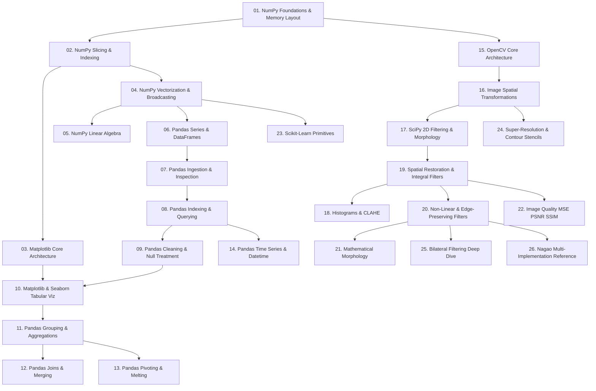

# 00. Library Learning Roadmap

## 1. Overview and Pedagogical Progression
This single directory contains the complete, unified learning path for every library in the curriculum: **NumPy, Matplotlib, Seaborn, Pandas, OpenCV, SciPy, and Scikit-Learn**. Each shared library is learned exactly **once** here — with its dedicated, in-depth explanation — and is then referenced (with brief in-context reminders) from both the Data Science chapters (01–05) and the Image Processing chapter (06). The notes are organized in a pedagogical sequence based on conceptual prerequisites and dependencies:

## 2. Note Sequence and Prerequisite Mapping

### 2.1 Data Science Stack (Notes 01–14)

| Note | Focus Concepts | Prerequisites | Dependents |
| :--- | :--- | :--- | :--- |
| **01. NumPy Foundations** | `ndarray`, contiguous C-buffers, shapes, strides, data types | Python primitives | [[02. NumPy Array Manipulation - Slicing, Strides, Shapes, and Vectorized Indexing]], [[15. OpenCV Core Architecture - Matrix Representation, Channels, and Color Constellations]] |
| **02. NumPy Array Manipulation** | Strided slicing, memory views, boolean masking, `np.where`, `np.clip`, Z-scores, `np.argsort` | [[01. NumPy Foundations - Memory Layout, ndarray Anatomy, and Array Instantiation]] | [[03. Matplotlib Core Architecture - Figure, Axes, and Canvas Visualization Mechanics]], [[04. NumPy Mathematical Engine - Vectorization, ufuncs, and Broadcasting Rules]] |
| **03. Matplotlib Core** | Figure, Axes, subplots, `imshow` with `cmap`/`vmin`/`vmax`, visual styling | [[02. NumPy Array Manipulation - Slicing, Strides, Shapes, and Vectorized Indexing]] | [[10. Matplotlib and Seaborn Statistical Plotting for Tabular Data]] |
| **04. NumPy Mathematical Engine** | Vectorization, universal functions, Broadcasting rules, `np.fft` | [[02. NumPy Array Manipulation - Slicing, Strides, Shapes, and Vectorized Indexing]] | [[05. NumPy Linear Algebra and Advanced Numerical Computation]], [[06. Pandas Structural Primitives - Series and DataFrame Architecture]] |
| **05. NumPy Linear Algebra** | Matrix products, inverses, determinants, eigenvalues | [[04. NumPy Mathematical Engine - Vectorization, ufuncs, and Broadcasting Rules]] | Production ML modeling |
| **06. Pandas Structural Primitives** | Series and DataFrame memory architecture, index alignment | [[04. NumPy Mathematical Engine - Vectorization, ufuncs, and Broadcasting Rules]] | [[07. Pandas Data Ingestion, Inspection, and Type Coercion]] |
| **07. Pandas Data Ingestion** | Reading CSVs, Excel, memory inspection (`info`, `describe`) | [[06. Pandas Structural Primitives - Series and DataFrame Architecture]] | [[08. Pandas Indexing, Slicing, and Query Mechanics (loc, iloc, query, at)]] |
| **08. Pandas Indexing Mechanics** | `loc`, `iloc`, `at`, `iat`, boolean masks, `.query()` | [[07. Pandas Data Ingestion, Inspection, and Type Coercion]] | [[09. Pandas Data Cleansing - Handling Nulls, Deduplication, and String Normalization]] |
| **09. Pandas Data Cleansing** | Missing data imputation, deduplication, string methods, `get_dummies` | [[08. Pandas Indexing, Slicing, and Query Mechanics (loc, iloc, query, at)]] | [[10. Matplotlib and Seaborn Statistical Plotting for Tabular Data]], [[11. Pandas Grouping, Split-Apply-Combine, and Statistical Aggregations]] |
| **10. Matplotlib & Seaborn Tabular** | Visualizing DataFrames, `Axes.hist` tonal histograms, heatmaps, violin plots, `plot_surface` | [[03. Matplotlib Core Architecture - Figure, Axes, and Canvas Visualization Mechanics]], [[09. Pandas Data Cleansing - Handling Nulls, Deduplication, and String Normalization]] | [[05.1. Exploratory Data Analysis Principles, Distributions, and Correlation Metrics]] |
| **11. Pandas Grouping & Agg** | Split-apply-combine, custom aggregations | [[09. Pandas Data Cleansing - Handling Nulls, Deduplication, and String Normalization]] | [[12. Pandas Relational Operations - Joins, Merging, and Concatenation]], [[13. Pandas Data Reshaping - Pivoting, Unpivoting, Stacking, and Melting]] |
| **12. Pandas Relational Ops** | Inner, left, right, outer joins, vertical/horizontal concat | [[11. Pandas Grouping, Split-Apply-Combine, and Statistical Aggregations]] | Feature engineering pipelines |
| **13. Pandas Data Reshaping** | `pivot`, `pivot_table`, unpivoting with `melt` | [[11. Pandas Grouping, Split-Apply-Combine, and Statistical Aggregations]] | Multi-index manipulation |
| **14. Pandas Time Series** | `to_datetime`, datetime indices, resample, rolling windows | [[08. Pandas Indexing, Slicing, and Query Mechanics (loc, iloc, query, at)]] | Temporal analytics |

### 2.2 Image Processing Stack (Notes 15–26)

| Note | Focus Concepts | Prerequisites | Dependents |
| :--- | :--- | :--- | :--- |
| **15. OpenCV Core** | `imread`/`imwrite`, BGR layout, `cvtColor`, channel splitting/merging, saturated arithmetic | [[01. NumPy Foundations - Memory Layout, ndarray Anatomy, and Array Instantiation]] | [[16. Image Spatial Transformations - Interpolation, Scaling, Cropping, and Affine Warping]] |
| **16. Image Spatial Transformations** | ROI cropping, `resize` interpolation flags, rotations, `warpAffine` | [[15. OpenCV Core Architecture - Matrix Representation, Channels, and Color Constellations]] | [[24. Super-Resolution and Edge-Adaptive Interpolation - Pascal Getreuer Contour Stencils]] |
| **17. SciPy Signal & Spatial Ops** | `convolve2d` modes and boundaries, `ndimage` binary morphology | [[04. NumPy Mathematical Engine - Vectorization, ufuncs, and Broadcasting Rules]] | [[19. Spatial Image Restoration - Noise Models, Linear Convolution, and Fast Integral Filters]], [[21. Mathematical Morphology - Set Theory, Structuring Elements, and Thinning]] |
| **18. Visual Frequency & Radiometry** | `cv2.calcHist`, `normalize`, `equalizeHist`, `createCLAHE` | [[19. Spatial Image Restoration - Noise Models, Linear Convolution, and Fast Integral Filters]] | Contrast engineering pipelines |
| **19. Spatial Image Restoration** | Noise models, convolution, integral images, `boxFilter`/`GaussianBlur`/`filter2D`/`addWeighted` | [[17. SciPy Signal and Spatial Operations - 2D Filtering and Morphology]] | [[20. Non-Linear and Edge-Preserving Filtering - Median, Bilateral, and Nagao Filters]], [[22. Objective Image Quality Assessment - MSE, PSNR, and SSIM Metrics]] |
| **20. Non-Linear & Edge-Preserving Filters** | `medianBlur`, `bilateralFilter`, Nagao 9-sector filter | [[19. Spatial Image Restoration - Noise Models, Linear Convolution, and Fast Integral Filters]] | [[21. Mathematical Morphology - Set Theory, Structuring Elements, and Thinning]] |
| **21. Mathematical Morphology** | Erosion, dilation, opening, closing, `morphologyEx`, `connectedComponentsWithStats`, Zhang-Suen | [[19. Spatial Image Restoration - Noise Models, Linear Convolution, and Fast Integral Filters]] | Segmentation pipelines |
| **22. Image Quality Assessment** | MSE, PSNR (dB), SSIM implementations | [[19. Spatial Image Restoration - Noise Models, Linear Convolution, and Fast Integral Filters]] | Restoration benchmarking |
| **23. Scikit-Learn Primitives** | `KMeans` pixel clustering, `jaccard_score` IoU, `StandardScaler` | [[04. NumPy Mathematical Engine - Vectorization, ufuncs, and Broadcasting Rules]] | Segmentation evaluation, classifier pipelines |
| **24. Super-Resolution & Contour Stencils** | Getreuer contour stencils, total variation along curves, 2x/4x SR | [[16. Image Spatial Transformations - Interpolation, Scaling, Cropping, and Affine Warping]] | Document restoration projects |
| **25. Bilateral Filtering Deep Dive** | Joint spatial-radiometric theory, worked examples, parameter limits, from-scratch NumPy + `cv2.bilateralFilter`, range LUT, artifacts | [[20. Non-Linear and Edge-Preserving Filtering - Median, Bilateral, and Nagao Filters]] | Denoising pipelines, tone mapping, pre-segmentation smoothing |
| **26. Nagao Multi-Implementation Reference** | 9-sector variance minimization, four cross-verified implementations (loops, `E[X²]-E[X]²` gathering, hardcoded kernels via `filter2D`, sliding-window `einsum`), measured benchmarks | [[20. Non-Linear and Edge-Preserving Filtering - Median, Bilateral, and Nagao Filters]], [[02. NumPy Array Manipulation - Slicing, Strides, Shapes, and Vectorized Indexing]] | Cell counting, document preprocessing, fingerprint enhancement |

## 3. How to Use This Section While Studying the Chapters
Learning is intentionally **non-linear**: you are not expected to finish all of NumPy before touching Pandas or OpenCV. Instead:
1. Start with notes 01–04 (NumPy core) — every later note depends on them.
2. Enter the Pandas branch (06–14) or the OpenCV branch (15–17) whenever your current chapter needs them.
3. When a chapter note uses a library function you have not met yet, it carries a **brief in-context explanation** plus a link back to the dedicated note here. Read the reminder, continue the chapter, and dive into the full note when you reach a natural stopping point.
4. The image-processing library notes (18–22, 24–26) parallel the theory notes of [[06.0. Chapter Overview and Navigation]]: theory explains *why*, the library note explains *how to call it*. Notes 25 and 26 are the exhaustive engineering references for the two flagship edge-preserving operators — read them alongside [[06.2.6. Structural Edge-Preserving Smoothing (Nagao 9-Sector Multi-Directional Filter)]] and [[06.2.7. Non-Linear Boundary-Preserving Filtering (Bilateral Joint Spatial-Radiometric Filter)]], and before attempting the laboratory [[06.9.5. TP2 Part 2 - Edge-Preserving Non-Linear Smoothing with Nagao Filter]].

---
