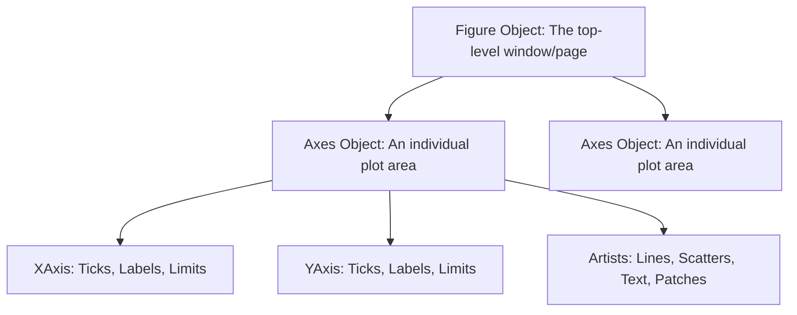

# 03. Matplotlib Core Architecture - Figure, Axes, and Canvas Visualization Mechanics

## 1. Overview
Matplotlib is Python's core plotting library. This note covers its rendering architecture, the difference between the functional and object-oriented interfaces, subplot grid management, and matrix display with `imshow`.

## 2. Rendering Architecture



1. **Figure (`Figure`)**: The overall container window or canvas where visualizations are drawn. Manages figure dimensions, DPI, and subplots.
2. **Axes (`Axes`)**: An individual coordinate area within the figure. An `Axes` object manages the coordinate system and contains plotting methods (`plot`, `scatter`, `hist`, `bar`).
3. **Axis (`XAxis`, `YAxis`)**: Handles scale limits, tick marks, and tick labels.
4. **Artists**: Everything rendered on an Axes, including lines, markers, legend boxes, and title text.

## 3. Interfaces: Pyplot vs. Object-Oriented Interface

### The Pyplot Functional Interface (Quick Prototyping)
Maintains state implicitly using global references. Calling functions like `plt.plot()` draws on the most recently active Axes automatically. Decorator calls (`plt.title`, `plt.xlabel`, `plt.ylabel`, `plt.legend`, `plt.grid`) style the active Axes the same way their object-oriented counterparts do:
```python
import matplotlib.pyplot as plt

plt.plot([1, 2, 3], [10, 20, 30])
plt.title("Functional Plot")
plt.xlabel("Sample Index")
plt.ylabel("Measurement")
plt.show()
```

### The Object-Oriented Interface (Recommended for Production)
Instantiates `Figure` and `Axes` objects explicitly. This provides finer control and prevents conflicts across complex, multi-plot layouts:
```python
fig, ax = plt.subplots(figsize=(6, 4))
ax.plot([1, 2, 3], [10, 20, 30], color="crimson", linewidth=2.0, label="Metric")
ax.set_title("Object-Oriented Plot", fontsize=12, fontweight="bold")
ax.set_xlabel("Time (s)")
ax.set_ylabel("Amplitude (mV)")
ax.grid(True, linestyle=":", alpha=0.6)
ax.legend()
plt.tight_layout()
plt.show()
```

## 4. Multi-Plot Subplot Management
The `plt.subplots(nrows, ncols)` function creates a grid of subplots and returns them as a 2D array of `Axes` objects:

```python
fig, axs = plt.subplots(nrows=1, ncols=2, figsize=(10, 4))

# Left Subplot (axs[0])
axs[0].bar(["Module A", "Module B"], [15.2, 12.8], color="skyblue")
axs[0].set_title("Module Average Grades")

# Right Subplot (axs[1])
axs[1].hist([10, 12, 12, 14, 15, 18, 19], bins=5, color="salmon")
axs[1].set_title("Grade Distributions")

plt.tight_layout()  # Automatically adjusts subplot spacing to prevent overlapping labels
plt.show()
```

## 5. Displaying Matrices: `Axes.imshow(X, cmap=None, vmin=None, vmax=None)`
`imshow` renders a 2D or 3D NumPy array as an image — the primary bridge between array processing and visual inspection in both Data Science (heatmaps) and Image Processing (rendering pixel matrices).

### Key Parameters
* `X`: The array. Supported shapes:
  * $(M, N)$: 2D scalar array interpreted using a color map (`cmap`).
  * $(M, N, 3)$: 3D array interpreted as RGB floating-point values in $[0.0, 1.0]$ or unsigned integers in $[0, 255]$.
  * $(M, N, 4)$: 3D array with an Alpha channel (RGBA).
* `cmap`: Color lookup table for 2D scalar matrices. Common values:
  * `'gray'`: Linear grayscale ($0 \to \text{black}, \ 255 \to \text{white}$).
  * `'viridis'`: Perceptually uniform modern default.
  * `'jet'` / `'hsv'`: High-contrast rainbow spectra (can introduce visual artifacts).
* `vmin`, `vmax`: Normalization bounds. If set to `None`, Matplotlib scales the display linearly to the matrix's actual minimum and maximum values. **Always set `vmin=0, vmax=255` for 8-bit images** to prevent automatic scaling from exaggerating background noise in dark images.

```python
import numpy as np
import matplotlib.pyplot as plt

synthetic_matrix = np.array([
    [10, 20],
    [30, 40]
], dtype=np.uint8)

fig, ax = plt.subplots()

# Incorrect: Automatically stretches 10 to Black and 40 to White!
# ax.imshow(synthetic_matrix, cmap='gray')

# Correct: Explicitly anchors dynamic range to standard 8-bit limits
im = ax.imshow(synthetic_matrix, cmap='gray', vmin=0, vmax=255)
ax.set_title("Absolute 8-bit Grayscale Rendering")
plt.colorbar(im, ax=ax)
plt.show()
```

### Multi-Panel Image Comparison
Comparing an original image with its processed variants is the standard pattern for restoration experiments:

```python
# Creating an input signal and filtered counterpart
original = np.random.randint(0, 256, size=(100, 100), dtype=np.uint8)
filtered = np.zeros_like(original)

fig, axes = plt.subplots(1, 2, figsize=(8, 4))

axes[0].imshow(original, cmap='gray', vmin=0, vmax=255)
axes[0].set_title("Original Corrupted Signal")
axes[0].axis('off')  # Suppress axis ticks and labels

axes[1].imshow(filtered, cmap='gray', vmin=0, vmax=255)
axes[1].set_title("Restored Output")
axes[1].axis('off')

plt.tight_layout()
plt.show()
```

## 6. Connections to Other Topics
- Next step: [[04. NumPy Mathematical Engine - Vectorization, ufuncs, and Broadcasting Rules]].
- Used to plot distributions in [[03.3. Tutorial 04 - Academic Performance Statistical Analysis with NumPy and Matplotlib]].
- Statistical chart types built on this architecture: [[10. Matplotlib and Seaborn Statistical Plotting for Tabular Data]].
- OpenCV images must be converted from BGR to RGB before display — see [[15. OpenCV Core Architecture - Matrix Representation, Channels, and Color Constellations]].

---
