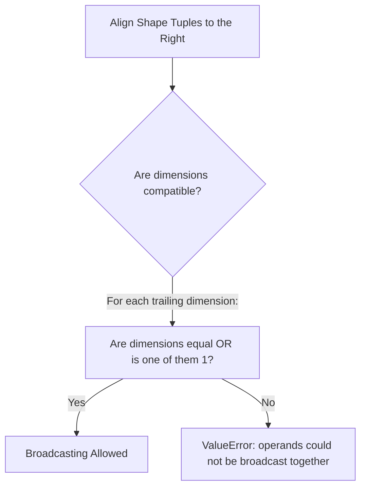

# 04. NumPy Mathematical Engine - Vectorization, ufuncs, and Broadcasting Rules

## 1. Overview
This note covers NumPy's mathematical computation engine, explaining universal functions (ufuncs), vectorization, multi-axis aggregations, array reshaping, stacking, tiling, broadcasting rules with practical Data Science and Image Processing applications, random number generation with reproducibility discipline, and the `np.fft` frequency-domain routines.

## 2. Universal Functions (ufuncs)
A universal function (ufunc) operates on `ndarray` objects element-by-element in compiled C code, eliminating Python interpreter overhead and enabling SIMD parallel execution:

```python
import numpy as np

x = np.array([1.0, 4.0, 9.0])
sqrt_x = np.sqrt(x)           # [1.0, 2.0, 3.0]
exp_x = np.exp([0.0, 1.0])    # [1.0, 2.71828...]
log_x = np.log([1.0, np.e])   # [0.0, 1.0]
sine_x = np.sin(np.pi / 2)    # 1.0
```

Core ufunc families: `np.add`, `np.subtract`, `np.multiply`, `np.divide`; `np.exp`, `np.log`, `np.sqrt`, `np.abs`; `np.sin`, `np.cos`, `np.arctan`. A frequent image-processing composite is the vectorized Euclidean hypotenuse for gradient magnitudes:

```python
# Calculating the pixel magnitude of spatial derivatives Gx and Gy
Gx = np.array([[-1.0, 0.0, 1.0]], dtype=np.float32)
Gy = np.array([[1.0, 2.0, 1.0]], dtype=np.float32)

# Vectorized Euclidean hypotenuse: sqrt(Gx^2 + Gy^2)
gradient_magnitude = np.hypot(Gx, Gy)
```

### Element-Wise extrema: `np.maximum` and `np.minimum`
Do not confuse the **reduction** `np.max(a)` (one scalar per axis) with the **binary ufunc** `np.maximum(a, b)`, which returns an array of the element-wise maxima of two arrays of matching (or broadcastable) shape:

```python
a = np.array([10, 40, 70])
b = np.array([30, 20, 50])
np.maximum(a, b)        # [30, 40, 70]  <- element-wise, shape preserved
np.max(a)               # 70            <- reduction to a scalar

# Classic image-processing use: clamping contrast-stretched values
stretched = 255 * (img - lo) / (hi - lo)
valid = np.maximum(stretched, 0)      # floor at 0 without np.where loops
```

`np.minimum` is the mirror operation (ceiling). The pair replaces slow `np.where(cond, x, y)` clamping patterns — for pure clamping to a fixed interval, `np.clip(a, lo, hi)` (a single call fusing `maximum` and `minimum`) is the idiomatic choice used throughout the restoration pipelines. Both accept broadcasting, so `np.maximum(img, 0)` works on any shape.

## 3. Multi-Axis Reductions and Aggregations
NumPy aggregation functions include an `axis` parameter that controls the direction of reduction:
- `axis=None`: Reduces the entire array to a single scalar value.
- `axis=0`: Collapses **rows** by computing statistics downward along each column.
- `axis=1`: Collapses **columns** by computing statistics across each row.

```python
a = np.array([
    [10, 20, 30],
    [40, 50, 60]
])

print("Total Array Sum:   ", np.sum(a))            # 210
print("Column-wise Means: ", np.mean(a, axis=0))    # [25., 35., 45.]
print("Row-wise Maxima:   ", np.max(a, axis=1))     # [30, 60]
print("Standard Deviation:", np.std(a))             # Overall standard deviation

# Order statistics: np.median and np.percentile (quartiles, robust outliers)
print("Median:            ", np.median(a))           # 35.0
print("75th Percentile:   ", np.percentile(a, 75))   # 50.0
```

`np.median` and `np.percentile(a, q)` are order statistics: unlike the mean, they are robust to extreme outlier values, which is why grading and salary analyses prefer them.

## 4. Array Reshaping, Flattening, and Stacking

### Reshaping and Flattening
- `a.reshape(r, c)`: Returns a view of the array with a new shape $(r, c)$, provided $r \times c = \text{a.size}$.
- `a.ravel()`: Flattens an array into 1D without copying data whenever possible.
- `a.flatten()`: Flattens an array into 1D, always allocating an independent copy.

### Stacking and Tiling Operations
```python
a = np.array([[1, 2], [3, 4]])
b = np.array([[5, 6], [7, 8]])

# Horizontal Stacking: Combine side-by-side along axis 1 (must share row count)
h_stacked = np.hstack((a, b))  # Shape: (2, 4)

# Vertical Stacking: Stack one above another along axis 0 (must share col count)
v_stacked = np.vstack((a, b))  # Shape: (4, 2)

# Generalized Concatenation:
cat_ax0 = np.concatenate((a, b), axis=0) # Equivalent to vstack

# Tiling: replicate a whole array along each axis (materializes memory)
tiled_2x3 = np.tile(a, (2, 3))           # Shape: (4, 6) - a repeated 2x vertically, 3x horizontally
row_vector = np.array([10, 20, 30])
np.tile(row_vector, (4, 1))              # Shape: (4, 3) - one row repeated 4 times
```

**`np.tile` vs. broadcasting vs. `np.repeat`:** `np.tile(a, reps)` copies the *entire block* `reps` times along each axis — it allocates real memory. Broadcasting (`a[None, :]` with stride-0 axes) achieves the same geometric layout *virtually, without copying* — prefer it whenever the next operation supports broadcasting (see Section 5). `np.repeat(a, n, axis)` instead repeats each *element* consecutively (interleaving), which is the behavior needed to build kernel columns and pixel replicators in filter construction. `np.tile` is the right tool when the repeated block must exist concretely — e.g., synthesizing a structured test image, building a 9-sector weight mask, or repeating a per-row scalar into a full matrix for a library call that cannot broadcast.

## 5. The Formal Rules of Array Broadcasting
Broadcasting allows arithmetic operations between arrays of different shapes by conceptually expanding the smaller array to match the larger array's dimensions without copying data. When a dimension size equals $1$, the array acts as if its data were repeated along that axis by setting the memory stride for that dimension to $0$.



### The Two Rules of Compatibility
1. **Right-to-Left Alignment**: Align the shape tuples of both arrays starting from their trailing (rightmost) dimensions. If an array has fewer dimensions than the other, its shape is padded with ones on the left until the dimensionalities match.
2. **Dimension Compatibility**: Two dimensions are compatible if:
   - They have the same size, OR
   - One of them has a size of 1.

```text
Dimension Alignment Example:
Array A (3D Image):    512 x 512 x 3
Array B (1D Weights):              3
-------------------------------------
Step 1: Pad B left:     1  x   1   x 3
Step 2: Check dims:    512    512    3
                       ↕      ↕      ↕
                        1      1     3  --> Compatible!
Resulting Shape:       512 x 512 x 3
```

```python
# Example: Adding a 1D row vector to a 2D matrix
matrix = np.ones((4, 3))      # Shape: (4, 3)
vector = np.array([10, 20, 30])# Shape:    (3,) -> Aligns as (1, 3)

# Trailing dimensions match (3 == 3); leading dimension expands (1 -> 4)
result = matrix + vector      # Shape: (4, 3)
```

### Practical Application A: Color Channel Weighting (Photometric Conversion)
Multiplying a color image of shape $(H, W, 3)$ by photometric luminance weights $(0.299, 0.587, 0.114)$ without manual loops:

```python
# Generate a synthetic RGB image
img_rgb = np.ones((480, 640, 3), dtype=np.float32)

# Luminance coefficients vector
weights = np.array([0.299, 0.587, 0.114], dtype=np.float32)

# Element-wise broadcasting multiplication across channels:
weighted_channels = img_rgb * weights  # Shape: (480, 640, 3)

# Sum across the trailing color axis to produce a 2D luminance plane
grayscale_img = np.sum(weighted_channels, axis=2)  # Shape: (480, 640)
```

### Practical Application B: Data Feature Normalization (Feature Scaling)
Centering tabular features by subtracting the feature means and dividing by the standard deviations:

```python
# Synthetic tabular matrix: 1000 samples, 4 features
X = np.random.randn(1000, 4).astype(np.float32)

# Compute mean and standard deviation along the sample axis (axis=0)
mu = np.mean(X, axis=0)   # Shape: (4,)
sigma = np.std(X, axis=0) # Shape: (4,)

# Broadcast subtraction and division: (1000, 4) with (4,)
X_standardized = (X - mu) / sigma
```

## 6. Random Number Generation and Reproducibility (`np.random`)
Every synthetic dataset, noise model, and stochastic benchmark in this vault draws from `np.random`. Two generations of API coexist:

```python
import numpy as np

# --- Legacy global API (seen in most course tutorials) ---
np.random.seed(42)                 # fix the global generator state -> reproducible runs
grades = np.random.randint(0, 101, size=50)     # 50 uniform integers in [0, 100]
noise = np.random.normal(0.0, 10.0, size=img.shape)  # Gaussian AWGN, sigma=10
mask = np.random.rand(h, w) < 0.05              # uniform [0,1), thresholded -> 5% salt mask

# --- Modern generator API (NumPy >= 1.17, preferred in new code) ---
rng = np.random.default_rng(42)    # independent, stream-safe generator object
grades = rng.integers(0, 101, size=50)
noise = rng.normal(0.0, 10.0, size=img.shape)
mask = rng.random((h, w)) < 0.05
```

Key functions and their distributions:

| Function | Distribution | Typical course use |
| :--- | :--- | :--- |
| `randint(lo, hi, size)` / `rng.integers` | discrete uniform $[lo, hi)$ | synthetic grades, test images |
| `rand(shape)` / `rng.random` | continuous uniform $[0, 1)$ | salt-and-pepper spatial masks |
| `randn(...)` | standard normal $\mathcal{N}(0,1)$ | feature matrices, Monte Carlo |
| `normal(mu, sigma, shape)` | Gaussian $\mathcal{N}(\mu, \sigma^2)$ | AWGN degradation model (note [[19. Spatial Image Restoration - Noise Models, Linear Convolution, and Fast Integral Filters|19]]) |
| `uniform(lo, hi, shape)` | continuous uniform $[lo, hi)$ | random parameter sweeps |

**Reproducibility discipline:** seed *once, at program start* (or pass a seeded `rng` object through functions); never re-seed inside loops (it correlates the draws); record the seed with every experimental result so PSNR/SSIM comparisons can be re-generated exactly. The legacy global API and `default_rng` streams are **independent** — `np.random.seed(42)` does not affect `default_rng(42)` and the two produce different sequences for the same seed.

## 7. Frequency-Domain Routines: `np.fft`
NumPy ships the Fast Fourier Transform used by the spectral analysis chapters:

- `np.fft.fft2(F)`: Computes the 2D Discrete Fourier Transform, mapping a spatial image to its frequency representation.
- `np.fft.ifft2(F)`: Inverse transform, mapping a spectrum back to the spatial domain (take `.real` to discard residual imaginary rounding noise).
- `np.fft.fftshift(F)`: Recenters the zero-frequency DC term from the corner to the middle of the spectrum for visualization.

```python
import numpy as np

# Magnitude spectrum of a grayscale image (log-compressed for display)
spectrum = np.fft.fftshift(np.fft.fft2(img_gray.astype(np.float64)))
magnitude = 20 * np.log10(np.abs(spectrum) + 1e-8)   # dB scale
```

The mathematical derivation of the 2D DFT, the convolution theorem, and frequency-domain filtering is covered in [[06.3.1. 2D Discrete Fourier Transform (DFT), FFT Shift, and Convolution Theorem]].

## 8. Connections to Other Topics
- Next step: [[05. NumPy Linear Algebra and Advanced Numerical Computation]].
- Explains DataFrame alignment in [[06. Pandas Structural Primitives - Series and DataFrame Architecture]].
- Boolean masks built on vectorized comparisons: [[02. NumPy Array Manipulation - Slicing, Strides, Shapes, and Vectorized Indexing]].
- Applied to noise synthesis in [[06.9.3. TP2 Part 1 - Discrete Noise Models and Spatial Convolution Smoothing]].
- `np.maximum`/`np.clip` clamping and `np.random` noise injection are exercised by the vectorized filters of [[26. Nagao Filtering - Multi-Implementation Reference with Hardcoded Kernels, Vectorized, and Convolution Approaches]].
