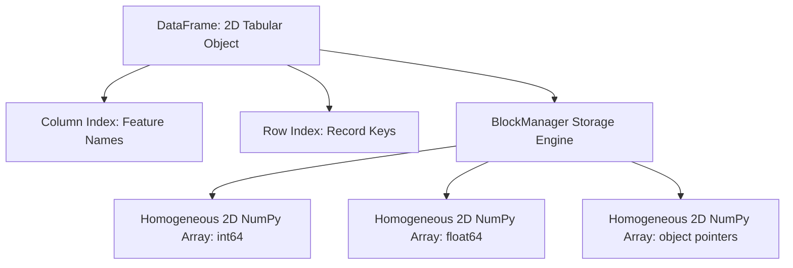

# 06. Pandas Structural Primitives - Series and DataFrame Architecture

## 1. Overview
Pandas provides structured, high-performance tabular data structures built on top of NumPy arrays. This note covers the architecture of **Series** (1D) and **DataFrames** (2D), custom index alignments, and conversion patterns.

## 2. Memory Architecture of Pandas Data Structures



### The 1D Structure: `pd.Series`
A Series is a one-dimensional labeled array. It wraps a contiguous 1D NumPy array while adding an associated index array that labels each row:

```python
import pandas as pd
import numpy as np

# Instantiate Series with custom labels
ages = pd.Series([25, 28, 22], index=["Amel", "Sami", "Rania"], name="Age")
print("Series Values: ", ages.values)       # Returns underlying NumPy array: [25, 28, 22]
print("Index Array:   ", ages.index)        # Index(['Amel', 'Sami', 'Rania'])
```

### The 2D Structure: `pd.DataFrame`
A DataFrame is a two-dimensional tabular data structure with labeled axes (rows and columns). Internally, a DataFrame groups columns of the same data type into shared 2D NumPy arrays using an engine called the `BlockManager`.

```python
# Create a DataFrame from a dictionary of lists
data = {
    "Name": ["Amel", "Sami", "Rania"],
    "Age": [25, 28, 22],
    "Salary": [50000, 54000, 58000]
}
df = pd.DataFrame(data, index=["A", "B", "C"])
display(df)
```

## 3. Index Mechanics and Index Resetting
- `df.index`: Accesses the row index labels.
- `df.reset_index(drop=False)`: Converts index labels into an explicit column and assigns a default integer index (`0, 1, 2...`).
- `df.drop(columns="index")`: Deletes redundant index columns generated by resetting.

```python
# Reset and clean indices
df_reset = df.reset_index()
df_cleaned = df_reset.drop(columns=["index"])
```

## 4. Connections to Other Topics
- Next step: [[07. Pandas Data Ingestion, Inspection, and Type Coercion]].
- Applied in [[03.4. Tutorial 04 - Hospital Department Patient Analytics with Pandas]].

---
