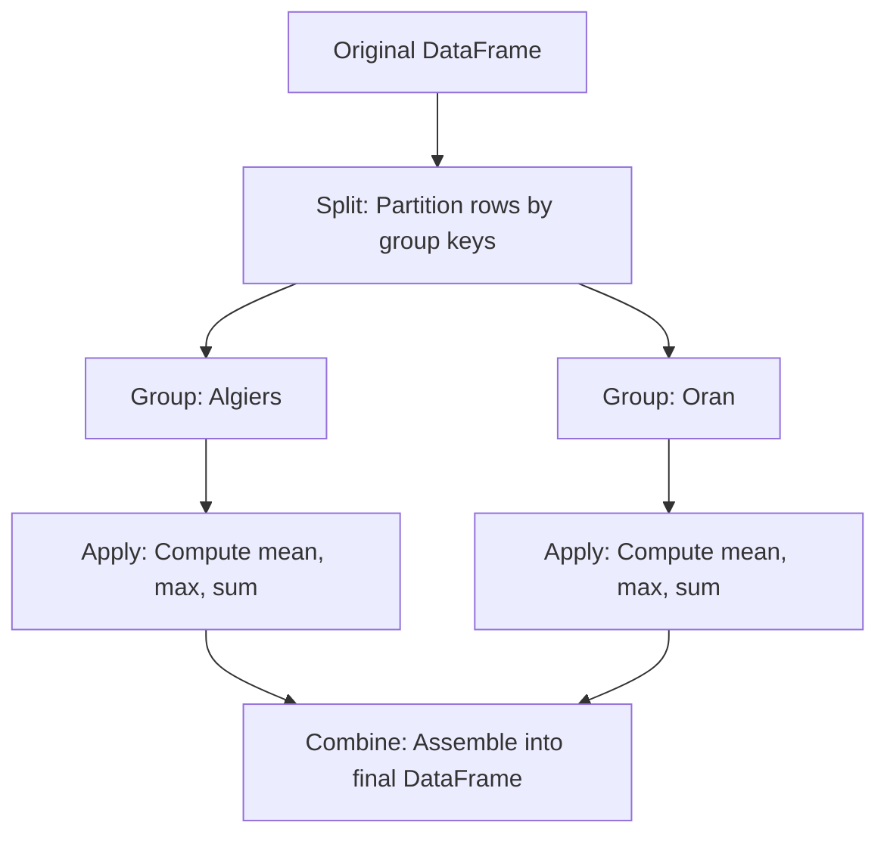

# 11. Pandas Grouping, Split-Apply-Combine, and Statistical Aggregations

## 1. Overview
Grouping operations in Pandas follow the **split-apply-combine** strategy. This note covers grouping by single and multiple keys, applying aggregate functions (`.agg()`), and broadcast transformations using `.transform()`.

## 2. The Split-Apply-Combine Architecture



1. **Split**: Groups rows based on unique values in specified key columns.
2. **Apply**: Computes summary statistics or transformations on each group independently.
3. **Combine**: Merges the group results into a single output DataFrame.

## 3. Aggregation Patterns

### Single Column Summary
```python
import pandas as pd

# Group by City and calculate the mean salary:
city_salary = df.groupby("City")["Salary"].mean()
```

### Multi-Metric Aggregations with `.agg()`
The `.agg()` method allows computing different statistical metrics across multiple columns in a single operation:

```python
# Compute multiple summaries across departments
grouped_summary = df.groupby("Department").agg(
    AvgSalary=("Salary", "mean"),
    MaxSalary=("Salary", "max"),
    MinSalary=("Salary", "min"),
    PatientCount=("PatientID", "count")
).reset_index()

display(grouped_summary)
```

### Cross-Tabulation with `pd.crosstab()`
A cross-tabulation computes the frequency table (contingency matrix) between two or more categorical columns — the counting counterpart of `groupby`:

```python
# Count occurrences of each (Department, RiskCategory) pair
contingency = pd.crosstab(df["Department"], df["RiskCategory"])
```

## 4. Aggregations vs. Group Transformations (`.transform()`)
- **`.agg()`**: Reduces each group to a single summary row, changing the DataFrame's dimensions.
- **`.transform()`**: Computes group statistics and broadcasts the result back across the original rows, preserving the DataFrame's shape:

```python
# Compute group means and align with original rows:
df["DeptAvgSalary"] = df.groupby("Department")["Salary"].transform("mean")
df["SalaryDiffFromDept"] = df["Salary"] - df["DeptAvgSalary"]
```

## 5. Connections to Other Topics
- Next step: [[12. Pandas Relational Operations - Joins, Merging, and Concatenation]].
- Applied in [[03.4. Tutorial 04 - Hospital Department Patient Analytics with Pandas]].

---
