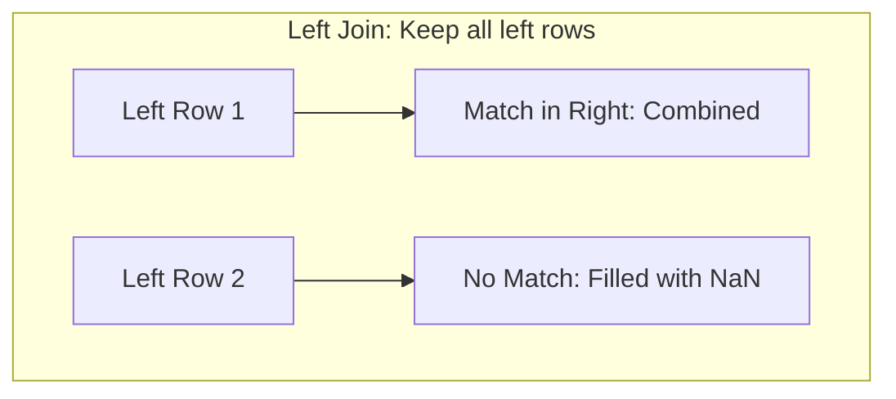

# 12. Pandas Relational Operations - Joins, Merging, and Concatenation

## 1. Overview
Real-world datasets are often split across multiple tables. This note covers combining DataFrames using SQL-style joins with `pd.merge()` and multi-axis concatenation with `pd.concat()`.

## 2. Relational Joining with `pd.merge()`
The `pd.merge()` function joins two DataFrames based on matching values in common key columns:



### Join Types (`how` parameter)
- `inner` (default): Retains only rows with matching keys in both DataFrames.
- `left`: Retains all rows from the left DataFrame, filling missing values from the right DataFrame with `NaN`.
- `right`: Retains all rows from the right DataFrame, filling missing values from the left DataFrame with `NaN`.
- `outer`: Retains all rows from both DataFrames, filling unmatched values with `NaN`.

```python
import pandas as pd

patients = pd.DataFrame({
    "PatientID": ["P1", "P2", "P3"],
    "Name": ["Amel", "Sami", "Rania"],
    "City": ["Algiers", "Oran", "Constantine"]
})

departments = pd.DataFrame({
    "City": ["Algiers", "Oran", "Blida"],
    "DeptName": ["Cardiology", "Neurology", "Orthopedics"]
})

# Left Join on common column 'City'
merged_df = pd.merge(patients, departments, on="City", how="left")
display(merged_df)
```

## 3. Concatenation along Axes with `pd.concat()`
`pd.concat()` stacks DataFrames together along a specified axis:
- `axis=0` (Vertical): Stacks rows on top of each other. Set `ignore_index=True` to reset the row index cleanly.
- `axis=1` (Horizontal): Aligns DataFrames side-by-side along shared row indices.

```python
df1 = pd.DataFrame({"A": [1, 2], "B": [3, 4]})
df2 = pd.DataFrame({"A": [5, 6], "B": [7, 8]})

# Vertical concatenation:
stacked_rows = pd.concat([df1, df2], axis=0, ignore_index=True)

# Horizontal concatenation:
stacked_cols = pd.concat([df1, df2], axis=1)
```

## 4. Connections to Other Topics
- Next step: [[13. Pandas Data Reshaping - Pivoting, Unpivoting, Stacking, and Melting]].
- Used to combine medical records in [[03.4. Tutorial 04 - Hospital Department Patient Analytics with Pandas]].

---
