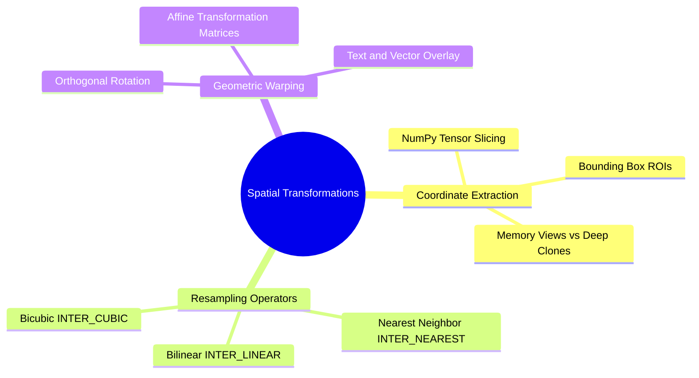
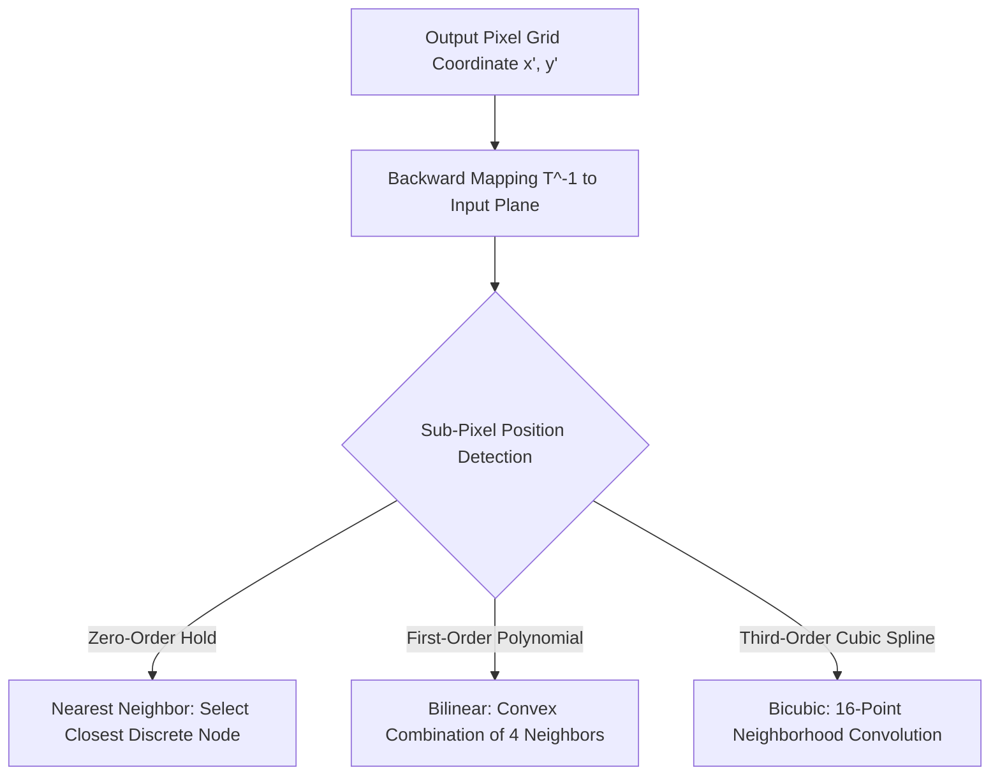

# 16. Image Spatial Transformations - Interpolation, Scaling, Cropping, and Affine Warping

## 1. Overview
Geometric and spatial transformations map pixel coordinates from an input image plane onto an output raster grid. This note covers coordinate mapping, spatial cropping via Region of Interest (ROI) slicing, geometric scaling, interpolation methods, and 2D matrix rotations.



## 2. Theoretical Foundations: Coordinate Mapping and Resampling

A spatial transformation is a mathematical mapping $T$ that relates input coordinates $(x, y)$ to output target coordinates $(x', y')$:

$$\begin{bmatrix} x' \\ y' \end{bmatrix} = T \begin{bmatrix} x \\ y \end{bmatrix}$$

Because transformed coordinates $(x', y')$ often fall on non-integer sub-pixel locations, discrete intensity values must be reconstructed using **spatial interpolation**.



### 2.1 Nearest Neighbor Interpolation (`cv2.INTER_NEAREST`)
Assigns the intensity of the nearest discrete coordinate:
$$I(x', y') = I(\text{round}(x), \ \text{round}(y))$$
- **Complexity**: $O(1)$ per target pixel.
- **Trade-off**: Extremely fast, but introduces jagged staircase artifacts along diagonal boundaries.

### 2.2 Bilinear Interpolation (`cv2.INTER_LINEAR`)
Performs linear interpolation sequentially across both axes over a $2 \times 2$ neighborhood. Let $(x_1, y_1)$, $(x_1, y_2)$, $(x_2, y_1)$, and $(x_2, y_2)$ denote the four neighboring pixel coordinates surrounding sub-pixel point $(x, y)$:

$$I(x, y_1) \approx \frac{x_2 - x}{x_2 - x_1} I(x_1, y_1) + \frac{x - x_1}{x_2 - x_1} I(x_2, y_1)$$

$$I(x, y_2) \approx \frac{x_2 - x}{x_2 - x_1} I(x_1, y_2) + \frac{x - x_1}{x_2 - x_1} I(x_2, y_2)$$

$$I(x, y) \approx \frac{y_2 - y}{y_2 - y_1} I(x, y_1) + \frac{y - y_1}{y_2 - y_1} I(x, y_2)$$

### 2.3 Bicubic Interpolation (`cv2.INTER_CUBIC`)
Interpolates across a $4 \times 4$ neighborhood (16 pixels) using cubic convolution kernels. It balances sharpness and smooth gradients while reducing pixelation artifacts.

## 3. Core Functions Reference

### 3.1 Region of Interest (ROI) Slicing
Because OpenCV images are stored as NumPy arrays, spatial sub-regions are extracted using standard slicing syntax:
$$\text{ROI} = I[y_{\text{start}}:y_{\text{end}}, \ x_{\text{start}}:x_{\text{end}}]$$
*Crucial Architecture Note*: Standard slicing returns a **memory view**. Modifying values inside an uncopied ROI alters the source image directly. Use `.copy()` to ensure data isolation.

### 3.2 `cv2.resize(src, dsize, fx, fy, interpolation)`
Rescales image raster dimensions.
- `src`: Input source tensor.
- `dsize`: Target output resolution specified as a tuple: `(width, height)`.
- `fx, fy`: Scale factor multipliers along the horizontal and vertical axes when `dsize = (0, 0)`.
- `interpolation`: Mathematical sampling algorithm:
  - `cv2.INTER_NEAREST`: Nearest-neighbor sampling. Fast, but produces visible pixelation and jagged edges.
  - `cv2.INTER_LINEAR`: Bilinear interpolation. Balanced performance; standard for general upsampling.
  - `cv2.INTER_CUBIC`: Bicubic spline interpolation over a $4 \times 4$ neighborhood. Produces sharper edges with fewer artifacts.
  - `cv2.INTER_AREA`: Resampling using pixel area relations. Preferred for downsampling images without aliasing.

### 3.3 `cv2.rotate(src, rotateCode)`
Performs fast 90-degree orthogonal rotations without matrix multiplication:
- `cv2.ROTATE_90_CLOCKWISE`: Rotates 90 degrees clockwise.
- `cv2.ROTATE_180`: Rotates 180 degrees.
- `cv2.ROTATE_90_COUNTERCLOCKWISE`: Rotates 270 degrees clockwise (90 degrees counter-clockwise).

### 3.4 Vector Drawing Primitives: `rectangle` and `putText`
- `cv2.rectangle(img, pt1, pt2, color, thickness)`:
  - `pt1`: Top-left corner coordinate tuple `(x1, y1)`.
  - `pt2`: Bottom-right corner coordinate tuple `(x2, y2)`.
  - `color`: BGR color tuple (e.g., pure blue: `(255, 0, 0)`).
  - `thickness`: Line thickness in pixels. Passing `-1` fills the rectangle completely.
- `cv2.putText(img, text, org, fontFace, fontScale, color, thickness)`:
  - `org`: Bottom-left text baseline coordinate tuple `(x, y)`.
  - `fontFace`: Font style identifier (e.g., `cv2.FONT_HERSHEY_SIMPLEX`).

## 4. Code Implementation Examples

```python
import cv2
import numpy as np

# Load color test image
img = cv2.imread("Images/pepper.bmp")
if img is None:
    raise FileNotFoundError("Image file 'Images/pepper.bmp' not found.")

h, w = img.shape[:2]

# 1. Rescaling by a factor of 0.5 (dividing dimensions by 2)
new_w = w // 2
new_h = h // 2
half_scaled = cv2.resize(img, (new_w, new_h), interpolation=cv2.INTER_LINEAR)

# 2. Extract bounding box Region of Interest (ROI)
# Defined boundary: y from 30 to 150, x from 200 to 400
y_start, y_end = 30, 150
x_start, x_end = 200, 400

# Perform isolated extraction using .copy()
cropped_roi = img[y_start:y_end, x_start:x_end].copy()

# 3. Geometric Annotation: Draw bounding box and text label
annotated_canvas = img.copy()
# Draw bounding box outline (Color: Blue (255, 0, 0), Thickness: 2px)
cv2.rectangle(annotated_canvas, (x_start, y_start), (x_end, y_end), (255, 0, 0), thickness=2)

# Render text string above bounding box (Color: Green (0, 255, 0), Scale: 0.6)
cv2.putText(
    annotated_canvas, 
    "My rectangle", 
    (x_start, y_start - 10), 
    cv2.FONT_HERSHEY_SIMPLEX, 
    fontScale=0.6, 
    color=(0, 255, 0), 
    thickness=2
)

# 4. Orthogonal rotation (90 degrees clockwise)
rotated_90 = cv2.rotate(img, cv2.ROTATE_90_CLOCKWISE)

# Export processed outputs
cv2.imwrite("Images/pepper_half_scaled.bmp", half_scaled)
cv2.imwrite("Images/pepper_cropped_roi.bmp", cropped_roi)
cv2.imwrite("Images/pepper_annotated.bmp", annotated_canvas)
cv2.imwrite("Images/pepper_rotated_90.bmp", rotated_90)
```

## 5. Connections to Other Topics
- Uses NumPy slicing mechanics from [[02. NumPy Array Manipulation - Slicing, Strides, Shapes, and Vectorized Indexing]].
- Serves as the foundation for super-resolution in [[24. Super-Resolution and Edge-Adaptive Interpolation - Pascal Getreuer Contour Stencils]].
- Applied practically in [[06.9.2. TP1 - Spatial Transformations, ROI Extraction, and Multi-Channel Histograms]].

---
