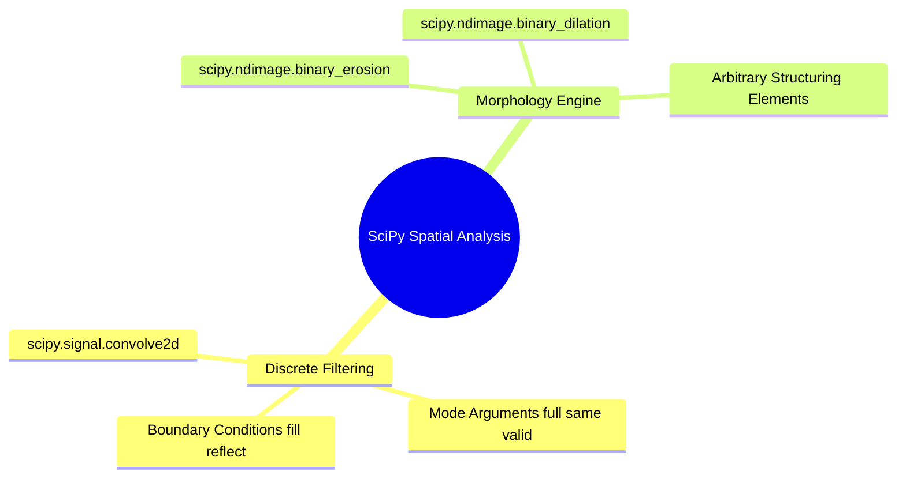

# 17. SciPy Signal and Spatial Operations - 2D Filtering and Morphology

## 1. Overview
SciPy extends NumPy with scientific algorithms. In this curriculum, `scipy.signal` provides the mathematically exact 2D discrete convolution used throughout the spatial filtering and restoration chapters, and `scipy.ndimage` provides multi-dimensional morphology engines that accept arbitrary structuring elements.



## 2. 2D Spatial Convolution: `scipy.signal.convolve2d(in1, in2, mode='full', boundary='fill', fillvalue=0)`
Computes the mathematically exact discrete two-dimensional convolution of two matrices (with kernel rotation, as opposed to cross-correlation):

* `mode`:
  * `'full'`: Computes convolution across all points of overlap. Output shape: $(M_1 + M_2 - 1, N_1 + N_2 - 1)$.
  * `'same'`: Returns the central portion of the convolution, matching the shape of `in1`.
  * `'valid'`: Computes output only for positions where the filter kernel overlaps completely with the input image. Output shape: $(M_1 - M_2 + 1, N_1 - N_2 + 1)$.
* `boundary`: Method for handling image edges:
  * `'fill'`: Pads borders with a constant value specified by `fillvalue`.
  * `'symm'` / `'reflect'`: Mirrors pixel values across the boundary.
  * `'wrap'`: Treats the image as periodic, wrapping values from the opposite edge.

```python
import numpy as np
from scipy import signal

# Define a 5x5 test image and a 3x3 averaging kernel
image = np.ones((5, 5), dtype=np.float32)
kernel = np.full((3, 3), 1.0 / 9.0, dtype=np.float32)

# Compute convolution with reflection padding, maintaining identical output dimensions
smooth = signal.convolve2d(image, kernel, mode='same', boundary='symm')
```

## 3. Morphological Operations: `scipy.ndimage`
The `ndimage` module applies set-theoretic morphology with any binary structuring element (not just the rectangular kernels of the OpenCV shortcuts):

* `scipy.ndimage.binary_erosion(input, structure)`: Fits the structuring element inside foreground regions (shrinks objects, removes thin bridges).
* `scipy.ndimage.binary_dilation(input, structure)`: Hits the structuring element against foreground regions (grows objects, closes small holes).

```python
import numpy as np
from scipy import ndimage

# Binary foreground region on a discrete grid
region = np.zeros((9, 9), dtype=bool)
region[2:7, 2:7] = True

# Arbitrary (non-square) structuring element: a 3x3 cross (N4 neighborhood)
cross = np.array([[0, 1, 0],
                  [1, 1, 1],
                  [0, 1, 0]], dtype=bool)

eroded = ndimage.binary_erosion(region, structure=cross)
dilated = ndimage.binary_dilation(region, structure=cross)
```

## 4. Critical Pitfalls and Best Practices
- **Convolution vs. cross-correlation**: `convolve2d` flips the kernel before sliding it. For symmetric kernels (box, Gaussian) the two operations coincide, but for asymmetric kernels (e.g., Sobel gradients) the direction of detected edges is inverted.
- **Boundary choice changes edge statistics**: `'fill'` with `fillvalue=0` darkens borders of the convolution result; `'symm'` preserves border brightness and matches the mirror-padding exercises in the worked exercises.
- **dtype promotion**: `convolve2d` on `uint8` inputs promotes to a wider integer type; cast images to `float32`/`float64` before filtering when fractional kernel weights are used.

## 5. Connections to Other Topics
- Mathematical foundations of the sliding-window sum in [[06.1.10. Mathematical 2D Spatial Convolution, Cross-Correlation, and Boundary Padding]].
- OpenCV's optimized filtering API is covered in [[19. Spatial Image Restoration - Noise Models, Linear Convolution, and Fast Integral Filters]].
- Set-theoretic morphology theory in [[21. Mathematical Morphology - Set Theory, Structuring Elements, and Thinning]].
- Applied in [[06.10.1. Exercise 1 - Complete Calculation of 2D Convolution and Boundary Padding Modes]] and [[06.9.3. TP2 Part 1 - Discrete Noise Models and Spatial Convolution Smoothing]].
