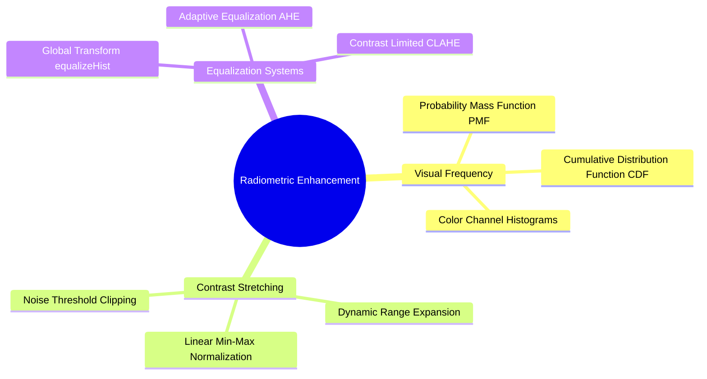
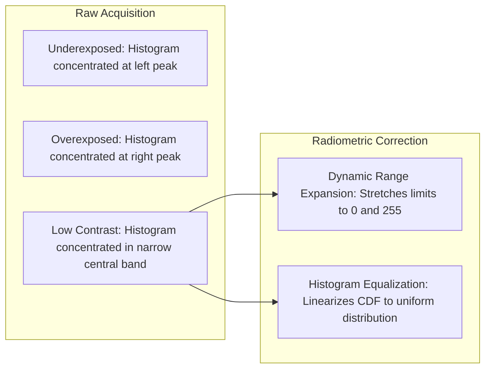

# 18. Visual Frequency and Radiometry - Histograms, Equalization, AHE, and CLAHE

## 1. Overview
Radiometric operations adjust an image's tonal distribution across its dynamic range. This note covers continuous and discrete intensity histograms, dynamic range expansion (contrast stretching), global histogram equalization, and Contrast Limited Adaptive Histogram Equalization (CLAHE).



## 2. Theoretical Formulations

### 2.1 The Discrete Image Histogram
For a single-channel image $I$ with $K$ discrete intensity levels (typically $K = 256$ for 8-bit unsigned images, spanning $[0, 255]$), the raw histogram $H(k)$ represents the total count of pixels having intensity $k$:

$$H(k) = \sum_{y=0}^{H-1} \sum_{x=0}^{W-1} \delta(I(y, x) - k), \quad k \in [0, K-1]$$

Where $\delta(\cdot)$ is the discrete Kronecker delta function. Normalizing $H(k)$ by the total number of pixels $N = H \times W$ yields the empirical **Probability Mass Function (PMF)**:

$$P(k) = \frac{H(k)}{N}$$

The **Cumulative Distribution Function (CDF)** models the cumulative probability that a randomly chosen pixel has an intensity less than or equal to $k$:

$$\text{CDF}(k) = \sum_{j=0}^{k} P(j)$$



### 2.2 Dynamic Range Expansion (Contrast Stretching)
When an image uses only a narrow band of available intensities $[X_{\min}, X_{\max}]$, contrast stretching remaps values across the full dynamic range $[Y_{\min}, Y_{\max}]$ (typically $[0, 255]$):

$$Y(y, x) = \alpha + \beta \cdot X(y, x)$$

Where the linear parameters $\alpha$ and $\beta$ are defined by:

$$\beta = \frac{Y_{\max} - Y_{\min}}{X_{\max} - X_{\min}}, \quad \alpha = \frac{Y_{\min} X_{\max} - Y_{\max} X_{\min}}{X_{\max} - X_{\min}}$$

Substituting $Y_{\min} = 0$ and $Y_{\max} = 255$ yields the standard contrast stretching formula:

$$Y(y, x) = \text{round}\left( \frac{255}{X_{\max} - X_{\min}} \cdot (X(y, x) - X_{\min}) \right)$$

To avoid skewing the range with isolated dead or hot pixels, $X_{\min}$ and $X_{\max}$ are determined using noise thresholds (percentile cutoffs).

### 2.3 Global Histogram Equalization
Global equalization applies a monotonic transformation function $T(k)$ designed to yield an output image with a uniform histogram distribution. This transformation uses the scaled Cumulative Distribution Function:

$$s_k = T(k) = \text{round}\left( (K - 1) \cdot \text{CDF}(k) \right) = \text{round}\left( \frac{\text{Max}}{N} \cdot \sum_{j=0}^{k} H(j) \right)$$

Where $\text{Max} = 255$ for 8-bit images.

### 2.4 Contrast Limited Adaptive Histogram Equalization (CLAHE)
Global equalization often over-amplifies background noise in homogeneous regions. CLAHE addresses this by:
1. Partitioning the image into contextual rectangular tiles (e.g., $8 \times 8$ grids).
2. Computing local histograms and clipping them at a specific threshold (`clipLimit`). Clipped pixels are redistributed uniformly across all bins before calculating the CDF.
3. Combining neighboring tile boundaries using bilinear interpolation to remove artificial block borders.

## 3. Function Reference

### 3.1 `cv2.calcHist(images, channels, mask, histSize, ranges)`
Computes intensity histograms across arbitrary channel arrays.
- `images`: Input tensor list `[img]`.
- `channels`: List of channel indices to compute (e.g., `[0]` for grayscale, `[0]`, `[1]`, `[2]` for BGR).
- `mask`: Optional binary array to limit calculation to specific regions. Use `None` for the full image.
- `histSize`: Bin counts specified as a list (e.g., `[256]`).
- `ranges`: Intensity boundaries, specified as `[0, 256]` (upper limit is exclusive).

### 3.2 `cv2.normalize(src, dst, alpha, beta, norm_type)`
Normalizes matrix values across a designated range:
- `norm_type = cv2.NORM_MINMAX`: Maps minimum values to `alpha` ($0$) and maximum values to `beta` ($255$).

### 3.3 `cv2.equalizeHist(src)`
Performs global histogram equalization on an 8-bit single-channel image.

### 3.4 `cv2.createCLAHE(clipLimit, tileGridSize)`
Initializes a CLAHE object:
- `clipLimit`: Threshold for histogram clipping (default: $40.0$, typical values: $2.0\text{--}4.0$).
- `tileGridSize`: Dimensions of contextual grid cells (e.g., `(8, 8)`).

## 4. Code Implementation Examples

```python
import cv2
import numpy as np
import matplotlib.pyplot as plt

# 1. Manual Histogram vs OpenCV Verification
def compute_histogram_pure_python(gray_matrix: np.ndarray) -> np.ndarray:
    """Computes a 256-bin intensity histogram using low-level array scanning."""
    histogram = np.zeros(256, dtype=np.int64)
    flat_pixels = gray_matrix.ravel()
    for pixel in flat_pixels:
        histogram[pixel] += 1
    return histogram

gray_img = cv2.imread("Images/cameraman.bmp", cv2.IMREAD_GRAYSCALE)
if gray_img is None:
    raise FileNotFoundError("File 'Images/cameraman.bmp' not found.")

# Compute histogram with OpenCV
cv_hist = cv2.calcHist([gray_img], [0], None, [256], [0, 256]).ravel()
py_hist = compute_histogram_pure_python(gray_img)

# Verify that both methods yield identical counts
assert np.array_equal(cv_hist.astype(np.int64), py_hist), "Histograms do not match."

# 2. Custom Dynamic Range Expansion (Contrast Stretching)
def expand_dynamic_range(image: np.ndarray, threshold: int = 0, y_min: int = 0, y_max: int = 255) -> np.ndarray:
    """Expands dynamic range using noise-tolerant min/max boundaries."""
    hist = np.bincount(image.ravel(), minlength=256)
    
    # Locate lowest and highest bins that exceed the noise threshold
    valid_bins = np.where(hist > threshold)[0]
    x_min = valid_bins[0]
    x_max = valid_bins[-1]
    
    if x_max == x_min:
        return image.copy()
        
    # Apply contrast stretching formula
    stretched = ((image.astype(np.float64) - x_min) / (x_max - x_min)) * (y_max - y_min) + y_min
    return np.clip(np.round(stretched), y_min, y_max).astype(np.uint8)

stretched_image = expand_dynamic_range(gray_img, threshold=5, y_min=0, y_max=255)

# 3. CLAHE Local Equalization on Grayscale and Color Images
clahe_operator = cv2.createCLAHE(clipLimit=2.0, tileGridSize=(8, 8))
clahe_grayscale = clahe_operator.apply(gray_img)

# For color images: Equalize the Luminance channel in LAB space to preserve colors
color_img = cv2.imread("Images/pepper.bmp")
lab_canvas = cv2.cvtColor(color_img, cv2.COLOR_BGR2LAB)
l_chan, a_chan, b_chan = cv2.split(lab_canvas)

# Equalize only the lightness (L) channel
l_clahe = clahe_operator.apply(l_chan)
merged_lab = cv2.merge([l_clahe, a_chan, b_chan])
clahe_color = cv2.cvtColor(merged_lab, cv2.COLOR_LAB2BGR)
```

## 5. Connections to Other Topics
- Visualized using Matplotlib frameworks from [[03. Matplotlib Core Architecture - Figure, Axes, and Canvas Visualization Mechanics]].
- Applied to medical and industrial imaging in [[06.9.7. TP2 Part 4 - Contrast Dynamics, Histogram Equalization, and CLAHE]].

---
