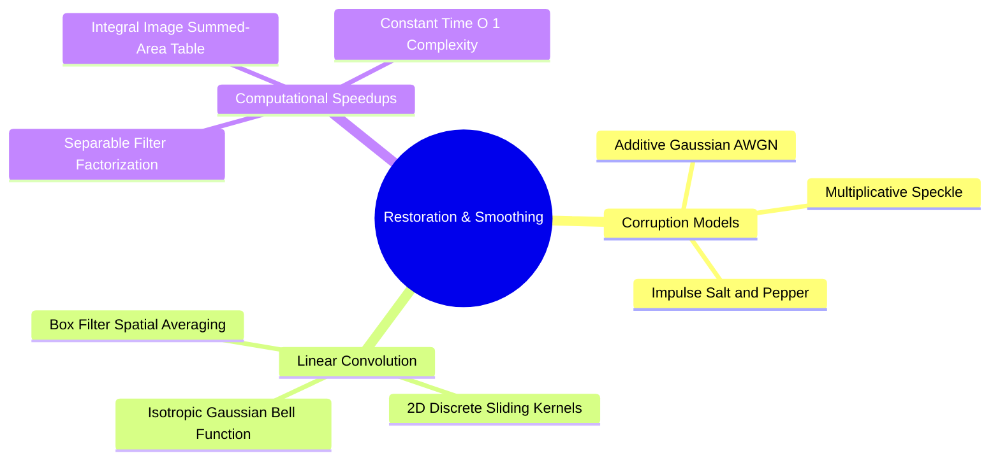
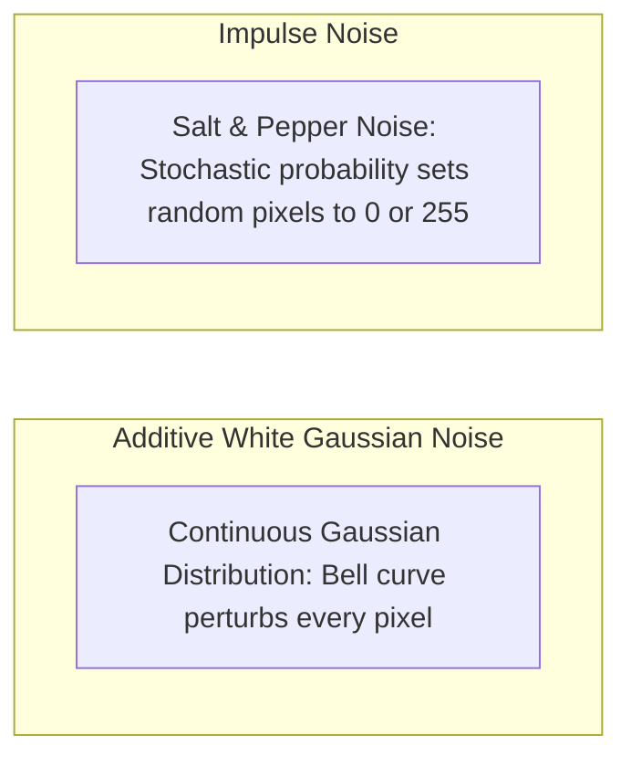
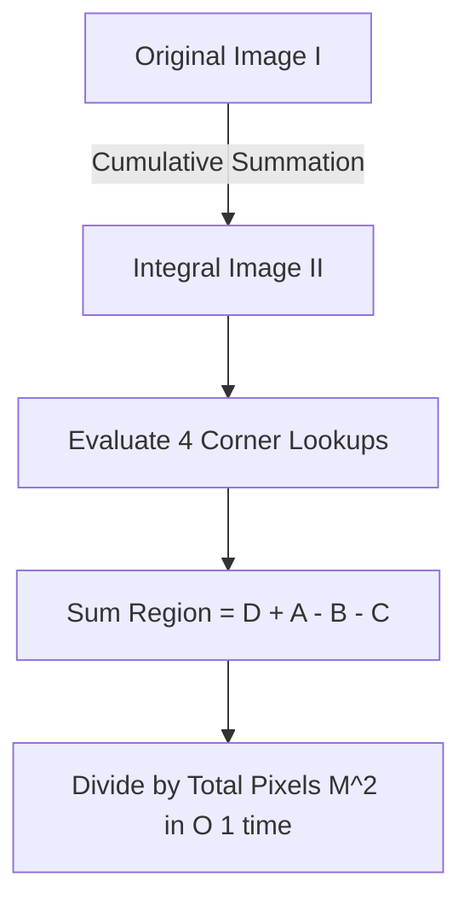

# 19. Spatial Image Restoration - Noise Models, Linear Convolution, and Fast Integral Filters

## 1. Overview
Digital images can suffer from various forms of corruption during acquisition, transmission, or sensor readout. This note covers mathematical noise models, 2D discrete convolution, box and Gaussian filtering, and $O(1)$ fast box filtering using integral images (summed-area tables).



## 2. Mathematical Noise Models



### 2.1 Additive White Gaussian Noise (AWGN)
Gaussian noise models thermal and electronic sensor fluctuations. It perturbs every pixel independently according to a normal distribution:

$$I_{\text{noisy}}(y, x) = \text{clip}\Big(I(y, x) + \eta(y, x), \ 0, \ 255\Big), \quad \eta(y, x) \sim \mathcal{N}(\mu, \sigma^2)$$

Where $\mu = 0$ is the mean error and $\sigma^2$ is the noise variance. As variance $\sigma^2$ increases, high-frequency image details are progressively obscured.

### 2.2 Impulse Noise (Salt-and-Pepper)
Impulse noise models transmission errors or faulty sensor photodiode elements. It alters a random fraction $p \in [0, 1]$ of pixels, replacing their values with extreme white (salt) or black (pepper) values:

$$I_{\text{noisy}}(y, x) = \begin{cases} 
255 & \text{with probability } \frac{p}{2} \quad (\text{Salt}) \\ 
0 & \text{with probability } \frac{p}{2} \quad (\text{Pepper}) \\ 
I(y, x) & \text{with probability } 1 - p \quad (\text{Uncorrupted}) 
\end{cases}$$

## 3. Linear Spatial Filtering and Convolution

Filtering modifies a pixel's value using a weighted combination of its spatial neighbors. For an odd kernel size $M \times M$ with half-width $k = \lfloor M / 2 \rfloor$:

$$I_{\text{conv}}(y, x) = \sum_{i=-k}^{k} \sum_{j=-k}^{k} I(y - i, \ x - j) \cdot K(i, j)$$

### 3.1 The Mean (Box) Filter
Replaces each pixel with the arithmetic mean of its local neighborhood:

$$K_{\text{box}} = \frac{1}{M^2} \begin{bmatrix} 1 & 1 & \cdots & 1 \\ 1 & 1 & \cdots & 1 \\ \vdots & \vdots & \ddots & \vdots \\ 1 & 1 & \cdots & 1 \end{bmatrix}_{M \times M}$$

- **Characteristics**: Smooths additive Gaussian noise effectively, but blurs sharp edge boundaries and introduces subtle rectangular artifacts.

### 3.2 The Gaussian Filter
Weights neighboring pixels according to a 2D Gaussian distribution:

$$G(x, y) = \frac{1}{2\pi\sigma^2} \exp\left( -\frac{x^2 + y^2}{2\sigma^2} \right)$$

Weights decay smoothly with spatial distance, reducing high-frequency noise while better preserving broader structural boundaries.

### 3.3 Boundary Padding with `np.pad(array, pad_width, mode)`
Before sliding a $M \times M$ window, the image is enlarged by $k = \lfloor M/2 \rfloor$ pixels on every side so the kernel always overlaps real data. `np.pad` implements the standard strategies:

- `mode='reflect'`: Mirrors border pixels (the `'symm'`-style strategy of `scipy.signal.convolve2d`).
- `mode='constant'`: Fills the border with a constant (`constant_values=0` is zero padding).
- `mode='wrap'`: Periodic tiling.

```python
padded = np.pad(image.astype(np.float64), k, mode='reflect')
```

The OpenCV counterpart `cv2.copyMakeBorder(src, top, bottom, left, right, borderType)` performs the same extension when a dedicated padded copy is needed (`cv2.BORDER_REFLECT` mirrors, `cv2.BORDER_CONSTANT` zero-fills, `cv2.BORDER_WRAP` tiles periodically):

```python
padded_cv = cv2.copyMakeBorder(image, 2, 2, 2, 2, cv2.BORDER_REFLECT)
```

The theory of these boundary conditions is developed in [[06.1.10. Mathematical 2D Spatial Convolution, Cross-Correlation, and Boundary Padding]].

### 3.4 Synthetic Noise Draw APIs
The two noise models above are synthesized in practice with NumPy's random module:
- `np.random.normal(mean, sigma, shape)`: Draws AWGN samples $\eta \sim \mathcal{N}(\mu, \sigma^2)$ for every pixel.
- `np.random.rand(*shape)`: Draws uniform $[0, 1)$ samples; thresholding them at `p/2` and `p` selects which pixels become salt and pepper.
- `np.random.seed(seed)`: Fixes the generator state so noise synthesis is reproducible run-to-run (used across the Data Science tutorials as well).

## 4. Accelerated Box Filtering via Integral Images

Applying a large $M \times M$ filter directly requires $O(M^2)$ operations per pixel. Using an **Integral Image** (Summed-Area Table) allows computing arbitrary rectangular neighborhood sums in **$O(1)$ constant time**, regardless of kernel size.



### 4.1 Definition
The integral image $II(y, x)$ stores the sum of all pixel values located above and to the left of coordinate $(y, x)$:

$$II(y, x) = \sum_{y' \le y} \sum_{x' \le x} I(y', x')$$

The integral image can be constructed efficiently in a single pass ($O(H \cdot W)$) using dynamic programming:

$$II(y, x) = I(y, x) + II(y - 1, x) + II(y, x - 1) - II(y - 1, x - 1)$$

### 4.2 Constant Time $O(1)$ Window Summation
To calculate the sum of pixel values within a rectangular region defined by top-left corner $(y_1, x_1)$ and bottom-right corner $(y_2, x_2)$:

$$\text{Sum} = II(y_2, x_2) + II(y_1 - 1, x_1 - 1) - II(y_1 - 1, x_2) - II(y_2, x_1 - 1)$$

Dividing this sum by the window area $M^2$ yields the exact box filter output in $O(1)$ time.

## 5. OpenCV Linear Filtering API
The production shortcuts for the convolution theory above (all accept `cv2.BORDER_REFLECT`-style boundary flags):

- `cv2.boxFilter(src, ddepth, ksize)`: Normalized $M \times M$ box mean in one call (the integral-image result, prepackaged).
- `cv2.GaussianBlur(src, ksize, sigmaX)`: Discrete Gaussian smoothing; `ksize` must be odd, and `sigmaX=0` derives $\sigma$ from the kernel size.
- `cv2.filter2D(src, ddepth, kernel)`: General 2D cross-correlation with any kernel — the tool for custom mean, sharpening, and Sobel kernels.
- `cv2.addWeighted(src1, alpha, src2, beta, gamma)`: Saturated weighted blend $\alpha \cdot I_1 + \beta \cdot I_2 + \gamma$; the standard primitive for unsharp masking $I + \lambda(I - I_{\text{blur}})$.

```python
import cv2
import numpy as np

# Box and Gaussian smoothing
blurred_box = cv2.boxFilter(img, -1, (5, 5))
blurred_gauss = cv2.GaussianBlur(img, (5, 5), sigmaX=1.4)

# Custom sharpening kernel via filter2D + saturated blending
sharpen_kernel = np.array([[ 0, -1,  0],
                           [-1,  5, -1],
                           [ 0, -1,  0]], dtype=np.float32)
details = cv2.filter2D(img, -1, sharpen_kernel)
sharpened = cv2.addWeighted(img, 0.5, details, 0.5, 0.0)
```

The mathematical derivations (box normalization, Gaussian separability, sharpening kernels) live in [[06.2.3. Linear Spatial Smoothing (Mean Box Filter, Gaussian Bell, and 1D Separability)]] and [[06.2.4. Spatial High-Pass Filtering, Sobel Gradients, and Laplacian Sharpening]]; the exact-convolution SciPy equivalent is [[17. SciPy Signal and Spatial Operations - 2D Filtering and Morphology]].

## 6. Code Implementation Examples

```python
import cv2
import numpy as np

# 1. Noise Injection Functions
def add_gaussian_noise(image: np.ndarray, mean: float = 0.0, variance: float = 100.0) -> np.ndarray:
    """Injects Additive White Gaussian Noise into an image matrix."""
    sigma = np.sqrt(variance)
    gauss_noise = np.random.normal(mean, sigma, image.shape)
    noisy = image.astype(np.float64) + gauss_noise
    return np.clip(noisy, 0, 255).astype(np.uint8)

def add_salt_and_pepper_noise(image: np.ndarray, probability: float = 0.10) -> np.ndarray:
    """Injects impulse salt-and-pepper noise into an image matrix."""
    noisy = image.copy()
    random_matrix = np.random.rand(*image.shape[:2])
    
    # Salt noise (white pixels = 255)
    noisy[random_matrix < (probability / 2.0)] = 255
    # Pepper noise (black pixels = 0)
    noisy[(random_matrix >= (probability / 2.0)) & (random_matrix < probability)] = 0
    return noisy

# 2. Pure Python vs Accelerated Integral Image Box Filtering
def box_filter_integral(image: np.ndarray, ksize: int) -> np.ndarray:
    """Fast box filtering in O(1) time using an integral image."""
    h, w = image.shape[:2]
    pad = ksize // 2
    padded = np.pad(image.astype(np.float64), pad, mode="reflect")
    
    # Compute Integral Image
    integral = np.zeros((padded.shape[0] + 1, padded.shape[1] + 1), dtype=np.float64)
    integral[1:, 1:] = np.cumsum(np.cumsum(padded, axis=0), axis=1)
    
    filtered = np.zeros((h, w), dtype=np.uint8)
    area = ksize * ksize
    
    for y in range(h):
        for x in range(w):
            y1, x1 = y, x
            y2, x2 = y + ksize, x + ksize
            window_sum = integral[y2, x2] + integral[y1, x1] - integral[y1, x2] - integral[y2, x1]
            filtered[y, x] = int(round(window_sum / area))
            
    return filtered
```

## 7. Connections to Other Topics
- Relates to quality benchmarks in [[22. Objective Image Quality Assessment - MSE, PSNR, and SSIM Metrics]].
- Succeeded by non-linear edge-preserving filters in [[20. Non-Linear and Edge-Preserving Filtering - Median, Bilateral, and Nagao Filters]].
- Applied practically in [[06.9.3. TP2 Part 1 - Discrete Noise Models and Spatial Convolution Smoothing]] and [[06.9.4. TP2 Part 1 Homework - Fast Integral Filtering and Adaptive Smoothing]].
