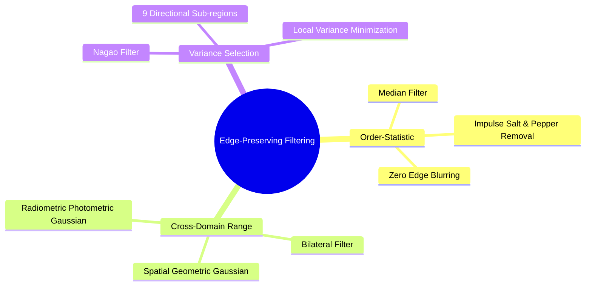
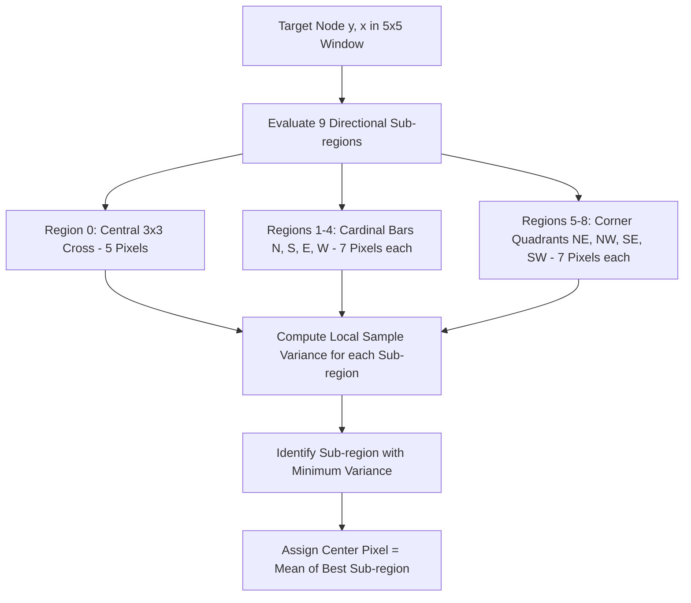

# 20. Non-Linear and Edge-Preserving Filtering - Median, Bilateral, and Nagao Filters

## 1. Overview
Linear filtering blurs sharp boundaries because it computes an unweighted average of neighboring pixels across edges. Non-linear edge-preserving filters solve this by adapting smoothing to local edge orientations and radiometric differences. This note covers Median filtering, Bilateral filtering, and the directional Nagao filter.



## 2. The Median Filter (`cv2.medianBlur`)
The median filter is an order-statistic filter that replaces each pixel with the statistical median of its neighborhood $W$:

$$I_{\text{median}}(y, x) = \text{median}\Big\{ I(y + i, \ x + j) \mid (i, j) \in W \Big\}$$

### Why the Median Filter Outperforms Mean Filters on Impulse Noise
- **Mean Filter**: Incorporates corrupted values ($0$ or $255$) directly into the average, pulling the result away from the true intensity:
  $$\text{Mean}([120, 122, 121, 123, 255]) = 148.2 \quad (\text{Distorted})$$
- **Median Filter**: Discards extreme outliers during rank sorting, preserving the underlying value:
  $$\text{Median}(\text{sort}([120, 121, 122, 123, 255])) = 122 \quad (\text{Accurate})$$

## 3. The Bilateral Filter (`cv2.bilateralFilter`)
The bilateral filter combines spatial geometric proximity with radiometric intensity similarity:

$$I_{\text{bilateral}}(p) = \frac{1}{W_p} \sum_{q \in S} I(q) \cdot G_{\sigma_s}(\|p - q\|) \cdot G_{\sigma_r}(|I(p) - I(q)|)$$

Where:
- $p = (y, x)$ is the target center pixel coordinate.
- $q = (y', x')$ is an adjacent neighborhood pixel coordinate.
- $G_{\sigma_s}(\|p - q\|) = \exp\left(-\frac{\|p - q\|^2}{2\sigma_s^2}\right)$ is the **spatial Gaussian kernel**, which weights pixels by geometric distance.
- $G_{\sigma_r}(|I(p) - I(q)|) = \exp\left(-\frac{|I(p) - I(q)|^2}{2\sigma_r^2}\right)$ is the **radiometric Gaussian kernel**, which weights pixels by intensity similarity.
- $W_p = \sum_{q \in S} G_{\sigma_s}(\|p - q\|) \cdot G_{\sigma_r}(|I(p) - I(q)|)$ is a normalization factor.

When the filter encounters a high-contrast boundary, pixels on the opposite side of the edge have large intensity differences $|I(p) - I(q)|$. This drives their radiometric weight $G_{\sigma_r}$ toward zero, preventing smoothing across the edge.

> **Deep dive:** the complete treatment — worked numeric examples, parameter limits, from-scratch NumPy and OpenCV implementations, the range-LUT optimization, complexity analysis, artifacts (staircasing, gradient reversal), and applications — is in [[25. Bilateral Filtering - Complete Mathematical Theory, Implementation, and Practice]].

## 4. The Nagao Filter

The Nagao filter is an edge-preserving operator that analyzes a $5 \times 5$ window around each pixel, partitioned into 9 directional sub-regions.



### 4.1 Sub-Region Geometry
Within a $5 \times 5$ window centered at $(0, 0)$, the 9 sub-regions are defined by the following relative coordinate offsets:
- **Region 0 (Central Cross - 5 pixels)**:
  $$\{(0,0), \ (-1,0), \ (1,0), \ (0,-1), \ (0,1)\}$$
- **Region 1 (North Cardinal Bar - 7 pixels)**:
  $$\{(0,0), \ (-1,0), \ (-2,0), \ (-1,-1), \ (-2,-1), \ (-1,1), \ (-2,1)\}$$
- **Region 2 (South Cardinal Bar - 7 pixels)**:
  $$\{(0,0), \ (1,0), \ (2,0), \ (1,-1), \ (2,-1), \ (1,1), \ (2,1)\}$$
- **Region 3 (East Cardinal Bar - 7 pixels)**:
  $$\{(0,0), \ (0,1), \ (0,2), \ (-1,1), \ (-1,2), \ (1,1), \ (1,2)\}$$
- **Region 4 (West Cardinal Bar - 7 pixels)**:
  $$\{(0,0), \ (0,-1), \ (0,-2), \ (-1,-1), \ (-1,-2), \ (1,-1), \ (1,-2)\}$$
- **Region 5 (Northeast Quadrant - 7 pixels)**:
  $$\{(0,0), \ (-1,0), \ (-1,1), \ (-1,2), \ (-2,1), \ (-2,2), \ (0,1)\}$$
- **Region 6 (Northwest Quadrant - 7 pixels)**:
  $$\{(0,0), \ (-1,0), \ (-1,-1), \ (-1,-2), \ (-2,-1), \ (-2,-2), \ (0,-1)\}$$
- **Region 7 (Southeast Quadrant - 7 pixels)**:
  $$\{(0,0), \ (1,0), \ (1,1), \ (1,2), \ (2,1), \ (2,2), \ (0,1)\}$$
- **Region 8 (Southwest Quadrant - 7 pixels)**:
  $$\{(0,0), \ (1,0), \ (1,-1), \ (1,-2), \ (2,-1), \ (2,-2), \ (0,-1)\}$$

### 4.2 Algorithm Steps
1. For each candidate sub-region $k \in \{0, \dots, 8\}$, compute the sample variance:
   $$\sigma_k^2 = \frac{1}{|R_k|} \sum_{(i, j) \in R_k} \Big( I(y + i, \ x + j) - \mu_k \Big)^2$$
2. Identify the sub-region that minimizes local variance:
   $$k^* = \arg\min_{k} \sigma_k^2$$
3. Replace the center pixel with the mean intensity of that lowest-variance sub-region:
   $$I_{\text{Nagao}}(y, x) = \text{round}(\mu_{k^*})$$

Because variance is high across an edge and low within homogeneous regions, this filter smooths noise while keeping edges sharp.

> **Deep dive:** the complete multi-implementation treatment — four cross-verified variants (explicit loops, semi-vectorized `E[X^2]-E[X]^2` gathering, hardcoded kernels through `cv2.filter2D`, stride-tricks sliding windows), measured speed comparisons, the border-mode pitfall, and selection guidance — is in [[26. Nagao Filtering - Multi-Implementation Reference with Hardcoded Kernels, Vectorized, and Convolution Approaches]].

## 5. Code Implementation Examples

```python
import numpy as np

def nagao_filter(image: np.ndarray) -> np.ndarray:
    """Applies the 5x5 edge-preserving Nagao filter to a grayscale image."""
    h, w = image.shape[:2]
    # Apply reflect padding of 2 pixels along each boundary
    padded = np.pad(image.astype(np.float64), pad_width=2, mode="reflect")
    output = np.zeros((h, w), dtype=np.uint8)

    sub_regions = [
        [(0,0), (-1,0), (1,0), (0,-1), (0,1)],
        [(0,0), (-1,0), (-2,0), (-1,-1), (-2,-1), (-1,1), (-2,1)],
        [(0,0), (1,0), (2,0), (1,-1), (2,-1), (1,1), (2,1)],
        [(0,0), (0,1), (0,2), (-1,1), (-1,2), (1,1), (1,2)],
        [(0,0), (0,-1), (0,-2), (-1,-1), (-1,-2), (1,-1), (1,-2)],
        [(0,0), (-1,0), (-1,1), (-1,2), (-2,1), (-2,2), (0,1)],
        [(0,0), (-1,0), (-1,-1), (-1,-2), (-2,-1), (-2,-2), (0,-1)],
        [(0,0), (1,0), (1,1), (1,2), (2,1), (2,2), (0,1)],
        [(0,0), (1,0), (1,-1), (1,-2), (2,-1), (2,-2), (0,-1)]
    ]

    for y in range(h):
        for x in range(w):
            py, px = y + 2, x + 2
            lowest_variance = float("inf")
            chosen_mean = padded[py, px]

            for region in sub_regions:
                values = [padded[py + dy, px + dx] for dy, dx in region]
                var = np.var(values)
                if var < lowest_variance:
                    lowest_variance = var
                    chosen_mean = np.mean(values)

            output[y, x] = int(round(chosen_mean))

    return output
```

## 6. Connections to Other Topics
- Theoretical comparison with linear smoothing in [[19. Spatial Image Restoration - Noise Models, Linear Convolution, and Fast Integral Filters]].
- Quantitative assessment in [[22. Objective Image Quality Assessment - MSE, PSNR, and SSIM Metrics]].
- Evaluated on test benchmarks in [[06.9.5. TP2 Part 2 - Edge-Preserving Non-Linear Smoothing with Nagao Filter]].
- Bilateral deep dive: [[25. Bilateral Filtering - Complete Mathematical Theory, Implementation, and Practice]].
- Nagao deep dive: [[26. Nagao Filtering - Multi-Implementation Reference with Hardcoded Kernels, Vectorized, and Convolution Approaches]].

---
