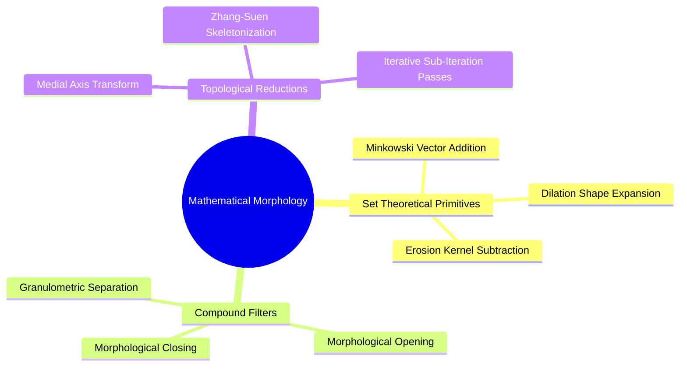
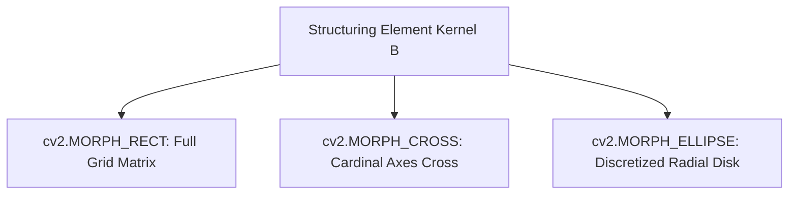
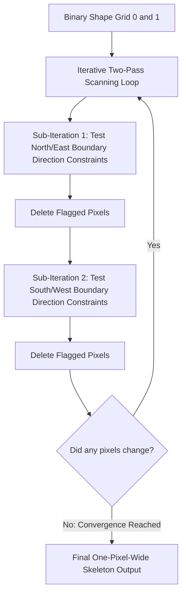

# 21. Mathematical Morphology - Set Theory, Structuring Elements, and Thinning

## 1. Overview
Mathematical morphology analyzes spatial shapes and geometric structures using set theory. This note covers structuring element probes, basic morphological operators (erosion, dilation, opening, closing), cell separation techniques, and the Zhang-Suen thinning algorithm.



## 2. Set Theory Foundations and Structuring Elements

Binary images are modeled as subsets of the discrete 2D space: $A \subseteq \mathbb{Z}^2$.
A **Structuring Element** (SE) $B \subset \mathbb{Z}^2$ is a predefined spatial shape (such as a cross, square, or disk) with an assigned origin:



### 2.1 Erosion ($A \ominus B$)
Shrinks foreground shapes by keeping only points where the structuring element fits entirely inside the foreground:

$$A \ominus B = \{ z \in \mathbb{Z}^2 \mid (B)_z \subseteq A \}$$

Where $(B)_z = \{ b + z \mid b \in B \}$ represents the translation of $B$ by spatial vector $z$.
- **Effect**: Eliminates isolated white noise pixels, shrinks object perimeters, and breaks thin bridges connecting adjacent structures.

### 2.2 Dilation ($A \oplus B$)
Expands foreground shapes by adding points where the translated structuring element touches the foreground:

$$A \oplus B = \{ z \in \mathbb{Z}^2 \mid (\hat{B})_z \cap A \neq \emptyset \}$$

Where $\hat{B} = \{ -b \mid b \in B \}$ is the reflection of $B$ around its origin.
- **Effect**: Fills small background holes, expands object boundaries, and bridges small structural gaps.

### 2.3 Morphological Opening ($A \circ B$)
Applies an erosion followed by a dilation using the same structuring element:

$$A \circ B = (A \ominus B) \oplus B$$

- **Effect**: Smooths object contours, breaks narrow isthmuses, and removes small foreground noise while preserving overall object geometry.

### 2.4 Morphological Closing ($A \bullet B$)
Applies a dilation followed by an erosion:

$$A \bullet B = (A \oplus B) \ominus B$$

- **Effect**: Fills narrow interior holes, closes narrow boundary channels, and bridges gaps without substantially changing object area.

## 3. The Zhang-Suen Skeletonization (Thinning) Algorithm

Thinning reduces binary foreground shapes to one-pixel-wide medial skeletons while preserving topological connectivity. The Zhang-Suen algorithm works by iteratively pruning contour pixels across two alternating sub-iterations.



### Mathematical Conditions for Pixel Deletion
A boundary pixel $P_1$ with 8-neighbors ordered cyclically:

$$\begin{bmatrix} P_9 & P_2 & P_3 \\ P_8 & P_1 & P_4 \\ P_7 & P_6 & P_5 \end{bmatrix}$$

Is flagged for deletion if all four conditions are satisfied:
1. **Connectivity Condition**: $2 \le B(P_1) \le 6$, where $B(P_1) = \sum_{i=2}^9 P_i$ is the number of active non-zero neighbors.
2. **Transition Count**: $A(P_1) = 1$, where $A(P_1)$ is the number of $0 \rightarrow 1$ patterns in the circular sequence $P_2, P_3, P_4, P_5, P_6, P_7, P_8, P_9, P_2$.
3. **Directional Constraint (Sub-iteration 1)**:
   $$P_2 \cdot P_4 \cdot P_6 = 0 \quad \text{and} \quad P_4 \cdot P_6 \cdot P_8 = 0$$
4. **Directional Constraint (Sub-iteration 2)**:
   $$P_2 \cdot P_4 \cdot P_8 = 0 \quad \text{and} \quad P_2 \cdot P_6 \cdot P_8 = 0$$

The algorithm repeats until no further pixels are flagged for deletion.

## 4. Code Implementation Examples

```python
import cv2
import numpy as np

# 1. Morphological Operations with OpenCV
binary_image = cv2.imread("Images/Globules_rouges.jpg", cv2.IMREAD_GRAYSCALE)
_, binary_thresh = cv2.threshold(binary_image, 127, 255, cv2.THRESH_BINARY)

# Construct flat cross-shaped and elliptical structuring elements
se_rect_3x3 = cv2.getStructuringElement(cv2.MORPH_RECT, (3, 3))
se_ellipse_5x5 = cv2.getStructuringElement(cv2.MORPH_ELLIPSE, (5, 5))

# Apply primitives
eroded = cv2.erode(binary_thresh, se_rect_3x3, iterations=1)
dilated = cv2.dilate(binary_thresh, se_rect_3x3, iterations=1)
opened = cv2.morphologyEx(binary_thresh, cv2.MORPH_OPEN, se_ellipse_5x5)
closed = cv2.morphologyEx(binary_thresh, cv2.MORPH_CLOSE, se_ellipse_5x5)

# 2. Automated Cell Separation Pipeline (Watershed / Granulometry)
def separate_overlapping_cells(binary_mask: np.ndarray) -> np.ndarray:
    """Separates touching circular cells using distance transforms and opening."""
    # Remove boundary noise with morphological opening
    opened_mask = cv2.morphologyEx(binary_mask, cv2.MORPH_OPEN, np.ones((3, 3), np.uint8), iterations=2)
    # Compute Euclidean distance transform from background boundaries
    dist_transform = cv2.distanceTransform(opened_mask, cv2.DIST_L2, 5)
    # Threshold distance peaks to identify cell centers
    _, sure_fg = cv2.threshold(dist_transform, 0.4 * dist_transform.max(), 255, cv2.THRESH_BINARY)
    return sure_fg.astype(np.uint8)

# 3. Zhang-Suen Skeletonization
# Available via OpenCV Contrib: cv2.ximgproc.thinning
try:
    skeleton = cv2.ximgproc.thinning(binary_thresh, thinningType=cv2.ximgproc.THINNING_ZHANGSUEN)
except AttributeError:
    print("opencv-contrib-python required for cv2.ximgproc.thinning.")
```

## 5. Connected Component Labeling: `cv2.connectedComponentsWithStats()`
After morphological cleanup, counting physical objects requires labeling spatially connected pixel groups. OpenCV performs the two-pass labeling and equivalence-tree resolution (theory in [[06.7.6. Connected Component Analysis (Two-Pass CCL and Equivalence Trees)]]) in one call:

- `cv2.connectedComponentsWithStats(image, connectivity=8)`: Returns `(num_labels, labels, stats, centroids)`:
  - `num_labels`: Count of connected regions **including the background label 0**; the foreground object count is `num_labels - 1`.
  - `labels`: Integer map where every pixel holds its component id.
  - `stats`: Per-component array of `(x, y, width, height, area)` — the axis-aligned bounding box (AABB) and pixel area used for size filtering. The columns are indexed by the constants `cv2.CC_STAT_LEFT`, `cv2.CC_STAT_TOP`, `cv2.CC_STAT_WIDTH`, `cv2.CC_STAT_HEIGHT`, and `cv2.CC_STAT_AREA`.
  - `centroids`: Per-component centroid coordinates $(\bar{x}, \bar{y})$.

```python
# Count cells after morphology and discard tiny noise blobs
num_labels, labels, stats, centroids = cv2.connectedComponentsWithStats(
    binary_mask.astype(np.uint8), connectivity=8
)

# Keep components with area >= 50 px (drops label 0 = background automatically by area filter)
min_area = 50
cell_count = sum(1 for i in range(1, num_labels) if stats[i, cv2.CC_STAT_AREA] >= min_area)
print(f"Detected cells: {cell_count}")
```

## 6. Connections to Other Topics
- Applied to segment and count biological cells in [[06.9.6. TP2 Part 3 - Mathematical Morphology, Cell Counting, and Skeletonization]].
- Combines with fixed thresholding from [[06.9.1. TP1 - Digital Image Acquisition, Matrix Topologies, and Fixed Thresholding]].
- Watershed theory and distance transforms: [[06.7.5. Morphological Watershed Segmentation and Topological Distance Transforms]].
- Geometric region descriptors (AABB, centroids, moments): [[06.7.7. Geometric Region Descriptors (AABB, OBB, Centroids, and Central Moments)]].
- SciPy morphology with arbitrary structuring elements: [[17. SciPy Signal and Spatial Operations - 2D Filtering and Morphology]].

---
