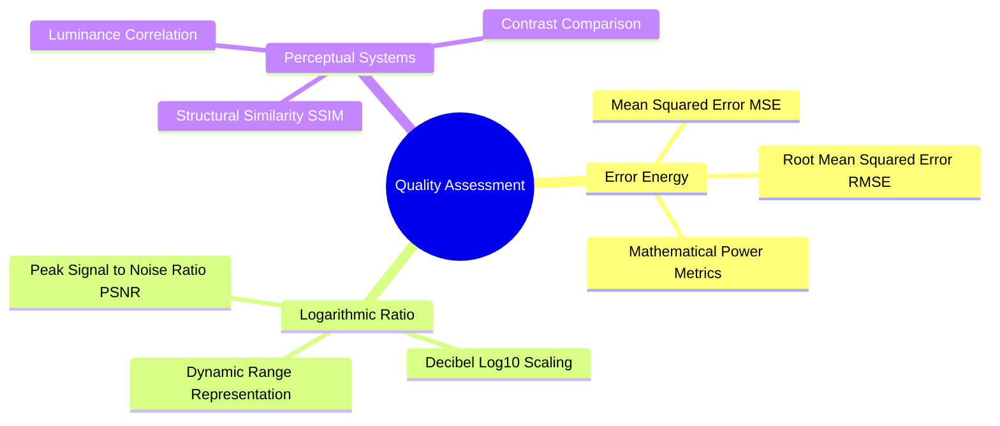
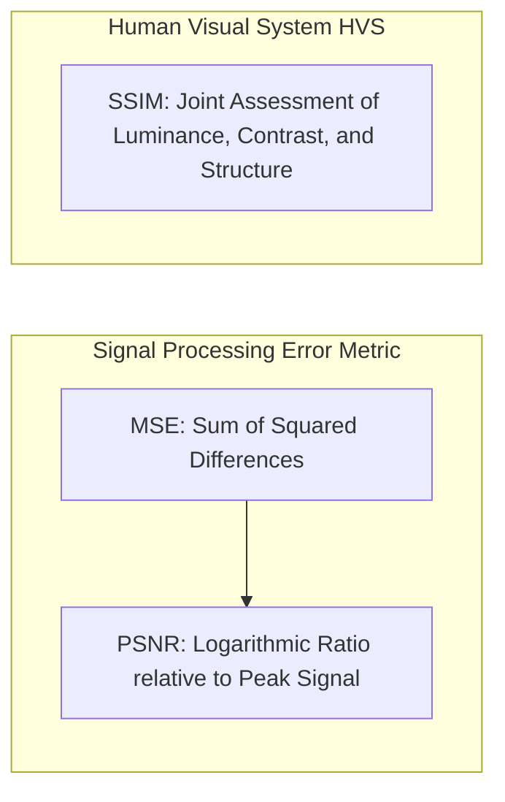

# 22. Objective Image Quality Assessment - MSE, PSNR, and SSIM Metrics

## 1. Overview
Objective image quality metrics provide quantitative benchmarks to assess fidelity after restoration, filtering, or super-resolution. This note covers Mean Squared Error (MSE), Peak Signal-to-Noise Ratio (PSNR), and the Structural Similarity Index (SSIM).



## 2. Mathematical Formulations



### 2.1 Mean Squared Error (MSE)
Calculates the average squared difference between an original reference image $I$ and a modified or degraded image $\hat{I}$, across dimensions $H \times W$:

$$\text{MSE} = \frac{1}{H \cdot W} \sum_{y=0}^{H-1} \sum_{x=0}^{W-1} \Big( I(y, x) - \hat{I}(y, x) \Big)^2$$

- **Ideal Value**: $0$ indicates identical images.
- **Limitation**: Sensitive to global brightness offsets that may not significantly impact perceived visual quality.

### 2.2 Peak Signal-to-Noise Ratio (PSNR)
Expresses reconstruction fidelity on a logarithmic decibel (dB) scale, comparing maximum possible signal power to the error power:

$$\text{PSNR} = 10 \cdot \log_{10} \left( \frac{R^2}{\text{MSE}} \right)$$

Where $R$ is the dynamic range of the image data type:
- For 8-bit unsigned integers (`uint8`), $R = 2^{8} - 1 = 255$.
- For normalized floating-point images (`float64`), $R = 1.0$.

$$\text{PSNR} = 10 \cdot \log_{10} \left( \frac{255^2}{\text{MSE}} \right) = 20 \cdot \log_{10}(255) - 10 \cdot \log_{10}(\text{MSE}) \approx 48.13 - 10 \cdot \log_{10}(\text{MSE})$$

- If $\text{MSE} \to 0$, $\text{PSNR} \to \infty$ (identical signals).
- Typical reconstruction values: $30\text{--}45\text{ dB}$ for high-quality restoration; $<20\text{ dB}$ for severely corrupted rasters.

### 2.3 Structural Similarity Index (SSIM)
While PSNR measures raw numerical error, SSIM evaluates image degradation based on three perceived visual components: **luminance** ($l$), **contrast** ($c$), and **structural correlation** ($s$):

$$\text{SSIM}(x, y) = \Big[ l(x, y) \Big]^\alpha \cdot \Big[ c(x, y) \Big]^\beta \cdot \Big[ s(x, y) \Big]^\gamma$$

Setting exponents $\alpha = \beta = \gamma = 1$ yields the standard form:

$$\text{SSIM}(x, y) = \frac{(2\mu_x\mu_y + C_1)(2\sigma_{xy} + C_2)}{(\mu_x^2 + \mu_y^2 + C_1)(\sigma_x^2 + \sigma_y^2 + C_2)}$$

Where:
- $\mu_x, \mu_y$: Local mean intensities.
- $\sigma_x^2, \sigma_y^2$: Local sample variances.
- $\sigma_{xy}$: Cross-covariance between signals $x$ and $y$.
- $C_1 = (K_1 R)^2, \ C_2 = (K_2 R)^2$: Regularization constants (typically $K_1 = 0.01, \ K_2 = 0.03$) preventing division by zero when denominators are near zero.

## 3. Python Implementations

```python
import numpy as np

def calculate_mse(original: np.ndarray, distorted: np.ndarray) -> float:
    """Computes Mean Squared Error between two matrices."""
    if original.shape != distorted.shape:
        raise ValueError("Image matrices must have identical dimensions.")
    diff = original.astype(np.float64) - distorted.astype(np.float64)
    return float(np.mean(diff ** 2))

def calculate_psnr(original: np.ndarray, distorted: np.ndarray, max_val: float = 255.0) -> float:
    """Computes Peak Signal-to-Noise Ratio in decibels (dB)."""
    mse = calculate_mse(original, distorted)
    if mse == 0.0:
        return float("inf")  # Perfect reconstruction
    return float(10.0 * np.log10((max_val ** 2) / mse))

def calculate_ssim_windowed(img1: np.ndarray, img2: np.ndarray) -> float:
    """Computes global Mean Structural Similarity Index across matrices."""
    c1 = (0.01 * 255) ** 2
    c2 = (0.03 * 255) ** 2
    
    img1 = img1.astype(np.float64)
    img2 = img2.astype(np.float64)
    
    mu1 = np.mean(img1)
    mu2 = np.mean(img2)
    
    sigma1_sq = np.var(img1)
    sigma2_sq = np.var(img2)
    sigma12 = np.mean((img1 - mu1) * (img2 - mu2))
    
    numerator = (2.0 * mu1 * mu2 + c1) * (2.0 * sigma12 + c2)
    denominator = (mu1**2 + mu2**2 + c1) * (sigma1_sq + sigma2_sq + c2)
    
    return float(numerator / denominator)
```

## 4. Connections to Other Topics
- Used to benchmark restoration filters in [[19. Spatial Image Restoration - Noise Models, Linear Convolution, and Fast Integral Filters]].
- Applied to evaluate super-resolution algorithms in [[24. Super-Resolution and Edge-Adaptive Interpolation - Pascal Getreuer Contour Stencils]] and [[06.9.8. TP2 Part 5 - Single-Frame Super-Resolution and Contour Stencils]].

---
