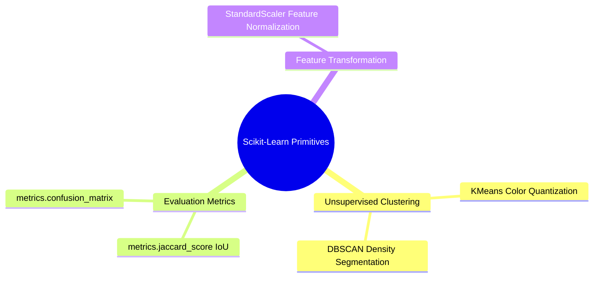

# 23. Scikit-Learn Primitives - Clustering, Dimensionality, and Metrics

## 1. Overview
Scikit-Learn (`sklearn`) provides the machine learning primitives used by this curriculum: unsupervised pixel clustering for segmentation, feature normalization for model input, and evaluation metrics for both classifiers (Data Science tutorials) and segmentation masks (Image Processing benchmarks).



## 2. Pixel Feature Clustering: `sklearn.cluster.KMeans`
Partitions pixel colors into $K$ discrete clusters to perform color quantization or unsupervised segmentation. K-Means minimizes the within-cluster sum of squared distances in feature space:

$$\arg\min_{C} \sum_{k=1}^{K} \sum_{x \in C_k} \| x - \mu_k \|^2$$

```python
import numpy as np
from sklearn.cluster import KMeans

# Synthesize an image: 100 rows, 100 cols, 3 color channels
img = np.random.randint(0, 256, size=(100, 100, 3), dtype=np.uint8)

# Reshape the 3D image into a 2D feature matrix: (N_pixels, 3_features)
pixel_features = img.reshape((-1, 3)).astype(np.float32)

# Fit KMeans to group pixels into 3 color clusters
kmeans = KMeans(n_clusters=3, random_state=42, n_init='auto')
labels = kmeans.fit_predict(pixel_features)

# Reshape the 1D cluster labels back into the original 2D image shape
segmented_labels = labels.reshape((100, 100))
```

The image-to-feature-matrix reshape pattern (`img.reshape((-1, 3))`) is the standard bridge from image tensors to scikit-learn's `(n_samples, n_features)` convention.

## 3. Segmentation Evaluation: `sklearn.metrics.jaccard_score`
Calculates the Jaccard similarity index (Intersection-over-Union, IoU) to measure overlap between a predicted binary segmentation and a ground-truth reference:

$$J(A, B) = \frac{|A \cap B|}{|A \cup B|}$$

```python
from sklearn.metrics import jaccard_score

# Flatten 2D binary masks to 1D arrays
gt_mask = np.array([0, 1, 1, 0, 1, 0], dtype=np.uint8)
pred_mask = np.array([0, 1, 0, 0, 1, 0], dtype=np.uint8)

iou = jaccard_score(gt_mask, pred_mask)
print("Jaccard IoU Score:", iou)
```

For multi-class segmentations, pass the flattened label maps with `average='macro'` or `average=None` to obtain per-class IoU scores.

## 4. Feature Normalization: `sklearn.preprocessing.StandardScaler`
Distance-based estimators (K-Means, k-NN) are scale-sensitive; standardizing features to zero mean and unit variance prevents large-range features from dominating the distance metric:

```python
from sklearn.preprocessing import StandardScaler

# X has shape (n_samples, n_features)
X_std = StandardScaler().fit_transform(X)
```

## 5. Critical Pitfalls and Best Practices
- **Always reshape images before fitting**: passing a 3D tensor directly raises an error; images must become `(pixels, channels)` matrices first.
- **Cast to float**: `uint8` pixel features overflow during distance accumulation; use `.astype(np.float32)`.
- **Set `random_state`**: K-Means is initialization-dependent; fixing the seed makes segmentation reproducible.

## 6. Connections to Other Topics
- Feature-space clustering theory in [[06.6.1. Feature Space Clustering (Mean-Shift and 2SP-DBSCAN by UMBB iVision)]].
- Segmentation evaluation benchmarks (Dice, Jaccard, Hausdorff) in [[06.7.8. Segmentation Evaluation Benchmarks (Dice DSC, Jaccard IoU, Hausdorff Distance)]].
- Classifier evaluation in the Titanic pipeline: [[04.6. Tutorial 05 - Titanic Predictive Modeling Pipeline and Classifier Evaluation]].
- Vectorized feature-matrix construction relies on [[02. NumPy Array Manipulation - Slicing, Strides, Shapes, and Vectorized Indexing]] and [[04. NumPy Mathematical Engine - Vectorization, ufuncs, and Broadcasting Rules]].
