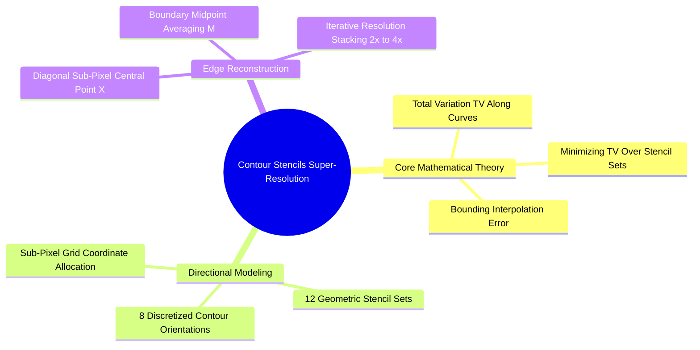
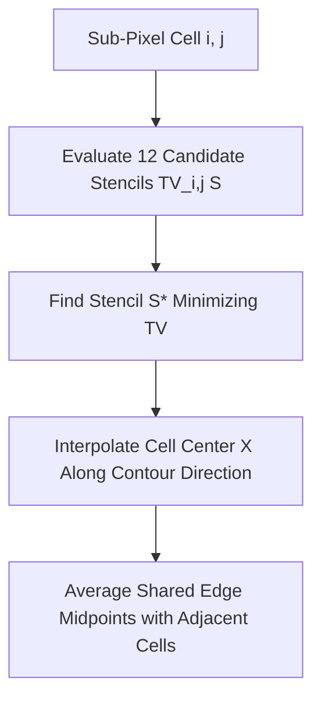

# 24. Super-Resolution and Edge-Adaptive Interpolation - Pascal Getreuer Contour Stencils

## 1. Overview and Problem Formulation
Single-frame image super-resolution reconstructs a high-resolution (HR) image from a low-resolution (LR) input. While standard linear interpolation methods (bilinear, bicubic) produce blurry or jagged edges, Pascal Getreuer's (2009) **Contour Stencils** algorithm preserves sharpness by estimating local edge orientations and interpolating **along** contours rather than across them.



## 2. Mathematical Foundations: Total Variation Along Curves
Reference: Pascal Getreuer, *Contour stencils for edge-adaptive image interpolation*, SPIE Proceedings Vol. 7257, 2009.

Interpolating across an edge creates blurring, while interpolating **along** an edge preserves sharpness. For a smooth candidate curve $C$ parameterized by $\gamma(t)$ for $t \in [0, T]$, its Total Variation (TV) is:

$$\text{TV}(C) = \int_{0}^{T} \left| \frac{\partial}{\partial t} u(\gamma(t)) \right| dt$$

If $\text{TV}(C) \approx 0$, pixel intensity is nearly constant along the curve, meaning it closely follows an image contour.

### 2.1 Error Bound Theorem (Getreuer Theorem 3.1)
Consider approximating intensity $u(x)$ along a curve segment passing through nodes $a, x, b$ with linear weights:
$$\hat{u}(x) = (1 - \lambda) u(a) + \lambda u(b), \quad 0 \le \lambda \le 1$$
The approximation error is bounded by the curve's Total Variation:

$$|\hat{u}(x) - u(x)| \le \max\Big( |1 - \lambda|, \ |\lambda| \Big) \cdot \text{TV}(C)$$

**Core Insight**: Selecting candidate curves that minimize $\text{TV}(C)$ directly minimizes the upper bound on interpolation error.



## 3. Discrete Contour Stencils and Sub-Pixel Formulas

In a factor-2 scaling setup, each $2 \times 2$ pixel cell on the low-resolution grid contains four known corner samples:
- Top-left: $v_{i, j}$
- Top-right: $v_{i, j+1}$
- Bottom-left: $v_{i+1, j}$
- Bottom-right: $v_{i+1, j+1}$

The goal is to compute the missing sub-pixel points:
- Cell center: $X$
- Edge midpoints: $N, S, W, E$

```text
Known LR:    v(i,j) -------- N -------- v(i, j+1)
               |                         |
               W            X            E
               |                         |
Known LR:    v(i+1,j) ------ S -------- v(i+1, j+1)
```

### 3.1 Center Point Interpolation ($X$)
Evaluating Total Variation across the cell's two diagonal directions:
- Diagonal 1: $\text{TV}_{\text{diag1}} = |v_{i, j} - v_{i+1, j+1}|$
- Diagonal 2: $\text{TV}_{\text{diag2}} = |v_{i+1, j} - v_{i, j+1}|$

The center point $X$ is interpolated along the lower-variation direction:

$$X = \begin{cases} 
\frac{1}{2} (v_{i, j} + v_{i+1, j+1}) & \text{if } \text{TV}_{\text{diag1}} < \text{TV}_{\text{diag2}} \\ 
\frac{1}{2} (v_{i+1, j} + v_{i, j+1}) & \text{if } \text{TV}_{\text{diag2}} < \text{TV}_{\text{diag1}} \\ 
\frac{1}{4} (v_{i, j} + v_{i+1, j} + v_{i, j+1} + v_{i+1, j+1}) & \text{if } \text{TV}_{\text{diag1}} = \text{TV}_{\text{diag2}} 
\end{cases}$$

### 3.2 Shared Edge Midpoint Averaging
Edge midpoints ($N, S, W, E$) are shared between adjacent cells. For instance, the boundary midpoint $M$ between horizontal cells $(i, j)$ and $(i+1, j)$ is computed as the average of the two independently assigned values:

$$M = \frac{1}{2} \left( E_{(i, j)} + W'_{(i+1, j)} \right)$$

## 4. Complete Code Implementation

```python
import numpy as np

def contour_stencil_super_resolution_2x(lr_image: np.ndarray) -> np.ndarray:
    """
    Performs 2x single-frame super-resolution using Pascal Getreuer's Contour Stencils.
    Preserves edge sharpness by interpolating along paths of minimum Total Variation.
    """
    h, w = lr_image.shape[:2]
    out_h = 2 * h - 1
    out_w = 2 * w - 1
    hr_output = np.zeros((out_h, out_w), dtype=np.float64)

    # Step 1: Copy known low-resolution samples to even grid coordinates
    for y in range(h):
        for x in range(w):
            hr_output[2 * y, 2 * x] = lr_image[y, x]

    # Step 2: Compute cell centers (X) along paths of minimum Total Variation
    for y in range(h - 1):
        for x in range(w - 1):
            v00 = float(lr_image[y, x])
            v01 = float(lr_image[y, x + 1])
            v10 = float(lr_image[y + 1, x])
            v11 = float(lr_image[y + 1, x + 1])

            tv_diag1 = abs(v00 - v11)
            tv_diag2 = abs(v10 - v01)

            if tv_diag1 < tv_diag2:
                center_val = 0.5 * (v00 + v11)
            elif tv_diag2 < tv_diag1:
                center_val = 0.5 * (v10 + v01)
            else:
                center_val = 0.25 * (v00 + v01 + v10 + v11)

            hr_output[2 * y + 1, 2 * x + 1] = center_val

    # Step 3: Interpolate intermediate edge midpoints
    for y in range(out_h):
        for x in range(out_w):
            if y % 2 == 1 and x % 2 == 0:
                # Vertical edge midpoint
                neighbors = []
                if y > 0:
                    neighbors.append(hr_output[y - 1, x])
                if y < out_h - 1:
                    neighbors.append(hr_output[y + 1, x])
                hr_output[y, x] = np.mean(neighbors)

            elif y % 2 == 0 and x % 2 == 1:
                # Horizontal edge midpoint
                neighbors = []
                if x > 0:
                    neighbors.append(hr_output[y, x - 1])
                if x < out_w - 1:
                    neighbors.append(hr_output[y, x + 1])
                hr_output[y, x] = np.mean(neighbors)

    return np.clip(np.round(hr_output), 0, 255).astype(np.uint8)
```

## 5. Connections to Other Topics
- Quality benchmarks (PSNR/SSIM) covered in [[22. Objective Image Quality Assessment - MSE, PSNR, and SSIM Metrics]].
- Evaluated on historical document datasets in [[06.9.8. TP2 Part 5 - Single-Frame Super-Resolution and Contour Stencils]].

---
