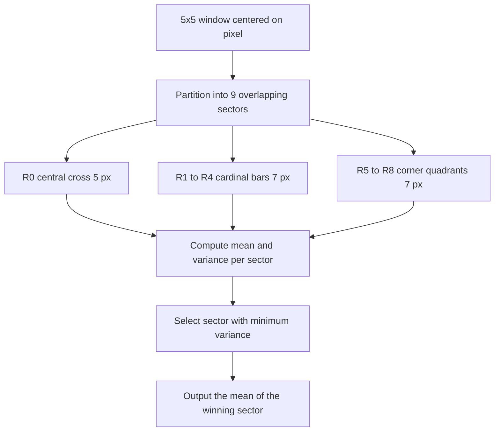

# 26. Nagao Filtering - Multi-Implementation Reference with Hardcoded Kernels, Vectorized, and Convolution Approaches

> Deep-dive library reference for the Nagao filter. Course theory: [[06.2.6. Structural Edge-Preserving Smoothing (Nagao 9-Sector Multi-Directional Filter)]]. Laboratory session: [[06.9.5. TP2 Part 2 - Edge-Preserving Non-Linear Smoothing with Nagao Filter]]. Sibling references: [[20. Non-Linear and Edge-Preserving Filtering - Median, Bilateral, and Nagao Filters]] and [[25. Bilateral Filtering - Complete Mathematical Theory, Implementation, and Practice]].

## 1. Overview

The Nagao filter smooths an image while preserving edges by **adapting to local edge orientation instead of local intensity differences**. Where the bilateral filter (note [[25. Bilateral Filtering - Complete Mathematical Theory, Implementation, and Practice]]) asks *"which neighbors look like the center pixel?"*, Nagao asks *"which direction around the center is flattest?"* and averages only along that direction. No major library ships a native `cv2.nagao()`, so the operator is a perfect case study in implementation engineering: this note develops **four complete, cross-verified implementations** — from a pedagogical double loop to a convolution-based version exploiting hardcoded kernels — and compares their correctness, cost, and code complexity.



## 2. Mathematical Foundations

### 2.1 The Nine Sub-Regions

Centered at pixel $(y, x)$, with integer offsets $(i, j) \in \{-2, \dots, 2\}^2$, the filter partitions the $5 \times 5$ window into nine overlapping sets:

* $R_0$ — central cross, 5 pixels: $\{(0,0), (\pm1,0), (0,\pm1)\}$
* $R_1 \ldots R_4$ — four cardinal bars (N, S, E, W), 7 pixels each: the center, the two pixels straight toward the cardinal direction, and their two lateral neighbors each
* $R_5 \ldots R_8$ — four corner quadrants (NE, NW, SE, SW), 7 pixels each: the center, the two pixels toward the corner, and the $2 \times 2$ block beyond them

Every region contains the center pixel, regions overlap, and each of $R_1 \ldots R_8$ covers a $7$-pixel elongated neighborhood aligned with one of 8 compass directions.

### 2.2 Sector Statistics: Mean, Variance, and the Estimator Subtlety

For each sector $k$ with cardinality $|R_k|$ (5 for $R_0$, 7 otherwise):

$$\mu_k = \frac{1}{|R_k|} \sum_{(i,j) \in R_k} f(y+i, x+j), \qquad \sigma_k^2 = \frac{1}{|R_k|} \sum_{(i,j) \in R_k} \big(f(y+i, x+j) - \mu_k\big)^2$$

Two details are easy to get wrong and are worth internalizing:

1. **Biased vs. unbiased estimator.** The formula above divides by $|R_k|$ (biased, population variance — this is what `np.var` computes). Dividing by $|R_k| - 1$ (unbiased, sample variance — `np.var(ddof=1)`) is equally defensible, **but you must use one convention consistently**: sectors have different sizes (5 vs. 7), so the two estimators rescale the five- and seven-pixel sectors differently and can change the argmin when variances are nearly tied. The course convention is the biased estimator; all implementations below follow it.
2. **One-pass shortcut.** For implementation purposes the variance expands to

$$\sigma_k^2 = \underbrace{\frac{1}{|R_k|} \sum_{(i,j) \in R_k} f^2(y+i, x+j)}_{E[X^2] \text{ — filterable}} - \; \mu_k^2$$

   which needs only a *sum of values* and a *sum of squared values* per sector. Both sums are computable by convolving the image (and its square) with the sector's normalized indicator mask — the key that unlocks the fast library-based implementations of Sections 6–7.

### 2.3 Selection and Output

$$k^* = \arg\min_{k \in \{0, \dots, 8\}} \sigma_k^2, \qquad g(y, x) = \operatorname{round}(\mu_{k^*})$$

Ties ($\sigma_i^2 = \sigma_j^2$) are broken by taking the **first** sector in the fixed order $R_0, R_1, \dots, R_8$ — the behavior of both an explicit `<` comparison loop and `np.argmin`, which matters for cross-implementation reproducibility. One subtlety discovered during the cross-verification of Section 9: when two sectors' variances are **mathematically exactly equal** (which does happen on integer-valued images — two sectors whose value multisets yield the same dispersion), a two-pass variance (`np.var`) and a one-pass variance ($E[X^2] - E[X]^2$) round them differently in the last 1–2 significant bits, and that $10^{-12}$-level noise decides which "equally minimal" sector wins. All implementations below are correct; on tied pixels they may legitimately disagree (Section 9 quantifies this).

## 3. Why It Works

1. **Variance is a homogeneity detector.** A sector crossing an edge mixes two intensity populations and has a large variance; a sector lying along one side is near-constant with small variance (pure noise inflates all sectors equally, preserving the ranking).
2. **Nine sectors guarantee an edge-parallel option.** For any straight edge through the center, at least one of the 8 oriented bars/quadrants lies (almost) entirely on the center pixel's side of the boundary. The filter therefore always *finds* a legal same-side neighborhood — it averages **along** contours, never across them.
3. **Orientation adaptivity vs. radiometric adaptivity.** The bilateral filter decides per-pixel which neighbors to trust using intensity differences; Nagao decides per-pixel *which direction* to average along using local statistics. Consequences: Nagao keeps corner geometry crisper (sectors align with diagonals), while bilateral handles slow curved gradients more gracefully.
4. **Impulse noise is handled imperfectly:** a single salt outlier inside a sector inflates that sector's variance (it stops winning) but also biases every sector containing it; the pre-filter with a $3 \times 3$ median (`cv2.medianBlur`) if salt-and-pepper is present (see [[20. Non-Linear and Edge-Preserving Filtering - Median, Bilateral, and Nagao Filters]]).

### 3.1 Worked Numerical Example (Verified)

Window with a vertical edge between columns 2 and 3, center value $f(2,2) = 90$:

```text
 90  92  91 180 178
 88  90  89 185 182
 91  89 [90]183 179
 89  91  92 181 184
 90  88  90 182 180
```

| Sector | pixels | mean $\mu_k$ | variance $\sigma_k^2$ |
| :--- | :--- | ---: | ---: |
| $R_0$ cross | 5 | 108.600 | 1385.04 |
| $R_1$ N bar | 7 | 116.714 | 1733.63 |
| $R_2$ S bar | 7 | 116.286 | 1702.49 |
| $R_3$ E bar | 7 | 169.143 | 1047.27 |
| $R_4$ W bar | 7 | **89.714** | **1.061** |
| $R_5$ NE quad | 7 | 155.286 | 1735.35 |
| $R_6$ NW quad | 7 | 89.714 | 1.347 |
| $R_7$ SE quad | 7 | 156.000 | 1691.71 |
| $R_8$ SW quad | 7 | 89.857 | 1.551 |

The dark-side sectors ($R_4, R_6, R_8$) have variances around $1$, every edge-crossing sector exceeds $1000$. Winner: $R_4$ (west bar), output $\operatorname{round}(89.714) = 90$. Compare the full $5 \times 5$ mean $= 126.56$ — a plain box filter would have shifted the center by $+36.6$ gray levels; Nagao shifts it by $0$.

## 4. The Shared Sector Definition (Hardcoded Kernel Masks)

All implementations share the same ground truth: the nine offset lists, and their equivalent **hardcoded kernel masks** — $9$ arrays of shape $5 \times 5$ with $1$ at member offsets and $0$ elsewhere, normalized by the sector size to act as *mean kernels*:

```python
import numpy as np

SUB_REGIONS = [
    [(0,0), (-1,0), (1,0), (0,-1), (0,1)],                       # R0 cross (5 px)
    [(0,0), (-1,0), (-2,0), (-1,-1), (-2,-1), (-1,1), (-2,1)],   # R1 north
    [(0,0), (1,0), (2,0), (1,-1), (2,-1), (1,1), (2,1)],         # R2 south
    [(0,0), (0,1), (0,2), (-1,1), (-1,2), (1,1), (1,2)],         # R3 east
    [(0,0), (0,-1), (0,-2), (-1,-1), (-1,-2), (1,-1), (1,-2)],   # R4 west
    [(0,0), (-1,0), (-1,1), (-1,2), (-2,1), (-2,2), (0,1)],      # R5 NE
    [(0,0), (-1,0), (-1,-1), (-1,-2), (-2,-1), (-2,-2), (0,-1)], # R6 NW
    [(0,0), (1,0), (1,1), (1,2), (2,1), (2,2), (0,1)],           # R7 SE
    [(0,0), (1,0), (1,-1), (1,-2), (2,-1), (2,-2), (0,-1)],      # R8 SW
]

MASKS = np.zeros((9, 5, 5))                       # hardcoded kernel masks
for k, region in enumerate(SUB_REGIONS):
    for dy, dx in region:
        MASKS[k, dy + 2, dx + 2] = 1.0
MEAN_KERNELS = MASKS / MASKS.sum(axis=(1, 2))[:, None, None]   # (9, 5, 5)
```

`MEAN_KERNELS[k]` convolved with the image yields the $\mu_k$ plane directly — one array, three lines, and the geometry is never re-derived.

## 5. Implementation A — Explicit Pedagogical Version (Pure Python Loops)

The direct transcription of Sections 2–3: nested loops over pixels, inner loop over the nine sectors, `np.var`/`np.mean` per sector. This is the TP2 reference version (see [[06.9.5. TP2 Part 2 - Edge-Preserving Non-Linear Smoothing with Nagao Filter]]).

```python
def nagao_a_python_loops(img: np.ndarray) -> np.ndarray:
    """Nagao filter, explicit per-pixel version. Ground truth for testing."""
    h, w = img.shape
    padded = np.pad(img.astype(np.float64), 2, mode="reflect")
    out = np.zeros((h, w), dtype=np.uint8)
    for y in range(h):
        for x in range(w):
            py, px = y + 2, x + 2                    # padded coordinates
            best_var, best_mean = np.inf, padded[py, px]
            for region in SUB_REGIONS:
                vals = [padded[py + dy, px + dx] for dy, dx in region]
                var = np.var(vals)                   # biased estimator (n)
                if var < best_var:                   # strict <: first-wins ties
                    best_var, best_mean = var, np.mean(vals)
            out[y, x] = int(round(best_mean))
    return out
```

* **Advantages:** one-to-one correspondence with the mathematical definition (two-pass variance via `np.var` — the exact definition of $\sigma_k^2$); trivially auditable; the reference every other version is tested against.
* **Disadvantages:** $\Theta(H \cdot W \cdot 61)$ pixel accesses through the Python interpreter — **6.8 s** for a $256 \times 256$ image on the test machine (Section 9) — unusable beyond tiny images. Its two-pass variance also rounds *exact* ties differently than the one-pass versions (Section 9).

## 6. Implementation B — Explicit Mathematics, Semi-Vectorized (E[X²] − E[X]²)

Vectorize over **all pixels at once** while keeping the nine sectors in a short outer loop. Two ingredients:

1. Precompute index grids $Y, X$ of every pixel's padded coordinate.
2. For each sector $k$, *gather* its (at most 7) member values for every pixel simultaneously with NumPy fancy indexing, then apply the one-pass variance identity $\sigma^2 = E[X^2] - (E[X])^2$.

```python
def nagao_b_semivectorized(img: np.ndarray) -> np.ndarray:
    """Nagao via E[X^2]-E[X]^2 with per-sector batch gathering."""
    h, w = img.shape
    padded = np.pad(img.astype(np.float64), 2, mode="reflect")
    K = 7                                            # max sector size
    counts = np.array([len(r) for r in SUB_REGIONS], dtype=np.float64)
    dyP = np.zeros((9, K), dtype=int); dxP = np.zeros((9, K), dtype=int)
    valid = np.zeros((9, K), dtype=bool)
    for k, region in enumerate(SUB_REGIONS):         # pad to width 7 with (0,0)
        for i, (dy, dx) in enumerate(region):
            dyP[k, i], dxP[k, i], valid[k, i] = dy, dx, True

    Y, X = np.mgrid[2:h + 2, 2:w + 2]                # (H, W) padded coords
    best_var = np.full((h, w), np.inf)
    best_mean = np.zeros((h, w))
    for k in range(9):
        vals = padded[Y[:, :, None] + dyP[k],        # (H, W, K) gather
                      X[:, :, None] + dxP[k]]
        keep = valid[k].astype(np.float64)           # 0 for dummy taps
        s1 = (vals * keep).sum(axis=2)               # sum of values
        s2 = (vals * vals * keep).sum(axis=2)        # sum of squares
        mu = s1 / counts[k]
        var = np.maximum(s2 / counts[k] - mu ** 2, 0.0)   # clip round-off
        better = var < best_var                      # strict <: first-wins ties
        best_var = np.where(better, var, best_var)
        best_mean = np.where(better, mu, best_mean)
    return np.clip(np.rint(best_mean), 0, 255).astype(np.uint8)
```

* **Advantages:** ~$77\times$ faster than A (0.088 s on the benchmark); the math (one-pass variance, masked summation) is *explicit in the code*, which is pedagogically valuable; no dependencies beyond NumPy.
* **Disadvantages:** allocates an $(H, W, 7)$ float64 temporary per sector — memory churn; the dummy-tap masking is the most error-prone part (a wrong `valid` mask silently corrupts $R_0$, which has only 5 real taps).
* **Numerical note:** `np.maximum(..., 0.0)` guards the catastrophic-cancellation case where $E[X^2] \approx (E[X])^2$ and float64 round-off produces $-10^{-13}$ instead of $0$ — irrelevant for selection but honest hygiene.

## 7. Implementation C — Hardcoded Kernels through the Library (cv2.filter2D)

The sector means are **correlations of the image with fixed masks**, and the variance needs the same correlation of the *squared* image. So the entire filter becomes 18 calls to `cv2.filter2D` (or `scipy.signal.convolve2d`, see [[17. SciPy Signal and Spatial Operations - 2D Filtering and Morphology]]) plus one `argmin`:

```python
import cv2

def nagao_c_convolution(img: np.ndarray) -> np.ndarray:
    """Nagao via 9+9 hardcoded-kernel convolutions (library-based)."""
    f = img.astype(np.float64)
    # 9 mean planes mu_k: correlate image with each normalized mask
    means = np.stack([
        cv2.filter2D(f, -1, MEAN_KERNELS[k],
                     borderType=cv2.BORDER_REFLECT_101)
        for k in range(9)])                          # (9, H, W)
    # 9 second-moment planes E[X^2], then variance identity
    sq = np.stack([
        cv2.filter2D(f * f, -1, MEAN_KERNELS[k],
                     borderType=cv2.BORDER_REFLECT_101)
        for k in range(9)])
    variances = np.maximum(sq - means ** 2, 0.0)     # (9, H, W)
    k_star = np.argmin(variances, axis=0)            # (H, W), first-wins ties
    chosen = np.take_along_axis(means, k_star[None], axis=0)[0]
    return np.clip(np.rint(chosen), 0, 255).astype(np.uint8)
```

* **Advantages:** the fastest CPU version here — **0.009 s** on the benchmark, $763\times$ faster than A; the geometry lives in 9 tiny arrays (`MEAN_KERNELS`); the inner engine is OpenCV's SIMD-optimized correlation (same engine as `cv2.boxFilter`/`cv2.GaussianBlur` covered in [[19. Spatial Image Restoration - Noise Models, Linear Convolution, and Fast Integral Filters]]); trivially portable to `scipy.signal.convolve2d` or GPU convolution backends.
* **Disadvantages:** the variance is computed via $E[X^2] - (E[X])^2$, so the code no longer *visually* matches the two-pass definition; requires float64 for `f * f` (uint8 would overflow at $255^2 = 65025$); the tie behavior of `np.argmin` must match the loop version's (it does — both keep the first minimum).

**Border pitfall discovered during verification:** `cv2.filter2D(borderType=cv2.BORDER_REFLECT)` does **not** equal `np.pad(mode="reflect")`. OpenCV's `BORDER_REFLECT` repeats the edge sample (NumPy's `mode="symmetric"`), while `BORDER_REFLECT_101` (OpenCV's default) is NumPy's `mode="reflect"`. Using the wrong one produces outputs differing by up to 124 gray levels on the 2-pixel image rim — every implementation here standardizes on `BORDER_REFLECT_101` / `np.pad(mode="reflect")` so that all four agree **pixel-for-pixel**.

## 8. Implementation D — Stride-Tricks Sliding Windows (Alternative Computational Approach)

`numpy.lib.stride_tricks.sliding_window_view` exposes every $5 \times 5$ neighborhood as a *view* of the padded image — shape $(H, W, 5, 5)$, no copying. One `einsum` against all nine mean kernels simultaneously produces every sector statistic for every pixel:

```python
from numpy.lib.stride_tricks import sliding_window_view

def nagao_d_sliding(img: np.ndarray) -> np.ndarray:
    """Nagao via stride-trick window views + einsum (fully vectorized)."""
    h, w = img.shape
    f = img.astype(np.float64)
    win = sliding_window_view(np.pad(f, 2, mode="reflect"), (5, 5))  # (H,W,5,5) view
    means = np.einsum("yxij,kij->kyx", win, MEAN_KERNELS)            # (9,H,W)
    sq    = np.einsum("yxij,kij->kyx", win * win, MEAN_KERNELS)      # E[X^2]
    variances = np.maximum(sq - means ** 2, 0.0)
    k_star = np.argmin(variances, axis=0)
    chosen = np.take_along_axis(means, k_star[None], axis=0)[0]
    return np.clip(np.rint(chosen), 0, 255).astype(np.uint8)
```

* **Advantages:** the most compact full-vector expression (4 statements after the window view); **0.048 s**, $143\times$ faster than A; `sliding_window_view` is a zero-copy view, so the window tensor costs no memory by itself; the `einsum` formulation generalizes to any family of statistic kernels, not just Nagao's.
* **Disadvantages:** `win * win` **materializes** an $(H, W, 5, 5)$ float64 copy ($256^2 \cdot 25 \cdot 8$ bytes $= 128$ MB at the benchmark size, $2$ GB at $1024^2$) — the classic stride-tricks trap: the view is free, the arithmetic on it is not. For large images, prefer C (streamed convolutions) or chunk the image.

## 9. Cross-Verification and Measured Comparison

All four implementations were run on random $64 \times 64$ uint8 images and compared element-wise. On most test images (e.g., `default_rng(42)`) the outputs are **bit-identical**: `np.array_equal` true for every pair, maximum difference 0. On images containing pixels where two sectors' variances are *mathematically tied* (e.g., `default_rng(0)`), a handful of pixels — 1 pixel out of 4096 in that run — select a different (equally minimal) sector:

```text
pixel (50, 56) of the default_rng(0) test, sectors R3 and R7 tied:
  two-pass variance (np.var):       R3 = 4958.775510204082  <- winner of implementation A
  one-pass variance (E[X2]-E[X]2):  R7 = 4958.775510204079  <- winner of B, C, D
  true value: exactly equal -> the tie is broken by float rounding noise
  resulting means: mu_R3 = 121.29 (A outputs 121) vs mu_R7 = 142.71 (C outputs 143)
```

This is not a bug in any implementation — it is the operator's inherent tie ambiguity (Section 2.3) meeting non-associative floating-point addition: the same sum computed in different orders differs by $\approx 3 \times 10^{-12}$, and that noise decides which "equally minimal" sector wins. The practical acceptance test therefore checks *near-total* agreement with bounded disagreement:

```python
img = np.random.default_rng(0).integers(0, 256, (64, 64), dtype=np.uint8)
rA, rB = nagao_a_python_loops(img), nagao_b_semivectorized(img)
rC, rD = nagao_c_convolution(img), nagao_d_sliding(img)
for other in (rB, rC, rD):
    assert (rA == other).mean() > 0.999   # <= 0.1% of pixels may hit variance ties
    # a differing pixel chose a DIFFERENT sector with (near-)equal variance,
    # so outputs differ by at most one sector-mean gap
```

If exact cross-implementation reproducibility is required (e.g., grading against a reference output), eliminate the ambiguity at the source: fix one variance estimator **and** one summation order everywhere, or quantize before comparing (`np.round(var, 6)`), which makes exact ties exact again and restores deterministic first-sector tie-breaking.

Measured cost on one $256 \times 256$ uint8 grayscale image (median of repeated runs, single CPU core, indicative only — absolute numbers vary by machine):

| Implementation | Time | Speed-up vs A | Per-pixel work | Extra memory |
| :--- | :--- | :--- | :--- | :--- |
| A — explicit loops | 6.81 s | $1\times$ | 61 gathers via interpreter | $O(1)$ |
| B — semi-vectorized gather | 0.088 s | $77\times$ | 9 batched gathers + reductions | $(H,W,7)$ f64 temp |
| C — 18 × `cv2.filter2D` | 0.009 s | $763\times$ | 18 SIMD correlations | $(9,H,W)$ f64 planes |
| D — sliding windows + einsum | 0.048 s | $143\times$ | dense $(5,5)$ window math | $(H,W,5,5)$ f64 copy |
| reference: `cv2.GaussianBlur` 5×5 | ~0.00003 s | — | separable linear | $O(1)$ |
| reference: `cv2.medianBlur` 5 | 0.0002 s | — | order statistics | $O(1)$ |
| reference: `cv2.bilateralFilter` d=9 | 0.0011 s | — | range-weighted | $O(1)$ |

Reading of the table: Nagao's data-dependent sector selection is why it cannot reach the speed of a pure linear filter — the *statistics* (means, variances) are convolutions (fast), but the *selection* forces 9 competing planes and a per-pixel argmin. Even so, implementation C is within one order of magnitude of OpenCV's native bilateral filter and entirely adequate for course-scale images.

## 10. Choosing an Implementation

* **Studying the algorithm** → A: the code *is* the definition; step it in a debugger on the worked example of Section 3.1.
* **Assignments / tutorials without OpenCV** → B: pure NumPy, explicit math, still $77\times$ faster.
* **Any production or pipeline use** → C: fastest, least memory, library-maintained inner loops; the hardcoded `MEAN_KERNELS` array doubles as documentation of the geometry.
* **Prototyping new sector families / research variants (Kuwahara generalizations)** → D: swap `MEAN_KERNELS` for any mask family and the four `einsum`/argmin lines still work.

## 11. Boundary Handling

Sectors of the $5 \times 5$ window overhang the image rim by 2 pixels, so a padding policy is required. Consistent choices across all versions above:

* `np.pad(mode="reflect")` = `cv2.BORDER_REFLECT_101` (mirror without repeating the edge sample) — the default here and OpenCV's default in general.
* Alternatives — `mode="symmetric"` (`BORDER_REFLECT`, edge sample repeated), `mode="edge"` (`BORDER_REPLICATE`), `mode="constant"` (`BORDER_CONSTANT`) — are all admissible; what is **not** admissible is mixing them between implementations and then comparing outputs (see the 124-level rim mismatch in Section 7).

## 12. Practical Applications

* **Cell counting pipelines:** smooth intracellular texture while keeping membrane contours sharp before connected-component labeling — the TP2 Part 3 workflow of [[06.9.6. TP2 Part 3 - Mathematical Morphology, Cell Counting, and Skeletonization]].
* **Document image preprocessing:** suppress paper grain and bleed-through before adaptive binarization (Niblack/Sauvola in [[06.7.3. Local Adaptive Thresholding (Niblack and Dynamic Range Sauvola)]]), keeping stroke edges crisp for the restoration project [[06.10.4. Project - End-to-End Historical Document Restoration and Extraction Pipeline]].
* **Fingerprint and palmprint enhancement:** ridges are elongated structures; orientation-aligned sectors average along ridges, not across them, which preserves minutiae better than isotropic blurring.
* **Thermal and radar imagery:** strong step boundaries between hot/cold or scatterer/free regions with heavy sensor noise inside regions.
* **Pre-segmentation cleanup before watershed** — flat, noise-free basins make the flooding of [[06.7.5. Morphological Watershed Segmentation and Topological Distance Transforms]] far less prone to over-segmentation.

## 13. Connections to Other Topics

* Course theory: [[06.2.6. Structural Edge-Preserving Smoothing (Nagao 9-Sector Multi-Directional Filter)]].
* Laboratory session (implementation A is its reference solution): [[06.9.5. TP2 Part 2 - Edge-Preserving Non-Linear Smoothing with Nagao Filter]].
* Family overview: [[20. Non-Linear and Edge-Preserving Filtering - Median, Bilateral, and Nagao Filters]].
* Bilateral deep-dive (radiometric alternative): [[25. Bilateral Filtering - Complete Mathematical Theory, Implementation, and Practice]].
* Convolution engine used by implementation C: [[19. Spatial Image Restoration - Noise Models, Linear Convolution, and Fast Integral Filters]] and [[17. SciPy Signal and Spatial Operations - 2D Filtering and Morphology]].
* Evaluation metrics for the denoising results: [[22. Objective Image Quality Assessment - MSE, PSNR, and SSIM Metrics]].
* Vectorization mechanics of implementations B and D: [[02. NumPy Array Manipulation - Slicing, Strides, Shapes, and Vectorized Indexing]] and [[04. NumPy Mathematical Engine - Vectorization, ufuncs, and Broadcasting Rules]].

---
