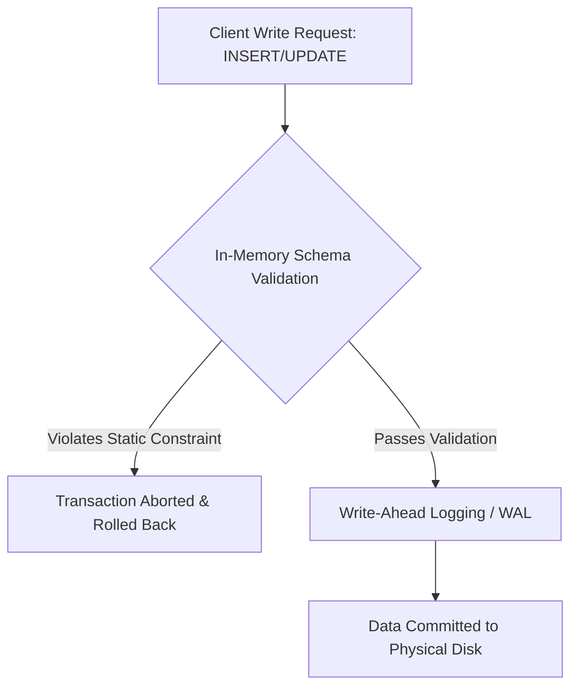

# Static Integrity Constraints

Rules defined at the schema level (`CREATE TABLE`) using SQL Data Definition Language (`DDL`), compiled and registered by the DBMS in the **system catalog**. They are checked **in-memory, before data is written** — before any write operation (`INSERT`, `UPDATE`, or `DELETE`) is physically written to the disk's storage pages.

By enforcing rules at the DBMS layer, static constraints provide a permanent line of defense that prevents application bugs from corrupting the relational state, regardless of the client or language used to access the database.



## 1. Entity Integrity (Row Identity)
Entity integrity ensures that every row within a relational table represents a distinct, identifiable real-world entity. Without it, a database can suffer from duplicate rows, leading to ambiguous queries and loss of historical tracking.

*   **PRIMARY KEY:** Unique identifier for a row. Cannot be NULL. Under the hood, the DBMS automatically applies two conditions: every column participating in the primary key is set to `NOT NULL`, and a unique index is built over the primary key columns (typically using a **B-Tree** structure) to accelerate lookups. A table can have only **one** primary key.
*   **UNIQUE:** Ensures no duplicates in a column. Unlike a primary key, a table can support **multiple** `UNIQUE` constraints. Crucially, depending on the SQL standard and specific DBMS implementation (such as PostgreSQL or MySQL), `NULL` values are usually treated as distinct from one another — so a `UNIQUE` column can contain multiple `NULL` rows unless it is explicitly paired with a `NOT NULL` constraint.
*   **NOT NULL:** Ensures a column cannot be left empty, forcing the application to provide a concrete value during row insertion. At the engine layer, this is checked by evaluating the row's **null-bitmap header** before writing the tuple.

## 2. Domain Integrity (Value Validity)
Domain integrity restricts the values that can be stored in a given column to a valid range or set of values defined by business rules.

*   **CHECK:** A Boolean expression that must be true. It is evaluated for every row being inserted or modified — if the expression evaluates to `FALSE`, the entire SQL statement is aborted and a constraint violation error is returned.
    *   *Example:* `CHECK (Salary > 0)`
    *   *Example:* `CHECK (Status IN ('Active', 'Inactive'))`
    *   **The Null-Value Bypass (Three-Valued Logic / 3VL):** Students often assume that a check constraint like `CHECK (Salary > 0)` will block `NULL` values. It does not. In SQL's three-valued logic (3VL), `NULL > 0` evaluates to `UNKNOWN`. Because `CHECK` constraints only reject values that explicitly evaluate to `FALSE`, `NULL` values pass check constraints without triggering errors. To block nulls, you must pair the check with an explicit `NOT NULL` constraint.
    *   **Single-Row Limitation:** Standard `CHECK` constraints can only reference columns within the specific row being written. They cannot execute subqueries, read data from other tables, or access historical data.

## Implementation Example
```sql
CREATE TABLE Students (
    ID INT PRIMARY KEY,
    Email VARCHAR(100) UNIQUE NOT NULL,
    Age INT CHECK (Age >= 18),
    Status VARCHAR(20) DEFAULT 'Active' CHECK (Status IN ('Active', 'Inactive', 'Suspended'))
);
```
