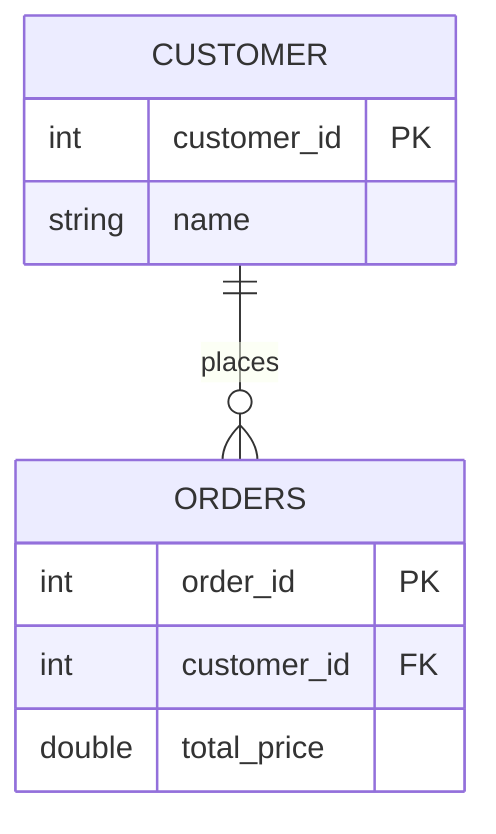
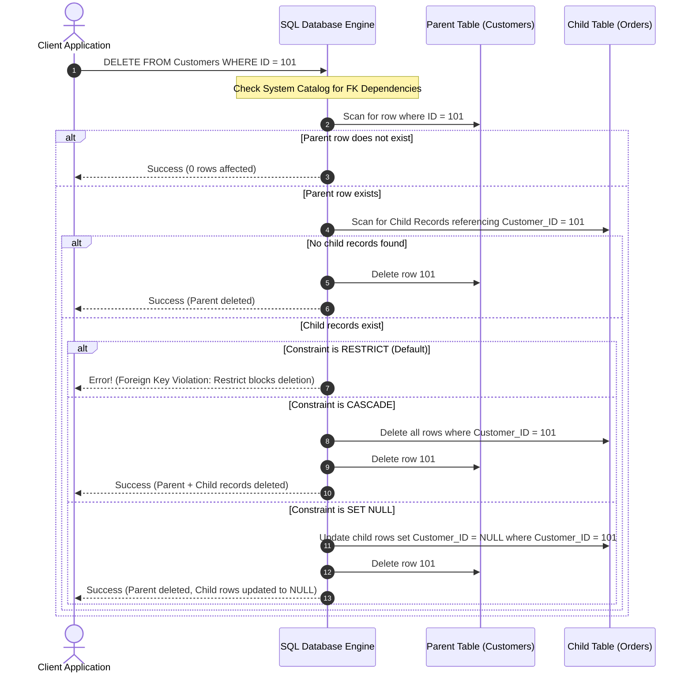

# Foreign Key Behaviors

**Concept:** **Declarative Referential Integrity (DRI)** ensures that a relationship between two tables remains valid. If `Order` references `Customer`, the Customer must exist. Formally, the database guarantees that the foreign key value must either reference a valid, existing parent row, or be set to `NULL`.

## Foreign Key Violations (Parent-Child Relationship Lifecycle)
The parent table contains the primary key referenced by the child table. Referential integrity rules are triggered when:
1.  An application attempts to insert or update a child row with a foreign key value that does not exist in the parent table (**Child-side violation**).
2.  An application attempts to update the primary key of a parent row, or delete a parent row, while child rows are still linked to it (**Parent-side violation**).

## What happens when the Parent is Deleted or Updated?
You must define the behavior for the Child records. To handle parent-side deletions and updates, you define **referential actions** on the foreign key constraint — these actions apply to **both `ON DELETE` and `ON UPDATE`**, dictating how the database engine propagates changes to preserve integrity.

### 1. CASCADE
*   **Action:** Delete the child automatically.
*   **Use Case:** Strong composition. If a `Post` is deleted, its `Comments` should also be deleted.
*   **Performance Risk:** Deleting a single parent row can trigger a cascading delete across **millions of child rows**, locking multiple tables and causing significant performance overhead.

### 2. SET NULL
*   **Action:** Keep the child, but remove the link (Set FK to NULL).
*   **Use Case:** Loose association. If an `Employee` leaves, their `Tasks` should remain but be unassigned.
*   **Constraint Collision:** This action will fail with a database error if the child table's foreign key column is defined with a `NOT NULL` constraint.

### 3. RESTRICT (Default)
*   **Action:** Block the deletion (or update). Throw an error — the transaction is aborted with a foreign key violation error.
*   **Use Case:** Data protection. You cannot delete a `Category` if `Products` are still using it. This is the default option in most relational systems to prevent accidental data loss.

### 4. SET DEFAULT
*   **Action:** Change the FK to a specific default ID.
*   **Use Case:** Fallback. If a `Teacher` leaves, assign students to a "Substitute Teacher" ID.

## Database Engine Execution Flow
The following diagram illustrates the path the database engine takes when a user deletes a record from a parent table:

